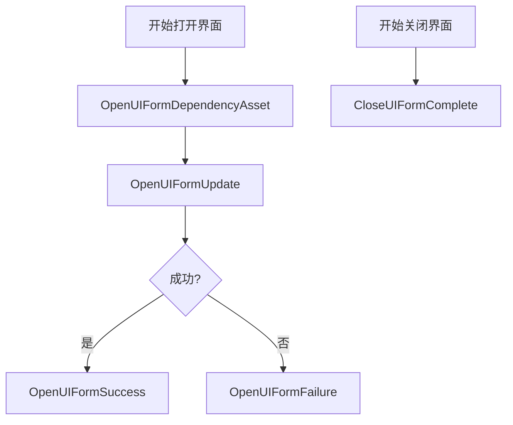
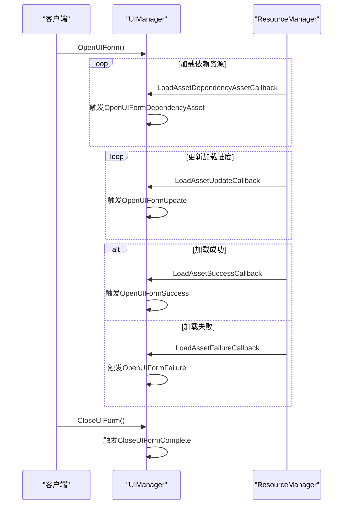
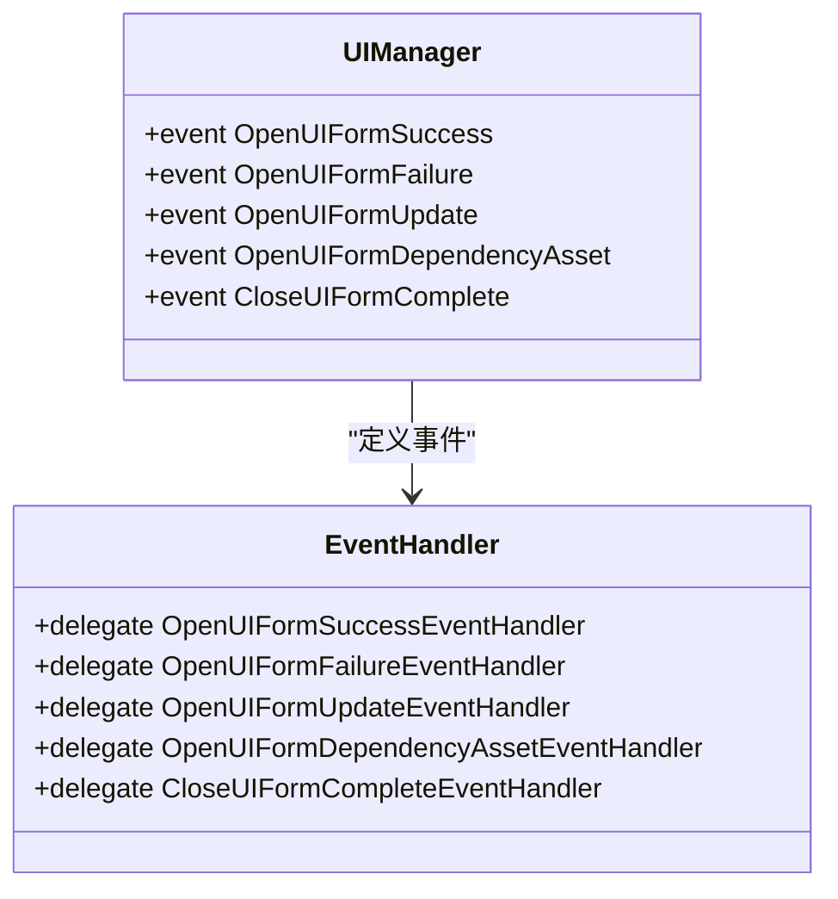
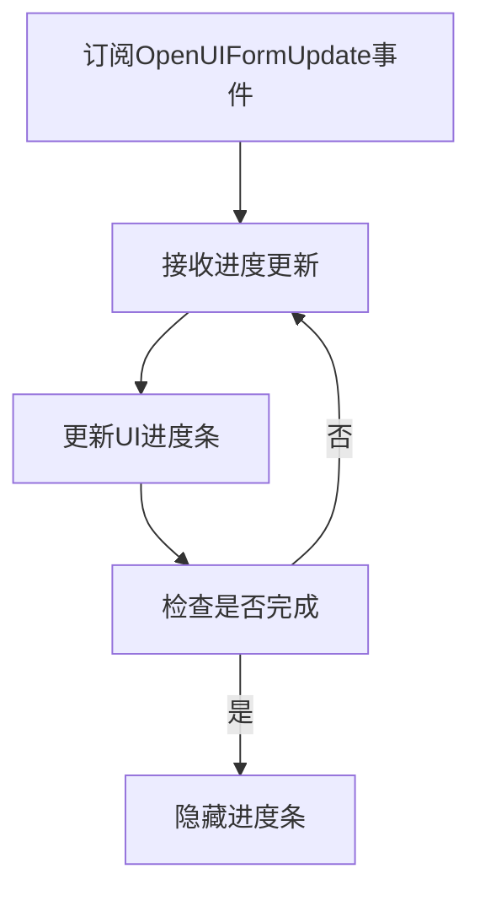
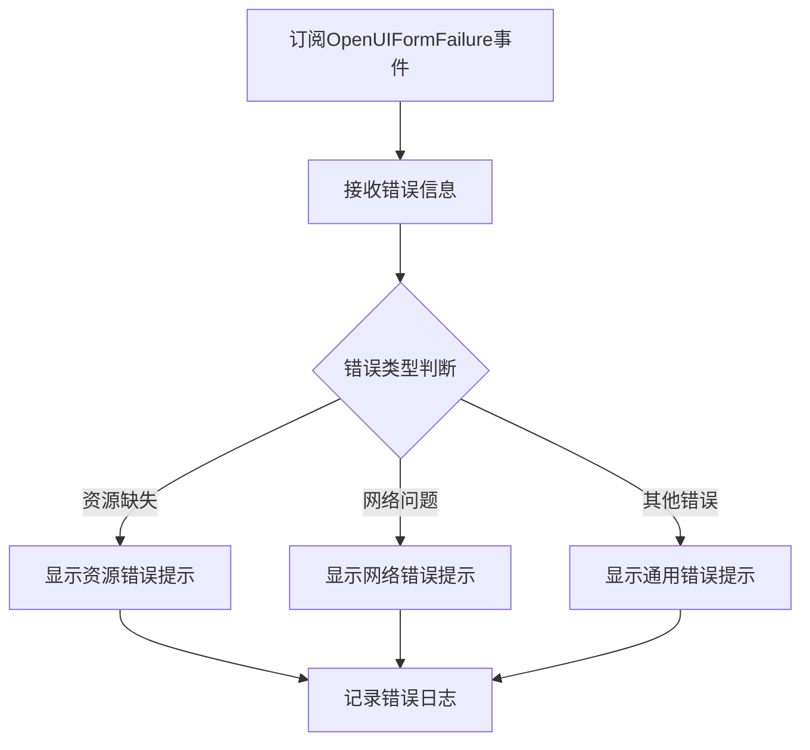
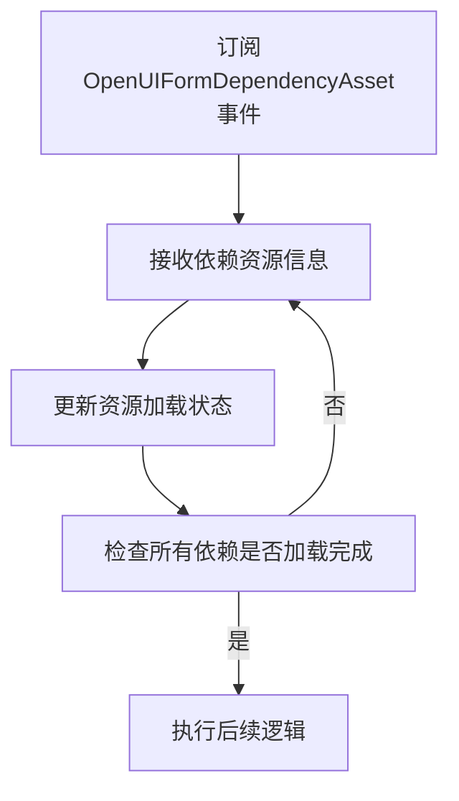
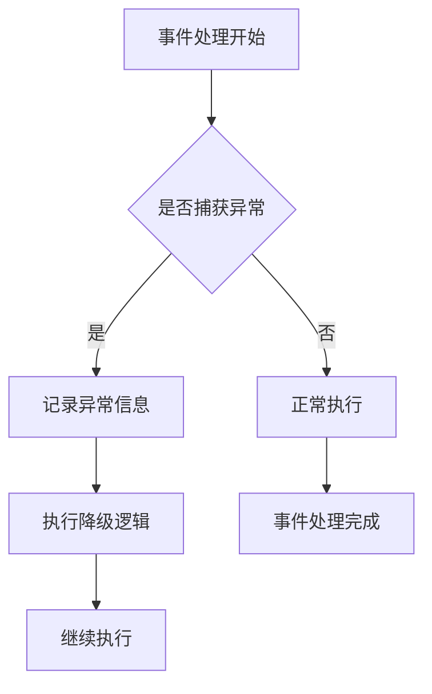

# UI事件系统

<cite>
**本文档引用的文件**
- [OpenUIFormSuccessEventArgs.cs](file://GameFramework/UI/OpenUIFormSuccessEventArgs.cs)
- [OpenUIFormFailureEventArgs.cs](file://GameFramework/UI/OpenUIFormFailureEventArgs.cs)
- [OpenUIFormUpdateEventArgs.cs](file://GameFramework/UI/OpenUIFormUpdateEventArgs.cs)
- [OpenUIFormDependencyAssetEventArgs.cs](file://GameFramework/UI/OpenUIFormDependencyAssetEventArgs.cs)
- [CloseUIFormCompleteEventArgs.cs](file://GameFramework/UI/CloseUIFormCompleteEventArgs.cs)
- [UIManager.cs](file://GameFramework/UI/UIManager.cs)
</cite>

## 目录
1. [核心事件概览](#核心事件概览)
2. [事件参数类详解](#事件参数类详解)
3. [事件生命周期与触发顺序](#事件生命周期与触发顺序)
4. [事件订阅与取消订阅模式](#事件订阅与取消订阅模式)
5. [高级功能实现示例](#高级功能实现示例)
6. [性能考量与异常处理](#性能考量与异常处理)

## 核心事件概览

UI系统提供了五个核心事件，用于监控界面的打开和关闭生命周期。这些事件通过`UIManager`类进行管理，允许开发者在界面状态变化时执行自定义逻辑。



**图示来源**
- [UIManager.cs](file://GameFramework/UI/UIManager.cs#L30-L34)

## 事件参数类详解

### OpenUIFormSuccessEventArgs
该事件在界面成功打开后触发，包含成功加载的界面实例和加载耗时信息。

- **UIForm**: 获取打开成功的界面实例，类型为`IUIForm`
- **Duration**: 获取加载持续时间，单位为秒
- **UserData**: 获取用户自定义数据，可用于传递上下文信息

**节来源**
- [OpenUIFormSuccessEventArgs.cs](file://GameFramework/UI/OpenUIFormSuccessEventArgs.cs#L12-L76)

### OpenUIFormFailureEventArgs
该事件在界面打开失败时触发，提供失败的详细原因和上下文信息。

- **SerialId**: 界面序列编号，用于唯一标识该界面实例
- **UIFormAssetName**: 界面资源名称，指示失败的资源
- **UIGroupName**: 界面组名称，标识界面所属的组
- **PauseCoveredUIForm**: 是否暂停被覆盖的界面
- **ErrorMessage**: 错误信息，描述失败原因
- **UserData**: 用户自定义数据

**节来源**
- [OpenUIFormFailureEventArgs.cs](file://GameFramework/UI/OpenUIFormFailureEventArgs.cs#L12-L115)

### OpenUIFormUpdateEventArgs
该事件在界面加载过程中定期触发，用于报告加载进度。

- **SerialId**: 界面序列编号
- **UIFormAssetName**: 界面资源名称
- **UIGroupName**: 界面组名称
- **PauseCoveredUIForm**: 是否暂停被覆盖的界面
- **Progress**: 打开界面进度，范围0.0到1.0
- **UserData**: 用户自定义数据

**节来源**
- [OpenUIFormUpdateEventArgs.cs](file://GameFramework/UI/OpenUIFormUpdateEventArgs.cs#L12-L115)

### OpenUIFormDependencyAssetEventArgs
该事件在加载界面依赖资源时触发，用于监控依赖资源的加载状态。

- **SerialId**: 界面序列编号
- **UIFormAssetName**: 界面资源名称
- **UIGroupName**: 界面组名称
- **PauseCoveredUIForm**: 是否暂停被覆盖的界面
- **DependencyAssetName**: 被加载的依赖资源名称
- **LoadedCount**: 当前已加载依赖资源数量
- **TotalCount**: 总共需要加载的依赖资源数量
- **UserData**: 用户自定义数据

**节来源**
- [OpenUIFormDependencyAssetEventArgs.cs](file://GameFramework/UI/OpenUIFormDependencyAssetEventArgs.cs#L12-L141)

### CloseUIFormCompleteEventArgs
该事件在界面关闭完成后触发，提供关闭后的上下文信息。

- **SerialId**: 界面序列编号
- **UIFormAssetName**: 界面资源名称
- **UIGroup**: 获取界面所属的界面组，类型为`IUIGroup`
- **UserData**: 用户自定义数据

**节来源**
- [CloseUIFormCompleteEventArgs.cs](file://GameFramework/UI/CloseUIFormCompleteEventArgs.cs#L12-L89)

## 事件生命周期与触发顺序

UI事件在界面生命周期中按特定顺序触发，形成完整的状态流转。



**图示来源**
- [UIManager.cs](file://GameFramework/UI/UIManager.cs#L722-L763)
- [UIManager.cs](file://GameFramework/UI/UIManager.cs#L811-L836)

## 事件订阅与取消订阅模式

事件订阅遵循标准的C#事件模式，但需要特别注意内存泄漏的防范。



**节来源**
- [UIManager.cs](file://GameFramework/UI/UIManager.cs#L97-L134)

### 订阅模式
```csharp
// 订阅事件
uiManager.OpenUIFormSuccess += OnOpenUIFormSuccess;
uiManager.OpenUIFormFailure += OnOpenUIFormFailure;
uiManager.CloseUIFormComplete += OnCloseUIFormComplete;

// 事件处理方法
private void OnOpenUIFormSuccess(object sender, OpenUIFormSuccessEventArgs e)
{
    // 处理成功事件
}

private void OnOpenUIFormFailure(object sender, OpenUIFormFailureEventArgs e)
{
    // 处理失败事件
}

private void OnCloseUIFormComplete(object sender, CloseUIFormCompleteEventArgs e)
{
    // 处理关闭完成事件
}
```

### 取消订阅模式
```csharp
// 取消订阅事件（防止内存泄漏）
uiManager.OpenUIFormSuccess -= OnOpenUIFormSuccess;
uiManager.OpenUIFormFailure -= OnOpenUIFormFailure;
uiManager.CloseUIFormComplete -= OnCloseUIFormComplete;
```

**节来源**
- [UIManager.cs](file://GameFramework/UI/UIManager.cs#L136-L180)

## 高级功能实现示例

### 加载进度条实现
利用`OpenUIFormUpdate`事件可以实现精确的加载进度显示。



**节来源**
- [UIManager.cs](file://GameFramework/UI/UIManager.cs#L1026-L1040)

### 错误提示系统
通过`OpenUIFormFailure`事件可以构建统一的错误处理机制。



**节来源**
- [UIManager.cs](file://GameFramework/UI/UIManager.cs#L999-L1024)

### 资源预加载监控
利用`OpenUIFormDependencyAsset`事件可以监控依赖资源的加载情况。



**节来源**
- [UIManager.cs](file://GameFramework/UI/UIManager.cs#L1042-L1056)

## 性能考量与异常处理

### 性能优化建议
1. **事件处理轻量化**: 事件处理方法应尽量简洁，避免复杂计算
2. **批量处理**: 对于频繁触发的更新事件，可采用节流或防抖技术
3. **及时取消订阅**: 在对象销毁时及时取消事件订阅，防止内存泄漏

### 异常处理策略


当`OpenUIFormSuccess`事件处理器抛出异常时，系统会继续执行后续逻辑；而`OpenUIFormFailure`事件处理器抛出异常时，系统会重新抛出异常，确保错误不会被忽略。

**节来源**
- [UIManager.cs](file://GameFramework/UI/UIManager.cs#L939-L973)
- [UIManager.cs](file://GameFramework/UI/UIManager.cs#L975-L997)