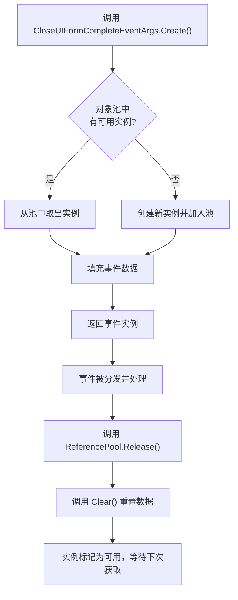

<cite>
**Referenced Files in This Document**  
- [CloseUIFormCompleteEventArgs.cs](file://GameFramework/UI/CloseUIFormCompleteEventArgs.cs)
- [ReferencePool.cs](file://GameFramework/Base/ReferencePool/ReferencePool.cs)
- [IUIGroup.cs](file://GameFramework/UI/IUIGroup.cs)
- [GameFrameworkEventArgs.cs](file://GameFramework/Base/GameFrameworkEventArgs.cs)
- [UIManager.cs](file://GameFramework/UI/UIManager.cs)
</cite>

## Table of Contents
1. [关闭界面完成事件](#关闭界面完成事件)
2. [属性解析与资源管理](#属性解析与资源管理)
3. [对象池管理机制](#对象池管理机制)
4. [事件监听与使用示例](#事件监听与使用示例)
5. [最佳实践与陷阱规避](#最佳实践与陷阱规避)

## 关闭界面完成事件

`CloseUIFormCompleteEventArgs` 是 Unity 游戏框架中用于标识界面关闭流程结束的核心事件类。该事件在界面实例完成销毁流程后触发，为上层逻辑提供关于已关闭界面的完整上下文信息。作为 `GameFrameworkEventArgs` 的派生类，它遵循框架统一的事件处理机制，确保在界面生命周期的终结阶段能够可靠地通知订阅者。

此事件在 `UIManager` 的 `CloseUIForm` 方法中被创建并分发，标志着一个界面从激活状态到完全释放的过渡完成。通过该事件，开发者可以精确掌握界面销毁的时机，执行后续的业务逻辑，如状态更新、资源验证或日志记录。

**Section sources**
- [CloseUIFormCompleteEventArgs.cs](file://GameFramework/UI/CloseUIFormCompleteEventArgs.cs#L12-L89)
- [UIManager.cs](file://GameFramework/UI/UIManager.cs#L811-L836)

## 属性解析与资源管理

`CloseUIFormCompleteEventArgs` 通过其核心属性精确标识已销毁的界面实例及其上下文，为资源管理和状态追踪提供关键信息。

### SerialId 与 UIFormAssetName
`SerialId`（序列编号）是框架为每个界面实例分配的唯一整数标识符。即使多个界面实例加载自同一资源，它们也拥有不同的 `SerialId`，这使得事件能够精确地指向特定的销毁实例。`UIFormAssetName`（界面资源名称）则指明了该实例所加载的原始资源路径（如 `"Assets/UI/Forms/LoginForm.prefab"`）。这两个属性的组合，既保证了实例的唯一性，又明确了其资源来源，是进行资源释放验证和状态清理的基石。

### UIGroup
`UIGroup` 属性返回该界面所属的界面组（`IUIGroup`）。界面组是框架中用于管理界面层级、深度和共通行为的逻辑容器。通过此属性，事件处理逻辑可以访问到界面的组织结构，例如判断是否需要更新整个组的激活状态，或是在特定组内执行后续操作。`IUIGroup` 接口提供了查询组内界面、获取当前界面等方法，为复杂的界面导航逻辑提供了支持。

**Section sources**
- [CloseUIFormCompleteEventArgs.cs](file://GameFramework/UI/CloseUIFormCompleteEventArgs.cs#L30-L50)
- [IUIGroup.cs](file://GameFramework/UI/IUIGroup.cs#L14-L119)
- [IUIForm.cs](file://GameFramework/UI/IUIForm.cs#L12-L130)

## 对象池管理机制

`CloseUIFormCompleteEventArgs` 的生命周期由框架的引用池（`ReferencePool`）系统管理，这是一项关键的性能优化技术。

### Create 工厂方法
`Create` 静态工厂方法是创建事件实例的唯一推荐途径。它不直接使用 `new` 操作符，而是调用 `ReferencePool.Acquire<CloseUIFormCompleteEventArgs>()` 从对象池中获取一个已存在的、但处于闲置状态的实例。如果池中无可用实例，则会创建新的实例并加入池中。随后，该方法会将传入的参数（`serialId`, `uiFormAssetName`, `uiGroup`, `userData`）填充到获取的实例中，并返回给调用者。

### 线程安全与内存回收
`ReferencePool` 的实现通过 `lock` 关键字对内部的 `Dictionary<Type, ReferenceCollection>` 进行同步，确保了在多线程环境下获取和归还实例的线程安全性。当事件处理完毕后，必须调用 `ReferencePool.Release(eventArgs)` 将实例归还池中。`Release` 方法会先调用实例的 `Clear()` 方法重置所有字段（如将 `SerialId` 置为 0，引用置为 `null`），然后将其标记为可用。这种机制避免了频繁的内存分配与垃圾回收（GC），显著提升了运行时性能。



**Diagram sources**
- [CloseUIFormCompleteEventArgs.cs](file://GameFramework/UI/CloseUIFormCompleteEventArgs.cs#L69-L77)
- [ReferencePool.cs](file://GameFramework/Base/ReferencePool/ReferencePool.cs#L98-L118)
- [CloseUIFormCompleteEventArgs.cs](file://GameFramework/UI/CloseUIFormCompleteEventArgs.cs#L80-L88)

**Section sources**
- [CloseUIFormCompleteEventArgs.cs](file://GameFramework/UI/CloseUIFormCompleteEventArgs.cs#L69-L88)
- [ReferencePool.cs](file://GameFramework/Base/ReferencePool/ReferencePool.cs#L98-L118)

## 事件监听与使用示例

开发者可以通过订阅 `UIManager` 的 `CloseUIFormComplete` 事件来监听界面关闭完成的通知。

### 监听事件
```csharp
// 订阅事件
GameFrameworkEntry.GetModule<IUIManager>().CloseUIFormComplete += OnCloseUIFormComplete;

// 事件处理函数
private void OnCloseUIFormComplete(object sender, CloseUIFormCompleteEventArgs e)
{
    // 在此处执行后续操作
}
```

### 典型使用场景
- **打开新界面**: 在当前界面关闭后，立即打开下一个界面。
  ```csharp
  GameFrameworkEntry.GetModule<IUIManager>().OpenUIForm("NextForm", null);
  ```
- **更新导航状态**: 根据关闭的界面更新游戏内的导航菜单或历史记录。
  ```csharp
  NavigationManager.Instance.PopHistory(e.UIFormAssetName);
  ```
- **记录关闭日志**: 记录用户行为，用于数据分析。
  ```csharp
  GameFrameworkLog.Info($"UI Form '{e.UIFormAssetName}' (SerialId: {e.SerialId}) closed.");
  ```

**Section sources**
- [UIManager.cs](file://GameFramework/UI/UIManager.cs#L811-L836)
- [CloseUIFormCompleteEventArgs.cs](file://GameFramework/UI/CloseUIFormCompleteEventArgs.cs#L12-L89)

## 最佳实践与陷阱规避

### 避免访问已销毁对象
**核心陷阱**：在 `OnCloseUIFormComplete` 事件处理函数中，`e.UIFormAssetName` 和 `e.SerialId` 是有效的，但**绝不能**尝试通过 `GetUIForm(serialId)` 或 `GetUIForm(uiFormAssetName)` 来重新获取该界面实例。因为此时该实例已被从界面组中移除，并即将被回收，任何访问都可能导致空引用异常或未定义行为。

### 与对象池协同工作
必须严格遵守“获取-使用-释放”的模式。事件实例由 `UIManager` 创建并分发，因此**事件处理者不应调用 `Release`**。`UIManager` 在事件分发后会立即调用 `ReferencePool.Release(closeUIFormCompleteEventArgs)` 来归还实例。如果开发者在其他地方创建了此类事件（尽管不常见），则必须确保在使用完毕后手动释放，以防止对象池泄漏。

**Section sources**
- [UIManager.cs](file://GameFramework/UI/UIManager.cs#L811-L836)
- [CloseUIFormCompleteEventArgs.cs](file://GameFramework/UI/CloseUIFormCompleteEventArgs.cs#L80-L88)