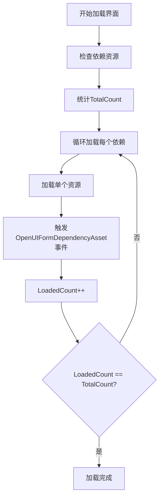
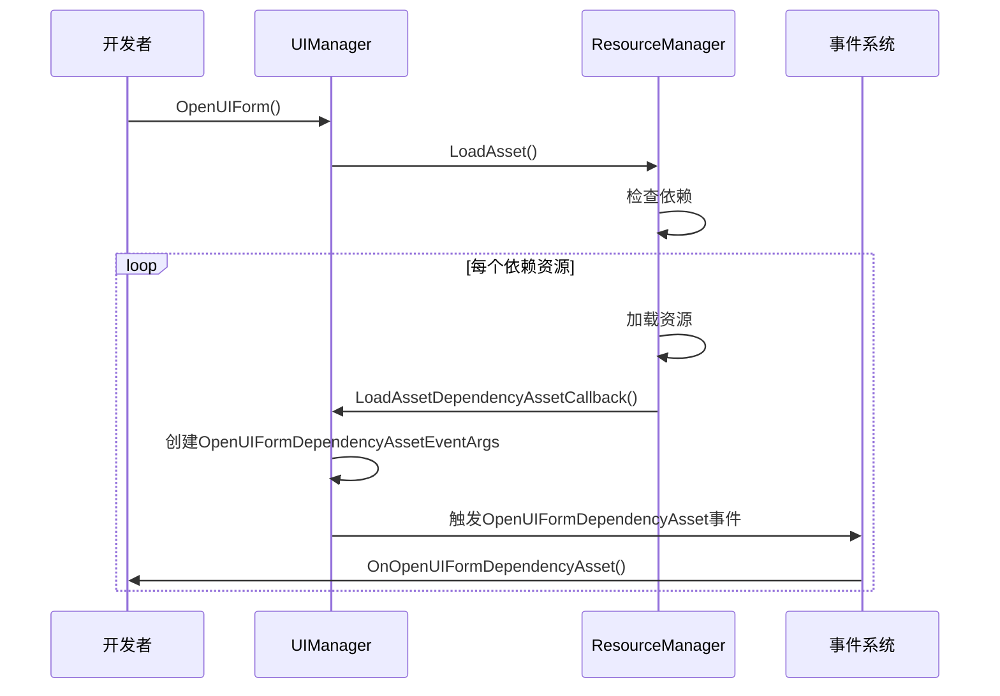
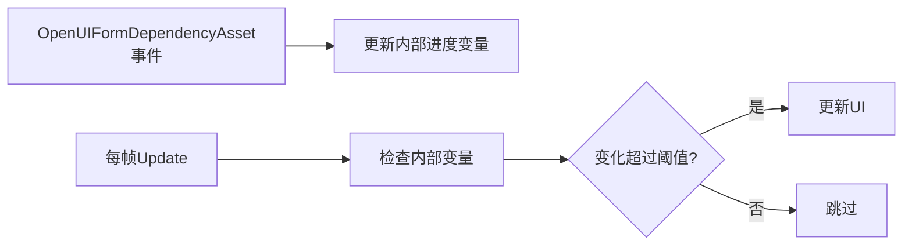
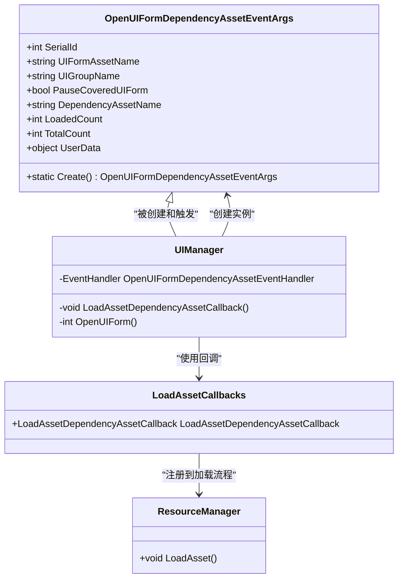

# 打开界面依赖资源加载事件

<cite>
**本文档引用文件**  
- [OpenUIFormDependencyAssetEventArgs.cs](file://GameFramework/UI/OpenUIFormDependencyAssetEventArgs.cs)
- [OpenUIFormUpdateEventArgs.cs](file://GameFramework/UI/OpenUIFormUpdateEventArgs.cs)
- [UIManager.cs](file://GameFramework/UI/UIManager.cs)
- [LoadAssetCallbacks.cs](file://GameFramework/Resource/LoadAssetCallbacks.cs)
- [ResourceManager.ResourceLoader.cs](file://GameFramework/Resource/ResourceManager.ResourceLoader.cs)
</cite>

## 目录
1. [简介](#简介)
2. [核心字段解析](#核心字段解析)
3. [事件触发机制](#事件触发机制)
4. [与OpenUIFormUpdate事件的对比](#与openuiformupdate事件的对比)
5. [实际应用示例](#实际应用示例)
6. [性能最佳实践](#性能最佳实践)
7. [UserData跨事件上下文关联](#userdata跨事件上下文关联)
8. [依赖关系图](#依赖关系图)

## 简介
`OpenUIFormDependencyAssetEventArgs` 是 GameFramework 框架中用于处理界面打开时依赖资源加载状态的关键事件类。该事件在加载界面所需依赖资源的过程中被频繁触发，为开发者提供了细粒度的资源加载监控能力。通过该事件，开发者可以精确掌握每个依赖资源的加载进度，实现加载过程的可视化、瓶颈分析和预加载优化。

该事件继承自 `GameFrameworkEventArgs`，作为事件系统的一部分，通过事件订阅机制实现松耦合的资源加载状态通知。其设计目标是提供比整体加载进度更精细的资源粒度控制，帮助开发者构建更流畅的用户体验。

**Section sources**
- [OpenUIFormDependencyAssetEventArgs.cs](file://GameFramework/UI/OpenUIFormDependencyAssetEventArgs.cs#L12-L141)

## 核心字段解析
`OpenUIFormDependencyAssetEventArgs` 类包含多个关键字段，用于反映当前依赖资源的加载状态：

- **DependencyAssetName**: 获取当前正在加载的依赖资源名称。该字段标识了具体是哪一个资源正在被处理，是进行资源粒度监控的基础。
- **LoadedCount**: 获取当前已成功加载的依赖资源数量。该字段是一个递增计数器，反映了加载过程的进展。
- **TotalCount**: 获取需要加载的依赖资源总数。该字段在加载开始时即已确定，为计算加载进度提供了基准。

这三个字段共同构成了一个动态的加载状态快照。例如，当 `LoadedCount` 从 3 增加到 4，而 `TotalCount` 为 10 时，开发者可以立即得知第 4 个依赖项已加载完成，整体进度已达到 40%。这种细粒度的信息对于实现精确的加载指示器或进行性能分析至关重要。



**Diagram sources**
- [OpenUIFormDependencyAssetEventArgs.cs](file://GameFramework/UI/OpenUIFormDependencyAssetEventArgs.cs#L65-L85)
- [ResourceManager.ResourceLoader.cs](file://GameFramework/Resource/ResourceManager.ResourceLoader.cs#L305-L354)

**Section sources**
- [OpenUIFormDependencyAssetEventArgs.cs](file://GameFramework/UI/OpenUIFormDependencyAssetEventArgs.cs#L65-L85)

## 事件触发机制
`OpenUIFormDependencyAssetEventArgs` 事件的触发流程始于 `UIManager.OpenUIForm` 方法的调用。当开发者请求打开一个界面时，`UIManager` 会通过 `ResourceManager` 启动资源加载流程。

`ResourceManager` 在加载主界面资源时，会检查其依赖关系，并为每个依赖资源创建加载任务。在加载过程中，`LoadAssetDependencyAssetCallback` 回调函数会被反复调用。该回调函数位于 `UIManager` 内部，负责将底层的加载进度信息封装成 `OpenUIFormDependencyAssetEventArgs` 事件。

具体流程如下：`ResourceManager` 加载一个依赖资源 → 调用 `LoadAssetCallbacks` 中的 `LoadAssetDependencyAssetCallback` → `UIManager` 的 `LoadAssetDependencyAssetCallback` 方法被触发 → 使用 `OpenUIFormDependencyAssetEventArgs.Create()` 方法创建事件实例 → 通过 `m_OpenUIFormDependencyAssetEventHandler` 事件处理器发布事件。这一系列操作确保了上层逻辑能够及时收到每一个依赖资源的加载状态更新。



**Diagram sources**
- [UIManager.cs](file://GameFramework/UI/UIManager.cs#L722-L763)
- [LoadAssetCallbacks.cs](file://GameFramework/Resource/LoadAssetCallbacks.cs#L136-L142)
- [UIManager.cs](file://GameFramework/UI/UIManager.cs#L1042-L1056)

**Section sources**
- [UIManager.cs](file://GameFramework/UI/UIManager.cs#L722-L763)
- [UIManager.cs](file://GameFramework/UI/UIManager.cs#L1042-L1056)

## 与OpenUIFormUpdate事件的对比
`OpenUIFormDependencyAssetEventArgs` 与 `OpenUIFormUpdateEventArgs` 虽然都用于报告界面打开过程中的进度，但它们的关注点和粒度有本质区别。

`OpenUIFormDependencyAssetEventArgs` 关注**资源粒度**。它报告的是每一个具体依赖资源的加载情况，如 "Texture_A"、"Audio_B" 等。它通过 `LoadedCount` 和 `TotalCount` 提供了离散的、基于计数的进度信息。这种事件适合用于分析加载瓶颈，例如发现某个特定资源加载时间过长。

相比之下，`OpenUIFormUpdateEventArgs` 关注**整体进度**。它通过一个 `float Progress` 字段提供一个 0.0 到 1.0 之间的连续进度值。这个值可能是基于字节数、时间或其他综合因素计算得出的，反映的是整个加载过程的宏观进展。它更适合用于驱动一个平滑的进度条。

| 特性 | OpenUIFormDependencyAssetEventArgs | OpenUIFormUpdateEventArgs |
| :--- | :--- | :--- |
| **关注粒度** | 单个依赖资源 | 整体加载过程 |
| **进度表示** | LoadedCount / TotalCount (整数) | Progress (浮点数 0.0-1.0) |
| **触发频率** | 每加载完一个依赖资源触发一次 | 可能按时间或字节流频繁触发 |
| **主要用途** | 资源监控、瓶颈分析、预加载 | 进度条显示、加载状态提示 |

**Section sources**
- [OpenUIFormDependencyAssetEventArgs.cs](file://GameFramework/UI/OpenUIFormDependencyAssetEventArgs.cs#L65-L85)
- [OpenUIFormUpdateEventArgs.cs](file://GameFramework/UI/OpenUIFormUpdateEventArgs.cs#L55-L60)

## 实际应用示例
利用 `OpenUIFormDependencyAssetEventArgs` 事件，开发者可以实现多种高级功能：

**细粒度资源监控**：通过订阅该事件，可以实时记录每个依赖资源的加载耗时。例如，可以创建一个字典，以 `DependencyAssetName` 为键，记录加载开始和结束时间，从而生成一份详细的加载性能报告。

**依赖预加载分析**：在游戏启动或场景切换的空闲时间，可以模拟打开某个界面，监听其 `OpenUIFormDependencyAsset` 事件，从而提前加载那些耗时较长的依赖资源，实现预加载，减少玩家实际打开界面时的等待时间。

**加载瓶颈定位**：当用户反馈某个界面加载缓慢时，可以通过分析 `OpenUIFormDependencyAsset` 事件序列，找出 `LoadedCount` 长时间停滞不前的那个 `DependencyAssetName`，快速定位到问题资源，进行优化或替换。

```csharp
// 示例：事件订阅代码
private void OnOpenUIFormDependencyAsset(object sender, OpenUIFormDependencyAssetEventArgs e)
{
    // 记录加载进度
    Debug.Log($"加载依赖: {e.DependencyAssetName} ({e.LoadedCount}/{e.TotalCount})");
    
    // 性能分析：如果某个资源加载时间过长，发出警告
    if (IsResourceLoadingTooLong(e.DependencyAssetName))
    {
        Debug.LogWarning($"警告: 资源 {e.DependencyAssetName} 加载缓慢");
    }
}
```

**Section sources**
- [OpenUIFormDependencyAssetEventArgs.cs](file://GameFramework/UI/OpenUIFormDependencyAssetEventArgs.cs#L65-L85)

## 性能最佳实践
在处理大量依赖资源时，频繁地触发 `OpenUIFormDependencyAssetEventArgs` 事件并进行 DOM 操作（如更新 UI 元素）可能会导致性能问题，尤其是在移动设备上。

最佳实践是**避免在事件回调中直接进行昂贵的 UI 更新**。例如，不要为每一次 `LoadedCount` 的增加都去刷新一个文本标签。相反，应该采用**节流（Throttling）或防抖（Debouncing）** 策略。

一种推荐的做法是，在事件回调中仅更新一个内部状态变量（如当前进度百分比），然后在一个独立的、频率较低的 `Update` 循环中检查这个状态变量，并决定是否需要更新 UI。这样可以将高频的事件处理与低频的 UI 渲染解耦，显著提升性能。



**Section sources**
- [UIManager.cs](file://GameFramework/UI/UIManager.cs#L1042-L1056)

## UserData跨事件上下文关联
`UserData` 字段是 `OpenUIFormDependencyAssetEventArgs` 中一个强大的功能，它允许开发者传递自定义数据，实现跨事件的上下文关联。

当调用 `UIManager.OpenUIForm` 时，可以传入一个 `UserData` 对象。这个对象会通过 `OpenUIFormInfo` 一直传递到 `LoadAssetDependencyAssetCallback`，最终被封装进 `OpenUIFormDependencyAssetEventArgs` 事件中。这使得在事件处理函数中，不仅能知道是哪个资源在加载，还能知道这次加载是属于哪个特定的业务逻辑或用户操作。

例如，如果游戏中有多个不同的加载场景（新手引导加载、主菜单加载），可以将场景标识符作为 `UserData` 传入。在事件处理函数中，就可以根据这个标识符来决定如何处理加载进度，从而实现不同场景下的差异化加载策略。

**Section sources**
- [OpenUIFormDependencyAssetEventArgs.cs](file://GameFramework/UI/OpenUIFormDependencyAssetEventArgs.cs#L95-L100)
- [UIManager.cs](file://GameFramework/UI/UIManager.cs#L722-L763)

## 依赖关系图
以下图表展示了 `OpenUIFormDependencyAssetEventArgs` 在整个框架中的位置和依赖关系。



**Diagram sources**
- [OpenUIFormDependencyAssetEventArgs.cs](file://GameFramework/UI/OpenUIFormDependencyAssetEventArgs.cs#L12-L141)
- [UIManager.cs](file://GameFramework/UI/UIManager.cs#L722-L763)
- [LoadAssetCallbacks.cs](file://GameFramework/Resource/LoadAssetCallbacks.cs#L12-L143)

**Section sources**
- [OpenUIFormDependencyAssetEventArgs.cs](file://GameFramework/UI/OpenUIFormDependencyAssetEventArgs.cs#L12-L141)
- [UIManager.cs](file://GameFramework/UI/UIManager.cs#L722-L763)
- [LoadAssetCallbacks.cs](file://GameFramework/Resource/LoadAssetCallbacks.cs#L12-L143)