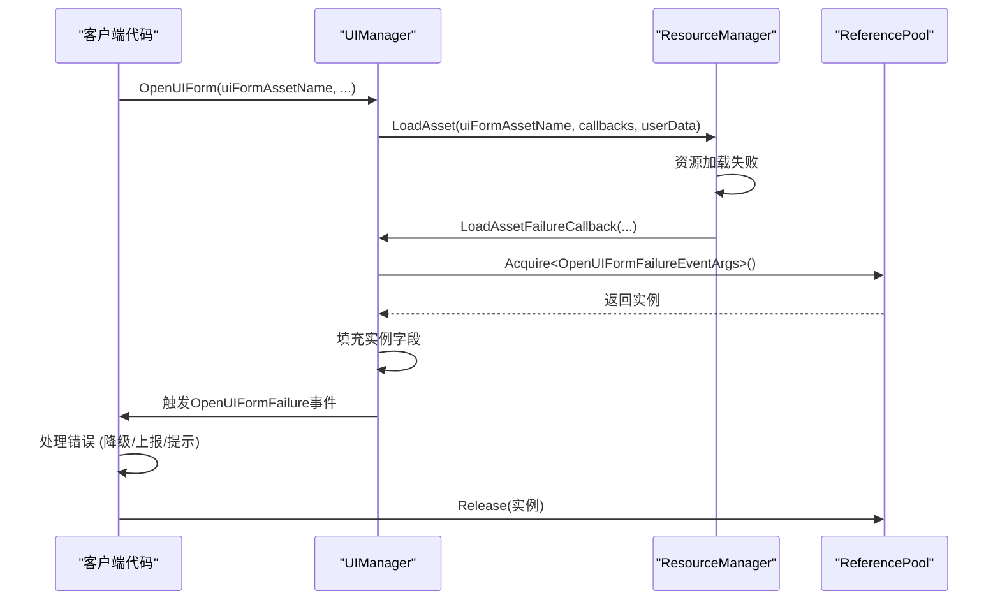
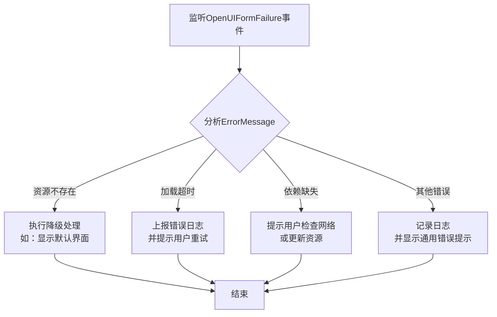

<cite>
**Referenced Files in This Document**   
- [OpenUIFormFailureEventArgs.cs](file://GameFramework/UI/OpenUIFormFailureEventArgs.cs)
- [ReferencePool.cs](file://GameFramework/Base/ReferencePool/ReferencePool.cs)
- [BaseEventArgs.cs](file://GameFramework/Base/EventPool/BaseEventArgs.cs)
- [UIManager.cs](file://GameFramework/UI/UIManager.cs)
- [LoadAssetCallbacks.cs](file://GameFramework/Resource/LoadAssetCallbacks.cs)
- [LoadResourceStatus.cs](file://GameFramework/Resource/LoadResourceStatus.cs)
</cite>

# 打开界面失败事件

## 项目结构
本项目为Unity游戏框架，采用模块化设计。`OpenUIFormFailureEventArgs`类位于`GameFramework/UI/`目录下，属于UI模块的核心事件类。该模块依赖于基础模块（Base）中的事件池（EventPool）和引用池（ReferencePool）机制，通过资源管理模块（Resource）加载界面资源，并与UI管理器（UIManager）协同工作完成界面的打开与错误处理。

**Section sources**
- [OpenUIFormFailureEventArgs.cs](file://GameFramework/UI/OpenUIFormFailureEventArgs.cs#L12-L115)

## 核心组件分析

### OpenUIFormFailureEventArgs 类设计
`OpenUIFormFailureEventArgs`类是UI模块中用于报告界面打开失败的核心事件数据类。它继承自`GameFrameworkEventArgs`，封装了失败事件的完整上下文信息，为上层应用提供精确的诊断依据。

#### 字段在错误诊断中的作用
该类包含多个关键字段，共同构成完整的错误诊断信息：

- **SerialId**: 界面序列编号，用于唯一标识一次打开请求，便于追踪特定请求的生命周期。
- **UIFormAssetName**: 界面资源名称，明确指出是哪个资源加载失败，是定位问题的第一线索。
- **UIGroupName**: 界面组名称，指示该界面所属的逻辑分组，有助于理解界面的层级和管理策略。
- **PauseCoveredUIForm**: 布尔值，记录了打开请求时是否要求暂停被覆盖的界面，用于复现和分析状态逻辑。
- **ErrorMessage**: **核心诊断字段**，提供具体的失败原因。该信息通常由底层资源加载系统生成，包含详细的错误描述和状态码。
- **UserData**: 用户自定义数据，允许调用者传入上下文信息（如请求ID、业务参数），是追溯请求源头和实现业务级降级处理的关键。

**Section sources**
- [OpenUIFormFailureEventArgs.cs](file://GameFramework/UI/OpenUIFormFailureEventArgs.cs#L12-L115)

### Create 方法与引用池管理
`Create`静态方法是创建`OpenUIFormFailureEventArgs`实例的唯一入口，它通过`ReferencePool.Acquire<T>()`从引用池中获取对象，而非直接使用`new`关键字。

**Diagram sources**
- [OpenUIFormFailureEventArgs.cs](file://GameFramework/UI/OpenUIFormFailureEventArgs.cs#L91-L101)
- [UIManager.cs](file://GameFramework/UI/UIManager.cs#L999-L1024)
- [ReferencePool.cs](file://GameFramework/Base/ReferencePool/ReferencePool.cs#L140-L148)

**Section sources**
- [OpenUIFormFailureEventArgs.cs](file://GameFramework/UI/OpenUIFormFailureEventArgs.cs#L91-L101)
- [ReferencePool.cs](file://GameFramework/Base/ReferencePool/ReferencePool.cs#L140-L148)

此设计实现了对象的高效复用，避免了频繁的内存分配与垃圾回收（GC），对于性能敏感的游戏应用至关重要。当事件处理完毕后，必须调用`ReferencePool.Release()`将实例归还池中，以保证池的正常运作。

## 事件监听与错误处理实例

### 监听与响应
开发者可以通过订阅`UIManager`的`OpenUIFormFailure`事件来监听界面打开失败的情况。在事件处理函数中，根据`ErrorMessage`和`UserData`执行相应的策略。

**Diagram sources**
- [OpenUIFormFailureEventArgs.cs](file://GameFramework/UI/OpenUIFormFailureEventArgs.cs#L50-L55)
- [UIManager.cs](file://GameFramework/UI/UIManager.cs#L999-L1024)

**Section sources**
- [UIManager.cs](file://GameFramework/UI/UIManager.cs#L999-L1024)

### UserData 的合理利用
`UserData`字段是实现精细化错误处理的桥梁。例如，在发起打开界面请求时，可以将一个包含“业务场景”和“请求ID”的自定义对象作为`UserData`传入。当失败事件触发时，即可根据`UserData`中的“业务场景”决定是静默降级还是强制提示，根据“请求ID”上报到日志系统，便于后端追踪。

## 常见故障应对策略

### 故障类型与恢复建议
`ErrorMessage`通常会结合`LoadResourceStatus`枚举来提供精确的失败原因。以下是几种常见故障的应对策略：

| 故障类型 | LoadResourceStatus | 应对策略 | 恢复建议 |
| :--- | :--- | :--- | :--- |
| **资源丢失** | `NotExist` | 启用备用资源路径或显示默认界面。 | 检查资源打包流程，确保资源已正确包含在构建中。 |
| **加载超时** | `NotReady` 或网络相关错误 | 限制重试次数，避免无限循环。 | 优化资源大小，或提示用户检查网络连接。 |
| **依赖缺失** | `DependencyError` | 暂停当前操作，优先加载缺失的依赖。 | 确保资源依赖关系正确配置，或提供离线模式。 |
| **资源类型错误** | `TypeError` | 记录严重错误，可能需要重启应用。 | 检查资源导入设置，确保类型匹配。 |
| **加载过程错误** | `AssetError` | 通用错误处理，上报详细日志。 | 检查资源文件完整性，或重新下载资源包。 |

**Section sources**
- [LoadResourceStatus.cs](file://GameFramework/Resource/LoadResourceStatus.cs#L12-L43)
- [LoadAssetCallbacks.cs](file://GameFramework/Resource/LoadAssetCallbacks.cs#L87-L98)
- [UIManager.cs](file://GameFramework/UI/UIManager.cs#L999-L1024)