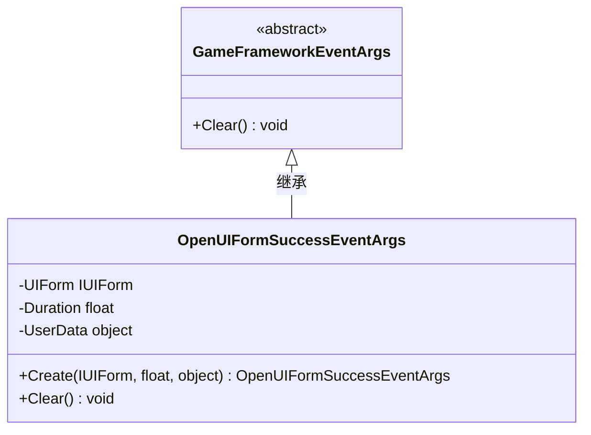

<cite>
**Referenced Files in This Document**   
- [OpenUIFormSuccessEventArgs.cs](file://GameFramework/UI/OpenUIFormSuccessEventArgs.cs)
- [GameFrameworkEventArgs.cs](file://GameFramework/Base/GameFrameworkEventArgs.cs)
- [IReference.cs](file://GameFramework/Base/ReferencePool/IReference.cs)
- [ReferencePool.cs](file://GameFramework/Base/ReferencePool/ReferencePool.cs)
- [IUIForm.cs](file://GameFramework/UI/IUIForm.cs)
- [UIManager.cs](file://GameFramework/UI/UIManager.cs)
</cite>

## 打开界面成功事件

本文档详细说明 `OpenUIFormSuccessEventArgs` 类的实现机制与使用方法，涵盖其继承架构、核心属性语义、对象复用机制、事件订阅方式及内存管理注意事项。

### 类继承架构与设计意义

`OpenUIFormSuccessEventArgs` 类继承自 `GameFrameworkEventArgs`，体现了事件驱动架构中的标准化事件数据封装模式。



**Diagram sources**  
- [OpenUIFormSuccessEventArgs.cs](file://GameFramework/UI/OpenUIFormSuccessEventArgs.cs#L12-L76)
- [GameFrameworkEventArgs.cs](file://GameFramework/Base/GameFrameworkEventArgs.cs#L14-L27)

该继承关系具有以下架构意义：
1. **统一事件契约**：所有框架事件均继承自 `GameFrameworkEventArgs`，确保事件处理接口的一致性。
2. **引用管理集成**：通过实现 `IReference` 接口，事件对象可被引用池统一管理，避免频繁创建与销毁。
3. **生命周期控制**：强制实现 `Clear()` 方法，确保事件对象在释放前能正确清理内部状态，防止内存泄漏。

**Section sources**  
- [OpenUIFormSuccessEventArgs.cs](file://GameFramework/UI/OpenUIFormSuccessEventArgs.cs#L12-L76)
- [GameFrameworkEventArgs.cs](file://GameFramework/Base/GameFrameworkEventArgs.cs#L14-L27)

### 核心属性语义与用途

`OpenUIFormSuccessEventArgs` 定义了三个核心只读属性，用于传递界面加载完成后的上下文信息：

| 属性 | 类型 | 语义 | 用途 |
|------|------|------|------|
| UIForm | IUIForm | 成功加载的界面实例 | 用于获取并操作新打开的UI界面，如初始化控件、绑定数据等 |
| Duration | float | 界面加载耗时（秒） | 用于性能监控、加载时间分析或实现超时逻辑 |
| UserData | object | 用户自定义数据 | 用于传递打开界面时附带的上下文参数，如配置信息、业务数据等 |

这些属性在事件触发时由系统填充，订阅者可通过这些信息执行后续逻辑。

**Section sources**  
- [OpenUIFormSuccessEventArgs.cs](file://GameFramework/UI/OpenUIFormSuccessEventArgs.cs#L25-L46)

### 对象复用机制与GC优化

为避免频繁创建事件对象导致的垃圾回收（GC）压力，`OpenUIFormSuccessEventArgs` 采用 `ReferencePool` 实现对象复用。

#### 静态工厂方法 `Create`

```csharp
public static OpenUIFormSuccessEventArgs Create(IUIForm uiForm, float duration, object userData)
{
    OpenUIFormSuccessEventArgs openUIFormSuccessEventArgs = ReferencePool.Acquire<OpenUIFormSuccessEventArgs>();
    openUIFormSuccessEventArgs.UIForm = uiForm;
    openUIFormSuccessEventArgs.Duration = duration;
    openUIFormSuccessEventArgs.UserData = userData;
    return openUIFormSuccessEventArgs;
}
```

该方法通过 `ReferencePool.Acquire<T>()` 从引用池中获取已存在的对象实例，而非使用 `new` 关键字创建新对象，从而显著减少内存分配。

#### 引用池工作流程

```mermaid
flowchart TD
A[事件触发] --> B{引用池中<br>有可用对象?}
B --> |是| C[取出对象并重置状态]
B --> |否| D[创建新对象]
C --> E[填充UIForm, Duration, UserData]
D --> E
E --> F[返回对象供事件分发]
F --> G[事件处理完成]
G --> H[调用ReferencePool.Release()]
H --> I[对象状态清零]
I --> J[对象返回引用池]
```

**Diagram sources**  
- [OpenUIFormSuccessEventArgs.cs](file://GameFramework/UI/OpenUIFormSuccessEventArgs.cs#L58-L65)
- [ReferencePool.cs](file://GameFramework/Base/ReferencePool/ReferencePool.cs#L108-L118)

**Section sources**  
- [OpenUIFormSuccessEventArgs.cs](file://GameFramework/UI/OpenUIFormSuccessEventArgs.cs#L58-L65)
- [ReferencePool.cs](file://GameFramework/Base/ReferencePool/ReferencePool.cs#L108-L118)

### 事件订阅与使用示例

开发者可通过订阅 `UIManager.OpenUIFormSuccess` 事件来响应界面成功加载。

#### 事件订阅代码示例

```csharp
// 订阅事件
uiManager.OpenUIFormSuccess += OnOpenUIFormSuccess;

// 事件处理方法
private void OnOpenUIFormSuccess(object sender, OpenUIFormSuccessEventArgs e)
{
    // 获取成功加载的界面
    IUIForm uiForm = e.UIForm;
    
    // 获取自定义用户数据
    var userData = e.UserData as MyCustomData;
    
    // 执行界面初始化逻辑
    if (uiForm != null)
    {
        // 例如：激活主界面功能模块
        InitializeMainUIFeatures(uiForm);
        
        // 例如：检查资源依赖
        CheckResourceDependencies(userData);
    }
    
    // 注意：事件处理完成后必须释放引用
    ReferencePool.Release(e);
}

// 取消订阅（推荐在适当时机执行）
// uiManager.OpenUIFormSuccess -= OnOpenUIFormSuccess;
```

#### 实际应用场景

1. **主界面加载完成后的功能模块激活**  
   在 `OnOpenUIFormSuccess` 中检查 `uiForm` 是否为主界面，若是则激活其子系统（如任务系统、背包系统等）。

2. **资源依赖检查**  
   利用 `UserData` 传递预加载的资源列表，在事件处理中验证所有依赖资源是否已就绪。

3. **性能监控**  
   记录 `Duration` 值，统计界面加载时间，用于优化资源加载策略。

**Section sources**  
- [UIManager.cs](file://GameFramework/UI/UIManager.cs#L130-L135)
- [OpenUIFormSuccessEventArgs.cs](file://GameFramework/UI/OpenUIFormSuccessEventArgs.cs#L58-L65)

### 内存管理与最佳实践

#### 必须正确释放引用

事件处理完成后，**必须**调用 `ReferencePool.Release(e)` 将事件对象归还引用池。若未释放，该对象将无法被复用，导致内存泄漏和引用池膨胀。

```csharp
// 正确做法
private void OnOpenUIFormSuccess(object sender, OpenUIFormSuccessEventArgs e)
{
    try
    {
        // 处理事件逻辑
        ProcessUIForm(e.UIForm, e.UserData);
    }
    finally
    {
        // 确保无论如何都会释放引用
        ReferencePool.Release(e);
    }
}
```

#### 最佳实践建议

1. **使用 `try-finally` 确保释放**：在异常情况下也能保证 `Release` 被调用。
2. **避免在事件中执行耗时操作**：防止阻塞主线程，影响用户体验。
3. **及时取消事件订阅**：在对象销毁时取消订阅，防止事件处理器成为内存泄漏的根源。
4. **合理使用 `UserData`**：避免传递大型对象，推荐传递轻量级标识符或结构体。

**Section sources**  
- [UIManager.cs](file://GameFramework/UI/UIManager.cs#L954-L981)
- [ReferencePool.cs](file://GameFramework/Base/ReferencePool/ReferencePool.cs#L108-L118)