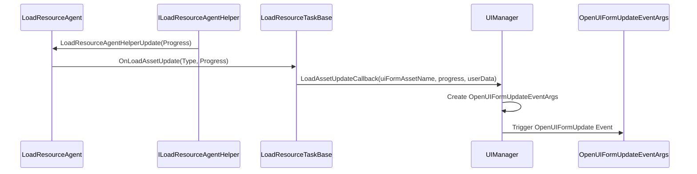
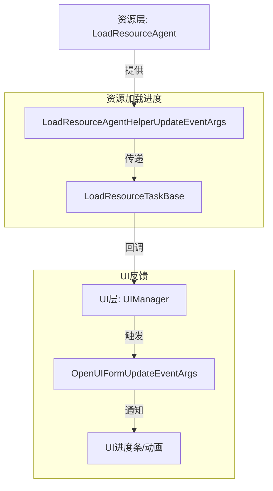

# 打开界面进度更新事件

<cite>
**Referenced Files in This Document**   
- [OpenUIFormUpdateEventArgs.cs](file://GameFramework/UI/OpenUIFormUpdateEventArgs.cs)
- [UIManager.cs](file://GameFramework/UI/UIManager.cs)
- [LoadResourceAgentHelperUpdateEventArgs.cs](file://GameFramework/Resource/LoadResourceAgentHelperUpdateEventArgs.cs)
- [LoadResourceProgress.cs](file://GameFramework/Resource/LoadResourceProgress.cs)
- [ResourceManager.ResourceLoader.LoadResourceAgent.cs](file://GameFramework/Resource/ResourceManager.ResourceLoader.LoadResourceAgent.cs)
</cite>

## 目录
1. [简介](#简介)
2. [核心属性解析](#核心属性解析)
3. [进度反馈机制](#进度反馈机制)
4. [唯一标识与多任务管理](#唯一标识与多任务管理)
5. [实际应用示例](#实际应用示例)
6. [遮挡管理与性能优化](#遮挡管理与性能优化)
7. [事件流与架构关系](#事件流与架构关系)

## 简介

`OpenUIFormUpdateEventArgs` 是 GameFramework 框架中用于在异步加载界面过程中提供进度反馈的核心事件类。该事件通过 `UIManager` 触发，为开发者提供了实时监控界面加载状态的能力，从而实现流畅的用户体验反馈。

该事件在用户调用 `UIManager.OpenUIForm` 方法后，由资源加载系统驱动，持续向注册的事件处理器发送进度更新。其设计目标是为 UI 进度条、加载动画等视觉反馈组件提供精确的数据支持。

**Section sources**
- [OpenUIFormUpdateEventArgs.cs](file://GameFramework/UI/OpenUIFormUpdateEventArgs.cs#L12-L115)

## 核心属性解析

### Progress 属性

`Progress` 属性是 `OpenUIFormUpdateEventArgs` 的核心，表示当前界面加载的完成度。

- **取值范围**: `0.0f` 到 `1.0f`，其中 `0.0f` 表示开始，`1.0f` 表示完成。
- **数据来源**: 该值直接来源于底层资源加载系统的 `LoadResourceAgentHelperUpdateEventArgs.Progress`，反映了资源文件读取和加载的实际进度。
- **更新时机**: 在资源代理辅助器 (`ILoadResourceAgentHelper`) 触发 `LoadResourceAgentHelperUpdate` 事件时更新。

### SerialId 与 UIFormAssetName

这两个属性共同构成了异步加载任务的唯一标识。

- **SerialId**: 由 `UIManager` 在调用 `OpenUIForm` 时生成的递增序列号，确保每个加载请求在当前会话中具有全局唯一性。
- **UIFormAssetName**: 界面资源的名称，标识了正在加载的具体资源。

在多任务并发环境下，这两个属性的组合可以精确区分不同的加载任务，避免进度信息混淆。

### PauseCoveredUIForm

该布尔值指示在打开新界面时，是否应暂停被其覆盖的旧界面。

- **作用**: 用于管理界面的生命周期和资源占用。当设置为 `true` 时，被覆盖的界面可能会被暂停（如停止更新、释放部分资源），以优化性能。
- **意义**: 在复杂的 UI 层级中，此字段有助于实现更精细的界面状态管理。

**Section sources**
- [OpenUIFormUpdateEventArgs.cs](file://GameFramework/UI/OpenUIFormUpdateEventArgs.cs#L47-L62)
- [UIManager.cs](file://GameFramework/UI/UIManager.cs#L1026-L1040)

## 进度反馈机制

### 事件触发流程

`OpenUIFormUpdateEventArgs` 的进度更新并非由 `UIManager` 直接计算，而是作为资源加载进度的“传递者”。

1.  资源加载代理 (`LoadResourceAgent`) 在执行 `ReadFile` 或 `ReadBytes` 操作时，会周期性地向其辅助器 (`ILoadResourceAgentHelper`) 报告进度。
2.  辅助器触发 `LoadResourceAgentHelperUpdate` 事件，并附带 `LoadResourceAgentHelperUpdateEventArgs` 实例。
3.  `LoadResourceAgent` 的 `OnLoadResourceAgentHelperUpdate` 方法捕获此事件，并调用 `m_Task.OnLoadAssetUpdate`。
4.  `LoadResourceTaskBase` 将此更新转发给 `UIManager` 的 `LoadAssetUpdateCallback`。
5.  `UIManager` 最终创建并触发 `OpenUIFormUpdateEventArgs` 事件。



**Diagram sources**
- [ResourceManager.ResourceLoader.LoadResourceAgent.cs](file://GameFramework/Resource/ResourceManager.ResourceLoader.LoadResourceAgent.cs#L298-L300)
- [UIManager.cs](file://GameFramework/UI/UIManager.cs#L1026-L1040)

### 更新频率控制策略

`OpenUIFormUpdateEventArgs` 的更新频率由底层资源加载系统决定，而非 `UIManager` 主动轮询。

- **驱动源**: 更新频率取决于 `ILoadResourceAgentHelper` 实现的报告频率。例如，如果使用的是基于文件流的加载器，它可能在每次读取一定量数据后报告一次进度。
- **间接控制**: 开发者可以通过选择不同的 `ILoadResourceAgentHelper` 实现来间接影响更新频率。例如，一个更精细的实现可能会提供更频繁的更新。
- **性能考量**: 由于事件是直接传递的，因此 `UIManager` 本身不会引入额外的轮询开销。

**Section sources**
- [LoadResourceAgentHelperUpdateEventArgs.cs](file://GameFramework/Resource/LoadResourceAgentHelperUpdateEventArgs.cs#L12-L63)
- [ResourceManager.ResourceLoader.LoadResourceAgent.cs](file://GameFramework/Resource/ResourceManager.ResourceLoader.LoadResourceAgent.cs#L298-L300)

## 唯一标识与多任务管理

在同时打开多个界面或快速连续打开同一界面时，`SerialId` 和 `UIFormAssetName` 的组合至关重要。

- **区分并发任务**: 当两个不同的界面（A 和 B）同时加载时，`UIFormAssetName` 可以区分它们。`SerialId` 则能区分同一资源的多次加载请求。
- **处理快速重开**: 如果用户快速关闭并重新打开同一个界面，会产生两个不同的 `SerialId`。UI 系统可以根据 `SerialId` 判断旧的加载任务是否已过时，从而决定是否忽略其后续的进度更新，避免界面状态错乱。

**Section sources**
- [UIManager.cs](file://GameFramework/UI/UIManager.cs#L950-L955)
- [OpenUIFormUpdateEventArgs.cs](file://GameFramework/UI/OpenUIFormUpdateEventArgs.cs#L28-L32)

## 实际应用示例

以下代码展示了如何订阅 `OpenUIFormUpdate` 事件，并利用 `OpenUIFormUpdateEventArgs` 更新 UI 进度条：

```csharp
// 订阅事件
uiManager.OpenUIFormUpdate += OnOpenUIFormUpdate;

private void OnOpenUIFormUpdate(object sender, OpenUIFormUpdateEventArgs e)
{
    // 通过 SerialId 或 UIFormAssetName 定位到具体的加载任务
    if (e.UIFormAssetName == "LoadingPanel")
    {
        // 更新进度条
        UpdateProgressBar(e.Progress);
        
        // 可选：根据进度类型（e.Type）显示不同的提示文本
        UpdateLoadingText(e.Progress);
    }
}

private void UpdateProgressBar(float progress)
{
    // 性能优化：使用阈值采样，避免UI频繁重绘
    const float threshold = 0.05f; // 5% 变化才更新
    if (Mathf.Abs(progress - lastReportedProgress) >= threshold || progress >= 1.0f)
    {
        // 执行UI更新
        progressBar.value = progress;
        lastReportedProgress = progress;
    }
}
```

**Section sources**
- [UIManager.cs](file://GameFramework/UI/UIManager.cs#L1026-L1040)

## 遮挡管理与性能优化

### PauseCoveredUIForm 字段的意义

`PauseCoveredUIForm` 字段在 `OpenUIFormInfo` 对象中被设置，并通过 `userData` 传递到整个加载流程。

- **生命周期管理**: 当新界面打开并覆盖旧界面时，如果 `PauseCoveredUIForm` 为 `true`，框架可以暂停旧界面的 `Update` 循环，停止不必要的动画和逻辑计算。
- **资源释放**: 可以触发旧界面释放部分非关键资源（如临时缓存），为新界面的加载腾出内存和CPU资源。
- **用户体验**: 避免被覆盖的界面在后台消耗性能，确保新界面的加载过程更加流畅。

### 性能优化建议

1.  **避免高频复杂逻辑**: 在 `OpenUIFormUpdate` 事件的处理函数中，应避免执行耗时的计算、字符串拼接或大量对象创建。该事件可能非常频繁地触发。
2.  **使用进度阈值采样**: 如上例所示，不要在每次事件触发时都更新UI。通过设置一个最小变化阈值（如 1% 或 5%），可以显著减少UI重绘次数，提升性能。
3.  **及时取消订阅**: 在UI销毁或场景切换时，务必取消事件订阅，防止内存泄漏和无效的事件处理。

**Section sources**
- [UIManager.cs](file://GameFramework/UI/UIManager.cs#L950-L955)
- [OpenUIFormUpdateEventArgs.cs](file://GameFramework/UI/OpenUIFormUpdateEventArgs.cs#L42-L46)

## 事件流与架构关系

`OpenUIFormUpdateEventArgs` 是连接 UI 层与资源层的关键桥梁。其数据流清晰地体现了 GameFramework 的分层架构。



**Diagram sources**
- [LoadResourceAgentHelperUpdateEventArgs.cs](file://GameFramework/Resource/LoadResourceAgentHelperUpdateEventArgs.cs#L12-L63)
- [UIManager.cs](file://GameFramework/UI/UIManager.cs#L1026-L1040)
- [OpenUIFormUpdateEventArgs.cs](file://GameFramework/UI/OpenUIFormUpdateEventArgs.cs#L12-L115)