<cite>
**本文档中引用的文件**
- [IUIManager.cs](file://GameFramework/UI/IUIManager.cs)
- [UIManager.cs](file://GameFramework/UI/UIManager.cs)
- [IUIForm.cs](file://GameFramework/UI/IUIForm.cs)
- [IUIGroup.cs](file://GameFramework/UI/IUIGroup.cs)
- [OpenUIFormSuccessEventArgs.cs](file://GameFramework/UI/OpenUIFormSuccessEventArgs.cs)
- [UIManager.UIGroup.cs](file://GameFramework/UI/UIManager.UIGroup.cs)
- [UIManager.UIFormInstanceObject.cs](file://GameFramework/UI/UIManager.UIFormInstanceObject.cs)
- [Constant.cs](file://GameFramework/Resource/Constant.cs)
</cite>

# UI管理

## 目录
1. [简介](#简介)
2. [核心接口与组件](#核心接口与组件)
3. 打开界面流程
4. 关闭界面流程
5. UI层级与排序逻辑
6. UI资源管理与内存释放
7. UI组控制与性能优化
8. 最佳实践

## 简介

UI管理系统是游戏框架中的核心模块之一，负责管理所有用户界面的生命周期，包括加载、打开、关闭、层级排序和分组控制。该系统通过一套清晰的接口定义和事件驱动机制，实现了界面的高效管理与资源优化。系统采用对象池技术减少内存分配，利用资源管理器异步加载界面资源，并通过UI组（UIGroup）实现界面的分层渲染与逻辑隔离。

**Section sources**
- [IUIManager.cs](file://GameFramework/UI/IUIManager.cs#L17-L380)
- [UIManager.cs](file://GameFramework/UI/UIManager.cs#L39-L57)

## 核心接口与组件

UI管理系统由多个核心接口和组件构成，它们共同协作以实现完整的界面管理功能。

### IUIManager

`IUIManager`是UI管理器的主接口，定义了对所有UI组件的统一访问和控制方法。它提供了对UI组和UI界面的增删查改操作，以及打开、关闭、激活界面等核心功能。

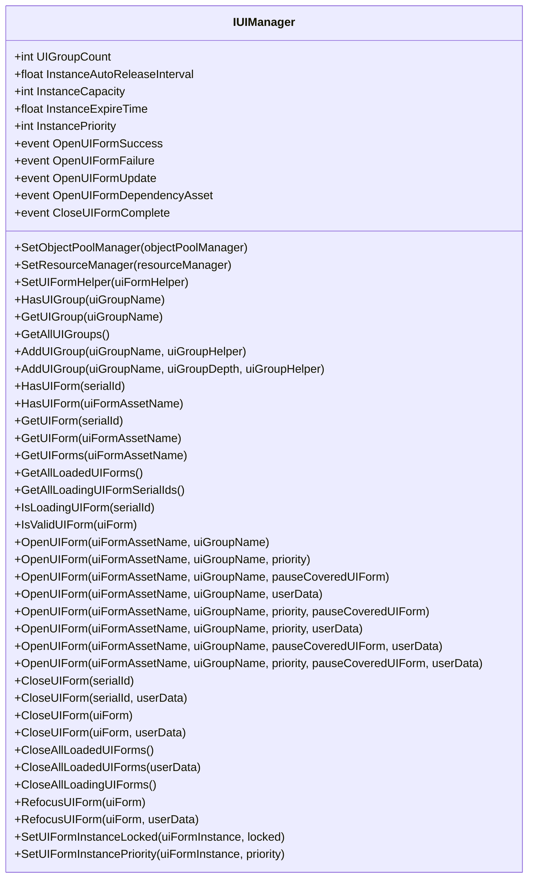

**Diagram sources**
- [IUIManager.cs](file://GameFramework/UI/IUIManager.cs#L17-L380)

**Section sources**
- [IUIManager.cs](file://GameFramework/UI/IUIManager.cs#L17-L380)

### IUIForm

`IUIForm`接口定义了单个UI界面的属性和生命周期方法。每个UI界面实例都必须实现此接口，以便被UI管理器统一管理。

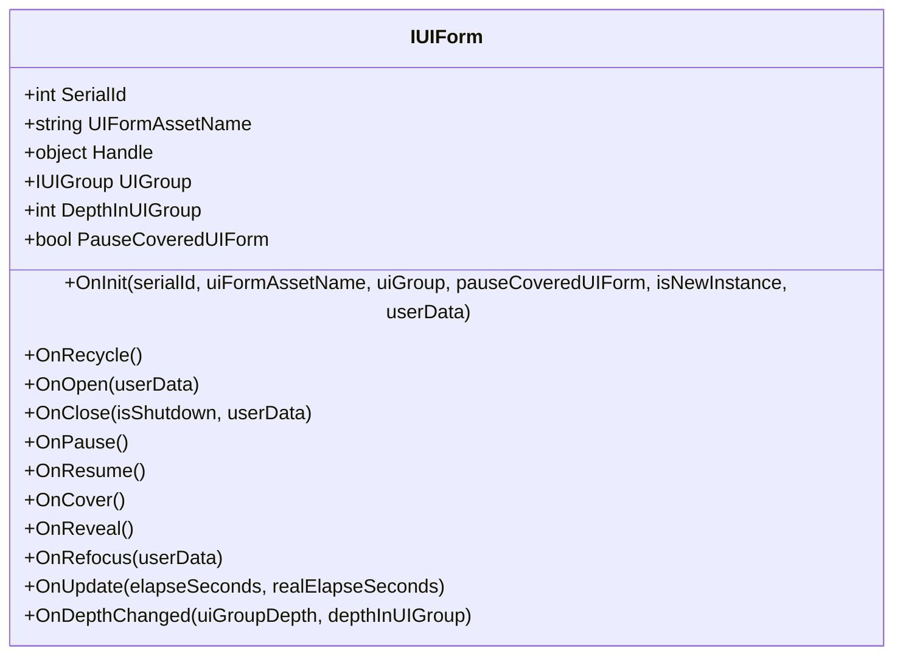

**Diagram sources**
- [IUIForm.cs](file://GameFramework/UI/IUIForm.cs#L12-L130)

**Section sources**
- [IUIForm.cs](file://GameFramework/UI/IUIForm.cs#L12-L130)

### IUIGroup

`IUIGroup`接口定义了UI组的属性和操作方法。UI组用于对界面进行分组管理，实现层级渲染和逻辑隔离。

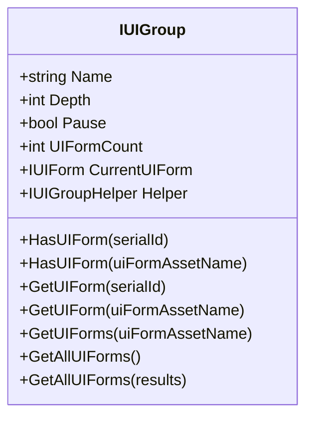

**Diagram sources**
- [IUIGroup.cs](file://GameFramework/UI/IUIGroup.cs#L14-L119)

**Section sources**
- [IUIGroup.cs](file://GameFramework/UI/IUIGroup.cs#L14-L119)

### OpenUIFormSuccessEventArgs

`OpenUIFormSuccessEventArgs`是打开界面成功事件的数据载体，包含打开成功的界面实例、加载耗时和用户自定义数据。

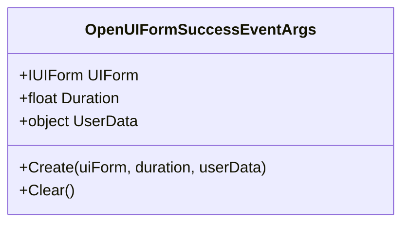

**Diagram sources**
- [OpenUIFormSuccessEventArgs.cs](file://GameFramework/UI/OpenUIFormSuccessEventArgs.cs#L12-L76)

**Section sources**
- [OpenUIFormSuccessEventArgs.cs](file://GameFramework/UI/OpenUIFormSuccessEventArgs.cs#L12-L76)

## 打开界面流程

### 异步加载流程

打开界面是一个异步过程，涉及资源加载、实例化和初始化等多个步骤。系统通过事件回调机制通知外部流程状态。

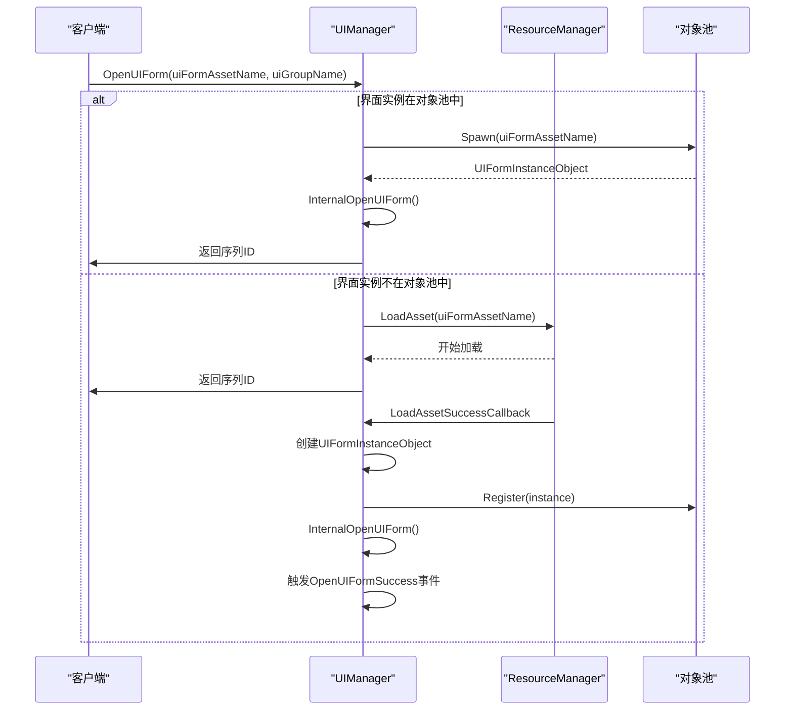

**Diagram sources**
- [UIManager.cs](file://GameFramework/UI/UIManager.cs#L722-L763)
- [UIManager.cs](file://GameFramework/UI/UIManager.cs#L975-L997)
- [UIManager.cs](file://GameFramework/UI/UIManager.cs#L939-L973)

**Section sources**
- [UIManager.cs](file://GameFramework/UI/UIManager.cs#L722-L763)
- [UIManager.cs](file://GameFramework/UI/UIManager.cs#L975-L997)
- [UIManager.cs](file://GameFramework/UI/UIManager.cs#L939-L973)

### 资源依赖处理

在加载界面资源时，系统会处理其依赖的其他资源。当依赖资源开始加载时，会触发`OpenUIFormDependencyAsset`事件。

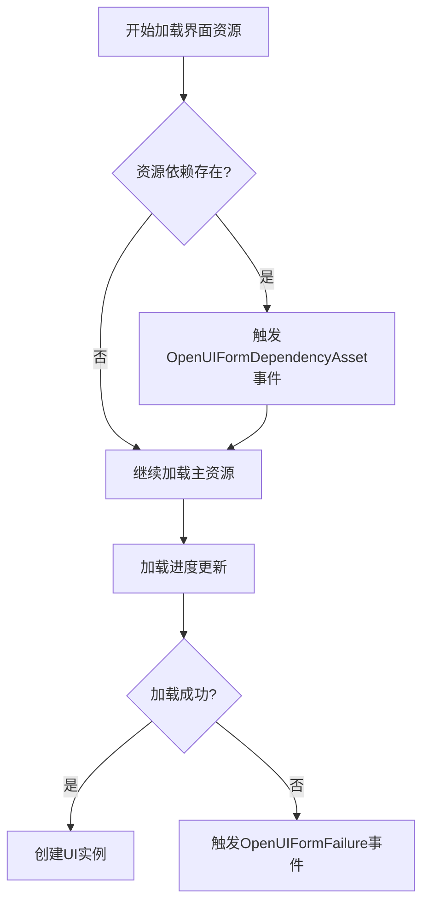

**Diagram sources**
- [UIManager.cs](file://GameFramework/UI/UIManager.cs#L975-L997)
- [UIManager.cs](file://GameFramework/UI/UIManager.cs#L1026-L1040)

**Section sources**
- [UIManager.cs](file://GameFramework/UI/UIManager.cs#L975-L997)
- [UIManager.cs](file://GameFramework/UI/UIManager.cs#L1026-L1040)

### 回调机制

系统提供了丰富的事件回调，允许外部代码响应界面状态变化：

- `OpenUIFormSuccess`: 界面成功打开
- `OpenUIFormFailure`: 界面打开失败
- `OpenUIFormUpdate`: 界面加载进度更新
- `OpenUIFormDependencyAsset`: 开始加载依赖资源

这些事件通过`EventHandler<T>`委托实现，确保了松耦合的设计。

**Section sources**
- [IUIManager.cs](file://GameFramework/UI/IUIManager.cs#L45-L75)

## 关闭界面流程

### 关闭流程

关闭界面涉及从UI组中移除、状态通知和对象回收等多个步骤。

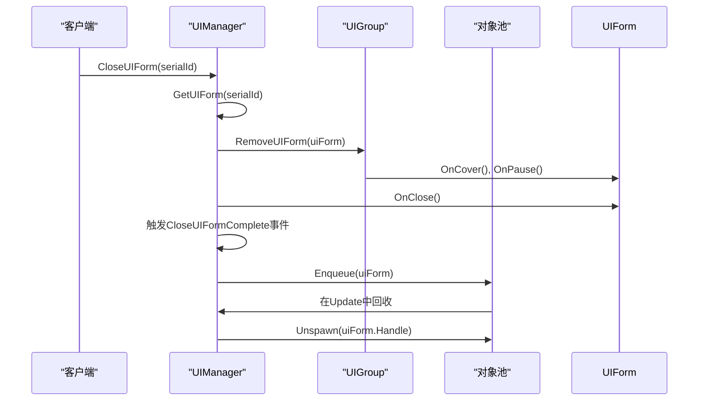

**Diagram sources**
- [UIManager.cs](file://GameFramework/UI/UIManager.cs#L779-L836)
- [UIManager.cs](file://GameFramework/UI/UIManager.cs#L100-L115)

**Section sources**
- [UIManager.cs](file://GameFramework/UI/UIManager.cs#L779-L836)
- [UIManager.cs](file://GameFramework/UI/UIManager.cs#L100-L115)

### 内存释放

系统采用延迟回收机制，在`Update`方法中批量处理界面回收，避免在任意时刻中断游戏逻辑。

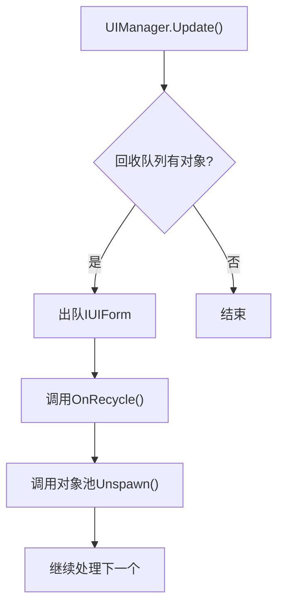

**Diagram sources**
- [UIManager.cs](file://GameFramework/UI/UIManager.cs#L100-L115)

**Section sources**
- [UIManager.cs](file://GameFramework/UI/UIManager.cs#L100-L115)

## UI层级与排序逻辑

### 层级结构

系统采用双层层级结构：UI组层级和组内界面层级。

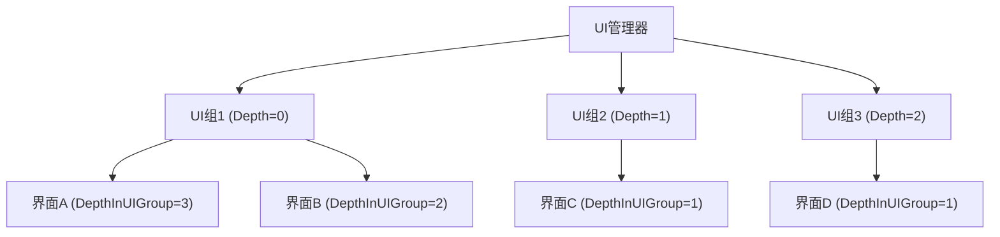

**Diagram sources**
- [UIManager.UIGroup.cs](file://GameFramework/UI/UIManager.UIGroup.cs#L119-L125)
- [IUIForm.cs](file://GameFramework/UI/IUIForm.cs#L25-L28)

**Section sources**
- [UIManager.UIGroup.cs](file://GameFramework/UI/UIManager.UIGroup.cs#L119-L125)
- [IUIForm.cs](file://GameFramework/UI/IUIForm.cs#L25-L28)

### 排序逻辑

界面排序通过`Refresh`方法实现，遵循以下规则：
1. 按UI组深度排序
2. 组内按添加顺序反向排序（后添加的在前）
3. 处理遮挡和暂停状态

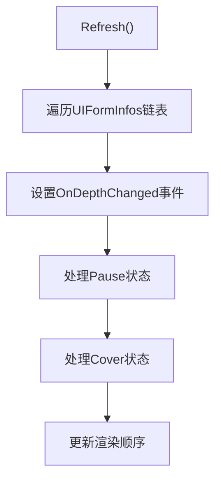

**Diagram sources**
- [UIManager.UIGroup.cs](file://GameFramework/UI/UIManager.UIGroup.cs#L437-L517)

**Section sources**
- [UIManager.UIGroup.cs](file://GameFramework/UI/UIManager.UIGroup.cs#L437-L517)

## UI资源管理与内存释放

### 对象池管理

系统使用对象池管理界面实例，减少GC压力。

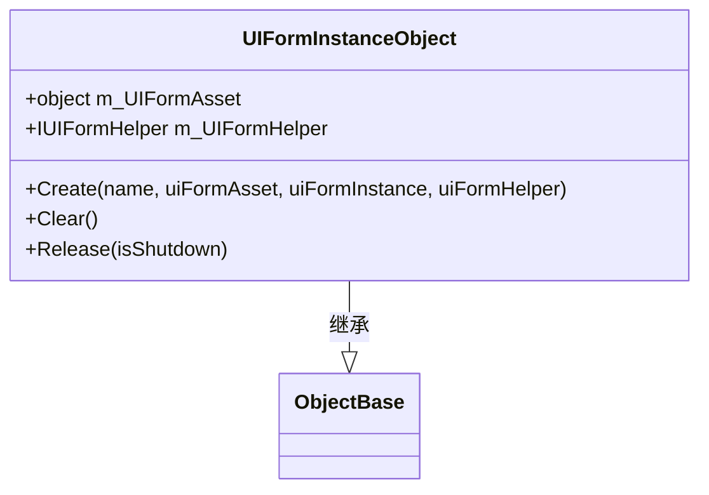

**Diagram sources**
- [UIManager.UIFormInstanceObject.cs](file://GameFramework/UI/UIManager.UIFormInstanceObject.cs#L17-L60)

**Section sources**
- [UIManager.UIFormInstanceObject.cs](file://GameFramework/UI/UIManager.UIFormInstanceObject.cs#L17-L60)

### 内存释放策略

- **延迟回收**: 在Update中批量回收，避免性能抖动
- **资源释放**: 通过`IUIFormHelper.ReleaseUIForm`释放底层资源
- **对象池注册**: 使用`m_InstancePool.Register`管理实例生命周期

**Section sources**
- [UIManager.UIFormInstanceObject.cs](file://GameFramework/UI/UIManager.UIFormInstanceObject.cs#L55-L60)
- [UIManager.cs](file://GameFramework/UI/UIManager.cs#L100-L115)

## UI组控制与性能优化

### UI组功能

UI组提供以下核心功能：
- **层级控制**: 通过`Depth`属性控制渲染顺序
- **批量操作**: 支持暂停、刷新整个组
- **逻辑隔离**: 不同组的界面互不影响

```mermaid
classDiagram
    class UIGroup {
        +string m_Name
        +int m_Depth
        +bool m_Pause
        +IUIGroupHelper m_UIGroupHelper
        +GameFrameworkLinkedList<UIFormInfo> m_UIFormInfos
        +Update(elapseSeconds, realElapseSeconds)
        +Refresh()
        +AddUIForm(uiForm)
        +RemoveUIForm(uiForm)
        +RefocusUIForm(uiForm, userData)
   