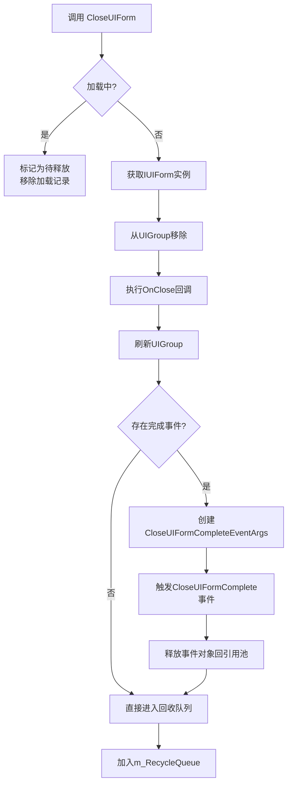
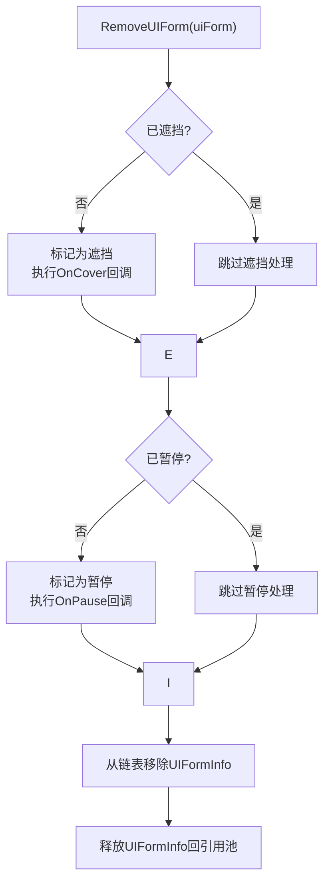
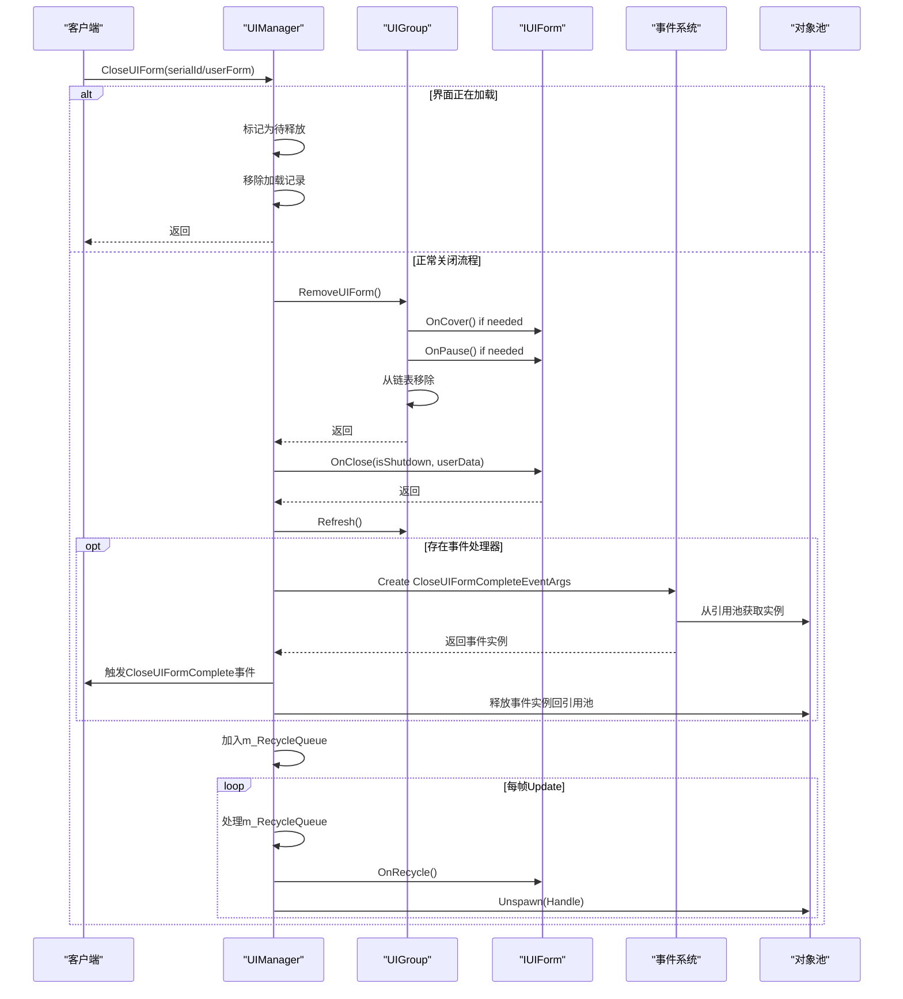

# UI关闭生命周期

<cite>
**Referenced Files in This Document**   
- [UIManager.cs](file://GameFramework/UI/UIManager.cs)
- [CloseUIFormCompleteEventArgs.cs](file://GameFramework/UI/CloseUIFormCompleteEventArgs.cs)
- [UIManager.UIGroup.cs](file://GameFramework/UI/UIManager.UIGroup.cs)
- [ReferencePool.cs](file://GameFramework/Base/ReferencePool/ReferencePool.cs)
</cite>

## 目录
1. [简介](#简介)
2. [核心执行流程](#核心执行流程)
3. [CloseUIForm方法调用方式](#closeuiform方法调用方式)
4. [资源回收机制](#资源回收机制)
5. [CloseUIFormComplete事件](#closeuiformcomplete事件)
6. [边界情况处理](#边界情况处理)
7. [完整执行时序图](#完整执行时序图)

## 简介

本文档全面解析Unity游戏框架中UI界面关闭的执行流程与资源回收机制。重点分析`CloseUIForm`方法的两种调用方式及其内部处理逻辑，详细说明界面状态检查、卸载任务调度与对象池归还的完整生命周期。同时解释`CloseUIFormComplete`事件的触发时机、参数构成以及用户数据传递机制，并讨论关闭过程中可能遇到的边界情况及其应对方案。

**Section sources**
- [UIManager.cs](file://GameFramework/UI/UIManager.cs#L769-L836)

## 核心执行流程

UI界面关闭的核心执行流程遵循严格的生命周期管理，确保界面状态正确转换、资源有序释放。整个流程从调用`CloseUIForm`方法开始，经过界面状态检查、组内移除、生命周期回调、事件通知，最终进入异步回收队列。

该流程的关键特点是将界面实例的销毁与资源释放解耦，通过`m_RecycleQueue`队列实现延迟回收，避免在单帧内执行大量资源卸载操作导致性能卡顿。同时，通过引用池机制管理事件对象，有效减少GC压力。



**Diagram sources**
- [UIManager.cs](file://GameFramework/UI/UIManager.cs#L779-L836)
- [UIManager.UIGroup.cs](file://GameFramework/UI/UIManager.UIGroup.cs#L339-L370)

**Section sources**
- [UIManager.cs](file://GameFramework/UI/UIManager.cs#L779-L836)
- [UIManager.UIGroup.cs](file://GameFramework/UI/UIManager.UIGroup.cs#L339-L370)

## CloseUIForm方法调用方式

### 通过serialId调用

第一种调用方式通过界面序列编号（serialId）来关闭界面。该方法首先检查界面是否正在加载中，如果是，则将其标记为待释放并移除加载记录，避免加载完成后错误地打开界面。

```csharp
public void CloseUIForm(int serialId)
{
    CloseUIForm(serialId, null);
}
```

当界面不在加载状态时，系统会通过`GetUIForm(serialId)`方法查找对应的`IUIForm`实例，若未找到则抛出异常。找到实例后，最终会委托给`CloseUIForm(IUIForm, object)`方法完成实际的关闭操作。

**Section sources**
- [UIManager.cs](file://GameFramework/UI/UIManager.cs#L769-L772)
- [UIManager.cs](file://GameFramework/UI/UIManager.cs#L779-L795)

### 通过IUIForm实例调用

第二种调用方式直接传入`IUIForm`实例进行关闭。这种方式更为直接，但需要确保传入的实例是有效的。

```csharp
public void CloseUIForm(IUIForm uiForm, object userData)
{
    if (uiForm == null)
    {
        throw new GameFrameworkException("UI form is invalid.");
    }

    UIGroup uiGroup = (UIGroup)uiForm.UIGroup;
    if (uiGroup == null)
    {
        throw new GameFrameworkException("UI group is invalid.");
    }
    // ...后续处理
}
```

该方法首先验证`IUIForm`实例和其所属的`UIGroup`的有效性，然后执行一系列清理操作。两种调用方式最终都会汇聚到同一个核心处理逻辑，确保行为一致性。

**Section sources**
- [UIManager.cs](file://GameFramework/UI/UIManager.cs#L801-L804)
- [UIManager.cs](file://GameFramework/UI/UIManager.cs#L811-L836)

## 资源回收机制

### 界面组内移除流程

在关闭界面时，首先会从其所属的`UIGroup`中移除。`RemoveUIForm`方法不仅从链表中删除界面信息，还会执行必要的状态转换：



**Diagram sources**
- [UIManager.UIGroup.cs](file://GameFramework/UI/UIManager.UIGroup.cs#L339-L370)

**Section sources**
- [UIManager.UIGroup.cs](file://GameFramework/UI/UIManager.UIGroup.cs#L339-L370)

### 异步回收队列

系统采用异步回收机制，通过`m_RecycleQueue`队列管理待回收的界面实例。在`Update`方法中，系统会逐个处理队列中的界面：

```csharp
internal override void Update(float elapseSeconds, float realElapseSeconds)
{
    while (m_RecycleQueue.Count > 0)
    {
        IUIForm uiForm = m_RecycleQueue.Dequeue();
        uiForm.OnRecycle();
        m_InstancePool.Unspawn(uiForm.Handle);
    }
    // ...其他更新逻辑
}
```

这种设计避免了在关闭界面时立即执行资源卸载可能带来的性能问题，将开销分散到多个帧中处理。

**Section sources**
- [UIManager.cs](file://GameFramework/UI/UIManager.cs#L210-L223)

### 对象池归还流程

最终，界面实例的句柄（Handle）会被归还到对象池中，供后续重用：

1. 调用`OnRecycle`生命周期方法，允许界面进行最后的清理工作
2. 通过`m_InstancePool.Unspawn(uiForm.Handle)`将实例归还对象池
3. 对象池负责管理实例的生命周期和内存

这种对象池模式有效减少了频繁创建和销毁UI对象带来的内存分配和垃圾回收压力。

**Section sources**
- [UIManager.cs](file://GameFramework/UI/UIManager.cs#L210-L223)
- [UIManager.cs](file://GameFramework/UI/UIManager.cs#L811-L836)

## CloseUIFormComplete事件

### 事件触发时机

`CloseUIFormComplete`事件在界面关闭流程的最后阶段触发，具体时机如下：

1. 界面已从`UIGroup`中成功移除
2. `OnClose`生命周期回调已执行完毕
3. `UIGroup`已完成刷新
4. 所有前置条件满足且存在事件处理器

```csharp
if (m_CloseUIFormCompleteEventHandler != null)
{
    CloseUIFormCompleteEventArgs closeUIFormCompleteEventArgs = CloseUIFormCompleteEventArgs.Create(uiForm.SerialId, uiForm.UIFormAssetName, uiGroup, userData);
    m_CloseUIFormCompleteEventHandler(this, closeUIFormCompleteEventArgs);
    ReferencePool.Release(closeUIFormCompleteEventArgs);
}
```

### 事件参数构成

`CloseUIFormCompleteEventArgs`事件参数包含以下关键信息：

| 参数名称 | 类型 | 说明 |
|---------|------|------|
| SerialId | int | 界面的唯一序列编号 |
| UIFormAssetName | string | 界面资源的名称 |
| UIGroup | IUIGroup | 界面所属的界面组 |
| UserData | object | 用户自定义数据 |

这些参数为事件监听者提供了完整的上下文信息，可用于更新UI状态、记录日志或执行后续操作。

**Section sources**
- [CloseUIFormCompleteEventArgs.cs](file://GameFramework/UI/CloseUIFormCompleteEventArgs.cs#L12-L89)
- [UIManager.cs](file://GameFramework/UI/UIManager.cs#L811-L836)

### userData传递作用

`userData`参数在关闭流程中贯穿始终，从`CloseUIForm`调用开始，经过事件传递，最终到达事件处理器。这使得开发者可以在关闭界面时传递上下文信息，例如：

- 关闭原因（用户操作、超时、系统关闭等）
- 需要保存的数据
- 后续导航目标
- 动画参数

```csharp
// 示例：传递关闭原因
CloseUIForm(form, new CloseReason { Type = CloseType.UserAction });
```

在事件处理器中，可以读取这些数据并执行相应的逻辑。

**Section sources**
- [CloseUIFormCompleteEventArgs.cs](file://GameFramework/UI/CloseUIFormCompleteEventArgs.cs#L12-L89)
- [UIManager.cs](file://GameFramework/UI/UIManager.cs#L811-L836)

## 边界情况处理

### 重复关闭处理

系统通过`UIGroup.RemoveUIForm`方法中的检查机制防止重复关闭同一界面：

```csharp
if (!m_UIFormInfos.Remove(uiFormInfo))
{
    throw new GameFrameworkException(Utility.Text.Format("UI group '{0}' not exists specified UI form '[{1}]{2}'.", m_Name, uiForm.SerialId, uiForm.UIFormAssetName));
}
```

如果尝试移除一个不存在的界面，系统会抛出异常，提醒开发者检查逻辑错误。

### 异步卸载延迟

由于采用异步回收机制，从调用`CloseUIForm`到实际销毁界面实例存在时间差。开发者需要注意：

1. 界面实例在`OnClose`后仍然存在，直到`Update`周期处理
2. 不应在`OnClose`后立即假设资源已被释放
3. 可以通过监听`CloseUIFormComplete`事件来确定关闭完成

### 加载中界面处理

对于正在加载的界面，系统采用特殊处理策略：

```csharp
if (IsLoadingUIForm(serialId))
{
    m_UIFormsToReleaseOnLoad.Add(serialId);
    m_UIFormsBeingLoaded.Remove(serialId);
    return;
}
```

这种设计确保了即使在加载过程中调用关闭，也不会导致界面错误地显示出来，而是直接标记为待释放。

**Section sources**
- [UIManager.cs](file://GameFramework/UI/UIManager.cs#L779-L795)
- [UIManager.UIGroup.cs](file://GameFramework/UI/UIManager.UIGroup.cs#L339-L370)

## 完整执行时序图



**Diagram sources**
- [UIManager.cs](file://GameFramework/UI/UIManager.cs#L769-L836)
- [UIManager.UIGroup.cs](file://GameFramework/UI/UIManager.UIGroup.cs#L339-L370)
- [CloseUIFormCompleteEventArgs.cs](file://GameFramework/UI/CloseUIFormCompleteEventArgs.cs#L12-L89)
- [ReferencePool.cs](file://GameFramework/Base/ReferencePool/ReferencePool.cs#L1-L226)