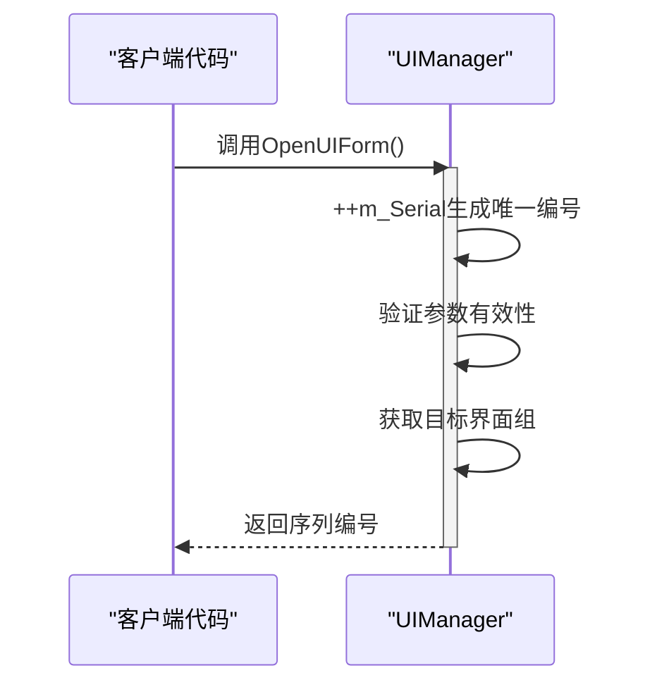
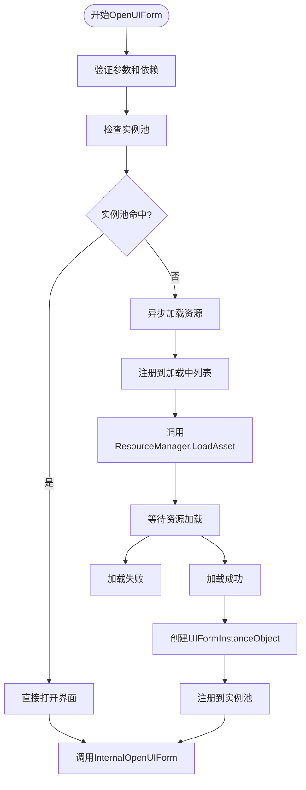
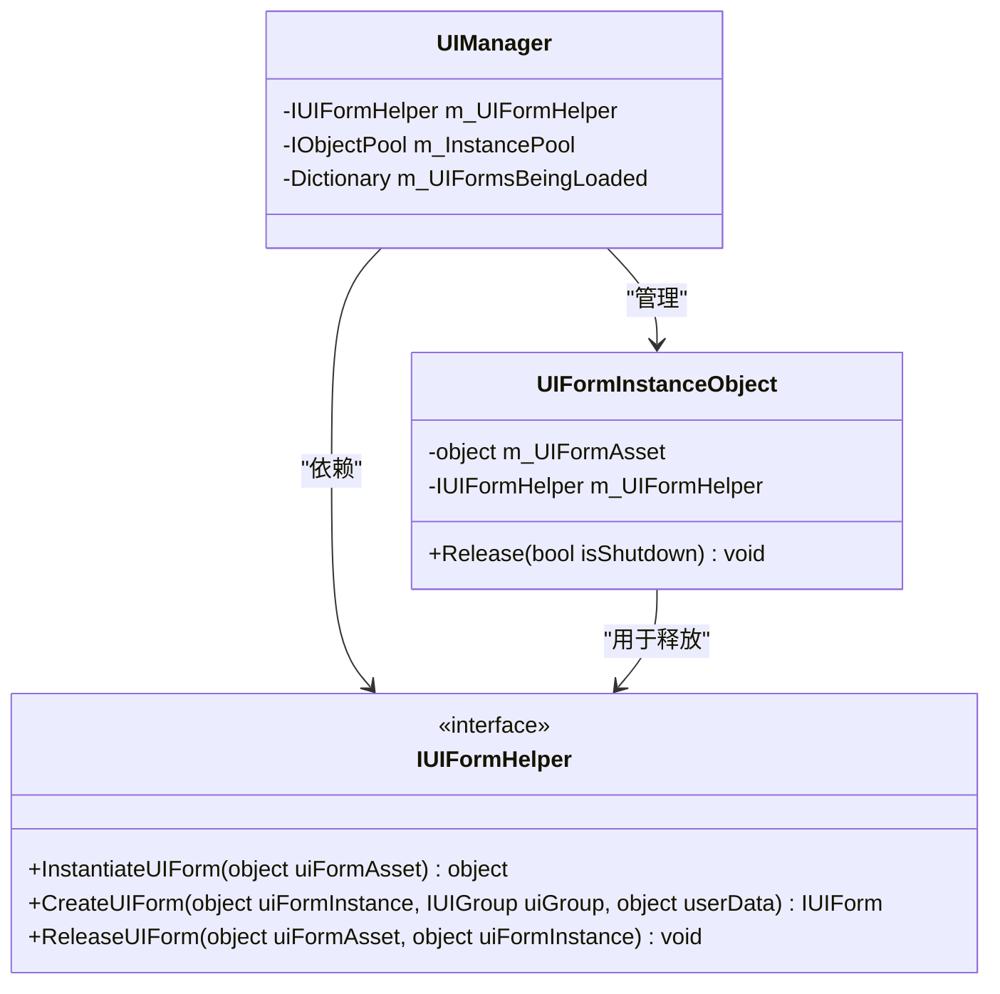
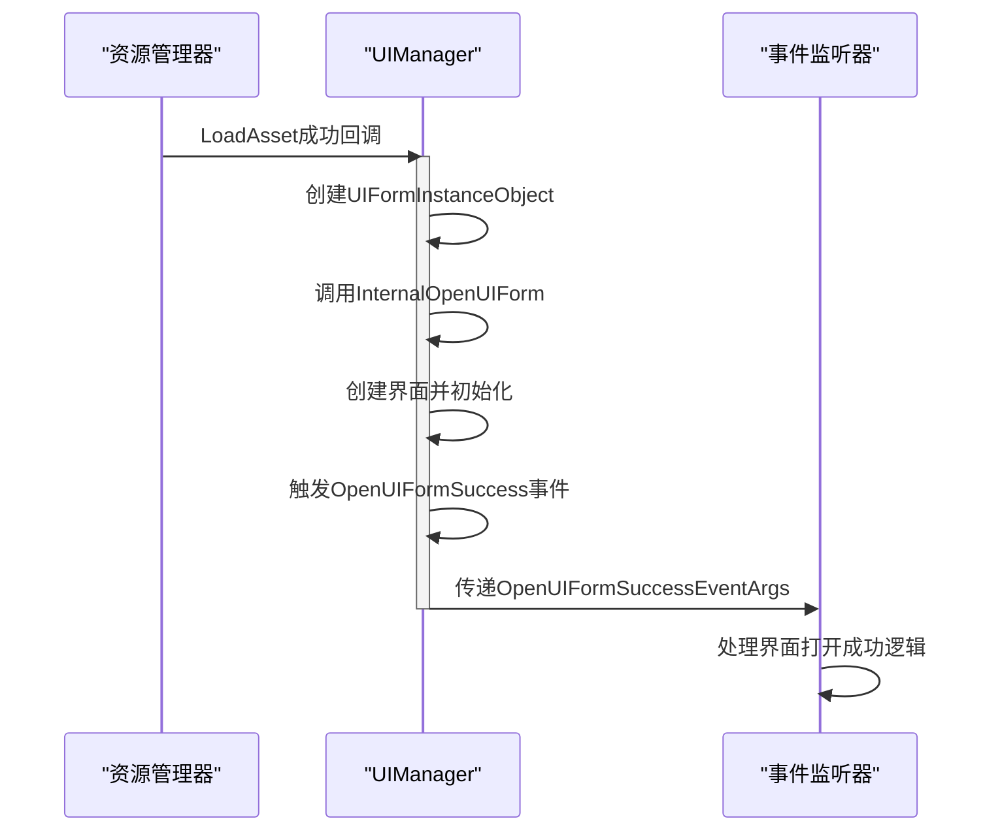
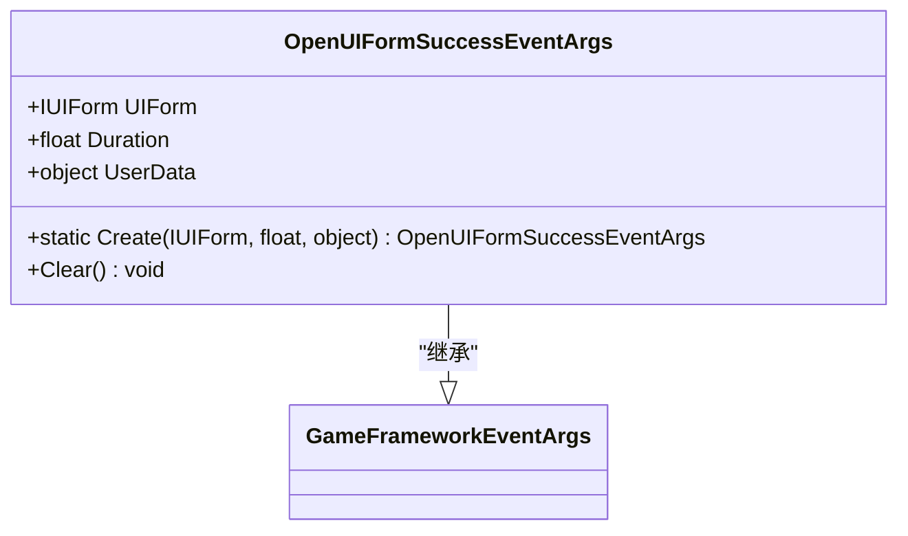
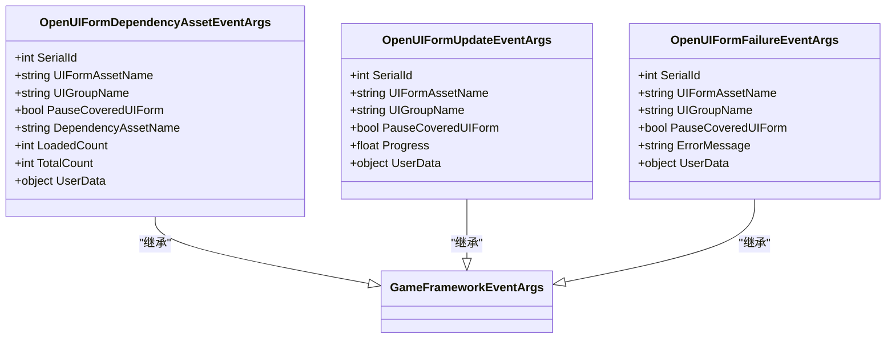
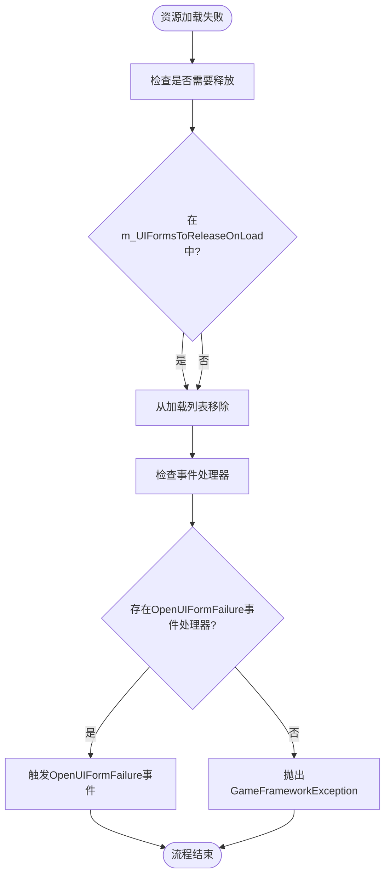

<cite>
**本文档引用的文件**
- [UIManager.cs](file://GameFramework/UI/UIManager.cs)
- [OpenUIFormSuccessEventArgs.cs](file://GameFramework/UI/OpenUIFormSuccessEventArgs.cs)
- [OpenUIFormFailureEventArgs.cs](file://GameFramework/UI/OpenUIFormFailureEventArgs.cs)
- [OpenUIFormUpdateEventArgs.cs](file://GameFramework/UI/OpenUIFormUpdateEventArgs.cs)
- [OpenUIFormDependencyAssetEventArgs.cs](file://GameFramework/UI/OpenUIFormDependencyAssetEventArgs.cs)
- [IUIFormHelper.cs](file://GameFramework/UI/IUIFormHelper.cs)
</cite>

# UI打开生命周期

## 目录
1. [调用入口与参数解析](#调用入口与参数解析)
2. [序列编号与界面组处理](#序列编号与界面组处理)
3. [资源加载与实例化流程](#资源加载与实例化流程)
4. [事件系统与回调机制](#事件系统与回调机制)
5. [错误处理与异常传播](#错误处理与异常传播)
6. [最佳实践与使用示例](#最佳实践与使用示例)

## 调用入口与参数解析

UI界面打开流程始于`UIManager`提供的多个`OpenUIForm`重载方法。这些方法提供了灵活的参数组合，允许开发者根据具体需求选择合适的调用方式。

系统提供了七种重载方法，覆盖了不同的参数组合场景：
- 基础调用：仅需界面资源名称和界面组名称
- 优先级控制：可指定资源加载优先级
- 覆盖行为控制：通过`pauseCoveredUIForm`参数控制被覆盖界面的行为
- 上下文传递：支持通过`userData`参数传递用户自定义数据

所有重载方法最终都会调用统一的主方法`OpenUIForm(string uiFormAssetName, string uiGroupName, int priority, bool pauseCoveredUIForm, object userData)`，实现了参数的标准化处理。

**Section sources**
- [UIManager.cs](file://GameFramework/UI/UIManager.cs#L633-L763)

## 序列编号与界面组处理

### 序列编号生成机制

每次调用`OpenUIForm`时，系统会自动生成唯一的序列编号（serialId），该编号通过递增`m_Serial`字段获得。此编号在整个UI生命周期中作为界面的唯一标识，用于事件回调、状态追踪和界面管理。



**Diagram sources**
- [UIManager.cs](file://GameFramework/UI/UIManager.cs#L722-L763)

### 界面组优先级与行为控制

界面组（UIGroup）在UI管理中扮演着重要角色。系统首先通过`GetUIGroup(uiGroupName)`获取目标界面组，若不存在则抛出异常。

`pauseCoveredUIForm`参数决定了新界面打开时对已存在界面的处理策略：
- 当值为`true`时，被新界面覆盖的现有界面将被暂停
- 当值为`false`时，被覆盖的界面保持运行状态

这种机制允许开发者根据UI层级关系和性能需求，灵活控制界面的生命周期行为。

**Section sources**
- [UIManager.cs](file://GameFramework/UI/UIManager.cs#L722-L763)

## 资源加载与实例化流程

### 双路径加载机制

系统采用智能的双路径加载机制，根据界面实例是否已在对象池中存在来决定处理流程：



**Diagram sources**
- [UIManager.cs](file://GameFramework/UI/UIManager.cs#L722-L763)
- [UIManager.cs](file://GameFramework/UI/UIManager.cs#L975-L997)

### 依赖处理与实例化

当资源异步加载成功时，`LoadAssetSuccessCallback`会被触发。此回调负责：
1. 从加载列表中移除该界面
2. 通过`IUIFormHelper.InstantiateUIForm`实例化界面对象
3. 创建`UIFormInstanceObject`并注册到对象池
4. 调用`InternalOpenUIForm`完成最终的界面打开流程

`IUIFormHelper`接口定义了三个核心方法，构成了UI实例化的完整生命周期：
- `InstantiateUIForm`: 负责将资源实例化为GameObject
- `CreateUIForm`: 将实例对象包装为`IUIForm`接口
- `ReleaseUIForm`: 负责资源释放



**Diagram sources**
- [IUIFormHelper.cs](file://GameFramework/UI/IUIFormHelper.cs#L12-L36)
- [UIManager.cs](file://GameFramework/UI/UIManager.cs#L975-L997)
- [UIManager.cs](file://GameFramework/UI/UIManager.UIFormInstanceObject.cs#L16-L57)

## 事件系统与回调机制

### OpenUIFormSuccess事件

当界面成功打开后，系统会触发`OpenUIFormSuccess`事件。该事件通过`OpenUIFormSuccessEventArgs`类传递相关信息：



**Diagram sources**
- [UIManager.cs](file://GameFramework/UI/UIManager.cs#L975-L997)
- [UIManager.cs](file://GameFramework/UI/UIManager.cs#L939-L973)

### 事件数据结构

`OpenUIFormSuccessEventArgs`类包含以下关键信息：
- `UIForm`: 指向成功打开的界面实例
- `Duration`: 资源加载耗时
- `UserData`: 调用时传递的用户自定义数据



**Diagram sources**
- [OpenUIFormSuccessEventArgs.cs](file://GameFramework/UI/OpenUIFormSuccessEventArgs.cs#L12-L76)

### 其他相关事件

系统还提供了完整的事件体系，用于监控UI打开过程的各个阶段：



**Diagram sources**
- [OpenUIFormDependencyAssetEventArgs.cs](file://GameFramework/UI/OpenUIFormDependencyAssetEventArgs.cs#L12-L141)
- [OpenUIFormUpdateEventArgs.cs](file://GameFramework/UI/OpenUIFormUpdateEventArgs.cs#L12-L115)
- [OpenUIFormFailureEventArgs.cs](file://GameFramework/UI/OpenUIFormFailureEventArgs.cs#L12-L115)

## 错误处理与异常传播

### 加载失败处理

当资源加载失败时，`LoadAssetFailureCallback`会被调用，系统会执行以下流程：



**Diagram sources**
- [UIManager.cs](file://GameFramework/UI/UIManager.cs#L999-L1024)

### 异常处理策略

系统采用分层的异常处理策略：
1. **内部捕获**: `InternalOpenUIForm`方法内部捕获所有异常
2. **事件传播**: 若存在失败事件处理器，则通过事件传播错误信息
3. **重新抛出**: 若无事件处理器，则重新抛出异常，由上层处理

这种策略既保证了系统的稳定性，又提供了灵活的错误处理机制。

**Section sources**
- [UIManager.cs](file://GameFramework/UI/UIManager.cs#L939-L973)
- [UIManager.cs](file://GameFramework/UI/UIManager.cs#L999-L1024)

## 最佳实践与使用示例

### userData传递与使用

通过`userData`参数，可以在UI打开过程中传递上下文数据。在事件回调中安全访问UI组件的最佳实践如下：

```csharp
// 注册事件监听
UIEvent.OpenUIFormSuccess += OnOpenUIFormSuccess;

// 打开界面时传递数据
object userData = new { PlayerId = 123, Level = 5 };
UIManager.OpenUIForm("MainMenu", "UI", userData);

// 事件回调中安全访问
private void OnOpenUIFormSuccess(object sender, OpenUIFormSuccessEventArgs e)
{
    // 安全检查
    if (e.UIForm != null && e.UserData != null)
    {
        var context = e.UserData as dynamic;
        // 使用传递的数据初始化界面
        InitializeUI(e.UIForm, context.PlayerId, context.Level);
    }
}
```

### 资源管理最佳实践

1. **及时释放**: 对于临时界面，使用后应及时关闭以释放资源
2. **合理使用对象池**: 频繁打开关闭的界面应充分利用对象池机制
3. **错误处理**: 始终监听`OpenUIFormFailure`事件，处理可能的加载失败情况
4. **内存监控**: 关注`m_InstancePool`的状态，避免内存泄漏

**Section sources**
- [UIManager.cs](file://GameFramework/UI/UIManager.cs#L722-L763)
- [OpenUIFormSuccessEventArgs.cs](file://GameFramework/UI/OpenUIFormSuccessEventArgs.cs#L12-L76)