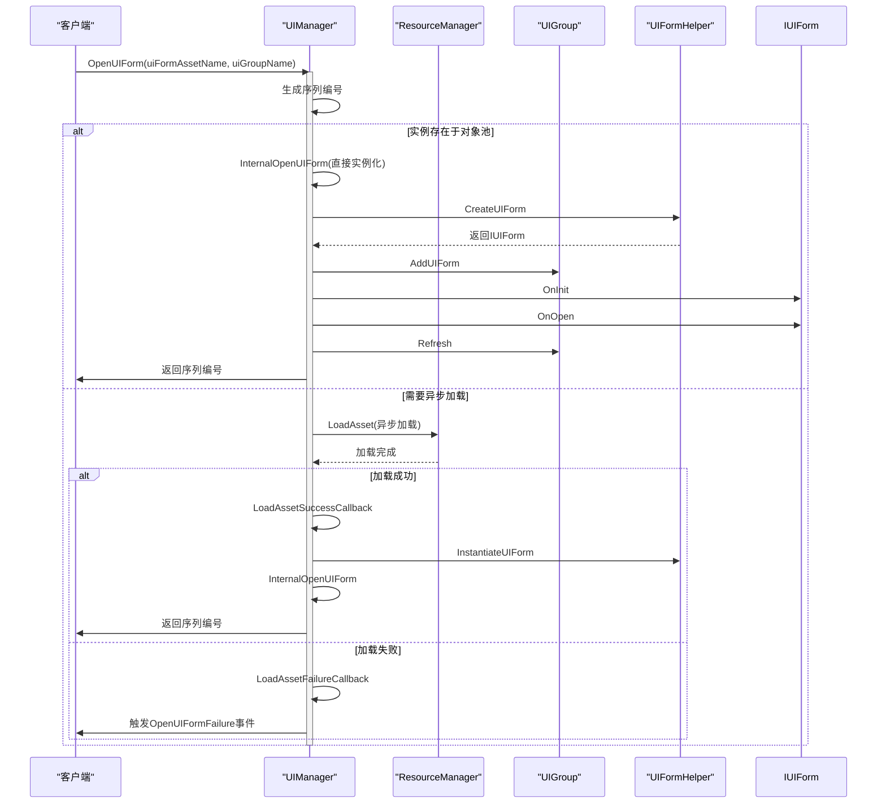
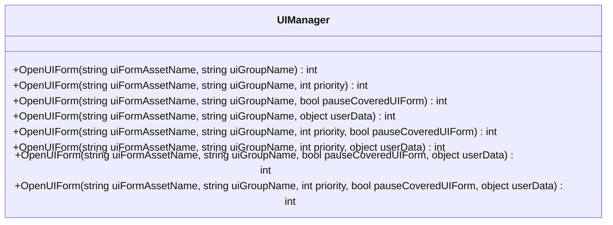
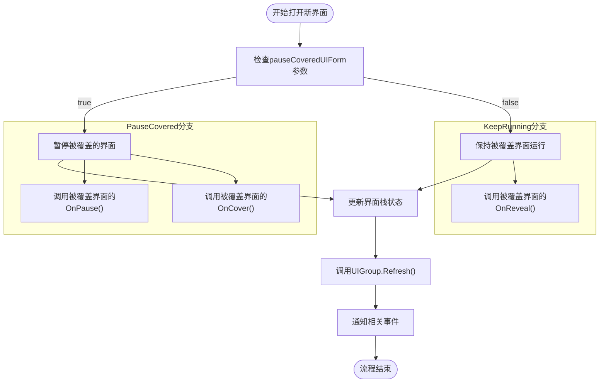
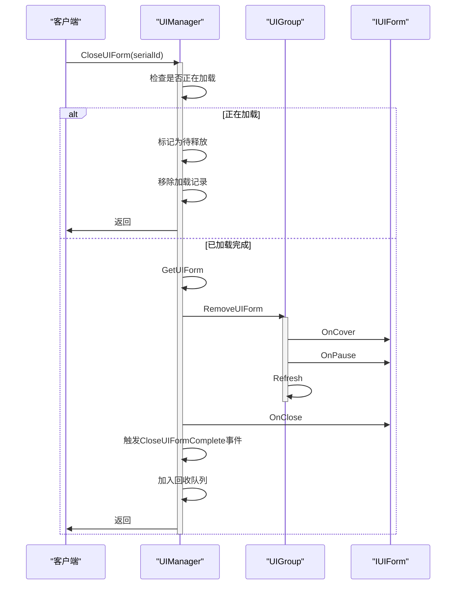
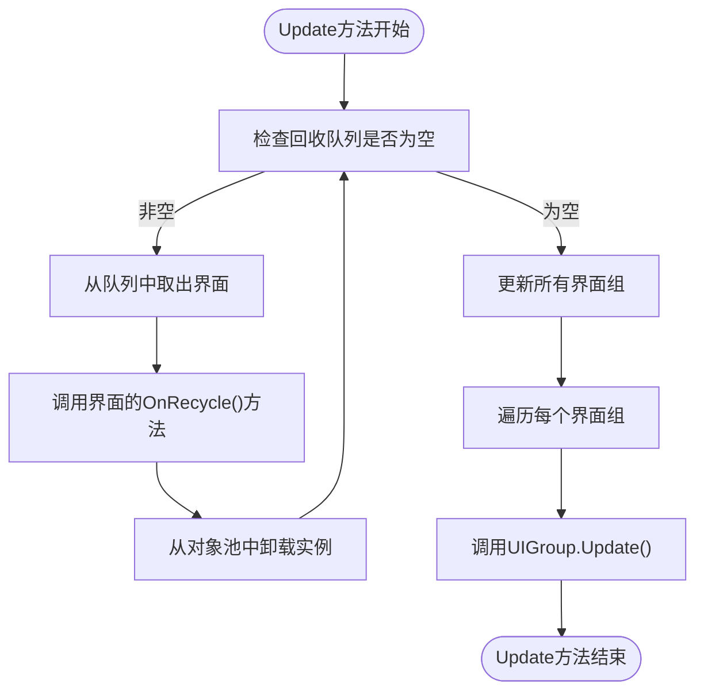
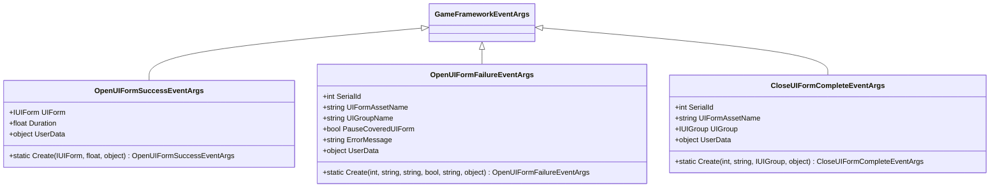
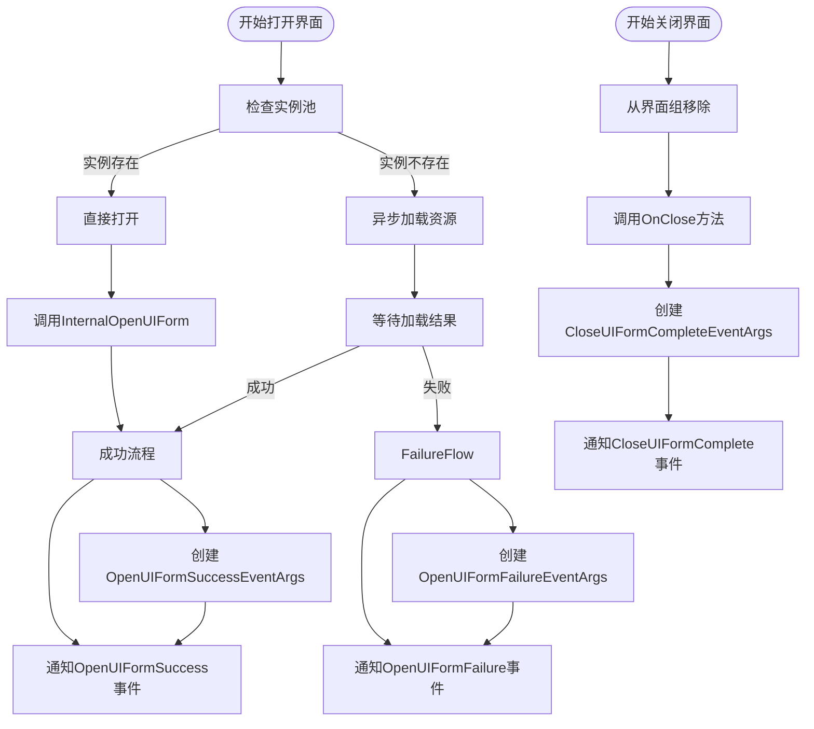
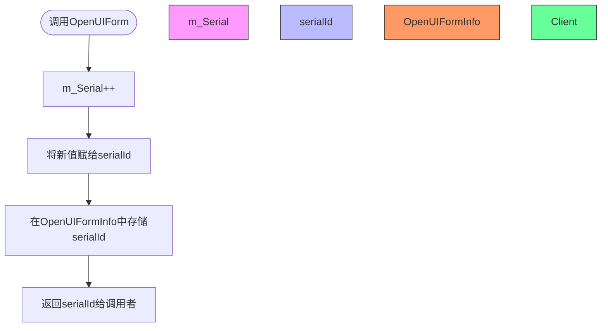
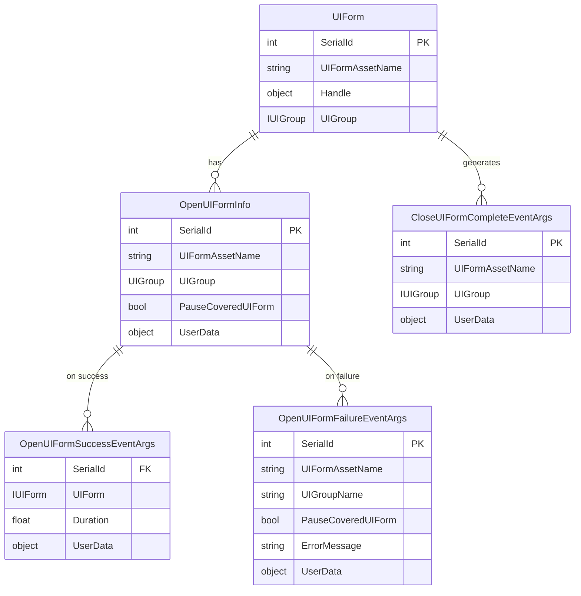
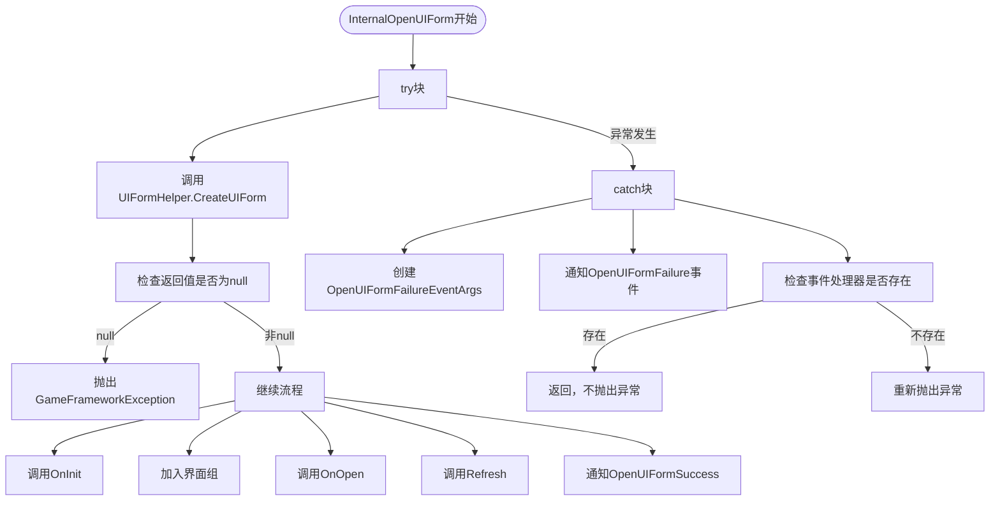

# UI生命周期管理

<cite>
**Referenced Files in This Document**   
- [UIManager.cs](file://GameFramework/UI/UIManager.cs)
- [OpenUIFormSuccessEventArgs.cs](file://GameFramework/UI/OpenUIFormSuccessEventArgs.cs)
- [OpenUIFormFailureEventArgs.cs](file://GameFramework/UI/OpenUIFormFailureEventArgs.cs)
- [CloseUIFormCompleteEventArgs.cs](file://GameFramework/UI/CloseUIFormCompleteEventArgs.cs)
- [UIManager.UIGroup.cs](file://GameFramework/UI/UIManager.UIGroup.cs)
- [UIManager.UIFormInstanceObject.cs](file://GameFramework/UI/UIManager.UIFormInstanceObject.cs)
- [IUIForm.cs](file://GameFramework/UI/IUIForm.cs)
</cite>

## 目录
1. [简介](#简介)
2. [核心组件](#核心组件)
3. [UI打开流程](#ui打开流程)
4. [UI关闭流程](#ui关闭流程)
5. [事件系统](#事件系统)
6. [序列编号机制](#序列编号机制)
7. [异常处理](#异常处理)
8. [最佳实践](#最佳实践)

## 简介
UI生命周期管理是游戏框架中的核心功能之一，负责界面的创建、显示、隐藏和销毁等完整生命周期管理。本系统通过`UIManager`类实现，提供了`OpenUIForm`和`CloseUIForm`等核心方法，实现了从请求打开、资源加载、实例化到最终激活的完整流程，以及关闭时的回收策略与事件通知机制。

## 核心组件

UI生命周期管理涉及多个核心组件的协同工作：

- `UIManager`：核心管理器，负责协调整个UI生命周期
- `UIGroup`：界面组，管理一组具有相同优先级的界面
- `IUIForm`：界面接口，定义了所有UI界面必须实现的方法
- `UIFormInstanceObject`：界面实例对象，用于对象池管理
- 各类事件参数类：用于事件传递和通知

**Section sources**
- [UIManager.cs](file://GameFramework/UI/UIManager.cs#L20-L30)
- [IUIForm.cs](file://GameFramework/UI/IUIForm.cs#L10-L25)

## UI打开流程

### 打开流程概述
UI打开流程从调用`OpenUIForm`方法开始，经历资源加载、实例化、初始化、加入界面组到最终激活的完整过程。该流程支持同步和异步两种模式，当界面实例存在于对象池中时可直接使用，否则需要异步加载资源。

**Diagram sources**
- [UIManager.cs](file://GameFramework/UI/UIManager.cs#L722-L763)
- [UIManager.cs](file://GameFramework/UI/UIManager.cs#L975-L997)
- [UIManager.cs](file://GameFramework/UI/UIManager.cs#L999-L1024)

**Section sources**
- [UIManager.cs](file://GameFramework/UI/UIManager.cs#L722-L763)
- [UIManager.cs](file://GameFramework/UI/UIManager.cs#L975-L1024)

### 多态OpenUIForm方法
`OpenUIForm`方法提供了多个重载版本，以满足不同的使用场景：

所有重载方法最终都会调用最完整的八参数版本，其中：
- `uiFormAssetName`：界面资源名称
- `uiGroupName`：目标界面组名称
- `priority`：资源加载优先级
- `pauseCoveredUIForm`：是否暂停被覆盖的界面
- `userData`：用户自定义数据

**Diagram sources**
- [UIManager.cs](file://GameFramework/UI/UIManager.cs#L633-L722)

**Section sources**
- [UIManager.cs](file://GameFramework/UI/UIManager.cs#L633-L722)

### pauseCoveredUIForm参数的影响
`pauseCoveredUIForm`参数对界面栈的行为有重要影响：

当`pauseCoveredUIForm`为`true`时，新打开的界面会暂停其下方的所有界面，防止它们继续更新；为`false`时，被覆盖的界面将继续正常运行。

**Diagram sources**
- [UIManager.UIGroup.cs](file://GameFramework/UI/UIManager.UIGroup.cs#L400-L450)
- [IUIForm.cs](file://GameFramework/UI/IUIForm.cs#L80-L95)

**Section sources**
- [UIManager.UIGroup.cs](file://GameFramework/UI/UIManager.UIGroup.cs#L400-L450)
- [IUIForm.cs](file://GameFramework/UI/IUIForm.cs#L80-L95)

## UI关闭流程

### 关闭流程概述
UI关闭流程从调用`CloseUIForm`方法开始，经历从界面组移除、状态通知到最终回收的完整过程。系统提供了多种关闭方式，包括通过序列编号关闭和直接关闭界面实例。

**Diagram sources**
- [UIManager.cs](file://GameFramework/UI/UIManager.cs#L779-L836)
- [UIManager.UIGroup.cs](file://GameFramework/UI/UIManager.UIGroup.cs#L300-L350)

**Section sources**
- [UIManager.cs](file://GameFramework/UI/UIManager.cs#L779-L836)
- [UIManager.UIGroup.cs](file://GameFramework/UI/UIManager.UIGroup.cs#L300-L350)

### 回收策略
系统采用延迟回收策略，在`Update`方法中处理回收队列：

这种策略确保了回收操作不会阻塞主线程，同时保证了界面状态的正确清理。

**Diagram sources**
- [UIManager.cs](file://GameFramework/UI/UIManager.cs#L210-L223)
- [UIManager.UIFormInstanceObject.cs](file://GameFramework/UI/UIManager.UIFormInstanceObject.cs#L50-L60)

**Section sources**
- [UIManager.cs](file://GameFramework/UI/UIManager.cs#L210-L223)
- [UIManager.UIFormInstanceObject.cs](file://GameFramework/UI/UIManager.UIFormInstanceObject.cs#L50-L60)

## 事件系统

### 事件类型
UI管理系统提供了完整的事件通知机制，包括：

**Diagram sources**
- [OpenUIFormSuccessEventArgs.cs](file://GameFramework/UI/OpenUIFormSuccessEventArgs.cs#L12-L76)
- [OpenUIFormFailureEventArgs.cs](file://GameFramework/UI/OpenUIFormFailureEventArgs.cs#L12-L115)
- [CloseUIFormCompleteEventArgs.cs](file://GameFramework/UI/CloseUIFormCompleteEventArgs.cs#L12-L89)

**Section sources**
- [OpenUIFormSuccessEventArgs.cs](file://GameFramework/UI/OpenUIFormSuccessEventArgs.cs#L12-L76)
- [OpenUIFormFailureEventArgs.cs](file://GameFramework/UI/OpenUIFormFailureEventArgs.cs#L12-L115)
- [CloseUIFormCompleteEventArgs.cs](file://GameFramework/UI/CloseUIFormCompleteEventArgs.cs#L12-L89)

### 事件触发条件
不同事件的触发条件如下：

**Diagram sources**
- [UIManager.cs](file://GameFramework/UI/UIManager.cs#L939-L973)
- [UIManager.cs](file://GameFramework/UI/UIManager.cs#L975-L1024)
- [UIManager.cs](file://GameFramework/UI/UIManager.cs#L811-L836)

**Section sources**
- [UIManager.cs](file://GameFramework/UI/UIManager.cs#L939-L1024)
- [UIManager.cs](file://GameFramework/UI/UIManager.cs#L811-L836)

## 序列编号机制

### SerialId生成规则
序列编号（SerialId）是每个UI界面的唯一标识符，其生成规则如下：

每次调用`OpenUIForm`时，`m_Serial`字段都会自增1，并将新值作为界面的序列编号返回。这个编号在整个应用程序生命周期内保证唯一。

**Diagram sources**
- [UIManager.cs](file://GameFramework/UI/UIManager.cs#L745-L746)
- [UIManager.cs](file://GameFramework/UI/UIManager.cs#L28-L28)

**Section sources**
- [UIManager.cs](file://GameFramework/UI/UIManager.cs#L745-L746)
- [UIManager.cs](file://GameFramework/UI/UIManager.cs#L28-L28)

### 序列编号的用途
序列编号在UI管理系统中具有多种用途：

1. **唯一标识**：作为每个UI界面的唯一标识符
2. **状态跟踪**：用于跟踪界面的加载状态
3. **关闭控制**：通过序列编号关闭特定界面
4. **事件关联**：在事件参数中传递，用于关联特定界面

**Diagram sources**
- [UIManager.cs](file://GameFramework/UI/UIManager.cs#L745-L746)
- [OpenUIFormSuccessEventArgs.cs](file://GameFramework/UI/OpenUIFormSuccessEventArgs.cs#L12-L76)
- [OpenUIFormFailureEventArgs.cs](file://GameFramework/UI/OpenUIFormFailureEventArgs.cs#L12-L115)
- [CloseUIFormCompleteEventArgs.cs](file://GameFramework/UI/CloseUIFormCompleteEventArgs.cs#L12-L89)

**Section sources**
- [UIManager.cs](file://GameFramework/UI/UIManager.cs#L745-L746)
- [OpenUIFormSuccessEventArgs.cs](file://GameFramework/UI/OpenUIFormSuccessEventArgs.cs#L12-L76)
- [OpenUIFormFailureEventArgs.cs](file://GameFramework/UI/OpenUIFormFailureEventArgs.cs#L12-L115)
- [CloseUIFormCompleteEventArgs.cs](file://GameFramework/UI/CloseUIFormCompleteEventArgs.cs#L12-L89)

## 异常处理

### 异常处理机制
系统在关键操作中实现了完善的异常处理机制：

当在`InternalOpenUIForm`方法中发生异常时，系统会尝试通过`OpenUIFormFailure`事件通知调用者。只有当没有注册该事件的监听器时，才会将异常重新抛出。

**Diagram sources**
- [UIManager.cs](file://GameFramework/UI/UIManager.cs#L939-L973)

**Section sources**
- [UIManager.cs](file://GameFramework/UI/UIManager.cs