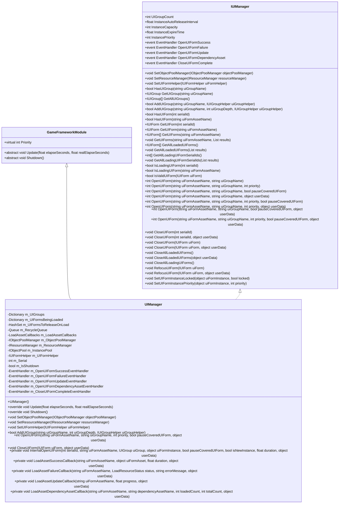
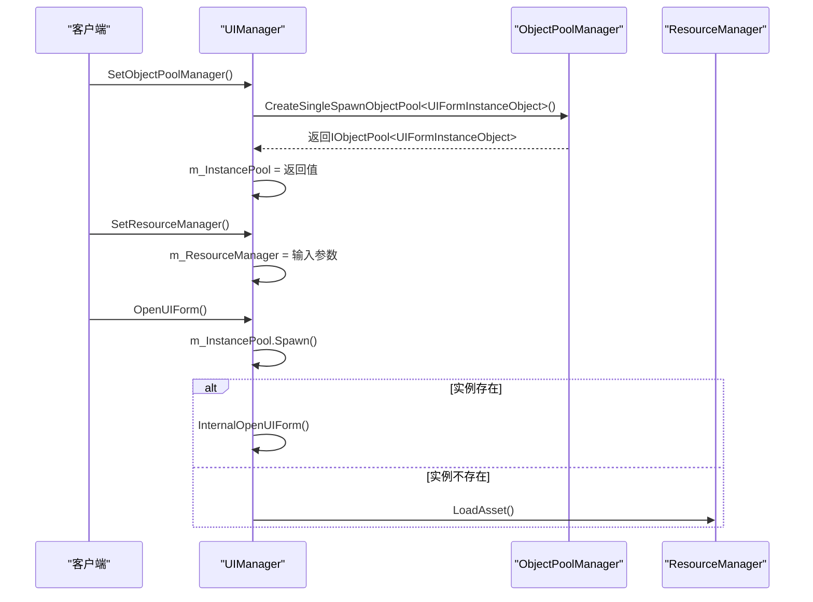
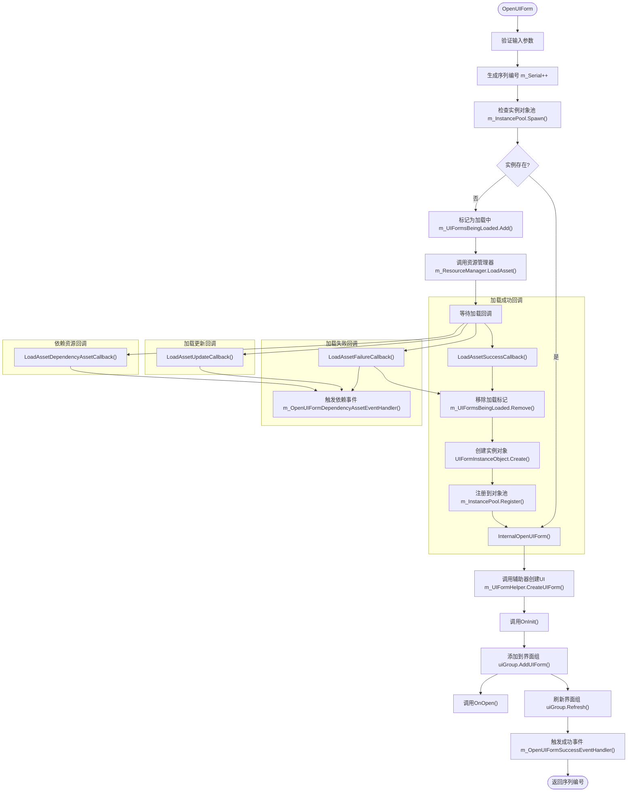
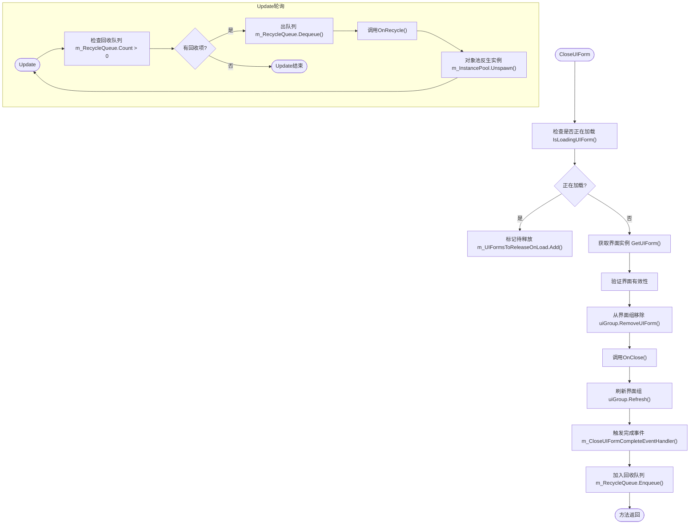
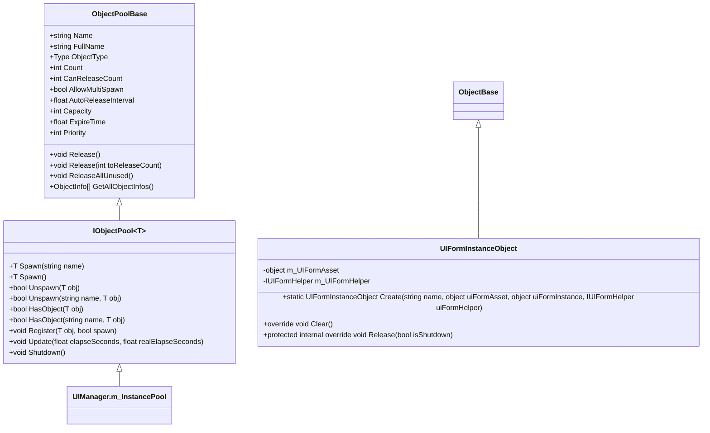
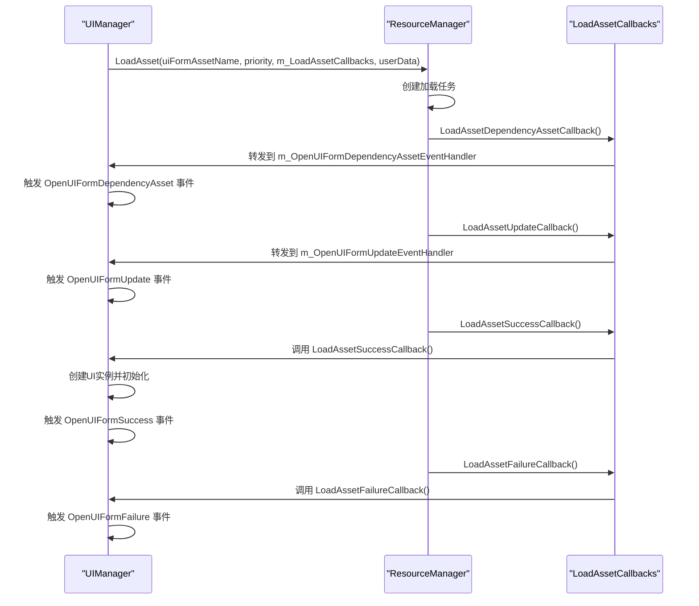

# UI管理核心系统

<cite>
**本文档中引用的文件**  
- [UIManager.cs](file://GameFramework/UI/UIManager.cs)
- [IUIManager.cs](file://GameFramework/UI/IUIManager.cs)
- [ObjectPoolManager.cs](file://GameFramework/ObjectPool/ObjectPoolManager.cs)
- [ResourceManager.cs](file://GameFramework/Resource/ResourceManager.cs)
- [LoadAssetCallbacks.cs](file://GameFramework/Resource/LoadAssetCallbacks.cs)
- [UIManager.UIFormInstanceObject.cs](file://GameFramework/UI/UIManager.UIFormInstanceObject.cs)
- [UIManager.OpenUIFormInfo.cs](file://GameFramework/UI/UIManager.OpenUIFormInfo.cs)
</cite>

## 目录
1. [简介](#简介)
2. [核心架构与模块继承](#核心架构与模块继承)
3. [对象池与资源管理集成](#对象池与资源管理集成)
4. [OpenUIForm完整生命周期](#openuiform完整生命周期)
5. [CloseUIForm回收机制](#closeuiform回收机制)
6. [UI实例对象池配置](#ui实例对象池配置)
7. [资源依赖加载与事件系统](#资源依赖加载与事件系统)
8. [初始化与关闭最佳实践](#初始化与关闭最佳实践)

## 简介
UI管理器（UIManager）是游戏框架中的核心模块之一，负责统一管理所有用户界面的生命周期。作为GameFrameworkModule的子类，UIManager通过与对象池管理器（ObjectPoolManager）和资源管理器（ResourceManager）深度集成，实现了高效的界面实例化、资源加载和内存回收机制。本文档详细阐述其核心架构、关键流程和配置参数，为开发者提供完整的系统级理解。

## 核心架构与模块继承
UIManager继承自GameFrameworkModule抽象类，遵循游戏框架的模块化设计原则。通过实现IUIManager接口，提供了标准化的UI管理功能。模块优先级机制确保UIManager在游戏框架中按正确顺序初始化和关闭。

**图示来源**  
- [UIManager.cs](file://GameFramework/UI/UIManager.cs#L39-L1024)
- [IUIManager.cs](file://GameFramework/UI/IUIManager.cs#L17-L380)
- [GameFrameworkModule.cs](file://GameFramework/Base/GameFrameworkModule.cs#L12-L37)

**本节来源**  
- [UIManager.cs](file://GameFramework/UI/UIManager.cs#L39-L1024)
- [IUIManager.cs](file://GameFramework/UI/IUIManager.cs#L17-L380)

## 对象池与资源管理集成
UIManager通过SetObjectPoolManager和SetResourceManager方法与对象池和资源系统建立连接。在SetObjectPoolManager调用时，会创建专门用于UI实例的单次获取对象池（UI Instance Pool），实现界面实例的高效复用。

**图示来源**  
- [UIManager.cs](file://GameFramework/UI/UIManager.cs#L83-L100)
- [ObjectPoolManager.cs](file://GameFramework/ObjectPool/ObjectPoolManager.cs#L384-L674)
- [ResourceManager.cs](file://GameFramework/Resource/ResourceManager.cs#L1462-L1627)

**本节来源**  
- [UIManager.cs](file://GameFramework/UI/UIManager.cs#L83-L100)
- [ObjectPoolManager.cs](file://GameFramework/ObjectPool/ObjectPoolManager.cs#L384-L674)

## OpenUIForm完整生命周期
OpenUIForm操作包含序列编号生成、资源异步加载、实例化和初始化等多个阶段。系统首先检查对象池中是否存在可用实例，若不存在则通过资源管理器异步加载资源。

**图示来源**  
- [UIManager.cs](file://GameFramework/UI/UIManager.cs#L722-L763)
- [UIManager.cs](file://GameFramework/UI/UIManager.cs#L975-L1024)
- [UIManager.cs](file://GameFramework/UI/UIManager.cs#L939-L973)

**本节来源**  
- [UIManager.cs](file://GameFramework/UI/UIManager.cs#L722-L763)
- [UIManager.cs](file://GameFramework/UI/UIManager.cs#L975-L1024)

## CloseUIForm回收机制
关闭界面时，系统会根据界面状态执行不同的回收策略。正在加载的界面会被标记为待释放，已加载的界面则进入回收队列，最终由对象池统一管理。

**图示来源**  
- [UIManager.cs](file://GameFramework/UI/UIManager.cs#L779-L836)
- [UIManager.cs](file://GameFramework/UI/UIManager.cs#L633-L763)
- [UIManager.cs](file://GameFramework/UI/UIManager.cs#L100-L115)

**本节来源**  
- [UIManager.cs](file://GameFramework/UI/UIManager.cs#L779-L836)

## UI实例对象池配置
UI实例对象池的配置参数直接影响内存性能和资源利用率。通过InstanceAutoReleaseInterval、InstanceCapacity等属性，开发者可以精细控制对象池行为。

| 配置属性 | 获取/设置方法 | 默认值 | 说明 |
|---------|-------------|-------|------|
| 自动释放间隔 | InstanceAutoReleaseInterval | 由ObjectPoolManager决定 | 控制对象池自动释放可释放对象的时间间隔（秒） |
| 对象池容量 | InstanceCapacity | int.MaxValue | 限制对象池中对象的最大数量 |
| 对象过期时间 | InstanceExpireTime | float.MaxValue | 设置对象在池中可存活的最长时间（秒） |
| 对象池优先级 | InstancePriority | 0 | 决定对象池在轮询时的优先级顺序 |

**图示来源**  
- [UIManager.cs](file://GameFramework/UI/UIManager.cs#L117-L149)
- [ObjectPoolBase.cs](file://GameFramework/ObjectPool/ObjectPoolBase.cs#L12-L152)
- [UIManager.UIFormInstanceObject.cs](file://GameFramework/UI/UIManager.UIFormInstanceObject.cs#L12-L60)

**本节来源**  
- [UIManager.cs](file://GameFramework/UI/UIManager.cs#L117-L149)

## 资源依赖加载与事件系统
UIManager通过LoadAssetCallbacks处理资源依赖加载，与ResourceManager深度集成。加载过程中的各个阶段都会触发相应的事件，实现完整的回调机制。

**图示来源**  
- [LoadAssetCallbacks.cs](file://GameFramework/Resource/LoadAssetCallbacks.cs#L12-L145)
- [UIManager.cs](file://GameFramework/UI/UIManager.cs#L975-L102