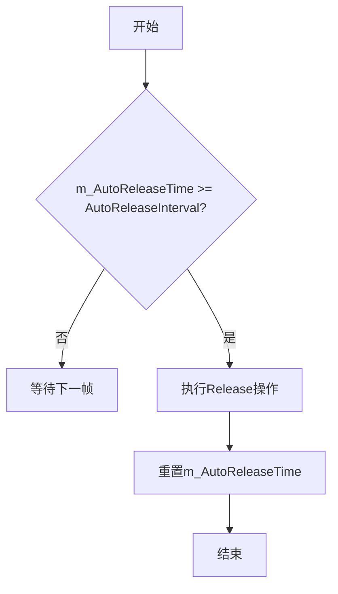
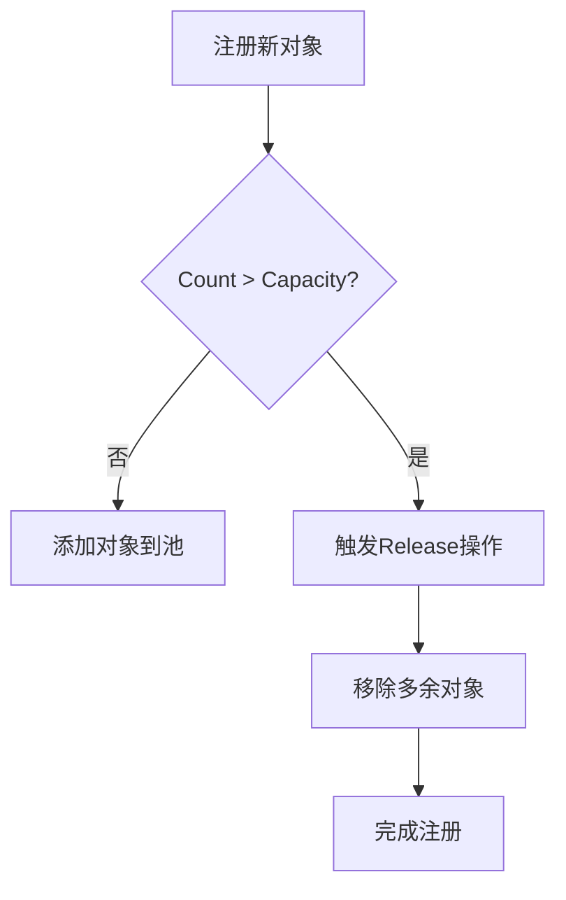
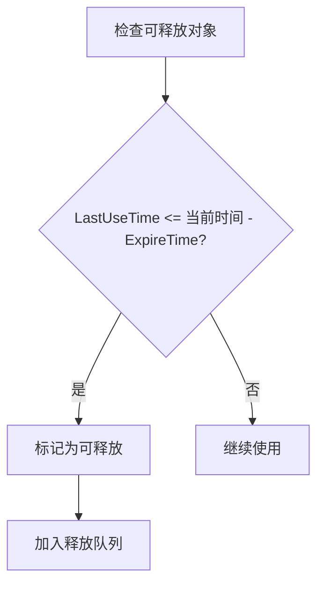
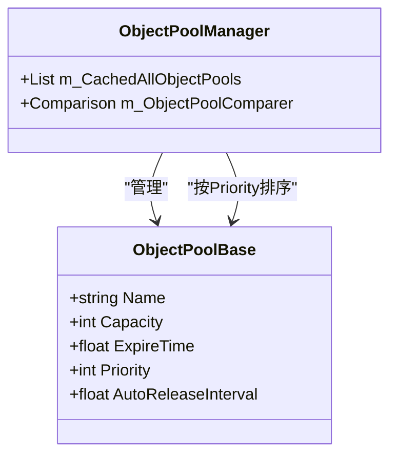
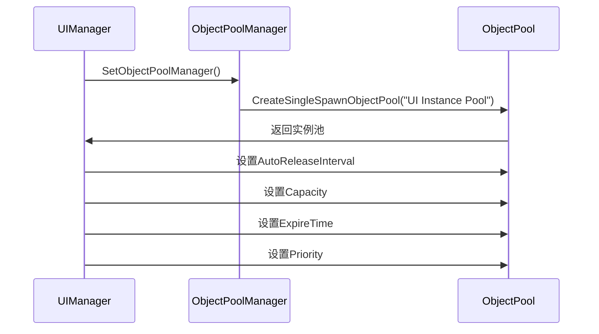

# 对象池配置参数

<cite>
**本文档中引用的文件**   
- [ObjectPoolBase.cs](file://GameFramework/ObjectPool/ObjectPoolBase.cs)
- [ObjectPoolManager.cs](file://GameFramework/ObjectPool/ObjectPoolManager.cs)
- [ObjectPoolManager.ObjectPool.cs](file://GameFramework/ObjectPool/ObjectPoolManager.ObjectPool.cs)
- [UIManager.cs](file://GameFramework/UI/UIManager.cs)
</cite>

## 目录
1. [引言](#引言)
2. [核心配置参数详解](#核心配置参数详解)
3. [参数配置对UI性能的影响](#参数配置对ui性能的影响)
4. [性能调优建议](#性能调优建议)
5. [结论](#结论)

## 引言

在游戏开发中，对象池技术是优化内存使用和提升性能的关键手段。通过预先创建和管理对象实例，避免频繁的内存分配与回收，从而减少GC压力。本文档详细解析UI对象池的四个核心配置参数：InstanceAutoReleaseInterval、InstanceCapacity、InstanceExpireTime和InstancePriority，阐述其作用机制、合理取值范围及性能调优建议。

**Section sources**
- [UIManager.cs](file://GameFramework/UI/UIManager.cs#L73-L128)

## 核心配置参数详解

### InstanceAutoReleaseInterval

InstanceAutoReleaseInterval参数控制对象池自动释放未使用对象的频率，单位为秒。该参数决定了对象池在运行时检查并释放可释放对象的时间间隔。

当对象池的Update方法被调用时，会累加真实流逝时间（realElapseSeconds）到m_AutoReleaseTime变量。一旦该值达到或超过AutoReleaseInterval设定的阈值，系统将触发Release操作，释放符合条件的对象。

**Diagram sources**
- [ObjectPoolManager.ObjectPool.cs](file://GameFramework/ObjectPool/ObjectPoolManager.ObjectPool.cs#L360-L368)

**Section sources**
- [ObjectPoolBase.cs](file://GameFramework/ObjectPool/ObjectPoolBase.cs#L92-L96)
- [ObjectPoolManager.ObjectPool.cs](file://GameFramework/ObjectPool/ObjectPoolManager.ObjectPool.cs#L125-L130)

### InstanceCapacity

InstanceCapacity参数定义了对象池的最大容量限制。该参数确保对象池中的对象数量不会无限增长，从而有效控制内存占用。

当对象池中对象数量超过容量限制时，系统会立即触发释放机制，移除多余的未使用对象。容量设置为负数将抛出异常，确保配置的合法性。

**Diagram sources**
- [ObjectPoolManager.ObjectPool.cs](file://GameFramework/ObjectPool/ObjectPoolManager.ObjectPool.cs#L148-L156)

**Section sources**
- [ObjectPoolBase.cs](file://GameFramework/ObjectPool/ObjectPoolBase.cs#L101-L105)
- [ObjectPoolManager.ObjectPool.cs](file://GameFramework/ObjectPool/ObjectPoolManager.ObjectPool.cs#L148-L156)

### InstanceExpireTime

InstanceExpireTime参数定义了对象的过期时间，单位为秒。该机制用于优化内存使用，自动清理长时间未使用的对象。

系统通过比较对象的LastUseTime与当前时间减去过期时间的差值来判断对象是否过期。过期的对象在释放检查时会被优先处理，确保内存资源的有效利用。

**Diagram sources**
- [ObjectPoolManager.ObjectPool.cs](file://GameFramework/ObjectPool/ObjectPoolManager.ObjectPool.cs#L320-L325)

**Section sources**
- [ObjectPoolBase.cs](file://GameFramework/ObjectPool/ObjectPoolBase.cs#L110-L114)
- [ObjectPoolManager.ObjectPool.cs](file://GameFramework/ObjectPool/ObjectPoolManager.ObjectPool.cs#L165-L173)

### InstancePriority

InstancePriority参数定义了对象池在多个池间的资源分配优先级。该参数影响对象释放的顺序，优先级较低的对象池中的对象会优先被释放。

在内存紧张时，系统会根据优先级排序对象池，优先释放低优先级池中的未使用对象。这使得关键UI组件的对象池能够保持更多实例，保障核心功能的流畅性。

**Diagram sources**
- [ObjectPoolManager.cs](file://GameFramework/ObjectPool/ObjectPoolManager.cs#L25)
- [ObjectPoolManager.ObjectPool.cs](file://GameFramework/ObjectPool/ObjectPoolManager.ObjectPool.cs#L178-L182)

**Section sources**
- [ObjectPoolBase.cs](file://GameFramework/ObjectPool/ObjectPoolBase.cs#L119-L123)
- [ObjectPoolManager.cs](file://GameFramework/ObjectPool/ObjectPoolManager.cs#L25)
- [ObjectPoolManager.ObjectPool.cs](file://GameFramework/ObjectPool/ObjectPoolManager.ObjectPool.cs#L178-L182)

## 参数配置对UI性能的影响

UI对象池的参数配置直接影响界面加载性能和内存使用效率。合理的配置能够显著提升用户体验。

当UIManager初始化时，会创建一个名为"UI Instance Pool"的单次获取对象池，并将InstanceAutoReleaseInterval、InstanceCapacity、InstanceExpireTime和InstancePriority等参数同步到该池的配置中。

**Diagram sources**
- [UIManager.cs](file://GameFramework/UI/UIManager.cs#L242-L251)
- [ObjectPoolManager.cs](file://GameFramework/ObjectPool/ObjectPoolManager.cs#L384-L387)

**Section sources**
- [UIManager.cs](file://GameFramework/UI/UIManager.cs#L73-L128)
- [ObjectPoolManager.cs](file://GameFramework/ObjectPool/ObjectPoolManager.cs#L384-L387)

## 性能调优建议

### 合理取值范围

| 参数 | 推荐取值范围 | 说明 |
|------|------------|------|
| InstanceAutoReleaseInterval | 1-10秒 | 过短会增加CPU开销，过长会导致内存释放不及时 |
| InstanceCapacity | 根据UI复杂度设定 | 一般为同时显示UI数量的1.5-2倍 |
| InstanceExpireTime | 30-300秒 | 根据UI使用频率调整，高频UI可设长些 |
| InstancePriority | 0-100 | 核心UI设高优先级，临时UI设低优先级 |

### 调优策略

1. **监控内存使用**：定期检查对象池的使用情况，根据实际内存占用调整容量
2. **动态调整**：根据设备性能动态调整参数，低端设备采用更激进的释放策略
3. **优先级分级**：建立清晰的UI优先级体系，确保关键界面的流畅性
4. **预加载策略**：结合对象池预创建常用UI实例，减少首次加载延迟

**Section sources**
- [ObjectPoolBase.cs](file://GameFramework/ObjectPool/ObjectPoolBase.cs)
- [ObjectPoolManager.cs](file://GameFramework/ObjectPool/ObjectPoolManager.cs)
- [UIManager.cs](file://GameFramework/UI/UIManager.cs)

## 结论

UI对象池的四个核心参数——InstanceAutoReleaseInterval、InstanceCapacity、InstanceExpireTime和InstancePriority——共同构成了高效的内存管理机制。通过合理配置这些参数，开发者能够在内存使用和性能表现之间找到最佳平衡点，显著提升游戏应用的用户体验。建议在实际开发中根据具体需求进行参数调优，并持续监控对象池的运行状态，以实现最优的性能表现。