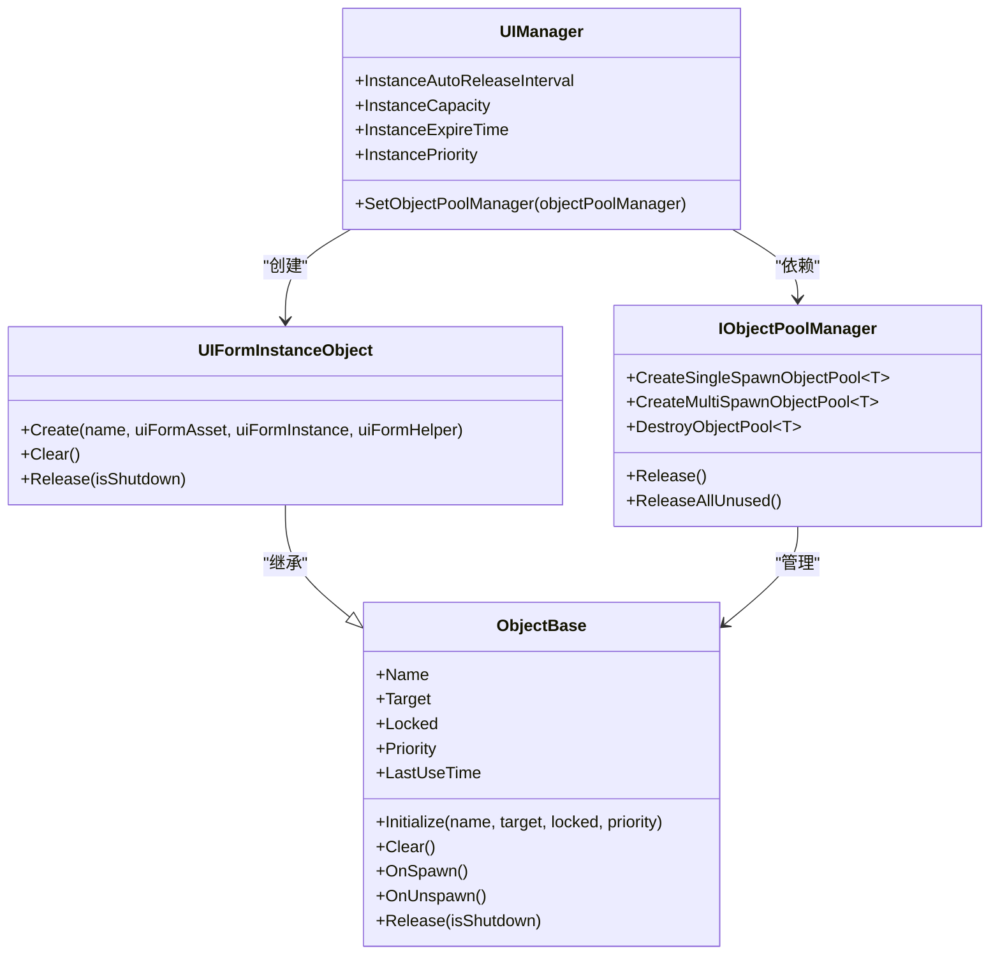
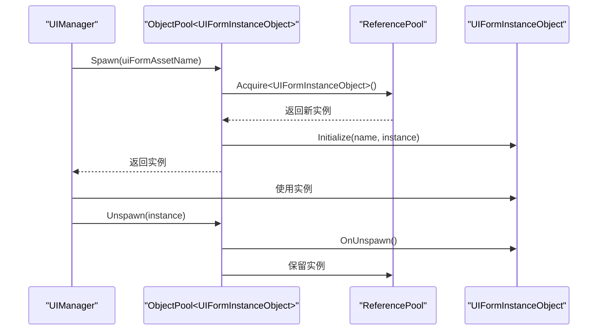
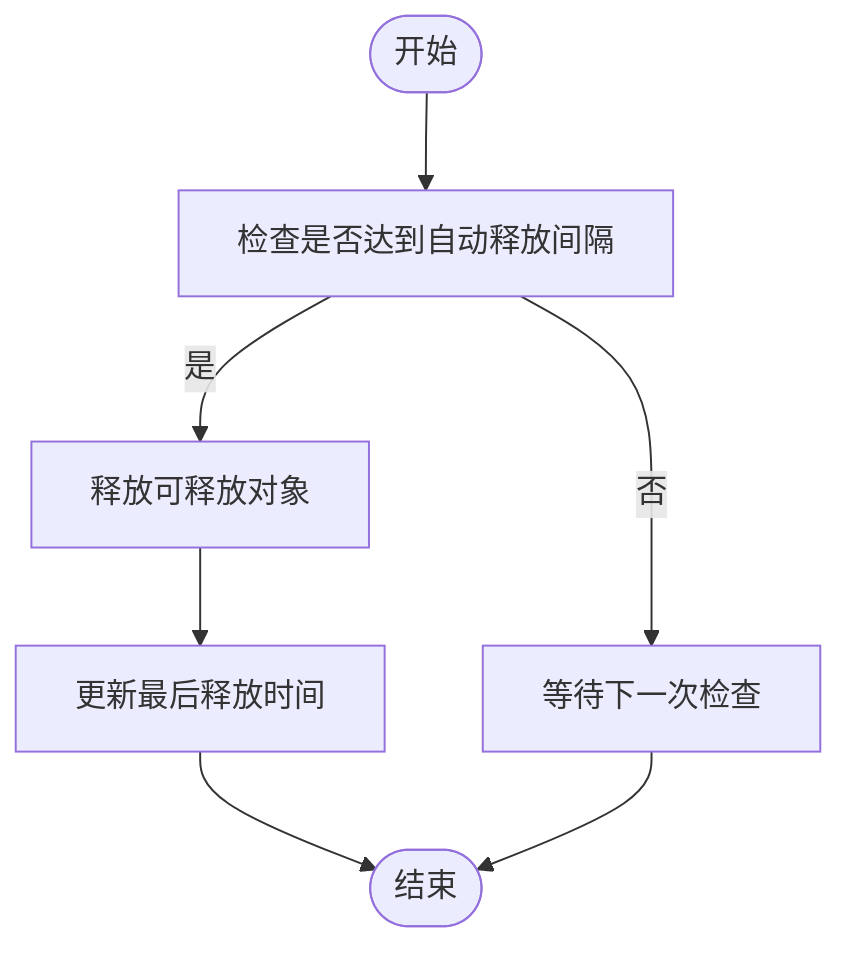
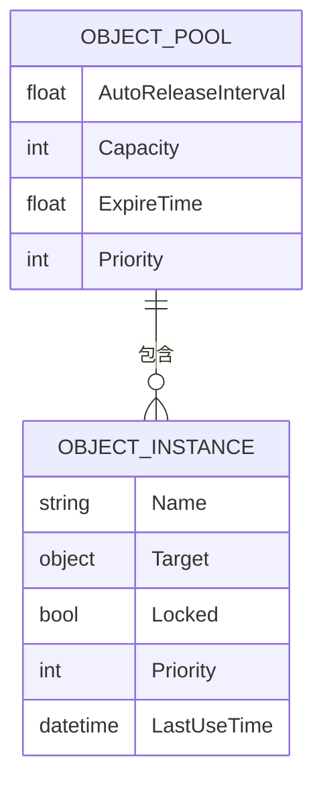
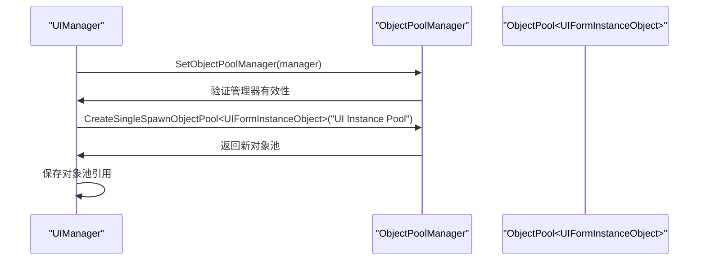
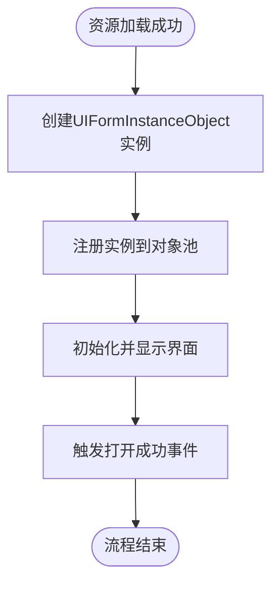

<cite>
**Referenced Files in This Document**   
- [UIManager.UIFormInstanceObject.cs](file://GameFramework/UI/UIManager.UIFormInstanceObject.cs)
- [ObjectBase.cs](file://GameFramework/ObjectPool/ObjectBase.cs)
- [IObjectPoolManager.cs](file://GameFramework/ObjectPool/IObjectPoolManager.cs)
- [UIManager.cs](file://GameFramework/UI/UIManager.cs)
- [ObjectPoolManager.cs](file://GameFramework/ObjectPool/ObjectPoolManager.cs)
</cite>

# 对象池集成机制

## Table of Contents
1. [UI管理器与对象池系统集成概述](#ui管理器与对象池系统集成概述)
2. [UIFormInstanceObject设计原理](#uiforminstanceobject设计原理)
3. [对象池配置参数详解](#对象池配置参数详解)
4. [对象池管理器关联机制](#对象池管理器关联机制)
5. [界面实例注册流程](#界面实例注册流程)
6. [对象池监控与性能调优](#对象池监控与性能调优)

## UI管理器与对象池系统集成概述

UI管理器与对象池系统的深度集成是游戏框架中资源管理的核心机制。该集成通过`UIManager`类与`IObjectPoolManager`接口的协作，实现了界面实例的高效创建、复用和回收。这种设计模式显著降低了内存分配频率，减少了垃圾回收压力，提升了应用性能。

集成架构的核心是`UIFormInstanceObject`类，它作为对象池的可回收对象，封装了界面实例及其相关资源。当界面需要显示时，系统从对象池中获取实例；当界面关闭时，实例被返回到对象池中等待复用，而不是被立即销毁。

**Diagram sources**
- [UIManager.cs](file://GameFramework/UI/UIManager.cs#L242-L251)
- [IObjectPoolManager.cs](file://GameFramework/ObjectPool/IObjectPoolManager.cs#L20-L751)
- [UIManager.UIFormInstanceObject.cs](file://GameFramework/UI/UIManager.UIFormInstanceObject.cs#L10-L60)
- [ObjectBase.cs](file://GameFramework/ObjectPool/ObjectBase.cs#L10-L208)

**Section sources**
- [UIManager.cs](file://GameFramework/UI/UIManager.cs#L1-L1060)
- [IObjectPoolManager.cs](file://GameFramework/ObjectPool/IObjectPoolManager.cs#L1-L752)

## UIFormInstanceObject设计原理

`UIFormInstanceObject`是UI管理器与对象池系统集成的关键组件，它继承自`ObjectBase`类，作为对象池中可回收的对象。该类的设计遵循了对象池模式的核心原则：对象的创建和销毁成本高昂，因此通过复用对象来提高性能。

`UIFormInstanceObject`类封装了界面实例所需的核心资源，包括界面资源资产(`m_UIFormAsset`)和界面辅助器(`m_UIFormHelper`)。通过`Create`静态方法创建实例时，会从引用池中获取对象并进行初始化，避免了频繁的内存分配。

当对象被回收时，`Release`方法会被调用，该方法通过`m_UIFormHelper.ReleaseUIForm`释放界面资源，确保资源的正确清理。`Clear`方法则负责重置对象状态，为下一次复用做好准备。

**Diagram sources**
- [UIManager.UIFormInstanceObject.cs](file://GameFramework/UI/UIManager.UIFormInstanceObject.cs#L10-L60)
- [ObjectBase.cs](file://GameFramework/ObjectPool/ObjectBase.cs#L10-L208)
- [UIManager.cs](file://GameFramework/UI/UIManager.cs#L242-L251)

**Section sources**
- [UIManager.UIFormInstanceObject.cs](file://GameFramework/UI/UIManager.UIFormInstanceObject.cs#L10-L60)

## 对象池配置参数详解

UI管理器提供了四个关键的配置参数来控制界面实例对象池的行为，这些参数直接影响内存使用和性能表现。

### InstanceAutoReleaseInterval

`InstanceAutoReleaseInterval`属性控制对象池自动释放可释放对象的间隔秒数。该参数决定了对象池清理未使用对象的频率。较短的间隔可以更快地释放内存，但会增加CPU开销；较长的间隔则相反。

### InstanceCapacity

`InstanceCapacity`属性设置对象池的容量，即池中可容纳的最大对象数量。合理的容量设置可以平衡内存使用和对象复用率。容量过小会导致频繁创建新对象，容量过大则会占用过多内存。

### InstanceExpireTime

`InstanceExpireTime`属性定义对象池中对象的过期秒数。超过此时间未被使用的对象将被视为可释放对象。该参数帮助系统清理长时间未使用的对象，防止内存泄漏。

### InstancePriority

`InstancePriority`属性设置对象池的优先级。在内存紧张时，系统会优先释放低优先级对象池中的对象。该参数为不同类型的界面实例提供了内存管理的优先级控制。

**Diagram sources**
- [UIManager.cs](file://GameFramework/UI/UIManager.cs#L253-L289)
- [ObjectBase.cs](file://GameFramework/ObjectPool/ObjectBase.cs#L10-L208)

**Section sources**
- [UIManager.cs](file://GameFramework/UI/UIManager.cs#L253-L289)

## 对象池管理器关联机制

`SetObjectPoolManager`接口是建立UI管理器与对象池管理器关联的关键方法。该方法不仅验证传入的对象池管理器的有效性，还负责创建专门用于管理界面实例的对象池。

当调用`SetObjectPoolManager`方法时，UI管理器会创建一个名为"UI Instance Pool"的单次获取对象池，专门用于管理`UIFormInstanceObject`实例。这种设计确保了界面实例的管理与其他类型对象的管理相分离，提高了系统的模块化程度。

**Diagram sources**
- [UIManager.cs](file://GameFramework/UI/UIManager.cs#L242-L251)
- [IObjectPoolManager.cs](file://GameFramework/ObjectPool/IObjectPoolManager.cs#L20-L751)

**Section sources**
- [UIManager.cs](file://GameFramework/UI/UIManager.cs#L242-L251)

## 界面实例注册流程

界面实例在加载完成后的注册流程是对象池集成机制的核心部分。该流程确保了界面实例能够正确地被对象池管理，实现高效的复用。

当界面资源加载成功后，`LoadAssetSuccessCallback`回调方法会被触发。该方法首先创建`UIFormInstanceObject`实例，然后通过`m_InstancePool.Register`方法将其注册到对象池中。注册成功后，实例会被传递给`InternalOpenUIForm`方法进行界面的初始化和显示。

**Diagram sources**
- [UIManager.cs](file://GameFramework/UI/UIManager.cs#L975-L997)
- [UIManager.cs](file://GameFramework/UI/UIManager.cs#L939-L973)

**Section sources**
- [UIManager.cs](file://GameFramework/UI/UIManager.cs#L939-L997)

## 对象池监控与性能调优

有效的对象池监控和性能调优是确保系统稳定运行的关键。开发者应关注对象池的使用率、回收率和内存占用等指标。

### 监控建议

- 定期检查对象池的当前使用量和容量比例
- 监控对象的平均存活时间和复用次数
- 跟踪对象创建和销毁的频率

### 性能调优建议

- 根据实际使用情况调整`InstanceCapacity`，避免过度分配内存
- 合理设置`InstanceExpireTime`，平衡内存使用和对象复用
- 根据界面的重要性设置`InstancePriority`，确保关键界面的性能
- 优化`InstanceAutoReleaseInterval`，避免过于频繁的自动释放操作影响性能

通过合理的监控和调优，可以最大化对象池的性能优势，同时避免潜在的内存问题。

**Section sources**
- [UIManager.cs](file://GameFramework/UI/UIManager.cs#L253-L289)
- [IObjectPoolManager.cs](file://GameFramework/ObjectPool/IObjectPoolManager.cs#L20-L751)