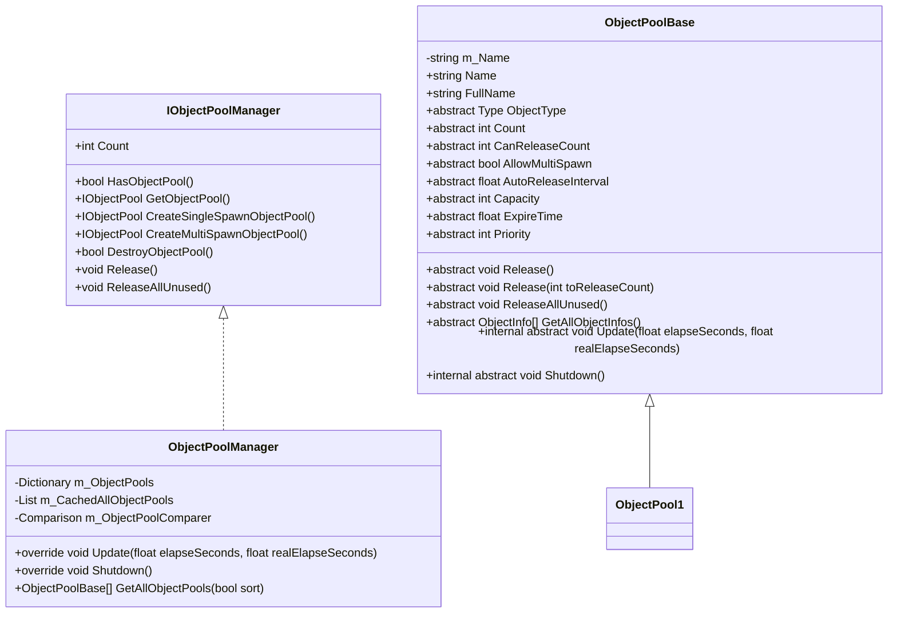
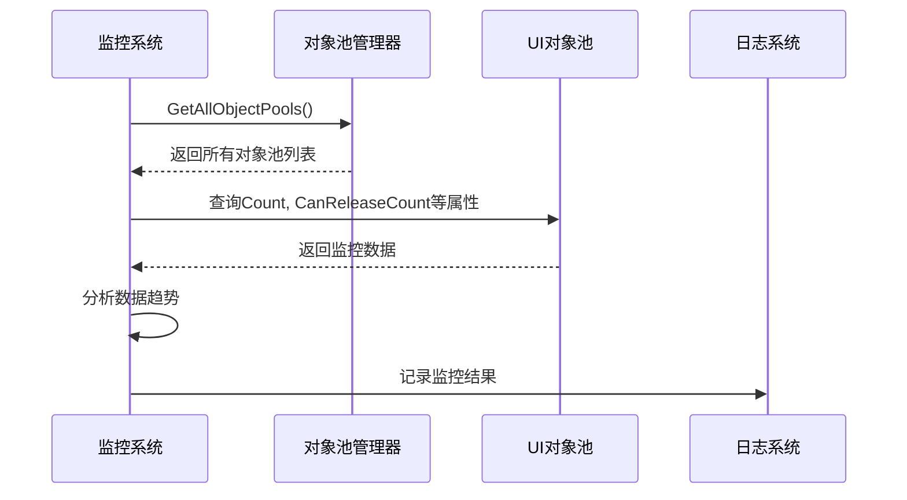
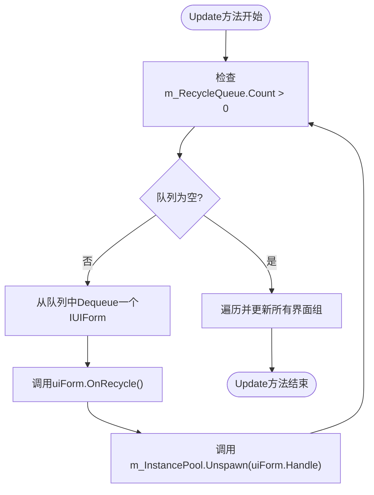
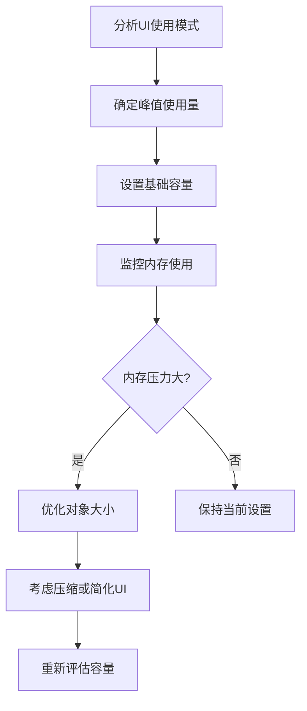

# 性能监控与优化

<cite>
**本文档引用的文件**  
- [ObjectPoolManager.cs](file://GameFramework/ObjectPool/ObjectPoolManager.cs)
- [ObjectPoolBase.cs](file://GameFramework/ObjectPool/ObjectPoolBase.cs)
- [UIManager.cs](file://GameFramework/UI/UIManager.cs)
- [IObjectPool.cs](file://GameFramework/ObjectPool/IObjectPool.cs)
- [ObjectBase.cs](file://GameFramework/ObjectPool/ObjectBase.cs)
- [ObjectInfo.cs](file://GameFramework/ObjectPool/ObjectInfo.cs)
</cite>

## 目录
1. [引言](#引言)
2. [对象池管理器架构](#对象池管理器架构)
3. [UI对象池监控机制](#ui对象池监控机制)
4. [对象回收队列处理](#对象回收队列处理)
5. [性能调优最佳实践](#性能调优最佳实践)
6. [动态参数调整策略](#动态参数调整策略)
7. [结论](#结论)

## 引言

在Unity游戏开发中，UI对象的频繁创建和销毁会导致严重的性能问题和垃圾回收（GC）压力。通过对象池技术可以有效复用UI对象，减少内存分配和GC触发频率。本文档详细介绍了如何通过对象池管理器监控UI对象池的运行状态，包括当前使用量、峰值使用量和内存占用情况。同时阐述了在Update方法中处理对象回收队列的机制，以及如何避免GC频繁触发。提供了性能调优的最佳实践，包括合理设置对象池容量、优化对象过期策略、监控内存使用趋势等，并说明了如何根据游戏运行时的UI使用模式动态调整对象池参数以达到最佳性能平衡。

## 对象池管理器架构

对象池管理器是整个对象池系统的核心组件，负责统一管理和调度所有类型的对象池。它实现了IObjectPoolManager接口，提供了创建、查询、销毁对象池的完整功能。



**图示来源**
- [ObjectPoolManager.cs](file://GameFramework/ObjectPool/ObjectPoolManager.cs#L28-L33)
- [IObjectPool.cs](file://GameFramework/ObjectPool/IObjectPool.cs#L10-L218)
- [ObjectPoolBase.cs](file://GameFramework/ObjectPool/ObjectPoolBase.cs#L10-L153)

**本节来源**
- [ObjectPoolManager.cs](file://GameFramework/ObjectPool/ObjectPoolManager.cs#L1-L1304)
- [ObjectPoolBase.cs](file://GameFramework/ObjectPool/ObjectPoolBase.cs#L1-L153)

## UI对象池监控机制

UI对象池的监控是性能优化的基础。通过对象池管理器提供的接口，可以实时获取UI对象池的各种运行时指标，包括当前使用量、峰值使用量和内存占用情况。

### 核心监控指标

| 指标 | 获取方法 | 说明 |
|------|--------|------|
| 当前对象数量 | `Count` | 获取对象池中当前存在的对象总数 |
| 可释放对象数量 | `CanReleaseCount` | 获取对象池中可被释放的对象数量 |
| 对象池容量 | `Capacity` | 获取对象池的最大容量限制 |
| 对象过期时间 | `ExpireTime` | 获取对象在池中可存活的最大时间（秒） |
| 自动释放间隔 | `AutoReleaseInterval` | 获取对象池自动释放可释放对象的时间间隔 |

### 监控实现方式



通过调用`GetObjectPool<T>()`方法获取特定类型的对象池实例，然后访问其属性来获取各种监控数据。对于UI对象池，主要关注`IObjectPool<UIFormInstanceObject>`类型的对象池。

**本节来源**
- [ObjectPoolBase.cs](file://GameFramework/ObjectPool/ObjectPoolBase.cs#L68-L79)
- [IObjectPool.cs](file://GameFramework/ObjectPool/IObjectPool.cs#L30-L60)
- [ObjectPoolManager.cs](file://GameFramework/ObjectPool/ObjectPoolManager.cs#L175-L178)

## 对象回收队列处理

对象回收队列的处理机制是避免GC频繁触发的关键。UI管理器在Update方法中处理对象回收队列，确保对象回收操作不会在主线程造成性能瓶颈。

### 回收队列工作机制



### 关键实现细节

UI管理器维护一个`m_RecycleQueue`队列，当UI界面被关闭时，不是立即销毁，而是将其加入回收队列。在每帧的Update方法中，系统会逐个处理回收队列中的对象，调用其`OnRecycle`回调方法，并将其归还到对象池中。

这种延迟回收机制有以下优势：
- 避免在关键路径上进行耗时的对象销毁操作
- 将回收操作分散到多帧中执行，避免单帧性能 spikes
- 确保对象回收在统一的Update上下文中进行，提高代码可预测性

```csharp
// 伪代码示例
internal override void Update(float elapseSeconds, float realElapseSeconds)
{
    while (m_RecycleQueue.Count > 0)
    {
        IUIForm uiForm = m_RecycleQueue.Dequeue();
        uiForm.OnRecycle();
        m_InstancePool.Unspawn(uiForm.Handle);
    }
    
    foreach (KeyValuePair<string, UIGroup> uiGroup in m_UIGroups)
    {
        uiGroup.Value.Update(elapseSeconds, realElapseSeconds);
    }
}
```

**本节来源**
- [UIManager.cs](file://GameFramework/UI/UIManager.cs#L210-L223)
- [UIManager.cs](file://GameFramework/UI/UIManager.cs#L22-L22)
- [UIManager.cs](file://GameFramework/UI/UIManager.cs#L26-L26)

## 性能调优最佳实践

为了实现最佳的UI对象池性能，需要遵循一系列最佳实践，包括合理设置对象池参数、优化内存使用和监控性能趋势。

### 对象池容量设置

对象池容量的设置需要根据实际使用情况进行调整：



建议的容量设置策略：
- 基础容量设置为历史峰值使用量的1.2-1.5倍
- 对于频繁使用的UI，可以适当增加容量以减少创建新对象的开销
- 对于不常用的UI，保持较小的容量以节省内存

### 对象过期策略优化

对象过期策略直接影响内存使用效率：

| 参数 | 建议值 | 说明 |
|------|-------|------|
| ExpireTime | 30-60秒 | 对象在池中存活的最大时间 |
| AutoReleaseInterval | 5-10秒 | 自动检查并释放过期对象的间隔 |
| Priority | 根据重要性设置 | 高优先级对象池优先保留 |

过期时间不宜设置过短，否则会导致频繁的对象创建和销毁；也不宜过长，否则会占用过多内存。建议根据UI的使用频率动态调整过期时间。

### 内存使用趋势监控

建立内存使用趋势监控系统，定期记录和分析对象池的使用情况：

```csharp
// 监控数据结构示例
public struct ObjectPoolMonitorData
{
    public string PoolName;
    public int CurrentCount;
    public int PeakCount;
    public int Capacity;
    public float ExpireTime;
    public float AutoReleaseInterval;
    public DateTime Timestamp;
}
```

通过长期监控，可以识别出内存使用模式，为性能优化提供数据支持。

**本节来源**
- [ObjectPoolBase.cs](file://GameFramework/ObjectPool/ObjectPoolBase.cs#L101-L123)
- [UIManager.cs](file://GameFramework/UI/UIManager.cs#L40-L57)
- [ObjectPoolManager.cs](file://GameFramework/ObjectPool/ObjectPoolManager.cs#L310-L377)

## 动态参数调整策略

为了适应不同的游戏场景和设备性能，需要实现动态调整对象池参数的策略。

### 运行时参数调整

```mermaid
stateDiagram-v2
[*] --> 初始化
初始化 --> 监控模式
监控模式 --> 性能压力{"检测到性能压力?"}
性能压力 --> |是| 内存优化
性能压力 --> |否| 资源充足
内存优化 --> 调整参数["降低容量，缩短过期时间"]
资源充足 --> 调整参数["增加容量，延长过期时间"]
调整参数 --> 监控模式
```

### 动态调整实现

通过UI管理器提供的接口，可以在运行时动态调整对象池参数：

```csharp
// 动态调整示例
public void AdjustObjectPoolParameters()
{
    // 根据当前内存使用情况调整
    if (MemoryUsage.IsHigh())
    {
        // 内存压力大时，减少容量，缩短过期时间
        InstanceCapacity = Mathf.Max(MinCapacity, InstanceCapacity * 0.8f);
        InstanceExpireTime = Mathf.Max(MinExpireTime, InstanceExpireTime * 0.7f);
    }
    else if (MemoryUsage.IsLow())
    {
        // 内存充足时，增加容量，延长过期时间
        InstanceCapacity = Mathf.Min(MaxCapacity, InstanceCapacity * 1.2f);
        InstanceExpireTime = Mathf.Min(MaxExpireTime, InstanceExpireTime * 1.3f);
    }
}
```

### 场景自适应策略

根据不同游戏场景的特点，采用不同的参数配置：

| 场景类型 | 容量策略 | 过期时间 | 优先级 |
|--------|--------|--------|-------|
| 主菜单 | 高容量 | 长时间 | 高 |
| 战斗界面 | 中等容量 | 中等时间 | 高 |
| 设置界面 | 低容量 | 短时间 | 低 |
| 暂停菜单 | 中等容量 | 中等时间 | 中 |

通过场景切换时的回调，可以自动应用相应的参数配置，实现无缝的性能优化。

**本节来源**
- [UIManager.cs](file://GameFramework/UI/UIManager.cs#L39-L57)
- [ObjectPoolBase.cs](file://GameFramework/ObjectPool/ObjectPoolBase.cs#L92-L123)
- [IObjectPool.cs](file://GameFramework/ObjectPool/IObjectPool.cs#L70-L100)

## 结论

UI对象池的性能监控和优化是一个系统工程，需要从架构设计、运行时监控到动态调整等多个方面综合考虑。通过合理使用对象池管理器提供的功能，可以有效监控UI对象池的运行状态，包括当前使用量、峰值使用量和内存占用情况。

在Update方法中处理对象回收队列的机制，能够有效避免GC频繁触发，提高游戏的运行流畅度。性能调优的最佳实践包括合理设置对象池容量、优化对象过期策略、监控内存使用趋势等。

最重要的是，需要根据游戏运行时的UI使用模式动态调整对象池参数，实现性能和内存使用的最佳平衡。通过建立完善的监控系统和动态调整策略，可以确保UI系统在各种设备和场景下都能保持良好的性能表现。