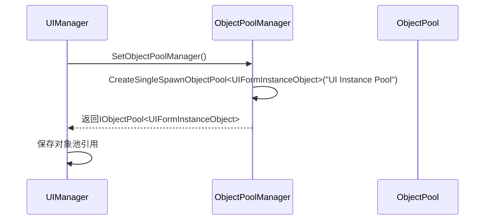
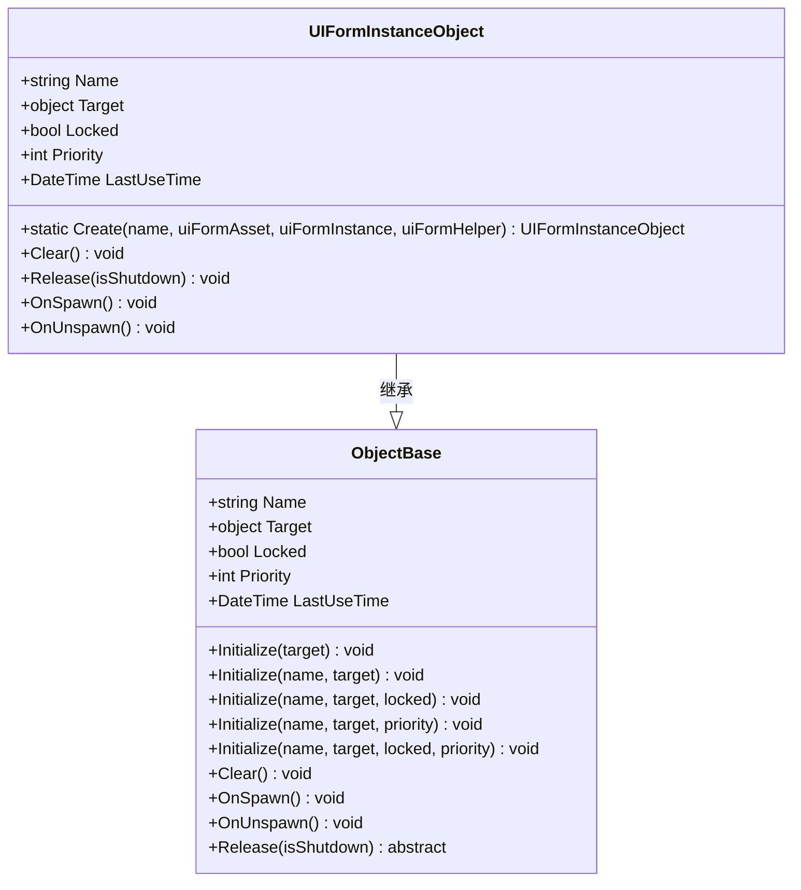
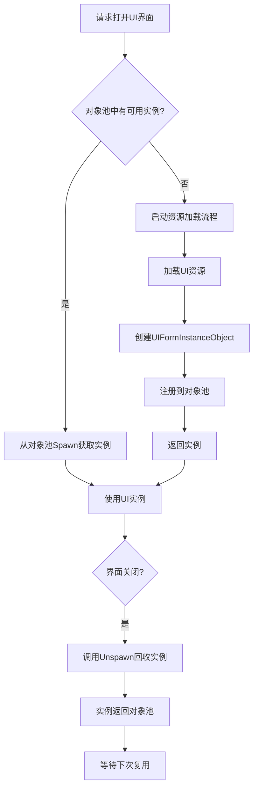

# 集成机制与实例管理

<cite>
**Referenced Files in This Document**   
- [UIManager.cs](file://GameFramework/UI/UIManager.cs)
- [ObjectPoolManager.cs](file://GameFramework/ObjectPool/ObjectPoolManager.cs)
- [UIManager.UIFormInstanceObject.cs](file://GameFramework/UI/UIManager.UIFormInstanceObject.cs)
- [ObjectBase.cs](file://GameFramework/ObjectPool/ObjectBase.cs)
</cite>

## 目录
1. [集成机制与实例管理](#集成机制与实例管理)
2. [UIManager与ObjectPoolManager的集成机制](#uimanager与objectpoolmanager的集成机制)
3. [对象池创建与初始化流程](#对象池创建与初始化流程)
4. [UIFormInstanceObject生命周期管理](#uiforminstanceobject生命周期管理)
5. [对象池与资源加载的协同工作](#对象池与资源加载的协同工作)

## UIManager与ObjectPoolManager的集成机制

`UIManager`与`ObjectPoolManager`的集成通过`SetObjectPoolManager`方法实现，该方法建立了两者之间的关联。当`UIManager`接收到`ObjectPoolManager`实例后，会立即创建一个名为"UI Instance Pool"的专用对象池，用于管理所有UI界面实例。

**Section sources**
- [UIManager.cs](file://GameFramework/UI/UIManager.cs#L242-L251)

## 对象池创建与初始化流程

在`UIManager`初始化过程中，通过调用`ObjectPoolManager`的`CreateSingleSpawnObjectPool`方法创建名为"UI Instance Pool"的专用对象池。该对象池专门用于管理`UIFormInstanceObject`类型的实例，确保UI界面的高效创建和回收。

**Diagram sources**
- [UIManager.cs](file://GameFramework/UI/UIManager.cs#L242-L251)
- [ObjectPoolManager.cs](file://GameFramework/ObjectPool/ObjectPoolManager.cs#L384-L387)

**Section sources**
- [UIManager.cs](file://GameFramework/UI/UIManager.cs#L242-L251)
- [ObjectPoolManager.cs](file://GameFramework/ObjectPool/ObjectPoolManager.cs#L384-L674)

## UIFormInstanceObject生命周期管理

`UIFormInstanceObject`作为可回收对象在对象池中进行生命周期管理，其核心是`Spawn`获取和`Unspawn`回收机制。

### 对象获取(Spawn)
当需要创建新的UI界面时，`UIManager`首先尝试从对象池中获取`UIFormInstanceObject`实例。如果对象池中有可用实例，则直接复用；否则启动资源加载流程。

### 对象回收(Unspawn)
当UI界面关闭时，实例不会被立即销毁，而是通过`Unspawn`方法返回对象池。在回收过程中，`UIFormInstanceObject`的`Release`方法会被调用，执行具体的资源释放逻辑。

**Diagram sources**
- [UIManager.UIFormInstanceObject.cs](file://GameFramework/UI/UIManager.UIFormInstanceObject.cs#L10-L60)
- [ObjectBase.cs](file://GameFramework/ObjectPool/ObjectBase.cs#L10-L208)

**Section sources**
- [UIManager.UIFormInstanceObject.cs](file://GameFramework/UI/UIManager.UIFormInstanceObject.cs#L10-L60)
- [ObjectBase.cs](file://GameFramework/ObjectPool/ObjectBase.cs#L10-L208)

## 对象池与资源加载的协同工作

对象池与UI资源加载流程紧密协同工作。在资源加载完成后，系统会自动将新创建的实例注册到对象池中，实现资源的高效管理。

### 资源加载与对象池协同流程
1. 调用`OpenUIForm`方法请求打开界面
2. 系统首先尝试从对象池中`Spawn`获取实例
3. 如果对象池中无可用实例，则启动资源加载
4. 资源加载完成后，创建新的`UIFormInstanceObject`并自动注册到对象池
5. 界面使用完毕后，通过`Unspawn`方法将实例返回对象池

**Diagram sources**
- [UIManager.cs](file://GameFramework/UI/UIManager.cs#L500-L550)
- [UIManager.UIFormInstanceObject.cs](file://GameFramework/UI/UIManager.UIFormInstanceObject.cs#L10-L60)

**Section sources**
- [UIManager.cs](file://GameFramework/UI/UIManager.cs#L500-L550)
- [UIManager.UIFormInstanceObject.cs](file://GameFramework/UI/UIManager.UIFormInstanceObject.cs#L10-L60)