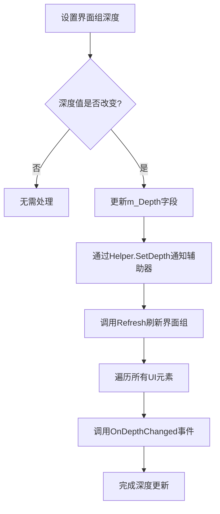
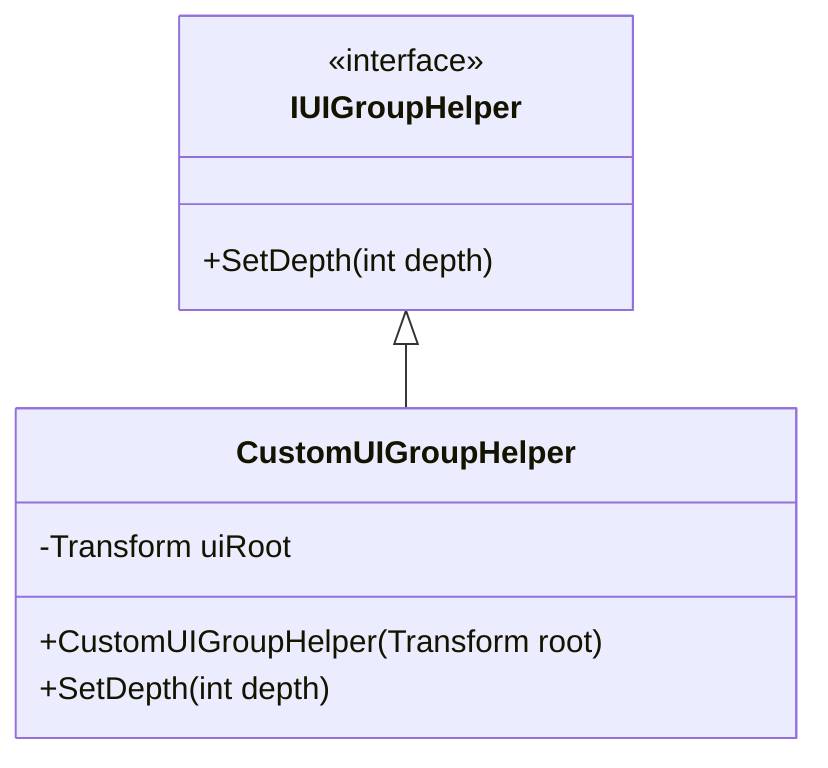

# 界面组创建

<cite>
**Referenced Files in This Document**  
- [IUIManager.cs](file://GameFramework/UI/IUIManager.cs)
- [IUIGroupHelper.cs](file://GameFramework/UI/IUIGroupHelper.cs)
- [UIManager.cs](file://GameFramework/UI/UIManager.cs)
- [UIManager.UIGroup.cs](file://GameFramework/UI/UIManager.UIGroup.cs)
</cite>

## 目录
1. [界面组创建方法](#界面组创建方法)
2. [uiGroupName命名规范](#uigroupname命名规范)
3. [uiGroupDepth参数对渲染层级的影响](#uigroupdepth参数对渲染层级的影响)
4. [IUIGroupHelper在初始化中的作用](#iuigrouphelper在初始化中的作用)
5. [自定义UIGroupHelper实现](#自定义uigrouphelper实现)
6. [创建失败原因及处理策略](#创建失败原因及处理策略)

## 界面组创建方法

`IUIManager`接口提供了两个重载的`AddUIGroup`方法用于创建界面组，分别支持带深度参数和不带深度参数的调用方式。

不带深度参数的`AddUIGroup`方法会默认将界面组深度设置为0，而带深度参数的版本允许开发者显式指定界面组的渲染深度。这两个方法共同构成了界面组创建的核心API。

**Section sources**
- [IUIManager.cs](file://GameFramework/UI/IUIManager.cs#L138-L147)
- [UIManager.cs](file://GameFramework/UI/UIManager.cs#L357-L389)

## uiGroupName命名规范

`uiGroupName`参数用于标识界面组的唯一名称，在系统中必须保持唯一性。根据代码实现，名称不能为空或null，且在创建新界面组时会检查是否已存在同名界面组。

命名应遵循清晰、可读的原则，建议使用有意义的英文单词组合，采用驼峰命名法或下划线分隔的方式。例如："MainMenuGroup"或"game_play_ui"等。避免使用特殊字符和空格，确保名称的合法性和可维护性。

当尝试创建已存在的界面组名称时，系统将直接返回false而不抛出异常，这为开发者提供了安全的创建机制。

**Section sources**
- [UIManager.cs](file://GameFramework/UI/UIManager.cs#L371-L375)
- [UIManager.UIGroup.cs](file://GameFramework/UI/UIManager.UIGroup.cs#L142-L146)

## uiGroupDepth参数对渲染层级的影响

`uiGroupDepth`参数决定了界面组在渲染层级中的位置，数值越大表示层级越高，越靠近用户视线。该参数直接影响界面的显示顺序和遮挡关系。

在`UIGroup`类的实现中，当深度值发生变化时，不仅会更新内部的`m_Depth`字段，还会通过`IUIGroupHelper`的`SetDepth`方法通知辅助器进行相应的UI布局调整，并调用`Refresh`方法刷新整个界面组中所有界面元素的深度状态。

深度变化会触发界面组内所有UI元素的`OnDepthChanged`事件，使它们能够根据新的层级信息调整自身表现。这种机制确保了界面层级的一致性和实时性。

**Diagram sources**
- [UIManager.UIGroup.cs](file://GameFramework/UI/UIManager.UIGroup.cs#L164-L174)

**Section sources**
- [UIManager.UIGroup.cs](file://GameFramework/UI/UIManager.UIGroup.cs#L158-L174)

## IUIGroupHelper在初始化中的作用

`IUIGroupHelper`接口在界面组初始化过程中扮演着关键角色，它作为界面组与具体UI系统之间的适配层，负责实现平台或框架特定的UI操作。

在创建界面组时，必须提供一个`IUIGroupHelper`实例，该实例将被保存在`UIGroup`对象中，并在后续的深度设置、布局调整等操作中被调用。其主要职责是通过`SetDepth`方法将逻辑深度值转换为实际UI系统中的渲染层级设置。

这种设计模式实现了关注点分离，使得核心UI管理逻辑与具体UI实现技术解耦，提高了系统的可扩展性和可维护性。开发者可以通过实现不同的`IUIGroupHelper`来适配Unity UI、NGUI或其他UI系统。

**Section sources**
- [IUIGroupHelper.cs](file://GameFramework/UI/IUIGroupHelper.cs#L12-L19)
- [UIManager.UIGroup.cs](file://GameFramework/UI/UIManager.UIGroup.cs#L147-L150)

## 自定义UIGroupHelper实现

要实现自定义的`UIGroupHelper`，需要创建一个类实现`IUIGroupHelper`接口，并重写`SetDepth`方法来定义具体的深度设置逻辑。以下是一个典型的实现模式：

**Diagram sources**
- [IUIGroupHelper.cs](file://GameFramework/UI/IUIGroupHelper.cs#L12-L19)

**Section sources**
- [IUIGroupHelper.cs](file://GameFramework/UI/IUIGroupHelper.cs#L12-L19)
- [UIManager.UIGroup.cs](file://GameFramework/UI/UIManager.UIGroup.cs#L170)

## 创建失败原因及处理策略

界面组创建可能失败的原因主要有以下几种：

1. **名称无效**：`uiGroupName`为空或null
2. **辅助器为空**：未提供有效的`IUIGroupHelper`实例
3. **名称冲突**：已存在同名的界面组

系统对这些情况的处理策略如下：对于前两种情况，会直接抛出`GameFrameworkException`异常，因为这是严重的编程错误；而对于名称冲突的情况，则会安静地返回false，允许开发者根据返回值进行相应处理。

推荐的处理策略是：在创建界面组前进行参数验证，使用`HasUIGroup`方法检查名称是否存在，并妥善处理可能的异常情况，确保程序的健壮性。

**Section sources**
- [UIManager.cs](file://GameFramework/UI/UIManager.cs#L371-L387)