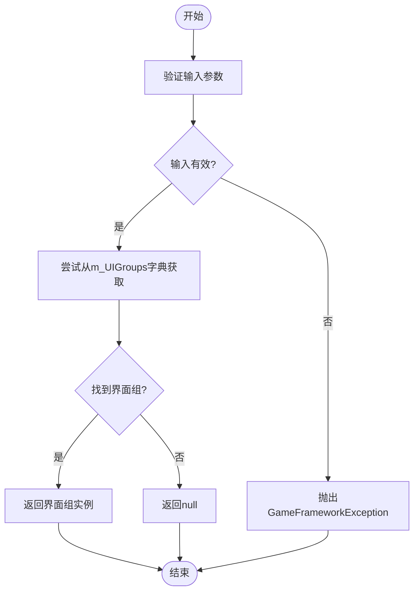
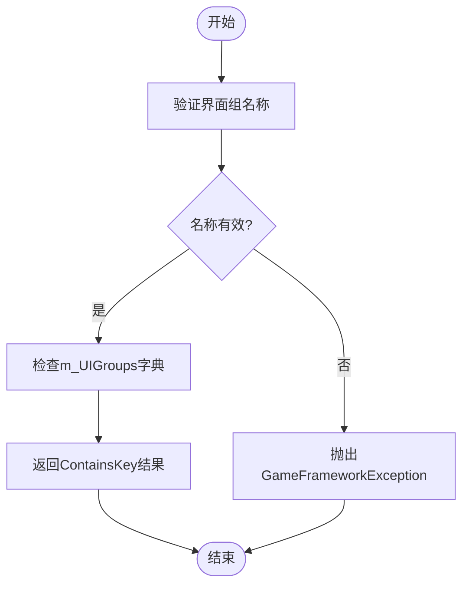
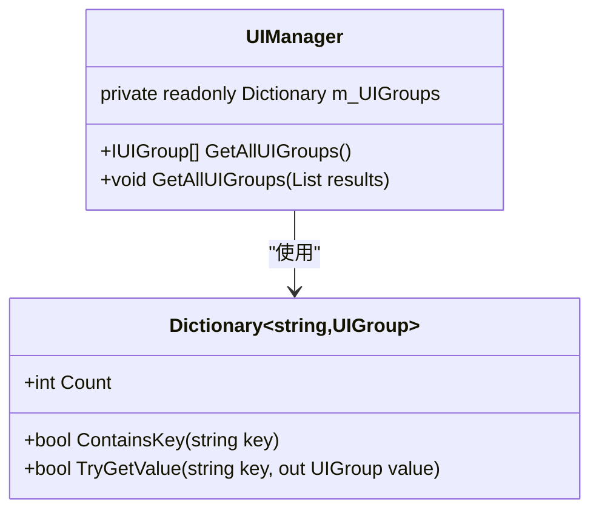
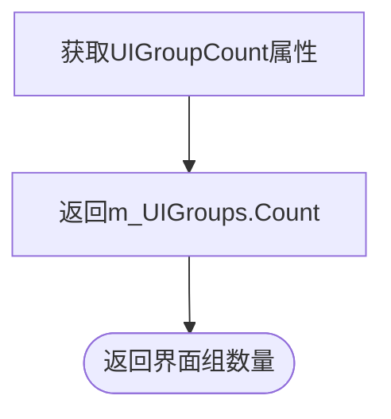
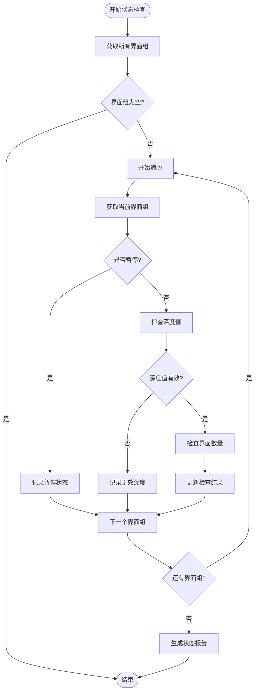
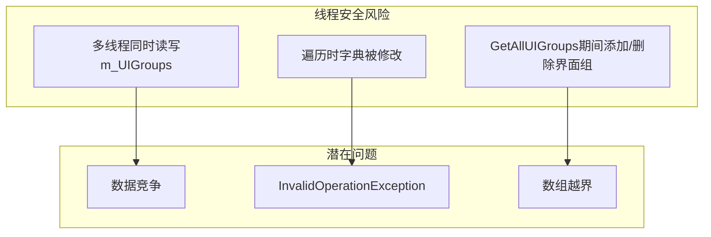

# 界面组查询

<cite>
**Referenced Files in This Document**   
- [UIManager.cs](file://GameFramework/UI/UIManager.cs)
- [UIManager.UIGroup.cs](file://GameFramework/UI/UIManager.UIGroup.cs)
- [IUIManager.cs](file://GameFramework/UI/IUIManager.cs)
- [IUIGroup.cs](file://GameFramework/UI/IUIGroup.cs)
</cite>

## 目录
1. [简介](#简介)
2. [核心查询方法](#核心查询方法)
3. [UIGroupCount属性分析](#uigrouncount属性分析)
4. [安全遍历实践](#安全遍历实践)
5. [线程安全性与最佳实践](#线程安全性与最佳实践)
6. [总结](#总结)

## 简介

界面组查询功能是游戏框架中UI管理系统的核心组成部分，提供了对界面组的高效查询和管理能力。本文档系统化地阐述了`GetUIGroup`、`HasUIGroup`和`GetAllUIGroups`三个核心查询方法的使用方式，深入分析了`UIGroupCount`属性的统计逻辑及其在性能监控中的应用。同时，通过实际场景示例展示了如何安全地遍历所有界面组进行状态检查，并详细说明了查询操作的线程安全性问题和最佳实践。

**Section sources**
- [UIManager.cs](file://GameFramework/UI/UIManager.cs#L36-L68)
- [IUIManager.cs](file://GameFramework/UI/IUIManager.cs#L1-L382)

## 核心查询方法

### GetUIGroup方法

`GetUIGroup`方法用于获取指定名称的界面组。该方法通过名称精确匹配来检索界面组，是获取特定界面组实例的主要途径。



**Diagram sources**
- [UIManager.cs](file://GameFramework/UI/UIManager.cs#L301-L314)

**Section sources**
- [UIManager.cs](file://GameFramework/UI/UIManager.cs#L301-L314)
- [IUIManager.cs](file://GameFramework/UI/IUIManager.cs#L118-L119)

### HasUIGroup方法

`HasUIGroup`方法用于判断指定名称的界面组是否存在。该方法在添加新界面组前进行存在性检查，避免重复添加。



**Diagram sources**
- [UIManager.cs](file://GameFramework/UI/UIManager.cs#L286-L294)

**Section sources**
- [UIManager.cs](file://GameFramework/UI/UIManager.cs#L286-L294)
- [IUIManager.cs](file://GameFramework/UI/IUIManager.cs#L111-L112)

### GetAllUIGroups方法

`GetAllUIGroups`方法提供了两种重载形式，用于获取所有界面组的集合。该方法支持数组和列表两种返回类型，满足不同场景的需求。



**Diagram sources**
- [UIManager.cs](file://GameFramework/UI/UIManager.cs#L321-L349)

**Section sources**
- [UIManager.cs](file://GameFramework/UI/UIManager.cs#L321-L349)
- [IUIManager.cs](file://GameFramework/UI/IUIManager.cs#L124-L130)

## UIGroupCount属性分析

### 统计逻辑

`UIGroupCount`属性直接返回`m_UIGroups`字典的`Count`属性值，提供了界面组数量的实时统计。该属性的实现简单高效，时间复杂度为O(1)。



**Diagram sources**
- [UIManager.cs](file://GameFramework/UI/UIManager.cs#L62-L68)

**Section sources**
- [UIManager.cs](file://GameFramework/UI/UIManager.cs#L62-L68)
- [IUIManager.cs](file://GameFramework/UI/IUIManager.cs#L5-L10)

### 性能监控应用

`UIGroupCount`属性在性能监控中具有重要应用价值：

1. **内存使用监控**：通过定期检查`UIGroupCount`值的变化，可以监控界面组的创建和销毁情况，及时发现内存泄漏问题。
2. **性能瓶颈分析**：当`UIGroupCount`值异常增长时，可能表明存在界面组未正确释放的问题，需要进行优化。
3. **资源管理决策**：根据`UIGroupCount`的实时值，可以动态调整资源分配策略，如对象池大小等。

```csharp
// 性能监控示例
void PerformanceMonitor()
{
    int currentCount = UIManager.Instance.UIGroupCount;
    if (currentCount > threshold)
    {
        // 触发警告或优化操作
        Log.Warning($"界面组数量超过阈值: {currentCount}");
    }
}
```

## 安全遍历实践

### 遍历方法对比

在需要对所有界面组进行状态检查时，有多种遍历方法可供选择，每种方法都有其适用场景和注意事项。

```mermaid
flowchart TD
subgraph "遍历方法"
Method1["GetAllUIGroups() 返回数组"]
Method2["GetAllUIGroups(List) 重用列表"]
Method3["直接遍历m_UIGroups"]
end
subgraph "特点"
Method1 --> |优点| "简单直接"
Method1 --> |缺点| "每次创建新数组"
Method1 --> |内存| "高"
Method2 --> |优点| "可重用List实例"
Method2 --> |缺点| "需要预先创建List"
Method2 --> |内存| "中"
Method3 --> |优点| "最高效"
Method3 --> |缺点| "需注意线程安全"
Method3 --> |内存| "低"
end
```

**Diagram sources**
- [UIManager.cs](file://GameFramework/UI/UIManager.cs#L321-L349)

### 实际场景示例

以下是一个安全遍历所有界面组并进行状态检查的完整示例：



**Diagram sources**
- [UIManager.cs](file://GameFramework/UI/UIManager.cs#L321-L349)
- [UIManager.UIGroup.cs](file://GameFramework/UI/UIManager.UIGroup.cs#L84-L136)

**Section sources**
- [UIManager.cs](file://GameFramework/UI/UIManager.cs#L321-L349)
- [UIManager.UIGroup.cs](file://GameFramework/UI/UIManager.UIGroup.cs#L84-L136)

## 线程安全性与最佳实践

### 线程安全性分析

界面组查询操作的线程安全性需要特别注意。`GetUIGroup`、`HasUIGroup`和`GetAllUIGroups`方法本身不提供线程安全保证，因为它们直接操作`m_UIGroups`字典。



**Diagram sources**
- [UIManager.cs](file://GameFramework/UI/UIManager.cs#L36-L68)

### 最佳实践

为确保线程安全和性能最优，建议遵循以下最佳实践：

1. **单线程访问**：在Unity的主线程中调用查询方法，避免跨线程访问。
2. **使用GetAllUIGroups(List重载)**：重用`List<IUIGroup>`实例，减少GC压力。
3. **避免在遍历中修改集合**：不要在遍历界面组时添加或删除界面组。
4. **缓存频繁查询结果**：对于频繁查询的界面组，建议缓存其引用。

```csharp
// 最佳实践示例
public class UIQueryManager
{
    private List<IUIGroup> _tempGroups = new List<IUIGroup>();
    private IUIGroup _cachedMainGroup;
    
    public void Update()
    {
        // 重用列表实例
        UIManager.Instance.GetAllUIGroups(_tempGroups);
        foreach (var group in _tempGroups)
        {
            // 执行状态检查
            CheckGroupStatus(group);
        }
        
        // 缓存常用界面组
        if (_cachedMainGroup == null)
        {
            _cachedMainGroup = UIManager.Instance.GetUIGroup("Main");
        }
    }
}
```

**Section sources**
- [UIManager.cs](file://GameFramework/UI/UIManager.cs#L286-L349)
- [IUIManager.cs](file://GameFramework/UI/IUIManager.cs#L111-L130)

## 总结

界面组查询功能为UI管理系统提供了强大的查询能力。`GetUIGroup`、`HasUIGroup`和`GetAllUIGroups`三个核心方法各司其职，满足了不同场景下的查询需求。`UIGroupCount`属性作为性能监控的重要指标，为系统优化提供了数据支持。在实际使用中，应遵循安全遍历和线程安全的最佳实践，确保系统的稳定性和性能。通过合理使用这些查询功能，可以构建高效、可靠的UI管理系统。