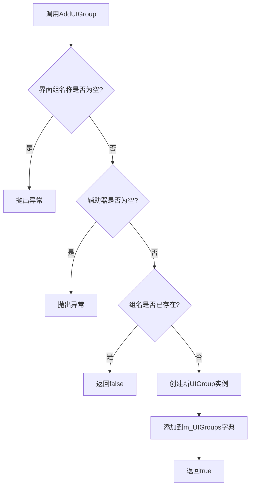
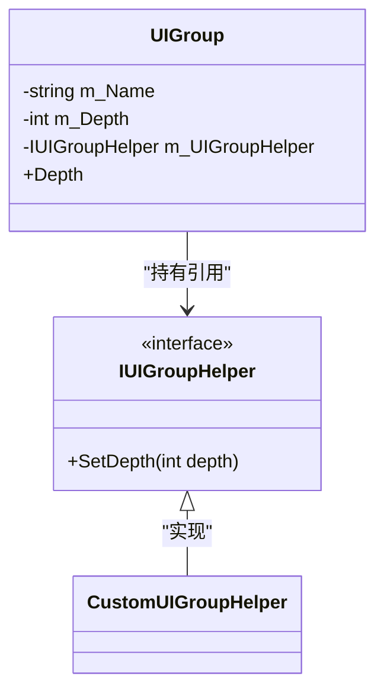

# 界面组管理

<cite>
**本文档引用的文件**
- [IUIGroup.cs](file://GameFramework/UI/IUIGroup.cs)
- [IUIManager.cs](file://GameFramework/UI/IUIManager.cs)
- [UIManager.cs](file://GameFramework/UI/UIManager.cs)
- [UIManager.UIGroup.cs](file://GameFramework/UI/UIManager.UIGroup.cs)
- [IUIGroupHelper.cs](file://GameFramework/UI/IUIGroupHelper.cs)
</cite>

## 目录
1. [简介](#简介)
2. [界面组核心属性](#界面组核心属性)
3. [界面组管理方法](#界面组管理方法)
4. [界面组层级与渲染](#界面组层级与渲染)
5. [IUIGroupHelper接口作用](#iuigrouphelper接口作用)
6. [使用示例](#使用示例)

## 简介
界面组（UIGroup）是游戏框架中用于组织和管理用户界面（UI）的核心机制。通过界面组，开发者可以对UI进行分层管理，实现Z轴排序、层级控制和行为定制。每个界面组包含一组UI界面，并通过深度（Depth）属性控制其在渲染层级中的位置。本文档详细说明界面组的创建、查询、层级管理以及相关接口的使用方法。

## 界面组核心属性

### UIGroupCount属性
`UIGroupCount` 是 `IUIManager` 接口中的一个只读属性，表示当前系统中已注册的界面组总数。该属性用于监控界面系统的整体状态，帮助开发者了解当前有多少个独立的UI分组正在被管理。

```csharp
/// <summary>
/// 获取界面组数量。
/// </summary>
int UIGroupCount { get; }
```

此属性常用于调试、性能监控或动态调整UI系统行为。例如，在初始化阶段检查是否所有预期的界面组都已正确加载。

**Section sources**
- [IUIManager.cs](file://GameFramework/UI/IUIManager.cs#L17-L19)
- [UIManager.cs](file://GameFramework/UI/UIManager.cs#L62-L66)

## 界面组管理方法

### HasUIGroup方法
`HasUIGroup` 方法用于判断指定名称的界面组是否已经存在。该方法接收一个字符串参数 `uiGroupName`，返回布尔值表示是否存在。

```csharp
bool HasUIGroup(string uiGroupName);
```

此方法适用于在创建新界面组前进行存在性检查，避免重复添加导致异常。

### GetUIGroup方法
`GetUIGroup` 方法用于根据名称获取对应的界面组实例。如果指定名称的界面组不存在，则返回 `null`。

```csharp
IUIGroup GetUIGroup(string uiGroupName);
```

该方法是访问特定界面组的主要入口，常用于后续对该组内UI的操作，如添加、查询或修改界面。

### GetAllUIGroups方法
`GetAllUIGroups` 提供了两种重载形式，用于获取系统中所有的界面组：

- 返回 `IUIGroup[]` 数组
- 接收 `List<IUIGroup>` 参数填充结果

```csharp
IUIGroup[] GetAllUIGroups();
void GetAllUIGroups(List<IUIGroup> results);
```

适用于需要遍历所有界面组进行统一操作的场景，如批量刷新、调试输出等。

**Section sources**
- [IUIManager.cs](file://GameFramework/UI/IUIManager.cs#L115-L135)
- [UIManager.cs](file://GameFramework/UI/UIManager.cs#L293-L331)

## 界面组层级与渲染

### AddUIGroup方法与uiGroupDepth参数
`AddUIGroup` 方法用于向系统注册新的界面组，其中 `uiGroupDepth` 参数决定了该组在渲染层级中的深度值。

```csharp
bool AddUIGroup(string uiGroupName, int uiGroupDepth, IUIGroupHelper uiGroupHelper);
```

#### uiGroupDepth对渲染的影响：
- **数值越大，层级越高**：具有更高深度值的界面组会覆盖在较低深度的组之上。
- **影响Z轴排序**：深度值直接影响UI元素的绘制顺序，确保重要界面（如弹窗、提示）能正确显示在顶层。
- **动态调整**：可通过 `Depth` 属性在运行时修改界面组深度，触发重新排序。

当调用 `AddUIGroup` 时，若指定名称的组已存在，则返回 `false`；否则创建并返回 `true`。



**Diagram sources**
- [UIManager.cs](file://GameFramework/UI/UIManager.cs#L362-L404)
- [UIManager.UIGroup.cs](file://GameFramework/UI/UIManager.UIGroup.cs#L38-L82)

## IUIGroupHelper接口作用

`IUIGroupHelper` 是一个接口，定义了界面组辅助器的行为，目前仅包含一个方法：

```csharp
void SetDepth(int depth);
```

### 作用说明：
- **解耦渲染逻辑**：将深度设置的具体实现从 `UIGroup` 中剥离，交由外部辅助器处理，便于定制不同平台或引擎下的UI渲染行为。
- **跨平台适配**：不同图形引擎（如UGUI、NGUI、自定义渲染器）可通过实现此接口适配各自的层级设置方式。
- **动态响应**：每当 `UIGroup.Depth` 被修改时，会自动调用 `Helper.SetDepth(depth)`，确保渲染层同步更新。



**Diagram sources**
- [IUIGroupHelper.cs](file://GameFramework/UI/IUIGroupHelper.cs#L12-L19)
- [UIManager.UIGroup.cs](file://GameFramework/UI/UIManager.UIGroup.cs#L38-L82)

## 使用示例

### 创建并管理界面组
```csharp
// 获取UI管理器实例
IUIManager uiManager = GameFrameworkEntry.GetModule<IUIManager>();

// 定义辅助器实现
class MyUIGroupHelper : IUIGroupHelper
{
    public void SetDepth(int depth)
    {
        // 自定义深度设置逻辑，例如更新Canvas的sortingOrder
        Debug.Log($"设置界面组深度: {depth}");
    }
}

// 添加三个不同层级的界面组
uiManager.AddUIGroup("Background", 10, new MyUIGroupHelper());  // 背景层
uiManager.AddUIGroup("Main", 20, new MyUIGroupHelper());       // 主界面层
uiManager.AddUIGroup("Popup", 30, new MyUIGroupHelper());      // 弹窗层

// 查询界面组
IUIGroup popupGroup = uiManager.GetUIGroup("Popup");
if (popupGroup != null)
{
    Debug.Log($"Popup组当前深度: {popupGroup.Depth}");
}
```

### 实现Z轴排序
当打开新UI时，框架会自动将其加入对应组的链表头部，结合深度值实现Z轴排序：

```csharp
// 打开一个UI到Popup组
int serialId = uiManager.OpenUIForm("MessageBox", "Popup");

// 内部逻辑：新UI插入链表头部 → Refresh() → OnDepthChanged() → Helper.SetDepth()
```

最终渲染顺序由两层决定：
1. **组间排序**：依据 `Depth` 值，高深度组整体在上。
2. **组内排序**：依据链表顺序，后打开的UI在前（LIFO）。

**Section sources**
- [UIManager.cs](file://GameFramework/UI/UIManager.cs#L362-L404)
- [UIManager.UIGroup.cs](file://GameFramework/UI/UIManager.UIGroup.cs#L38-L82)
- [IUIGroupHelper.cs](file://GameFramework/UI/IUIGroupHelper.cs#L12-L19)