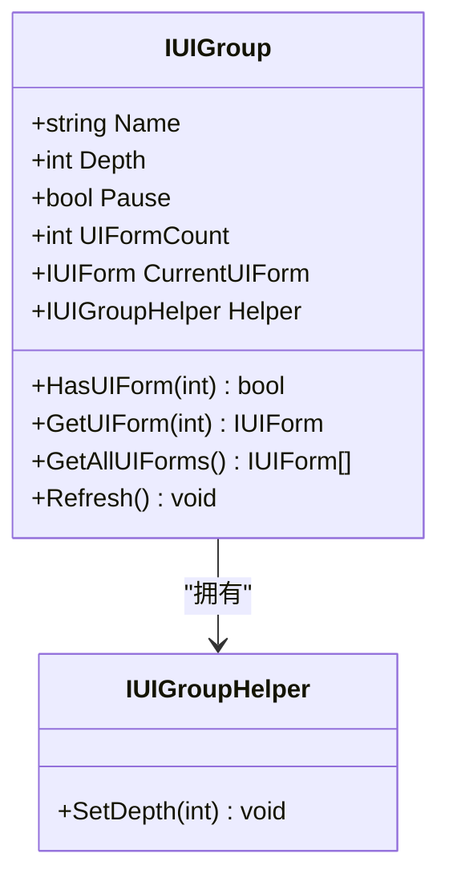
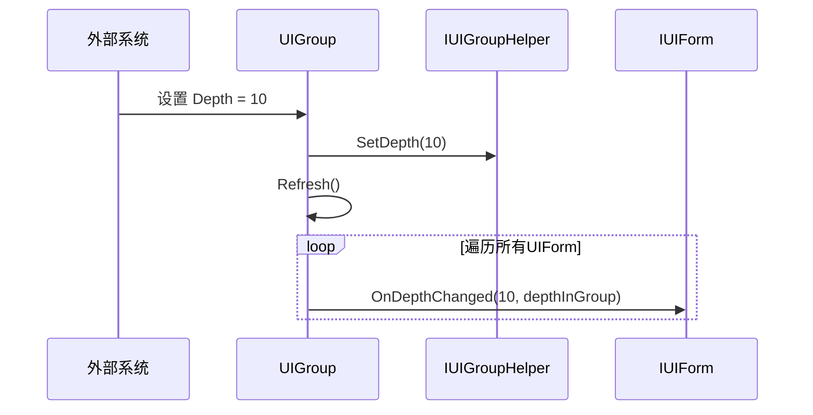
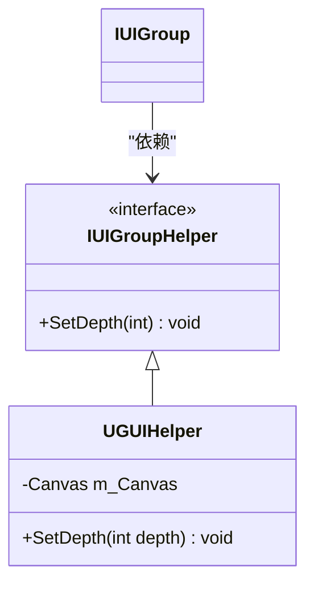

# 界面组配置

<cite>
**本文档中引用的文件**   
- [IUIGroup.cs](file://GameFramework/UI/IUIGroup.cs)
- [IUIGroupHelper.cs](file://GameFramework/UI/IUIGroupHelper.cs)
- [UIManager.UIGroup.cs](file://GameFramework/UI/UIManager.UIGroup.cs)
- [IUIForm.cs](file://GameFramework/UI/IUIForm.cs)
</cite>

## 目录
1. [引言](#引言)
2. [核心配置属性](#核心配置属性)
3. [Depth属性与Z轴排序机制](#depth属性与z轴排序机制)
4. [Pause属性与界面暂停控制](#pause属性与界面暂停控制)
5. [Helper属性与自定义行为扩展](#helper属性与自定义行为扩展)
6. [外部系统动态调整深度](#外部系统动态调整深度)
7. [配置变更监听与集成建议](#配置变更监听与集成建议)
8. [结论](#结论)

## 引言
界面组（UIGroup）是UI框架中的核心管理单元，负责组织和控制一组界面（UIForm）的显示、更新和生命周期。本文档深入解析界面组的运行时配置能力，重点阐述Depth属性对UI渲染Z轴排序的影响机制、Pause属性对组内所有UIForm的暂停控制逻辑，以及Helper属性如何通过实现IUIGroupHelper接口来扩展界面组的自定义行为。同时，文档将说明外部系统如何通过Helper属性动态调整界面组深度，并提供配置变更的监听方案与UI框架集成建议，确保开发者充分理解配置更改的实时性与作用范围。

## 核心配置属性
界面组通过三个核心属性进行运行时配置：`Depth`、`Pause`和`Helper`。这些属性共同决定了界面组在UI层级中的位置、其内部界面的更新状态以及渲染行为。



**图示来源**
- [IUIGroup.cs](file://GameFramework/UI/IUIGroup.cs#L14-L119)
- [IUIGroupHelper.cs](file://GameFramework/UI/IUIGroupHelper.cs#L12-L19)

**本节来源**
- [IUIGroup.cs](file://GameFramework/UI/IUIGroup.cs#L14-L119)

## Depth属性与Z轴排序机制
`Depth`属性是控制UI渲染Z轴顺序的关键。它定义了整个界面组在全局UI层级中的基础深度。当界面组的`Depth`值被修改时，会触发一系列连锁反应，确保所有组内界面的Z轴位置得到正确更新。

其核心机制如下：
1.  **属性变更触发**：当通过`IUIGroup.Depth`的setter设置新值时，首先会检查新旧值是否相同，若相同则直接返回，避免不必要的更新。
2.  **辅助器调用**：若深度值发生变化，新的`Depth`值会被立即传递给`Helper`属性所引用的`IUIGroupHelper`对象的`SetDepth`方法。这允许外部系统（如UI渲染器）接收到深度变更的通知，并执行相应的渲染层调整。
3.  **组内刷新**：调用`Refresh()`方法，遍历该界面组中的所有`UIForm`。
4.  **深度回调**：对于组内的每一个`UIForm`，框架会调用其`OnDepthChanged(int uiGroupDepth, int depthInUIGroup)`方法。该方法接收两个参数：
    *   `uiGroupDepth`：即当前界面组的`Depth`值。
    *   `depthInUIGroup`：该界面在其所属组内的相对深度（通常根据其在组内链表中的位置倒序计算）。
5.  **最终渲染**：`UIForm`的实现者（即具体的UI脚本）可以根据这两个深度值，计算出自身在最终渲染队列中的绝对Z轴坐标，并更新其Transform或Canvas的Sorting Order。

此机制确保了界面组作为一个整体的深度调整能够实时、一致地反映到所有成员界面上。



**图示来源**
- [IUIGroup.cs](file://GameFramework/UI/IUIGroup.cs#L27-L31)
- [UIManager.UIGroup.cs](file://GameFramework/UI/UIManager.UIGroup.cs#L61-L82)
- [IUIForm.cs](file://GameFramework/UI/IUIForm.cs#L129-L129)

**本节来源**
- [IUIGroup.cs](file://GameFramework/UI/IUIGroup.cs#L27-L31)
- [UIManager.UIGroup.cs](file://GameFramework/UI/UIManager.UIGroup.cs#L61-L82)
- [IUIForm.cs](file://GameFramework/UI/IUIForm.cs#L129-L129)

## Pause属性与界面暂停控制
`Pause`属性用于控制界面组内所有`UIForm`的逻辑更新和交互状态。当一个界面组被暂停时，其内部的界面将停止接收`OnUpdate`事件，并进入暂停状态。

其控制逻辑如下：
1.  **属性变更**：当`Pause`属性被设置为`true`时，`m_Pause`字段被更新。
2.  **触发刷新**：与`Depth`属性类似，`Pause`的变更也会调用`Refresh()`方法。
3.  **状态同步**：在`Refresh()`方法的遍历过程中，如果`m_Pause`为`true`，则会对每个`UIForm`执行以下操作：
    *   如果该界面尚未被“遮挡”（Covered），则调用其`OnCover()`方法。
    *   如果该界面尚未处于“暂停”（Paused）状态，则调用其`OnPause()`方法。
4.  **恢复逻辑**：当`Pause`被设置回`false`时，`Refresh()`方法会遍历所有界面，对处于暂停状态的界面调用`OnResume()`方法，使其恢复正常的更新和交互。
5.  **层级暂停**：值得注意的是，`Pause`状态的传播是层级化的。如果一个`UIForm`的`PauseCoveredUIForm`属性为`true`，那么当它被新打开的界面覆盖时，会自动导致其下方的界面组进入暂停状态。

此机制为开发者提供了强大的批量控制能力，例如在打开一个全屏弹窗时，可以轻松地暂停所有背景界面的逻辑更新，以节省性能。

```mermaid
flowchart TD
A[设置 Pause = true] --> B{遍历所有UIForm}
B --> C[UIForm是否已Covered?]
C --> |否| D[调用 OnCover()]
C --> |是| E[跳过]
D --> F[UIForm是否已Paused?]
E --> F
F --> |否| G[调用 OnPause()]
F --> |是| H[跳过]
G --> I[完成]
H --> I
```

**图示来源**
- [IUIGroup.cs](file://GameFramework/UI/IUIGroup.cs#L36-L40)
- [UIManager.UIGroup.cs](file://GameFramework/UI/UIManager.UIGroup.cs#L84-L136)
- [UIManager.UIGroup.cs](file://GameFramework/UI/UIManager.UIGroup.cs#L407-L444)

**本节来源**
- [IUIGroup.cs](file://GameFramework/UI/IUIGroup.cs#L36-L40)
- [UIManager.UIGroup.cs](file://GameFramework/UI/UIManager.UIGroup.cs#L84-L136)
- [IUIForm.cs](file://GameFramework/UI/IUIForm.cs#L94-L94)

## Helper属性与自定义行为扩展
`Helper`属性是界面组与外部系统进行交互的桥梁。它持有一个`IUIGroupHelper`接口的实例，该接口定义了`SetDepth(int depth)`方法。通过这个属性，界面组可以将内部状态的变更（主要是深度）通知给外部的渲染系统或自定义逻辑。

`IUIGroupHelper`接口的设计遵循了依赖倒置原则，使得界面管理器（UIManager）的核心逻辑不依赖于任何具体的渲染实现。开发者可以创建自己的`IUIGroupHelper`实现类，来适配不同的UI系统（如UGUI、NGUI或自定义渲染器）。

例如，一个UGUI的Helper实现可能会在`SetDepth`方法中，根据传入的深度值，动态地调整该界面组所对应Canvas的`sortingOrder`属性，从而实现Z轴排序。



**图示来源**
- [IUIGroupHelper.cs](file://GameFramework/UI/IUIGroupHelper.cs#L12-L19)
- [IUIGroup.cs](file://GameFramework/UI/IUIGroup.cs#L61-L64)

**本节来源**
- [IUIGroupHelper.cs](file://GameFramework/UI/IUIGroupHelper.cs#L12-L19)
- [IUIGroup.cs](file://GameFramework/UI/IUIGroup.cs#L61-L64)

## 外部系统动态调整深度
外部系统可以通过`IUIGroup`接口的`Helper`属性，间接地动态调整界面组的深度。具体流程如下：

1.  **获取界面组引用**：外部系统首先需要通过`IUIManager.GetUIGroup(string uiGroupName)`方法获取目标界面组的`IUIGroup`接口引用。
2.  **修改Depth属性**：直接对获取到的`IUIGroup`对象的`Depth`属性进行赋值操作。
3.  **触发连锁反应**：如前所述，`Depth`属性的setter会自动调用`Helper.SetDepth()`，并触发`Refresh()`，从而完成整个深度更新流程。

这种方式保证了深度调整的封装性和一致性，所有深度变更都必须通过统一的入口，确保了`Helper`和`Refresh()`逻辑的正确执行。

**本节来源**
- [IUIGroup.cs](file://GameFramework/UI/IUIGroup.cs#L27-L31)
- [UIManager.cs](file://GameFramework/UI/UIManager.cs#L301-L315)

## 配置变更监听与集成建议
由于`Depth`和`Pause`属性的变更会立即触发`Helper.SetDepth()`和`Refresh()`，因此`IUIGroupHelper`的`SetDepth`方法是监听深度变更的最佳位置。开发者应在其实现类中重写此方法，以执行具体的渲染层调整逻辑。

**集成建议**：
*   **实时性**：所有配置变更都是实时生效的。一旦`Depth`或`Pause`被修改，相关回调会立即在下一帧的`Update`周期中被处理。
*   **作用范围**：`Depth`和`Pause`的变更作用于整个界面组及其所有成员`UIForm`。`Depth`影响Z轴排序，`Pause`影响逻辑更新。
*   **避免直接操作**：应避免绕过`IUIGroup`接口直接操作`UIForm`的深度或暂停状态，这会破坏框架的统一管理。所有控制都应通过界面组进行。
*   **Helper实现**：确保为每个界面组正确配置了合适的`IUIGroupHelper`实现，否则`SetDepth`调用将无效。

## 结论
界面组的`Depth`、`Pause`和`Helper`属性构成了一个强大而灵活的运行时配置系统。`Depth`属性通过与`IUIGroupHelper`的协作，精确控制UI的Z轴渲染顺序；`Pause`属性提供了一种高效的批量暂停机制，用于管理界面的更新状态；而`Helper`属性则作为扩展点，允许开发者将框架逻辑与具体的UI渲染系统无缝集成。理解这些属性的内部机制和相互关系，对于构建高性能、可维护的UI系统至关重要。