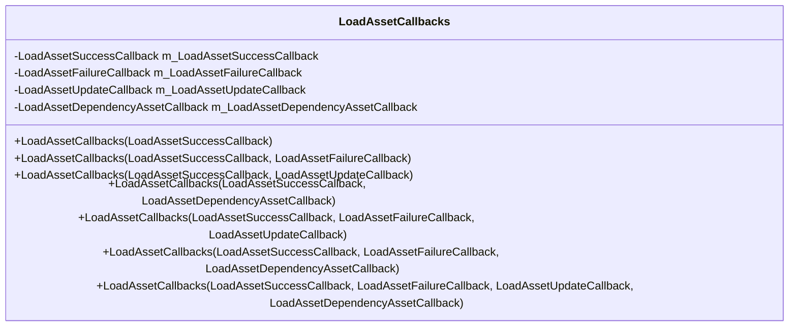
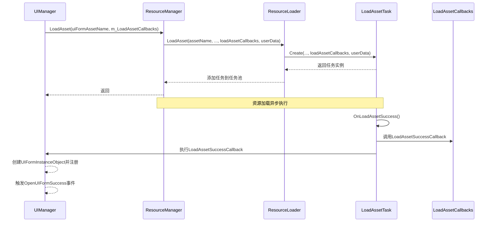

# LoadAssetCallbacks回调机制

<cite>
**本文档引用的文件**  
- [LoadAssetCallbacks.cs](file://GameFramework/Resource/LoadAssetCallbacks.cs)
- [UIManager.cs](file://GameFramework/UI/UIManager.cs)
- [ResourceManager.ResourceLoader.cs](file://GameFramework/Resource/ResourceManager.ResourceLoader.cs)
- [ResourceManager.ResourceLoader.LoadAssetTask.cs](file://GameFramework/Resource/ResourceManager.ResourceLoader.LoadAssetTask.cs)
</cite>

## 目录
1. [简介](#简介)
2. [核心回调委托详解](#核心回调委托详解)
3. [构造函数重载设计](#构造函数重载设计)
4. [在UIManager中的实际应用](#在uimanager中的实际应用)
5. [执行流程与触发时机](#执行流程与触发时机)
6. [总结](#总结)

## 简介
`LoadAssetCallbacks` 类是游戏框架中用于管理资源加载过程中各类事件回调的核心组件。该类通过封装四个关键的回调委托，实现了对资源加载成功、失败、进度更新以及依赖资源加载等场景的精细化控制。其设计充分体现了灵活性与可扩展性，允许调用者根据实际需求选择性地注册所需回调函数。

**Section sources**
- [LoadAssetCallbacks.cs](file://GameFramework/Resource/LoadAssetCallbacks.cs#L12-L143)

## 核心回调委托详解
`LoadAssetCallbacks` 类定义了四个核心回调委托，分别对应资源加载过程中的不同阶段和状态。

### LoadAssetSuccessCallback（加载成功回调）
当目标资源及其所有依赖项均成功加载并准备就绪时触发。此回调通常用于初始化新加载的资源实例，并通知上层系统进行后续处理。

**Section sources**
- [LoadAssetCallbacks.cs](file://GameFramework/Resource/LoadAssetCallbacks.cs#L103-L109)

### LoadAssetFailureCallback（加载失败回调）
在资源加载过程中发生任何错误时触发，例如资源不存在、依赖缺失或加载异常。该回调提供了详细的错误信息，便于进行错误处理和用户提示。

**Section sources**
- [LoadAssetCallbacks.cs](file://GameFramework/Resource/LoadAssetCallbacks.cs#L114-L120)

### LoadAssetUpdateCallback（加载更新回调）
在资源加载过程中定期触发，用于报告当前的加载进度。此回调对于实现加载进度条或百分比显示等UI功能至关重要。

**Section sources**
- [LoadAssetCallbacks.cs](file://GameFramework/Resource/LoadAssetCallbacks.cs#L125-L131)

### LoadAssetDependencyAssetCallback（依赖资源加载回调）
每当一个依赖资源被成功加载时触发。该回调会传递当前已加载的依赖数量和总依赖数量，有助于监控依赖加载的整体进度。

**Section sources**
- [LoadAssetCallbacks.cs](file://GameFramework/Resource/LoadAssetCallbacks.cs#L136-L142)

## 构造函数重载设计
`LoadAssetCallbacks` 类提供了多个构造函数重载，允许调用者灵活组合所需的回调函数，体现了高度的使用便捷性。

**Diagram sources**
- [LoadAssetCallbacks.cs](file://GameFramework/Resource/LoadAssetCallbacks.cs#L12-L143)

所有构造函数最终都会调用具有完整参数列表的私有构造函数，确保对象状态的一致性。这种设计模式既保证了API的简洁性，又不失功能的完整性。

**Section sources**
- [LoadAssetCallbacks.cs](file://GameFramework/Resource/LoadAssetCallbacks.cs#L23-L98)

## 在UIManager中的实际应用
`UIManager` 类通过其私有字段 `m_LoadAssetCallbacks` 实例化了一个包含全部四个回调的 `LoadAssetCallbacks` 对象，用于管理界面资源的加载过程。

**Diagram sources**
- [UIManager.cs](file://GameFramework/UI/UIManager.cs#L39-L57)
- [ResourceManager.ResourceLoader.cs](file://GameFramework/Resource/ResourceManager.ResourceLoader.cs#L305-L354)
- [ResourceManager.ResourceLoader.LoadAssetTask.cs](file://GameFramework/Resource/ResourceManager.ResourceLoader.LoadAssetTask.cs#L15-L84)

### 回调方法绑定
`UIManager` 将其内部的私有方法绑定到 `LoadAssetCallbacks` 的各个回调上：

- `LoadAssetSuccessCallback` 绑定到 `private void LoadAssetSuccessCallback(string, object, float, object)`
- `LoadAssetFailureCallback` 绑定到 `private void LoadAssetFailureCallback(string, LoadResourceStatus, string, object)`
- `LoadAssetUpdateCallback` 绑定到 `private void LoadAssetUpdateCallback(string, float, object)`
- `LoadAssetDependencyAssetCallback` 绑定到 `private void LoadAssetDependencyAssetCallback(string, string, int, int, object)`

这些私有方法在被调用时，会进一步处理加载结果，并通过事件机制（如 `OpenUIFormSuccess`、`OpenUIFormFailure` 等）通知外部监听者，实现了资源加载与UI系统之间的解耦。

**Section sources**
- [UIManager.cs](file://GameFramework/UI/UIManager.cs#L39-L57)
- [UIManager.cs](file://GameFramework/UI/UIManager.cs#L975-L1056)

## 执行流程与触发时机
资源加载的完整流程由 `ResourceManager` 和其内部的 `ResourceLoader` 协同完成。`LoadAssetTask` 作为具体的任务单元，在其生命周期的各个阶段会检查 `LoadAssetCallbacks` 中对应的回调是否为空，若不为空则进行调用。

例如，在 `OnLoadAssetSuccess` 方法中，代码会检查 `m_LoadAssetCallbacks.LoadAssetSuccessCallback` 是否存在，如果存在，则立即调用它，并传入资源名、资源对象、加载耗时和用户数据等参数。其他回调的触发逻辑与此类似。

这种设计确保了回调机制的健壮性：即使某个回调未被注册，也不会影响整个加载流程的执行。

**Section sources**
- [ResourceManager.ResourceLoader.LoadAssetTask.cs](file://GameFramework/Resource/ResourceManager.ResourceLoader.LoadAssetTask.cs#L60-L84)

## 总结
`LoadAssetCallbacks` 类通过精心设计的回调委托和构造函数重载，为资源加载过程提供了强大而灵活的事件通知机制。其在 `UIManager` 中的应用，展示了如何将底层资源管理与上层业务逻辑（如UI系统）进行有效集成。通过私有方法绑定和事件转发，该机制实现了高内聚、低耦合的架构设计，是游戏框架中资源管理模块的重要组成部分。

**Section sources**
- [LoadAssetCallbacks.cs](file://GameFramework/Resource/LoadAssetCallbacks.cs#L12-L143)
- [UIManager.cs](file://GameFramework/UI/UIManager.cs#L39-L57)