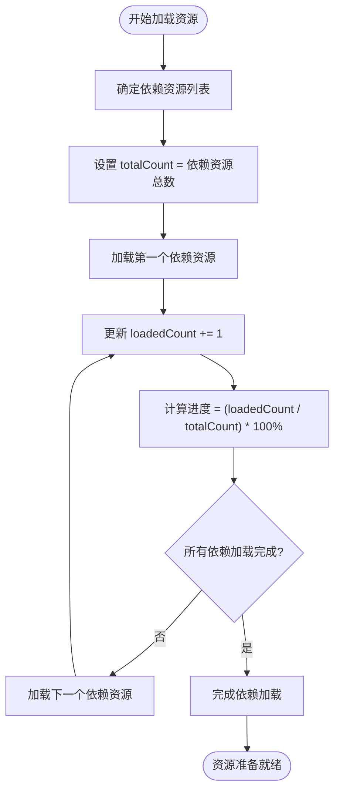
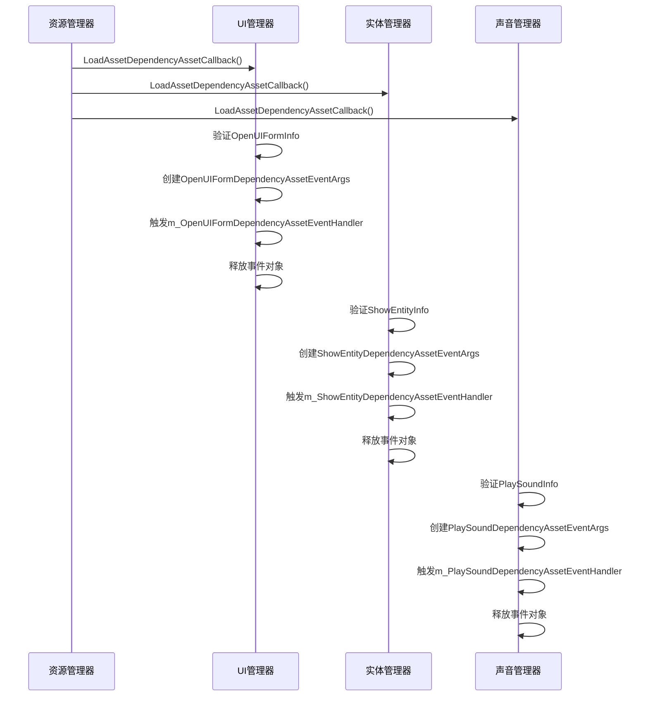
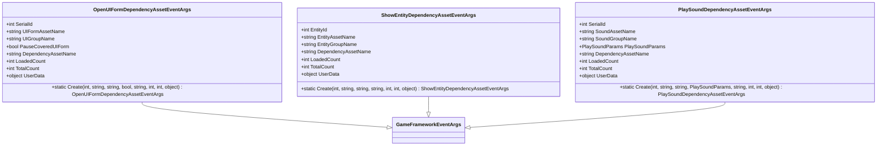

# 加载资源依赖项回调

<cite>
**Referenced Files in This Document**   
- [LoadAssetDependencyAssetCallback.cs](file://GameFramework/Resource/LoadAssetDependencyAssetCallback.cs)
- [LoadAssetCallbacks.cs](file://GameFramework/Resource/LoadAssetCallbacks.cs)
- [OpenUIFormDependencyAssetEventArgs.cs](file://GameFramework/UI/OpenUIFormDependencyAssetEventArgs.cs)
- [ShowEntityDependencyAssetEventArgs.cs](file://GameFramework/Entity/ShowEntityDependencyAssetEventArgs.cs)
- [PlaySoundDependencyAssetEventArgs.cs](file://GameFramework/Sound/PlaySoundDependencyAssetEventArgs.cs)
- [ResourceManager.ResourceLoader.LoadDependencyAssetTask.cs](file://GameFramework/Resource/ResourceManager.ResourceLoader.LoadDependencyAssetTask.cs)
</cite>

## 目录
1. [加载资源依赖项回调](#加载资源依赖项回调)
2. [核心参数解析](#核心参数解析)
3. [加载进度计算机制](#加载进度计算机制)
4. [上层系统通知机制](#上层系统通知机制)
5. [复杂资源加载中的重要性](#复杂资源加载中的重要性)
6. [可视化监控与调试](#可视化监控与调试)
7. [事件驱动架构](#事件驱动架构)

## 核心参数解析

`LoadAssetDependencyAssetCallback` 委托在处理资源依赖关系时扮演着关键角色，其定义位于 `LoadAssetDependencyAssetCallback.cs` 文件中。该委托接收五个参数，每个参数都承载着特定的语义信息：

- **assetName**: 表示正在加载的主资源名称。这是依赖关系的起点，标识了当前操作所针对的核心资源。
- **dependencyAssetName**: 表示被加载的依赖资源名称。在资源加载过程中，一个主资源可能依赖于多个子资源，此参数标识了当前正在处理的具体依赖项。
- **loadedCount**: 表示当前已成功加载的依赖资源数量。这是一个动态递增的计数器，反映了加载过程的实时进度。
- **totalCount**: 表示总共需要加载的依赖资源数量。这个值在加载开始时确定，为进度计算提供了基准。
- **userData**: 用户自定义数据，用于在回调过程中传递上下文信息。

**Section sources**
- [LoadAssetDependencyAssetCallback.cs](file://GameFramework/Resource/LoadAssetDependencyAssetCallback.cs#L1-L20)

## 加载进度计算机制

加载进度的计算是通过 `loadedCount` 和 `totalCount` 两个参数实现的。当资源加载器开始处理一个包含多个依赖项的资源时，它会首先确定所有依赖资源的总数，并将此值赋给 `totalCount`。随着每个依赖资源的成功加载，`loadedCount` 会递增1。

进度百分比的计算公式为：`progress = (loadedCount / totalCount) * 100%`。这种机制允许上层系统精确地跟踪加载过程，从0%到100%的完整进度条可以被准确地渲染。`ResourceManager.ResourceLoader.LoadDependencyAssetTask` 类中的 `Create` 方法在创建依赖加载任务时，会将主任务的 `TotalDependencyAssetCount` 递增，这正是 `totalCount` 的来源。

**Diagram sources**
- [ResourceManager.ResourceLoader.LoadDependencyAssetTask.cs](file://GameFramework/Resource/ResourceManager.ResourceLoader.LoadDependencyAssetTask.cs#L1-L60)
- [LoadAssetDependencyAssetCallback.cs](file://GameFramework/Resource/LoadAssetDependencyAssetCallback.cs#L1-L20)

**Section sources**
- [ResourceManager.ResourceLoader.LoadDependencyAssetTask.cs](file://GameFramework/Resource/ResourceManager.ResourceLoader.LoadDependencyAssetTask.cs#L1-L60)

## 上层系统通知机制

`LoadAssetDependencyAssetCallback` 通过事件机制将依赖加载信息通知给上层系统。在UI、Entity和Sound系统中，都实现了相应的回调方法来处理这一事件：

- **UI系统**: `UIManager` 类中的 `LoadAssetDependencyAssetCallback` 方法会创建 `OpenUIFormDependencyAssetEventArgs` 事件，通知UI系统当前正在加载的界面依赖资源及其进度。
- **Entity系统**: `EntityManager` 类中的 `LoadAssetDependencyAssetCallback` 方法会创建 `ShowEntityDependencyAssetEventArgs` 事件，通知实体系统实体依赖资源的加载状态。
- **Sound系统**: `SoundManager` 类中的 `LoadAssetDependencyAssetCallback` 方法会创建 `PlaySoundDependencyAssetEventArgs` 事件，通知声音系统音频依赖资源的加载情况。

这些回调方法都遵循相同的模式：首先验证用户数据的有效性，然后通过相应的事件处理器发布事件，最后释放事件对象以避免内存泄漏。

**Diagram sources**
- [UIManager.cs](file://GameFramework/UI/UIManager.cs#L1042-L1056)
- [EntityManager.cs](file://GameFramework/Entity/EntityManager.cs#L1310-L1324)
- [SoundManager.cs](file://GameFramework/Sound/SoundManager.cs#L737-L751)

**Section sources**
- [UIManager.cs](file://GameFramework/UI/UIManager.cs#L1042-L1056)
- [EntityManager.cs](file://GameFramework/Entity/EntityManager.cs#L1310-L1324)
- [SoundManager.cs](file://GameFramework/Sound/SoundManager.cs#L737-L751)

## 复杂资源加载中的重要性

在处理包含多个子资源的复杂资源（如Prefab）时，`LoadAssetDependencyAssetCallback` 机制的重要性尤为突出。一个Prefab可能包含纹理、材质、动画、音频等多个依赖资源，这些资源需要按特定顺序或并行加载。

该机制确保了：
1. **完整性**: 所有依赖资源都必须成功加载，主资源才能被视为准备就绪。
2. **顺序性**: 某些依赖资源可能需要优先加载，以确保后续资源的正确解析。
3. **容错性**: 当某个依赖资源加载失败时，系统可以及时捕获错误并采取相应措施，如重试或降级处理。

通过 `LoadAssetCallbacks` 类，开发者可以灵活地组合不同的回调函数，仅在需要时启用依赖加载进度通知，从而优化性能。

**Section sources**
- [LoadAssetCallbacks.cs](file://GameFramework/Resource/LoadAssetCallbacks.cs#L1-L143)

## 可视化监控与调试

通过 `OpenUIFormDependencyAssetEventArgs` 等事件，系统实现了依赖加载过程的可视化监控与调试。这些事件不仅包含了基本的进度信息，还携带了丰富的上下文数据：

- **UI系统**: 包含界面序列编号、界面组名称、是否暂停被覆盖界面等信息，便于在UI上显示精确的加载状态。
- **Entity系统**: 包含实体编号、实体组名称等信息，有助于在调试工具中追踪特定实体的加载过程。
- **Sound系统**: 包含播放声音参数，允许根据不同的播放配置调整加载策略。

这些事件通过 `ReferencePool` 进行对象池管理，既保证了性能，又避免了频繁的内存分配与回收。

**Diagram sources**
- [OpenUIFormDependencyAssetEventArgs.cs](file://GameFramework/UI/OpenUIFormDependencyAssetEventArgs.cs#L1-L144)
- [ShowEntityDependencyAssetEventArgs.cs](file://GameFramework/Entity/ShowEntityDependencyAssetEventArgs.cs#L1-L131)
- [PlaySoundDependencyAssetEventArgs.cs](file://GameFramework/Sound/PlaySoundDependencyAssetEventArgs.cs#L1-L144)

**Section sources**
- [OpenUIFormDependencyAssetEventArgs.cs](file://GameFramework/UI/OpenUIFormDependencyAssetEventArgs.cs#L1-L144)
- [ShowEntityDependencyAssetEventArgs.cs](file://GameFramework/Entity/ShowEntityDependencyAssetEventArgs.cs#L1-L131)
- [PlaySoundDependencyAssetEventArgs.cs](file://GameFramework/Sound/PlaySoundDependencyAssetEventArgs.cs#L1-L144)

## 事件驱动架构

整个依赖加载通知系统建立在事件驱动架构之上。`LoadAssetDependencyAssetCallback` 作为事件的源头，通过资源管理器触发，由各个子系统注册的事件处理器接收并处理。这种松耦合的设计使得各个系统可以独立地响应加载事件，而无需直接依赖资源管理器的具体实现。

事件的创建和释放都通过 `ReferencePool` 进行管理，确保了高性能和低内存占用。`Create` 静态方法从对象池中获取实例并初始化，而 `Clear` 方法则在事件处理完成后将其状态重置并返回池中，实现了高效的对象复用。

**Section sources**
- [OpenUIFormDependencyAssetEventArgs.cs](file://GameFramework/UI/OpenUIFormDependencyAssetEventArgs.cs#L1-L144)
- [ShowEntityDependencyAssetEventArgs.cs](file://GameFramework/Entity/ShowEntityDependencyAssetEventArgs.cs#L1-L131)
- [PlaySoundDependencyAssetEventArgs.cs](file://GameFramework/Sound/PlaySoundDependencyAssetEventArgs.cs#L1-L144)