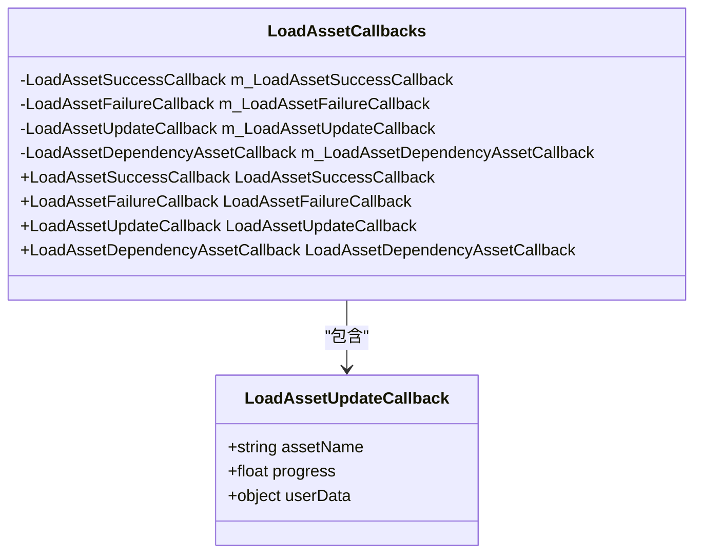
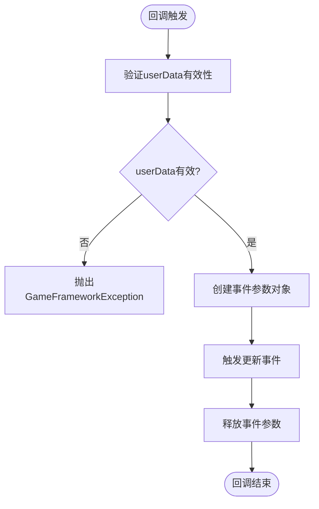
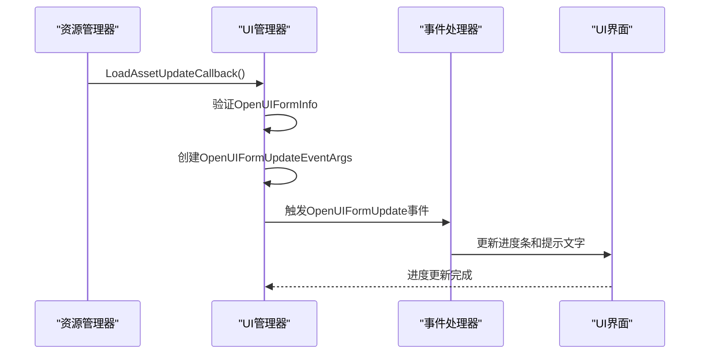
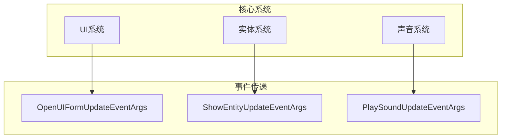
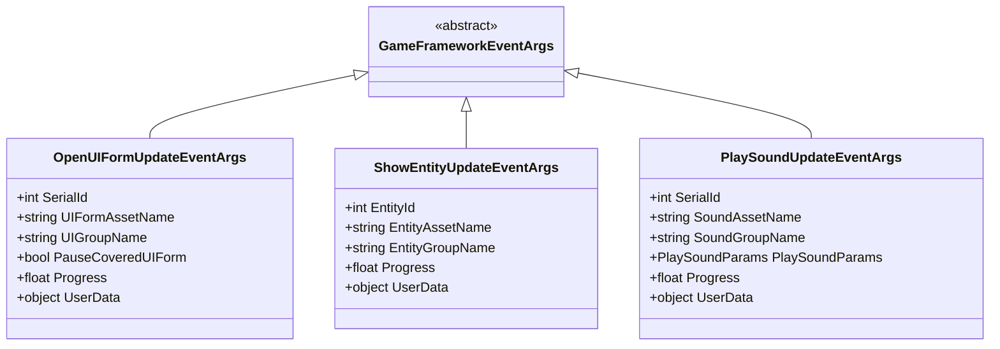

# 加载资源进度更新回调

<cite>
**Referenced Files in This Document**  
- [LoadAssetUpdateCallback.cs](file://GameFramework/Resource/LoadAssetUpdateCallback.cs)
- [LoadAssetCallbacks.cs](file://GameFramework/Resource/LoadAssetCallbacks.cs)
- [UIManager.cs](file://GameFramework/UI/UIManager.cs)
- [EntityManager.cs](file://GameFramework/Entity/EntityManager.cs)
- [SoundManager.cs](file://GameFramework/Sound/SoundManager.cs)
- [OpenUIFormUpdateEventArgs.cs](file://GameFramework/UI/OpenUIFormUpdateEventArgs.cs)
- [ShowEntityUpdateEventArgs.cs](file://GameFramework/Entity/ShowEntityUpdateEventArgs.cs)
- [PlaySoundUpdateEventArgs.cs](file://GameFramework/Sound/PlaySoundUpdateEventArgs.cs)
</cite>

## 目录
1. [简介](#简介)
2. [核心机制](#核心机制)
3. [参数详解](#参数详解)
4. [UI系统集成](#ui系统集成)
5. [跨模块应用](#跨模块应用)
6. [用户体验分析](#用户体验分析)
7. [事件同步机制](#事件同步机制)

## 简介

`LoadAssetUpdateCallback` 是游戏框架中用于异步加载资源时提供进度反馈的核心委托。该回调机制在长时间资源加载过程中为用户提供实时反馈，显著提升了用户体验。通过将加载进度传递给UI系统，开发者可以实现动态更新的加载界面，如进度条和提示文字。

该回调在实体系统和声音系统中均有广泛应用，通过事件机制实现跨模块的进度同步。其设计体现了游戏框架对用户体验和系统解耦的重视。

**Section sources**
- [LoadAssetUpdateCallback.cs](file://GameFramework/Resource/LoadAssetUpdateCallback.cs)

## 核心机制

`LoadAssetUpdateCallback` 作为 `LoadAssetCallbacks` 类的一部分，与其他回调函数共同构成了完整的资源加载回调体系。当资源加载过程中需要更新进度时，系统会调用此回调函数。

该机制通过委托模式实现，允许不同模块注册自己的进度更新处理逻辑。在 `UIManager`、`EntityManager` 和 `SoundManager` 中，都实现了针对各自业务场景的 `LoadAssetUpdateCallback` 方法。

**Diagram sources**
- [LoadAssetUpdateCallback.cs](file://GameFramework/Resource/LoadAssetUpdateCallback.cs)
- [LoadAssetCallbacks.cs](file://GameFramework/Resource/LoadAssetCallbacks.cs)

**Section sources**
- [LoadAssetCallbacks.cs](file://GameFramework/Resource/LoadAssetCallbacks.cs)

## 参数详解

`LoadAssetUpdateCallback` 委托包含三个关键参数：

- **assetName**: 正在加载的资源名称，用于标识当前加载的资源
- **progress**: 加载进度，归一化范围为 0.0~1.0，表示加载完成的百分比
- **userData**: 用户自定义数据，用于传递上下文信息

**Diagram sources**
- [UIManager.cs](file://GameFramework/UI/UIManager.cs#L1026-L1040)
- [EntityManager.cs](file://GameFramework/Entity/EntityManager.cs#L1294-L1308)
- [SoundManager.cs](file://GameFramework/Sound/SoundManager.cs#L721-L735)

**Section sources**
- [UIManager.cs](file://GameFramework/UI/UIManager.cs#L1026-L1040)
- [EntityManager.cs](file://GameFramework/Entity/EntityManager.cs#L1294-L1308)
- [SoundManager.cs](file://GameFramework/Sound/SoundManager.cs#L721-L735)

## UI系统集成

在 `UIManager` 中，`LoadAssetUpdateCallback` 被用于更新界面加载进度。当用户打开一个UI界面时，系统会触发此回调，并将进度信息通过 `OpenUIFormUpdateEventArgs` 事件传递给UI系统。

**Diagram sources**
- [UIManager.cs](file://GameFramework/UI/UIManager.cs#L1026-L1040)
- [OpenUIFormUpdateEventArgs.cs](file://GameFramework/UI/OpenUIFormUpdateEventArgs.cs)

**Section sources**
- [UIManager.cs](file://GameFramework/UI/UIManager.cs#L1026-L1040)

## 跨模块应用

`LoadAssetUpdateCallback` 在多个核心系统中都有应用，体现了其通用性和重要性。

### 实体系统应用

在实体系统中，当加载实体资源时，`EntityManager` 会调用 `LoadAssetUpdateCallback` 来更新加载进度。进度信息通过 `ShowEntityUpdateEventArgs` 事件传递。

### 声音系统应用

在声音系统中，播放声音前需要加载声音资源。`SoundManager` 通过 `LoadAssetUpdateCallback` 监控加载进度，并通过 `PlaySoundUpdateEventArgs` 事件通知相关模块。

**Diagram sources**
- [EntityManager.cs](file://GameFramework/Entity/EntityManager.cs#L1294-L1308)
- [ShowEntityUpdateEventArgs.cs](file://GameFramework/Entity/ShowEntityUpdateEventArgs.cs)
- [SoundManager.cs](file://GameFramework/Sound/SoundManager.cs#L721-L735)
- [PlaySoundUpdateEventArgs.cs](file://GameFramework/Sound/PlaySoundUpdateEventArgs.cs)

**Section sources**
- [EntityManager.cs](file://GameFramework/Entity/EntityManager.cs#L1294-L1308)
- [SoundManager.cs](file://GameFramework/Sound/SoundManager.cs#L721-L735)

## 用户体验分析

`LoadAssetUpdateCallback` 在提升用户体验方面发挥着关键作用：

1. **实时反馈**: 在长时间资源加载过程中提供实时进度反馈，避免用户因等待而产生焦虑
2. **界面响应**: 通过动态更新的进度条和提示文字，保持界面的活跃状态
3. **可预测性**: 用户可以根据进度预估等待时间，提高操作的可预测性
4. **系统透明**: 让用户了解系统当前状态，增强对系统的信任感

该机制特别适用于大型资源加载场景，如场景切换、新功能模块加载等。

## 事件同步机制

`LoadAssetUpdateCallback` 通过事件机制实现跨模块的进度同步。每个系统都定义了特定的更新事件：

- **UI系统**: `OpenUIFormUpdateEventArgs`
- **实体系统**: `ShowEntityUpdateEventArgs`
- **声音系统**: `PlaySoundUpdateEventArgs`

这些事件都继承自 `GameFrameworkEventArgs`，确保了事件处理的一致性。通过事件系统，不同模块可以订阅和响应进度更新，实现了松耦合的架构设计。

**Diagram sources**
- [OpenUIFormUpdateEventArgs.cs](file://GameFramework/UI/OpenUIFormUpdateEventArgs.cs)
- [ShowEntityUpdateEventArgs.cs](file://GameFramework/Entity/ShowEntityUpdateEventArgs.cs)
- [PlaySoundUpdateEventArgs.cs](file://GameFramework/Sound/PlaySoundUpdateEventArgs.cs)

**Section sources**
- [OpenUIFormUpdateEventArgs.cs](file://GameFramework/UI/OpenUIFormUpdateEventArgs.cs)
- [ShowEntityUpdateEventArgs.cs](file://GameFramework/Entity/ShowEntityUpdateEventArgs.cs)
- [PlaySoundUpdateEventArgs.cs](file://GameFramework/Sound/PlaySoundUpdateEventArgs.cs)