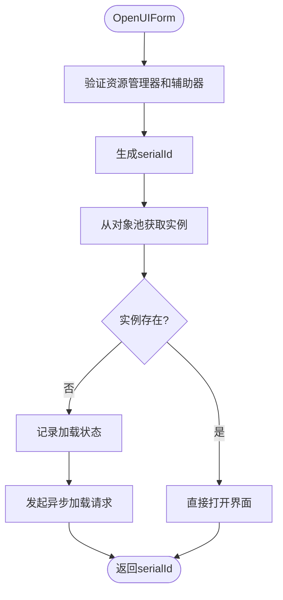

# UI资源加载流程

<cite>
**Referenced Files in This Document**   
- [UIManager.cs](file://GameFramework/UI/UIManager.cs)
- [IResourceManager.cs](file://GameFramework/Resource/IResourceManager.cs)
- [IObjectPool.cs](file://GameFramework/ObjectPool/IObjectPool.cs)
- [LoadAssetCallbacks.cs](file://GameFramework/Resource/LoadAssetCallbacks.cs)
</cite>

## Table of Contents
1. [UI资源加载流程](#ui资源加载流程)
2. [UIManager资源管理器绑定](#uimanager资源管理器绑定)
3. [OpenUIForm方法执行流程](#openuiform方法执行流程)
4. [m_UIFormsBeingLoaded字典的作用](#m_uiformsbeingloaded字典的作用)
5. [资源加载分支逻辑](#资源加载分支逻辑)
6. [serialId流程追踪机制](#serialid流程追踪机制)

## UIManager资源管理器绑定

UIManager通过SetResourceManager接口与资源管理器建立绑定关系，这是UI资源加载流程的前置条件。该接口接收IResourceManager类型的参数，确保UI系统能够通过统一的资源管理接口发起资源请求。

当调用SetResourceManager方法时，系统会进行参数有效性验证，若传入的资源管理器为空，则抛出GameFrameworkException异常。验证通过后，将传入的资源管理器实例赋值给私有字段m_ResourceManager，完成绑定过程。此绑定关系为后续的OpenUIForm方法调用提供了资源加载能力支持。

**Section sources**
- [UIManager.cs](file://GameFramework/UI/UIManager.cs#L257-L265)

## OpenUIForm方法执行流程

OpenUIForm是UI界面显示的入口方法，其执行流程始于对必要条件的完整性检查。方法首先验证m_ResourceManager和m_UIFormHelper是否已正确设置，若任一依赖组件为空，则抛出GameFrameworkException异常，确保系统处于可运行状态。

在通过前置条件检查后，方法生成唯一的序列ID（serialId），该ID用于在整个加载流程中追踪特定的UI表单实例。随后，系统尝试从对象池中获取UI表单实例，这一操作构成了资源加载流程的分支判断点，决定了后续是直接使用缓存实例还是发起异步加载请求。

```mermaid
sequenceDiagram
participant Client as "调用方"
participant UIManager as "UIManager"
participant ObjectPool as "对象池"
participant ResourceManager as "资源管理器"
Client->>UIManager : 调用OpenUIForm
activate UIManager
UIManager->>UIManager : 验证资源管理器和辅助器
alt 验证失败
UIManager-->>Client : 抛出异常
deactivate UIManager
else 验证成功
UIManager->>UIManager : 生成serialId
UIManager->>ObjectPool : 尝试获取实例(Spawn)
activate ObjectPool
ObjectPool-->>UIManager : 返回实例或null
deactivate ObjectPool
alt 实例存在
UIManager->>UIManager : 直接打开界面
UIManager-->>Client : 返回serialId
deactivate UIManager
else 实例不存在
UIManager->>UIManager : 记录加载状态
UIManager->>ResourceManager : 发起异步加载
activate ResourceManager
ResourceManager-->>UIManager : 异步加载中
deactivate ResourceManager
UIManager-->>Client : 返回serialId
deactivate UIManager
end
end
```

**Diagram sources**
- [UIManager.cs](file://GameFramework/UI/UIManager.cs#L722-L763)
- [IResourceManager.cs](file://GameFramework/Resource/IResourceManager.cs#L571)

**Section sources**
- [UIManager.cs](file://GameFramework/UI/UIManager.cs#L722-L763)

## m_UIFormsBeingLoaded字典的作用

m_UIFormsBeingLoaded是一个私有的字典类型字段，用于跟踪所有正在异步加载中的UI表单。该字典以serialId作为键，uiFormAssetName作为值，建立了加载中UI表单的索引映射关系。

此字典在资源加载流程中扮演着状态管理器的角色，其主要作用包括：记录哪些UI表单正处于加载过程中，防止重复加载同一资源，以及在加载完成后能够准确地定位到对应的加载上下文。当系统需要查询某个UI表单是否正在加载时，可通过IsLoadingUIForm方法查询该字典，实现加载状态的快速判断。

**Section sources**
- [UIManager.cs](file://GameFramework/UI/UIManager.cs#L20)

## 资源加载分支逻辑

UI资源加载流程包含两个主要分支：缓存实例获取和异步资源加载。这两个分支的决策点在于对象池中是否存在可用的UI表单实例。

当m_InstancePool.Spawn方法返回非空实例时，表示对象池中存在已缓存的UI表单实例。系统将直接调用InternalOpenUIForm方法，传入获取到的实例，完成界面的初始化和显示，此为快速路径分支。

当Spawn方法返回null时，表示对象池中无可用实例，需要从资源系统异步加载。此时系统执行以下操作：将serialId和uiFormAssetName添加到m_UIFormsBeingLoaded字典中，记录加载状态；然后调用m_ResourceManager.LoadAsset方法发起异步加载请求，传入资源名称、优先级、回调函数集和用户数据。加载完成后，资源管理器会通过回调机制通知UIManager，完成后续的界面初始化工作。



**Diagram sources**
- [UIManager.cs](file://GameFramework/UI/UIManager.cs#L722-L763)
- [IObjectPool.cs](file://GameFramework/ObjectPool/IObjectPool.cs#L85-L94)

**Section sources**
- [UIManager.cs](file://GameFramework/UI/UIManager.cs#L722-L763)

## serialId流程追踪机制

serialId是UI资源加载流程中的关键追踪标识，由m_Serial递增生成，确保每个UI表单实例具有全局唯一的序列号。该ID贯穿整个加载流程，实现了从请求发起、状态跟踪到结果回调的完整闭环。

在异步加载分支中，serialId作为m_UIFormsBeingLoaded字典的键值，将加载请求与特定的UI表单实例关联起来。当资源加载成功后，系统能够通过serialId快速定位到对应的加载上下文，包括目标UI组、暂停设置和用户数据等信息，确保界面能够正确初始化。同时，serialId也作为外部系统追踪UI表单生命周期的标识，支持通过HasUIForm、GetUIForm等方法查询界面状态。