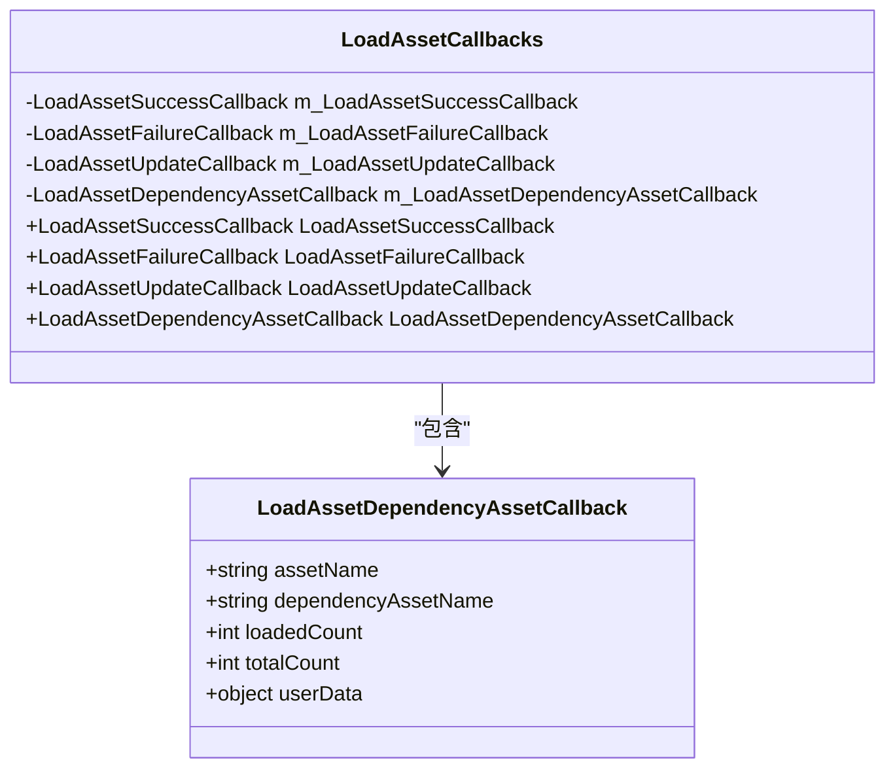
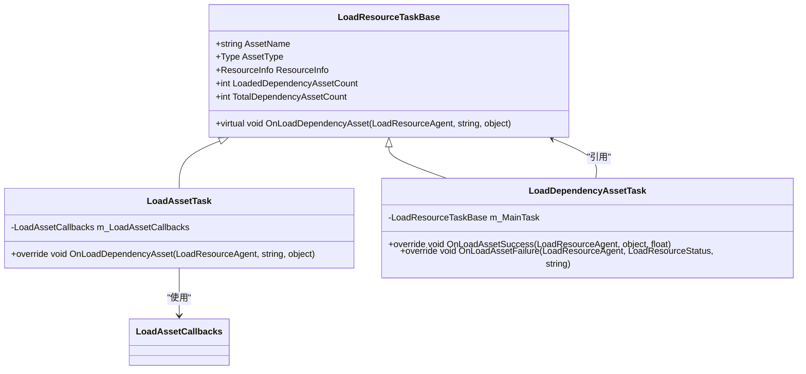
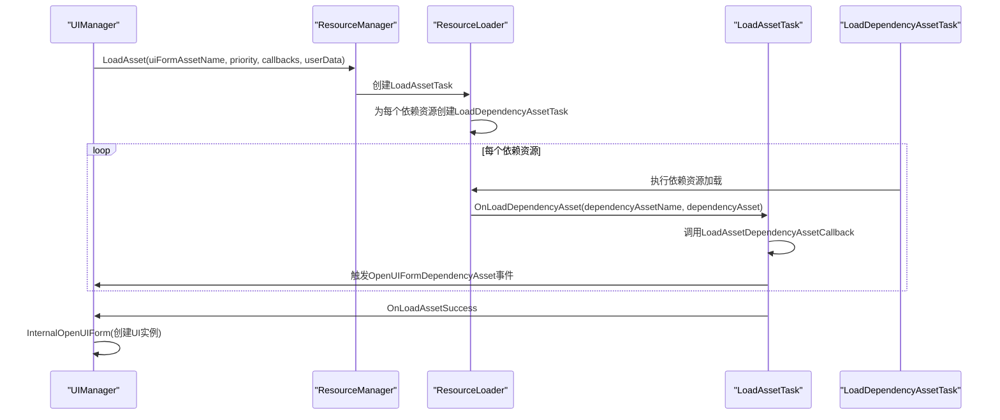
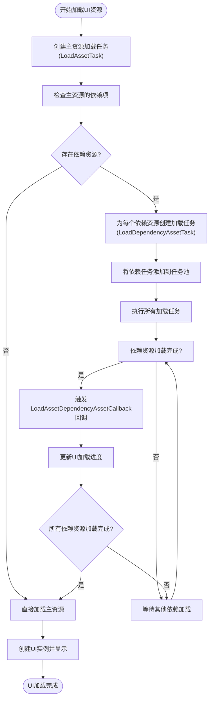
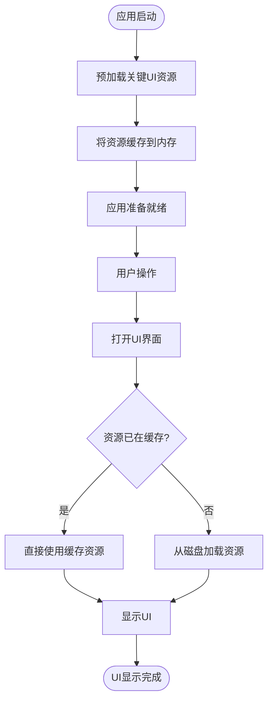
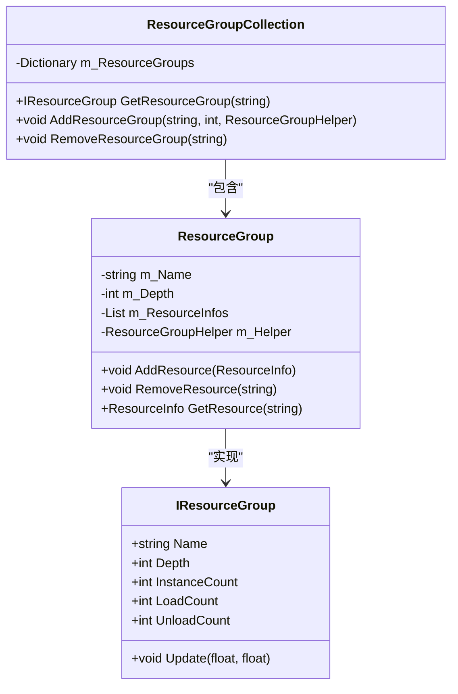
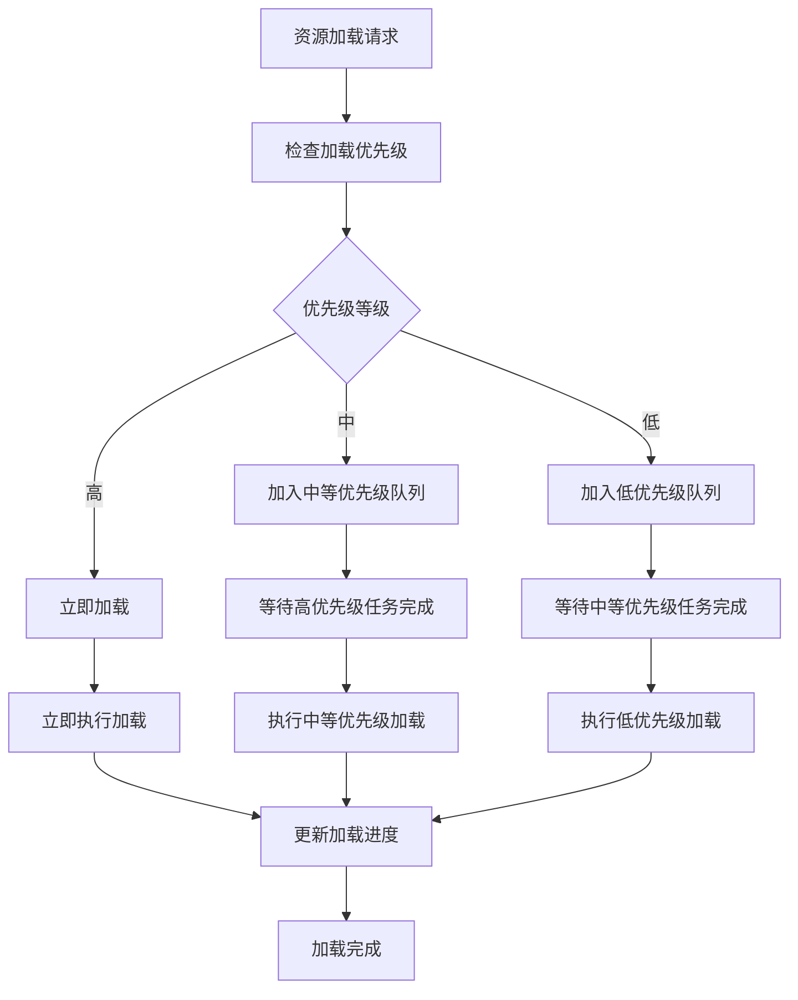
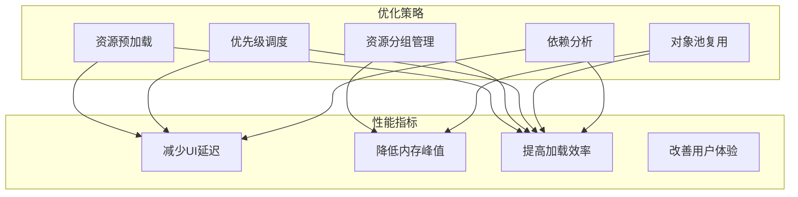

# 依赖资源加载与性能优化

<cite>
**Referenced Files in This Document**  
- [LoadAssetDependencyAssetCallback.cs](file://GameFramework/Resource/LoadAssetDependencyAssetCallback.cs)
- [ResourceManager.ResourceLoader.cs](file://GameFramework/Resource/ResourceManager.ResourceLoader.cs)
- [UIManager.cs](file://GameFramework/UI/UIManager.cs)
- [ResourceManager.ResourceLoader.LoadDependencyAssetTask.cs](file://GameFramework/Resource/ResourceManager.ResourceLoader.LoadDependencyAssetTask.cs)
- [ResourceManager.ResourceLoader.LoadAssetTask.cs](file://GameFramework/Resource/ResourceManager.ResourceLoader.LoadAssetTask.cs)
- [LoadAssetCallbacks.cs](file://GameFramework/Resource/LoadAssetCallbacks.cs)
- [UIManager.OpenUIFormInfo.cs](file://GameFramework/UI/UIManager.OpenUIFormInfo.cs)
- [ResourceManager.ResourceLoader.LoadResourceTaskBase.cs](file://GameFramework/Resource/ResourceManager.ResourceLoader.LoadResourceTaskBase.cs)
</cite>

## 目录
1. [引言](#引言)
2. [核心机制分析](#核心机制分析)
3. [依赖资源加载流程](#依赖资源加载流程)
4. [性能影响分析](#性能影响分析)
5. [优化策略](#优化策略)
6. [总结](#总结)

## 引言

在Unity游戏开发中，UI资源的加载效率直接影响用户体验。当用户打开界面时，主资源（如预制件）往往依赖于其他资源（如纹理、材质、音频等）。这些依赖资源的加载处理机制对UI显示性能有着重要影响。本文档深入分析`LoadAssetDependencyAssetCallback`回调在加载主资源所依赖的其他资源时的触发逻辑，探讨依赖加载对UI显示性能的影响，并提供基于资源预加载、资源分组和优先级调度的优化策略。

## 核心机制分析

### LoadAssetDependencyAssetCallback回调机制

`LoadAssetDependencyAssetCallback`是资源加载系统中的关键回调函数，用于通知主资源依赖的其他资源的加载进度。

**Diagram sources**
- [LoadAssetDependencyAssetCallback.cs](file://GameFramework/Resource/LoadAssetDependencyAssetCallback.cs)
- [LoadAssetCallbacks.cs](file://GameFramework/Resource/LoadAssetCallbacks.cs)

**Section sources**
- [LoadAssetDependencyAssetCallback.cs](file://GameFramework/Resource/LoadAssetDependencyAssetCallback.cs#L1-L20)
- [LoadAssetCallbacks.cs](file://GameFramework/Resource/LoadAssetCallbacks.cs#L1-L146)

该回调函数定义了五个参数：
- `assetName`：正在加载的主资源名称
- `dependencyAssetName`：当前正在加载的依赖资源名称
- `loadedCount`：当前已加载的依赖资源数量
- `totalCount`：总共需要加载的依赖资源数量
- `userData`：用户自定义数据，用于传递上下文信息

### 资源加载任务体系

资源加载系统采用任务驱动的架构，通过任务队列管理资源加载过程。

**Diagram sources**
- [ResourceManager.ResourceLoader.LoadResourceTaskBase.cs](file://GameFramework/Resource/ResourceManager.ResourceLoader.LoadResourceTaskBase.cs)
- [ResourceManager.ResourceLoader.LoadAssetTask.cs](file://GameFramework/Resource/ResourceManager.ResourceLoader.LoadAssetTask.cs)
- [ResourceManager.ResourceLoader.LoadDependencyAssetTask.cs](file://GameFramework/Resource/ResourceManager.ResourceLoader.LoadDependencyAssetTask.cs)

**Section sources**
- [ResourceManager.ResourceLoader.LoadResourceTaskBase.cs](file://GameFramework/Resource/ResourceManager.ResourceLoader.LoadResourceTaskBase.cs#L1-L177)
- [ResourceManager.ResourceLoader.LoadAssetTask.cs](file://GameFramework/Resource/ResourceManager.ResourceLoader.LoadAssetTask.cs#L1-L89)
- [ResourceManager.ResourceLoader.LoadDependencyAssetTask.cs](file://GameFramework/Resource/ResourceManager.ResourceLoader.LoadDependencyAssetTask.cs#L1-L61)

## 依赖资源加载流程

### UI界面打开时的依赖加载流程

当打开UI界面时，系统会触发一系列资源加载操作，其中依赖资源的加载是关键环节。

**Diagram sources**
- [UIManager.cs](file://GameFramework/UI/UIManager.cs)
- [ResourceManager.ResourceLoader.cs](file://GameFramework/Resource/ResourceManager.ResourceLoader.cs)
- [ResourceManager.ResourceLoader.LoadAssetTask.cs](file://GameFramework/Resource/ResourceManager.ResourceLoader.LoadAssetTask.cs)
- [ResourceManager.ResourceLoader.LoadDependencyAssetTask.cs](file://GameFramework/Resource/ResourceManager.ResourceLoader.LoadDependencyAssetTask.cs)

**Section sources**
- [UIManager.cs](file://GameFramework/UI/UIManager.cs#L1-L1060)
- [ResourceManager.ResourceLoader.cs](file://GameFramework/Resource/ResourceManager.ResourceLoader.cs#L1-L944)

### 依赖加载的触发逻辑

依赖资源加载的触发逻辑遵循以下步骤：

1. **主资源加载任务创建**：当调用`LoadAsset`方法时，创建`LoadAssetTask`实例
2. **依赖任务生成**：遍历主资源的所有依赖项，为每个依赖资源创建`LoadDependencyAssetTask`
3. **任务调度**：将所有依赖加载任务添加到任务池中等待执行
4. **进度通知**：每当一个依赖资源加载完成，触发`LoadAssetDependencyAssetCallback`回调

**Diagram sources**
- [ResourceManager.ResourceLoader.cs](file://GameFramework/Resource/ResourceManager.ResourceLoader.cs)
- [ResourceManager.ResourceLoader.LoadAssetTask.cs](file://GameFramework/Resource/ResourceManager.ResourceLoader.LoadAssetTask.cs)
- [ResourceManager.ResourceLoader.LoadDependencyAssetTask.cs](file://GameFramework/Resource/ResourceManager.ResourceLoader.LoadDependencyAssetTask.cs)

**Section sources**
- [ResourceManager.ResourceLoader.cs](file://GameFramework/Resource/ResourceManager.ResourceLoader.cs#L1-L944)

## 性能影响分析

### 加载阻塞问题

依赖资源加载可能导致UI显示延迟，主要体现在以下几个方面：

1. **串行加载阻塞**：如果依赖资源较多且采用串行加载方式，会导致主资源等待时间过长
2. **网络IO阻塞**：从远程服务器加载依赖资源时，网络延迟会直接影响UI打开速度
3. **磁盘IO瓶颈**：大量小文件的随机读取会造成磁盘IO压力，影响加载效率

### 资源重复加载

在UI频繁打开关闭的场景下，可能出现资源重复加载问题：

1. **未正确管理资源引用**：每次打开UI都重新加载所有资源，即使资源已存在于内存中
2. **对象池管理不当**：UI实例未正确回收到对象池，导致资源无法复用
3. **缓存机制缺失**：缺乏有效的资源缓存策略，相同资源被多次加载

### 内存占用问题

依赖资源加载对内存使用的影响主要体现在：

1. **峰值内存占用**：在加载过程中，所有依赖资源同时存在于内存中，可能导致内存峰值过高
2. **内存碎片**：频繁的资源加载和卸载可能造成内存碎片
3. **资源泄漏**：未正确释放不再使用的资源，导致内存持续增长

## 优化策略

### 资源预加载策略

通过预加载关键资源，可以显著减少UI打开延迟。

**Diagram sources**
- [ResourceManager.ResourceLoader.cs](file://GameFramework/Resource/ResourceManager.ResourceLoader.cs)
- [UIManager.cs](file://GameFramework/UI/UIManager.cs)

**Section sources**
- [ResourceManager.ResourceLoader.cs](file://GameFramework/Resource/ResourceManager.ResourceLoader.cs#L1-L944)

### 资源分组（ResourceGroup）管理

通过资源分组管理，可以实现更高效的资源加载和内存管理。

**Diagram sources**
- [ResourceManager.ResourceLoader.cs](file://GameFramework/Resource/ResourceManager.ResourceLoader.cs)

**Section sources**
- [ResourceManager.ResourceLoader.cs](file://GameFramework/Resource/ResourceManager.ResourceLoader.cs#L1-L944)

### 优先级调度优化

利用优先级参数实现资源加载的智能调度。

**Diagram sources**
- [ResourceManager.ResourceLoader.cs](file://GameFramework/Resource/ResourceManager.ResourceLoader.cs)

**Section sources**
- [ResourceManager.ResourceLoader.cs](file://GameFramework/Resource/ResourceManager.ResourceLoader.cs#L1-L944)

### 综合优化方案

结合多种优化策略，构建完整的UI资源加载优化体系。

## 总结

`LoadAssetDependencyAssetCallback`回调在UI资源加载过程中扮演着重要角色，它提供了依赖资源加载进度的实时反馈。通过深入理解其触发逻辑和工作机制，我们可以针对性地优化UI显示性能。

关键优化建议包括：
1. 实施资源预加载策略，提前加载关键UI资源
2. 合理使用资源分组管理，提高资源组织效率
3. 利用优先级调度机制，确保重要资源优先加载
4. 完善对象池管理，避免资源重复加载
5. 优化依赖分析，减少不必要的依赖项

通过综合运用这些优化策略，可以显著减少UI打开延迟，提升用户体验，同时有效控制内存使用和系统资源消耗。