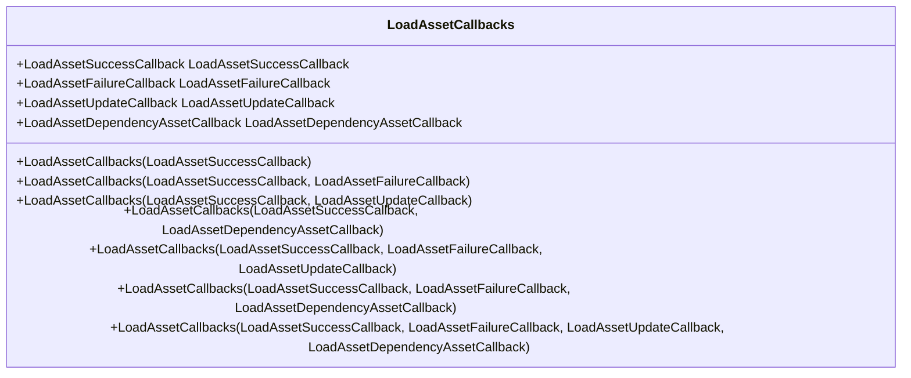
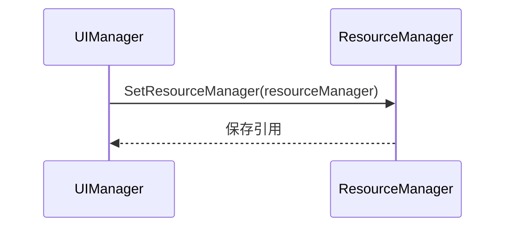
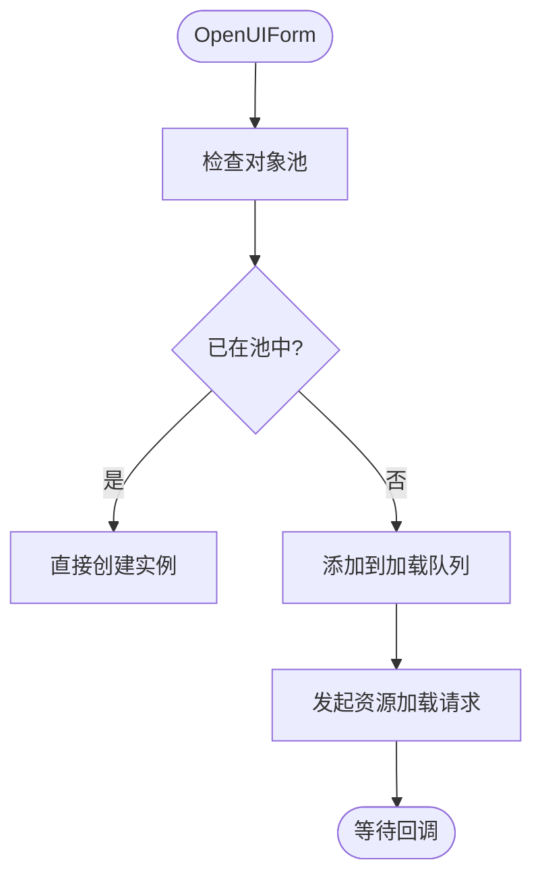
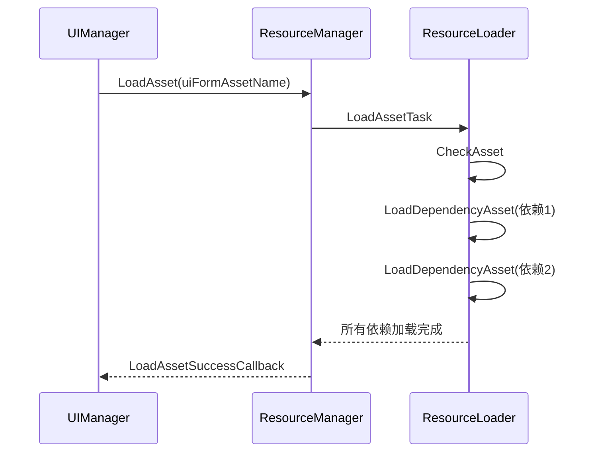

# 资源加载协调

<cite>
**本文档引用的文件**   
- [UIManager.cs](file://GameFramework/UI/UIManager.cs)
- [ResourceManager.cs](file://GameFramework/Resource/ResourceManager.cs)
- [LoadAssetCallbacks.cs](file://GameFramework/Resource/LoadAssetCallbacks.cs)
- [ResourceManager.ResourceLoader.cs](file://GameFramework/Resource/ResourceManager.ResourceLoader.cs)
</cite>

## 目录
1. [简介](#简介)
2. [核心组件分析](#核心组件分析)
3. [LoadAssetCallbacks 回调机制](#loadassetcallbacks-回调机制)
4. [SetResourceManager 接口作用](#setresourcemanager-接口作用)
5. [OpenUIForm 过程中的资源加载](#openuiform-过程中的资源加载)
6. [资源依赖加载流程](#资源依赖加载流程)
7. [性能影响与优化策略](#性能影响与优化策略)
8. [结论](#结论)

## 简介
本文档系统性地阐述了 `UIManager` 如何与 `ResourceManager` 协同完成界面资源的异步加载。详细说明了 `LoadAssetCallbacks` 的注册机制，包括 `LoadAssetSuccessCallback`、`LoadAssetFailureCallback`、`LoadAssetUpdateCallback` 和 `LoadAssetDependencyAssetCallback` 四个回调函数的触发时机和处理逻辑。同时解释了 `SetResourceManager` 接口的作用，以及在 `OpenUIForm` 过程中如何根据 `uiFormAssetName` 发起资源加载请求。此外，还分析了资源依赖加载的流程及其对 UI 加载性能的影响，并提供了资源预加载的优化策略。

## 核心组件分析

`UIManager` 和 `ResourceManager` 是 Unity 游戏框架中负责界面和资源管理的核心模块。`UIManager` 负责界面的创建、显示、隐藏和销毁，而 `ResourceManager` 则负责资源的加载、卸载和管理。两者通过 `SetResourceManager` 接口建立联系，实现资源的异步加载。

**本节来源**
- [UIManager.cs](file://GameFramework/UI/UIManager.cs#L39-L57)
- [ResourceManager.cs](file://GameFramework/Resource/ResourceManager.cs#L81-L129)

## LoadAssetCallbacks 回调机制

`LoadAssetCallbacks` 类封装了加载资源时的四个主要回调函数：成功、失败、更新和依赖资源加载。这些回调函数在资源加载的不同阶段被触发，允许开发者进行相应的处理。

**图表来源**
- [LoadAssetCallbacks.cs](file://GameFramework/Resource/LoadAssetCallbacks.cs#L12-L143)

**本节来源**
- [LoadAssetCallbacks.cs](file://GameFramework/Resource/LoadAssetCallbacks.cs#L12-L143)

### LoadAssetSuccessCallback
当资源成功加载时触发。`UIManager` 在此回调中创建界面实例并调用 `OnInit`、`OnOpen` 等方法，完成界面的初始化和显示。

### LoadAssetFailureCallback
当资源加载失败时触发。`UIManager` 在此回调中清理加载状态，并通过 `OpenUIFormFailureEventHandler` 通知上层逻辑。

### LoadAssetUpdateCallback
在资源加载过程中，当加载进度发生变化时触发。`UIManager` 可以利用此回调更新加载界面的进度条。

### LoadAssetDependencyAssetCallback
当加载资源的依赖资源时触发。`UIManager` 可以利用此回调监控依赖资源的加载情况。

## SetResourceManager 接口作用

`SetResourceManager` 接口用于将 `ResourceManager` 实例注入到 `UIManager` 中，建立两者之间的依赖关系。`UIManager` 通过 `m_ResourceManager` 字段持有对 `ResourceManager` 的引用，从而能够发起资源加载请求。

**图表来源**
- [UIManager.cs](file://GameFramework/UI/UIManager.cs#L257-L265)
- [ResourceManager.cs](file://GameFramework/Resource/ResourceManager.cs#L1462-L1475)

**本节来源**
- [UIManager.cs](file://GameFramework/UI/UIManager.cs#L257-L265)
- [ResourceManager.cs](file://GameFramework/Resource/ResourceManager.cs#L1462-L1475)

## OpenUIForm 过程中的资源加载

当调用 `OpenUIForm` 方法时，`UIManager` 会首先检查资源是否已在对象池中。如果不在，则通过 `m_ResourceManager.LoadAsset` 方法发起异步加载请求，并传入 `m_LoadAssetCallbacks` 回调集。

**图表来源**
- [UIManager.cs](file://GameFramework/UI/UIManager.cs#L722-L763)
- [ResourceManager.ResourceLoader.cs](file://GameFramework/Resource/ResourceManager.ResourceLoader.cs#L0-L799)

**本节来源**
- [UIManager.cs](file://GameFramework/UI/UIManager.cs#L722-L763)
- [ResourceManager.ResourceLoader.cs](file://GameFramework/Resource/ResourceManager.ResourceLoader.cs#L0-L799)

## 资源依赖加载流程

`ResourceManager` 在加载主资源时，会自动解析其依赖资源，并通过 `LoadDependencyAsset` 方法递归加载所有依赖。这一过程确保了资源的完整性和一致性。

**图表来源**
- [ResourceManager.ResourceLoader.cs](file://GameFramework/Resource/ResourceManager.ResourceLoader.cs#L800-L943)

**本节来源**
- [ResourceManager.ResourceLoader.cs](file://GameFramework/Resource/ResourceManager.ResourceLoader.cs#L800-L943)

## 性能影响与优化策略

资源依赖加载虽然保证了资源的完整性，但也可能成为性能瓶颈。特别是当依赖层级过深或依赖资源过多时，会导致加载时间过长。

### 优化策略
1. **资源预加载**：在游戏启动或场景切换时，预先加载常用的 UI 资源，减少运行时的加载压力。
2. **资源分组**：将相关的 UI 资源打包成资源组，通过 `GetResourceGroupCollection` 接口批量加载，提高加载效率。
3. **异步加载**：充分利用 `LoadAsset` 的异步特性，避免阻塞主线程。
4. **对象池**：通过 `m_InstancePool` 复用已加载的 UI 实例，减少资源加载和对象创建的开销。

**本节来源**
- [ResourceManager.cs](file://GameFramework/Resource/ResourceManager.cs#L1600-L2399)
- [UIManager.cs](file://GameFramework/UI/UIManager.cs#L633-L763)

## 结论
`UIManager` 与 `ResourceManager` 通过 `SetResourceManager` 接口紧密协作，实现了界面资源的高效异步加载。`LoadAssetCallbacks` 提供了完整的回调机制，使开发者能够精确控制资源加载的各个阶段。通过合理利用资源依赖加载和预加载策略，可以显著提升 UI 的加载性能和用户体验。