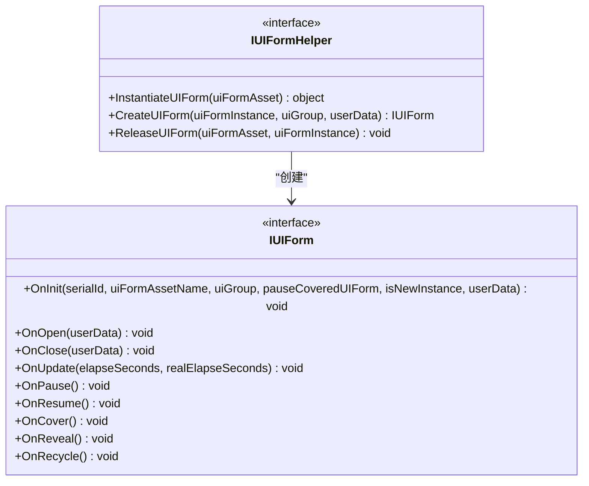
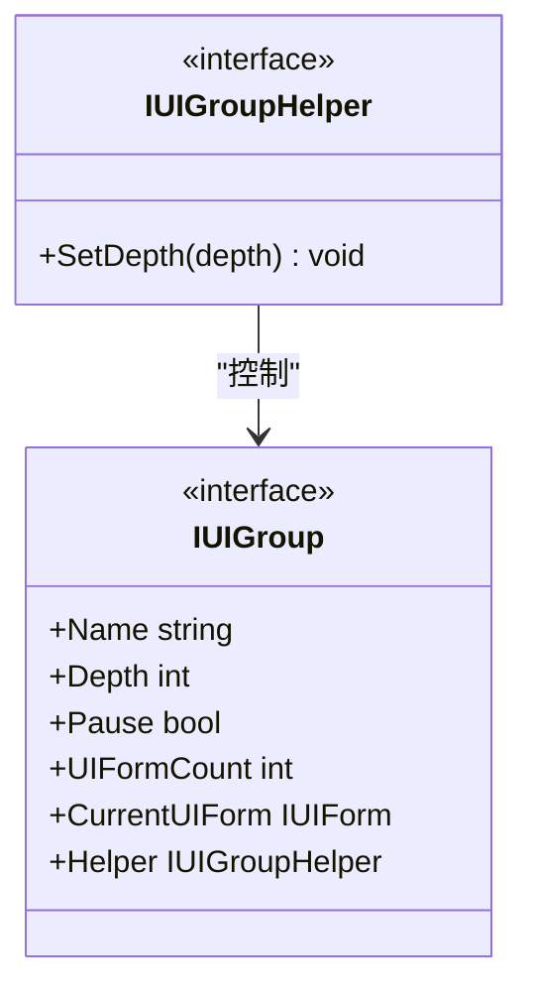
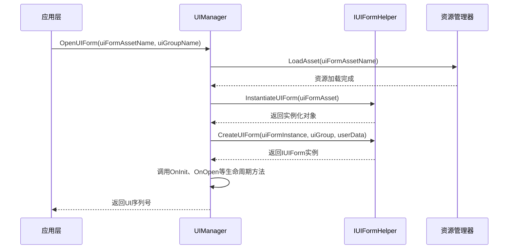
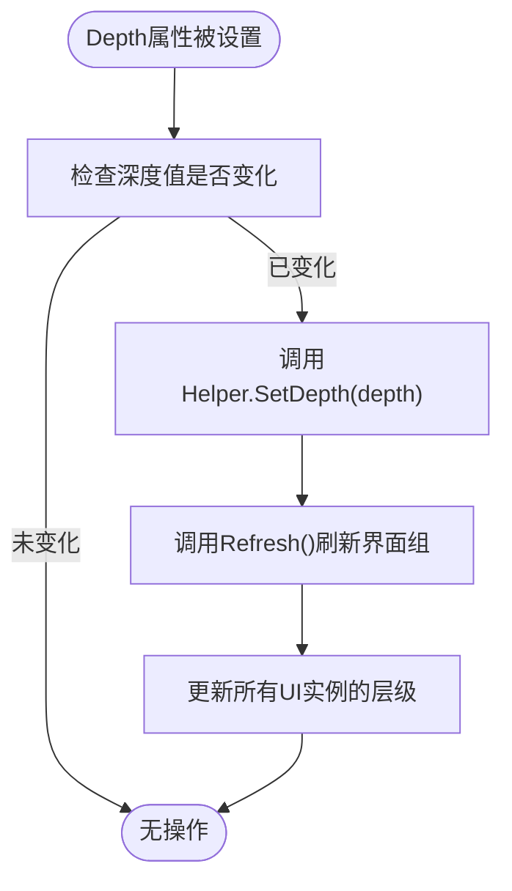
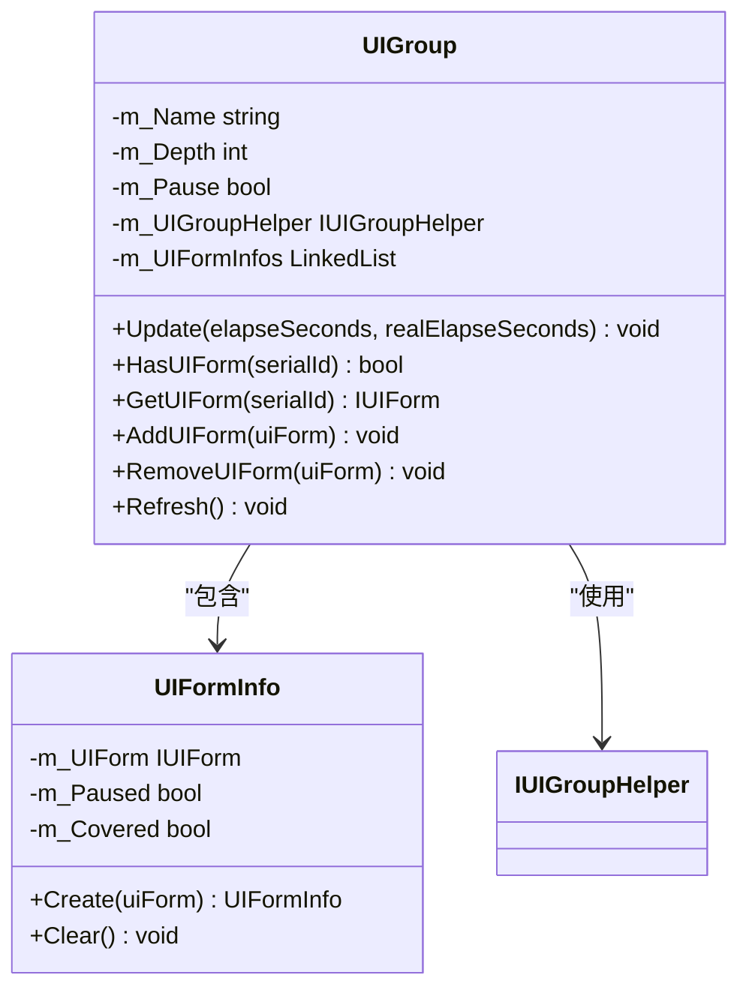
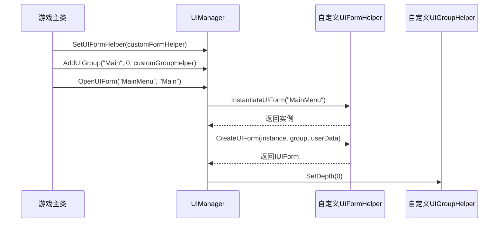
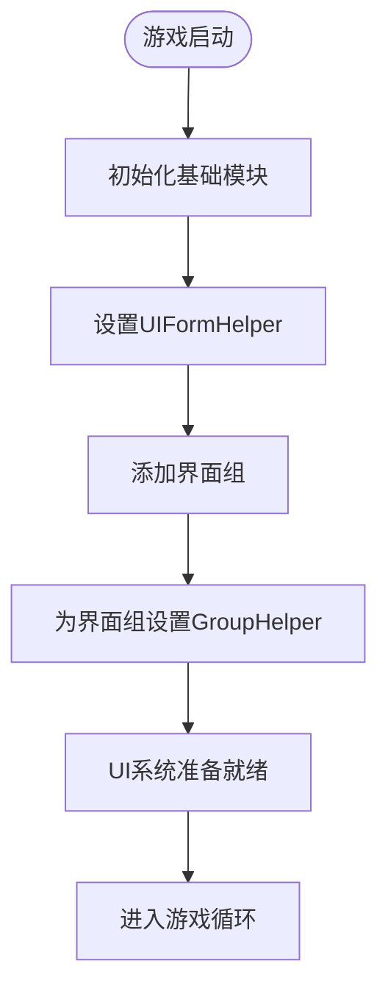

# UI辅助器系统

<cite>
**本文档中引用的文件**   
- [IUIFormHelper.cs](file://GameFramework/UI/IUIFormHelper.cs)
- [IUIGroupHelper.cs](file://GameFramework/UI/IUIGroupHelper.cs)
- [UIManager.cs](file://GameFramework/UI/UIManager.cs)
- [UIManager.UIGroup.cs](file://GameFramework/UI/UIManager.UIGroup.cs)
- [UIManager.UIFormInstanceObject.cs](file://GameFramework/UI/UIManager.UIFormInstanceObject.cs)
</cite>

## 目录
1. [引言](#引言)
2. [核心接口设计](#核心接口设计)
3. [UIFormHelper实现机制](#uiformhelper实现机制)
4. [UIGroupHelper实现机制](#uigrouphelper实现机制)
5. [辅助器注入流程](#辅助器注入流程)
6. [高级功能实现示例](#高级功能实现示例)
7. [总结](#总结)

## 引言
UI辅助器系统是游戏框架中用于实现界面行为定制的核心扩展机制。通过IUIFormHelper和IUIGroupHelper两个扩展点接口，开发者可以注入自定义逻辑，实现对UI实例创建、场景集成、层级管理、动画过渡等高级功能的完全控制。该系统采用依赖注入模式，将UI核心逻辑与具体实现解耦，为框架提供了极强的可扩展性和灵活性。

## 核心接口设计

### IUIFormHelper接口
IUIFormHelper接口定义了UI实例生命周期管理的核心方法，作为UI实例化和集成过程的扩展点。



**图示来源**
- [IUIFormHelper.cs](file://GameFramework/UI/IUIFormHelper.cs#L12-L36)
- [UIManager.cs](file://GameFramework/UI/UIManager.cs#L921-L952)

### IUIGroupHelper接口
IUIGroupHelper接口提供了界面组深度管理的扩展点，允许自定义界面组的渲染层级行为。



**图示来源**
- [IUIGroupHelper.cs](file://GameFramework/UI/IUIGroupHelper.cs#L12-L19)
- [UIManager.UIGroup.cs](file://GameFramework/UI/UIManager.UIGroup.cs#L38-L82)

## IUIFormHelper实现机制

### 接口方法详解
IUIFormHelper接口中的方法在UI实例创建与场景集成过程中扮演关键角色：

- **InstantiateUIForm**: 负责将界面资源实例化为具体的UI对象，可在此方法中实现自定义的资源加载和实例化逻辑
- **CreateUIForm**: 将实例化的UI对象包装为框架可管理的IUIForm接口实现，完成UI的初始化和配置
- **ReleaseUIForm**: 在UI释放时执行清理工作，确保资源正确回收

### 实例创建流程
当调用OpenUIForm方法时，框架会通过IUIFormHelper完成UI实例的创建和集成：



**图示来源**
- [UIManager.cs](file://GameFramework/UI/UIManager.cs#L790-L952)
- [IUIFormHelper.cs](file://GameFramework/UI/IUIFormHelper.cs#L12-L36)

**本节来源**
- [UIManager.cs](file://GameFramework/UI/UIManager.cs#L790-L952)
- [IUIFormHelper.cs](file://GameFramework/UI/IUIFormHelper.cs#L12-L36)
- [UIManager.UIFormInstanceObject.cs](file://GameFramework/UI/UIManager.UIFormInstanceObject.cs#L39-L59)

## IUIGroupHelper实现机制

### 深度变化回调
IUIGroupHelper接口中的OnDepthChanged回调用于响应界面组深度变化，当界面组的Depth属性被修改时自动触发：



**图示来源**
- [UIManager.UIGroup.cs](file://GameFramework/UI/UIManager.UIGroup.cs#L38-L82)

### 界面组管理
界面组通过IUIGroupHelper实现对组内所有UI实例的统一管理，包括层级、渲染顺序等：



**图示来源**
- [UIManager.UIGroup.cs](file://GameFramework/UI/UIManager.UIGroup.cs#L38-L136)

**本节来源**
- [IUIGroupHelper.cs](file://GameFramework/UI/IUIGroupHelper.cs#L12-L19)
- [UIManager.UIGroup.cs](file://GameFramework/UI/UIManager.UIGroup.cs#L38-L136)
- [IUIGroup.cs](file://GameFramework/UI/IUIGroup.cs#L61-L64)

## 辅助器注入流程

### 注入方法
框架通过SetUIFormHelper和SetUIGroupHelper方法注入自定义逻辑：



**图示来源**
- [UIManager.cs](file://GameFramework/UI/UIManager.cs#L271-L279)
- [UIManager.UIGroup.cs](file://GameFramework/UI/UIManager.UIGroup.cs#L38-L82)

### 初始化时序
辅助器的注入通常在框架初始化阶段完成：



**本节来源**
- [UIManager.cs](file://GameFramework/UI/UIManager.cs#L271-L279)
- [UIManager.UIGroup.cs](file://GameFramework/UI/UIManager.UIGroup.cs#L38-L82)

## 高级功能实现示例

### Canvas层级管理
通过IUIFormHelper实现Canvas层级的自动管理：

```csharp
public class CanvasLayerHelper : IUIFormHelper
{
    public object InstantiateUIForm(object uiFormAsset)
    {
        GameObject uiFormInstance = GameObject.Instantiate(uiFormAsset as GameObject);
        return uiFormInstance;
    }

    public IUIForm CreateUIForm(object uiFormInstance, IUIGroup uiGroup, object userData)
    {
        GameObject go = uiFormInstance as GameObject;
        Canvas canvas = go.GetComponent<Canvas>();
        canvas.sortingOrder = uiGroup.Depth * 100;
        
        // 根据UI类型设置具体层级
        if (go.CompareTag("Popup"))
            canvas.sortingOrder += 10;
        else if (go.CompareTag("Dialog"))
            canvas.sortingOrder += 20;
            
        return new DefaultUIForm(go);
    }

    public void ReleaseUIForm(object uiFormAsset, object uiFormInstance)
    {
        GameObject.Destroy((uiFormInstance as GameObject));
    }
}
```

### 动画过渡效果
通过IUIGroupHelper实现界面组的动画过渡：

```csharp
public class AnimationGroupHelper : IUIGroupHelper
{
    private Dictionary<string, float> m_DepthTransitions;
    
    public AnimationGroupHelper()
    {
        m_DepthTransitions = new Dictionary<string, float>();
    }

    public void SetDepth(int depth)
    {
        // 触发深度变化动画
        PlayDepthTransitionAnimation(depth);
    }

    private void PlayDepthTransitionAnimation(int targetDepth)
    {
        // 实现平滑的层级过渡动画
        // 可以结合协程实现渐变效果
    }
}
```

### 自定义加载逻辑
实现带进度显示的UI加载逻辑：

```csharp
public class LoadingUIFormHelper : IUIFormHelper
{
    public object InstantiateUIForm(object uiFormAsset)
    {
        // 显示加载进度UI
        ShowLoadingProgress();
        
        // 异步加载资源
        GameObject uiFormInstance = LoadAssetAsync(uiFormAsset);
        
        // 隐藏加载进度
        HideLoadingProgress();
        
        return uiFormInstance;
    }

    public IUIForm CreateUIForm(object uiFormInstance, IUIGroup uiGroup, object userData)
    {
        GameObject go = uiFormInstance as GameObject;
        
        // 添加淡入动画组件
        AddFadeInAnimation(go);
        
        return new AnimatedUIForm(go);
    }

    public void ReleaseUIForm(object uiFormAsset, object uiFormInstance)
    {
        GameObject go = uiFormInstance as GameObject;
        
        // 播放淡出动画后销毁
        PlayFadeOutAnimation(go, () => GameObject.Destroy(go));
    }
}
```

**本节来源**
- [IUIFormHelper.cs](file://GameFramework/UI/IUIFormHelper.cs#L12-L36)
- [IUIGroupHelper.cs](file://GameFramework/UI/IUIGroupHelper.cs#L12-L19)
- [UIManager.cs](file://GameFramework/UI/UIManager.cs#L790-L952)

## 总结
UI辅助器系统通过IUIFormHelper和IUIGroupHelper两个扩展点接口，为框架提供了强大的可扩展性。开发者可以通过实现这些接口，完全控制UI实例的创建、集成、层级管理和生命周期行为。该设计模式实现了关注点分离，将UI核心逻辑与具体实现解耦，使得框架既保持了核心功能的稳定性，又具备了高度的灵活性。通过合理利用这些扩展点，可以实现Canvas层级管理、动画过渡效果、自定义加载逻辑等高级功能，满足各种复杂的UI需求。