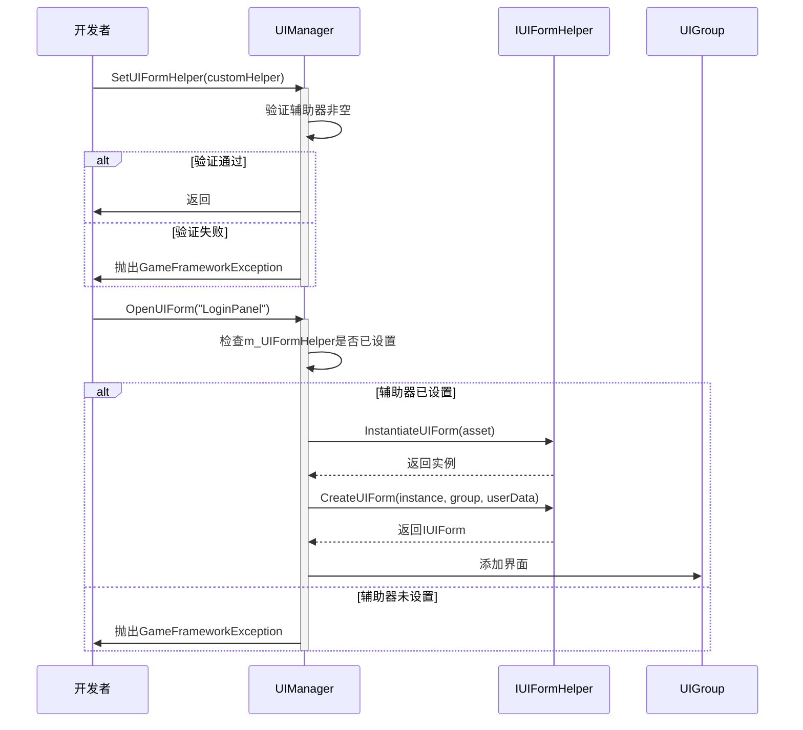
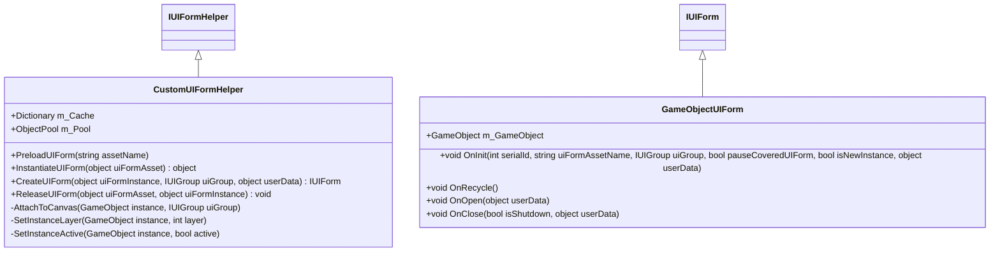

# 界面实例辅助器

<cite>
**Referenced Files in This Document**   
- [IUIFormHelper.cs](file://GameFramework/UI/IUIFormHelper.cs)
- [UIManager.cs](file://GameFramework/UI/UIManager.cs)
- [IUIForm.cs](file://GameFramework/UI/IUIForm.cs)
- [IUIGroup.cs](file://GameFramework/UI/IUIGroup.cs)
- [UIManager.UIFormInstanceObject.cs](file://GameFramework/UI/UIManager.UIFormInstanceObject.cs)
</cite>

## 目录
1. [接口设计目的](#接口设计目的)
2. [核心方法实现](#核心方法实现)
3. [辅助器注入机制](#辅助器注入机制)
4. [自定义实现示例](#自定义实现示例)
5. [异常处理与资源管理](#异常处理与资源管理)
6. [性能优化建议](#性能优化建议)

## 接口设计目的

`IUIFormHelper`接口在UI系统中扮演着关键的抽象层角色，其设计目的在于解耦界面资源的实例化、创建和释放逻辑与具体的UI框架实现。通过定义标准化的辅助方法，该接口允许开发者在不修改核心UI管理器代码的情况下，灵活扩展和定制UI对象的生命周期管理流程。

该接口的核心作用体现在三个方面：首先，它提供了对底层资源加载机制的抽象，使得UI系统能够无缝集成AssetBundle、Addressable等不同的资源管理系统；其次，它支持对象池模式的实现，通过`InstantiateUIForm`和`ReleaseUIForm`方法的配合，有效减少频繁的内存分配与垃圾回收开销；最后，它为UI对象的初始化和配置提供了扩展点，允许在`CreateUIForm`方法中执行自定义的挂接逻辑、层级设置和激活状态控制。

**Section sources**
- [IUIFormHelper.cs](file://GameFramework/UI/IUIFormHelper.cs#L12-L36)

## 核心方法实现

### InstantiateUIForm方法实现

`InstantiateUIForm`方法负责将原始的界面资源（如Prefab、AssetBundle等）转换为可操作的实例对象。该方法接收一个`uiFormAsset`参数，代表要实例化的界面资源，返回值为实例化后的对象。在框架内部，此方法通常由资源管理器调用，在成功加载资源后立即执行。

当UI管理器尝试打开新界面时，首先会检查对象池中是否存在可用的实例。如果存在，则直接复用；否则，通过`InstantiateUIForm`方法创建新实例。这种设计确保了资源实例化的统一入口，便于集中管理预加载、缓存和异步加载等高级功能。

[SPEC SYMBOL](file://GameFramework/UI/IUIFormHelper.cs#L17-L19)

### CreateUIForm方法实现

`CreateUIForm`方法承担着将实例对象包装为`IUIForm`接口并建立完整上下文的关键职责。该方法接收三个参数：`uiFormInstance`（实例对象）、`uiGroup`（目标界面组）和`userData`（用户自定义数据）。其主要功能包括：创建`IUIForm`接口的实现对象，调用`OnInit`方法进行初始化，将新创建的界面添加到指定的界面组中，并触发相应的生命周期事件。

此方法的实现通常涉及将原始实例对象（如GameObject）包装为符合`IUIForm`接口的适配器对象，同时关联界面组的深度信息和用户数据。通过这种方式，框架能够统一管理所有界面的生命周期，而无需关心底层实例的具体类型。

[SPEC SYMBOL](file://GameFramework/UI/IUIFormHelper.cs#L24-L27)

### ReleaseUIForm方法实现

`ReleaseUIForm`方法负责安全地释放界面资源与实例，防止内存泄漏。该方法接收两个参数：`uiFormAsset`（原始资源引用）和`uiFormInstance`（实例对象）。在标准实现中，此方法会将实例对象返回到对象池中，以便后续复用，而不是直接销毁。

特别值得注意的是，`ReleaseUIForm`方法被设计为在对象池的`Release`回调中调用。这意味着当一个界面实例从对象池中被释放时，会自动触发该方法，确保资源引用的正确清理。这种设计保证了资源管理的原子性和一致性，避免了因手动调用遗漏导致的资源泄露。

[SPEC SYMBOL](file://GameFramework/UI/IUIFormHelper.cs#L32-L34)

## 辅助器注入机制

框架通过`SetUIFormHelper`方法实现自定义逻辑的注入，为开发者提供了强大的扩展能力。`UIManager`类中的`m_UIFormHelper`字段存储了当前激活的辅助器实例，所有与UI实例化相关的操作都会通过该字段进行委派。

**Diagram sources**
- [UIManager.cs](file://GameFramework/UI/UIManager.cs#L271-L279)
- [UIManager.cs](file://GameFramework/UI/UIManager.cs#L722-L763)

**Section sources**
- [UIManager.cs](file://GameFramework/UI/UIManager.cs#L271-L279)

此机制支持多种高级功能的集成：
- **AssetBundle加载**：自定义辅助器可以在`InstantiateUIForm`中处理AssetBundle的加载和卸载逻辑
- **对象池复用**：通过管理实例的生命周期，实现高效的对象复用
- **异步加载回调**：在资源加载过程中提供进度反馈和错误处理
- **资源依赖管理**：处理UI界面可能依赖的纹理、字体等附属资源

## 自定义实现示例

### 预加载与缓存管理

**Diagram sources**
- [IUIFormHelper.cs](file://GameFramework/UI/IUIFormHelper.cs#L12-L36)
- [IUIForm.cs](file://GameFramework/UI/IUIForm.cs#L12-L132)

**Section sources**
- [IUIFormHelper.cs](file://GameFramework/UI/IUIFormHelper.cs#L12-L36)

自定义辅助器可以实现预加载功能，提前将常用UI资源加载到内存中并缓存，从而减少运行时的加载延迟。同时，通过维护一个对象池，可以高效地复用UI实例，避免频繁的实例化和销毁操作。

### 深度集成Unity UI系统

在`CreateUIForm`方法中，可以执行与Unity Canvas、RectTransform和UI动画系统的深度集成：
- **挂接逻辑**：通过`AttachTo`方法将UI实例正确挂接到Canvas的层级结构中
- **层级设置**：使用`SetInstanceLayer`方法确保UI对象位于正确的渲染层级
- **激活状态控制**：通过`SetInstanceActive`方法管理UI对象的激活状态，配合Unity的UI系统优化性能

这些自定义逻辑的实现使得框架能够更好地适应具体的项目需求和技术栈，提供更流畅的用户体验。

## 异常处理与资源管理

框架在关键路径上实现了完善的异常处理机制。在`InternalOpenUIForm`方法中，所有通过`IUIFormHelper`创建界面的操作都被包裹在try-catch块中。如果`CreateUIForm`方法抛出异常，框架会触发`OpenUIFormFailure`事件，通知上层系统加载失败，而不是让异常向上蔓延导致程序崩溃。

资源泄露风险主要通过对象池机制来规避。`UIFormInstanceObject`类的`Release`方法会自动调用`m_UIFormHelper.ReleaseUIForm`，确保每次实例释放时都能正确清理资源引用。这种设计遵循了"获取即负责释放"的原则，将资源管理的责任明确地分配给了辅助器实现。

**Section sources**
- [UIManager.cs](file://GameFramework/UI/UIManager.cs#L939-L973)
- [UIManager.UIFormInstanceObject.cs](file://GameFramework/UI/UIManager.UIFormInstanceObject.cs#L55-L59)

## 性能优化建议

1. **对象池配置**：合理设置`InstanceAutoReleaseInterval`、`InstanceCapacity`和`InstanceExpireTime`参数，平衡内存占用和实例复用效率
2. **异步加载**：对于大型UI界面，建议实现异步加载逻辑，避免主线程卡顿
3. **资源预加载**：识别高频使用的UI界面，在游戏启动或场景切换时预先加载并缓存
4. **层级优化**：通过`SetInstanceLayer`方法将UI对象分配到合适的渲染层级，减少不必要的渲染开销
5. **事件精简**：谨慎使用UI事件系统，避免过度订阅导致的性能下降

通过合理利用`IUIFormHelper`接口提供的扩展点，开发者可以针对具体项目的需求进行深度优化，构建高效、稳定的UI系统。