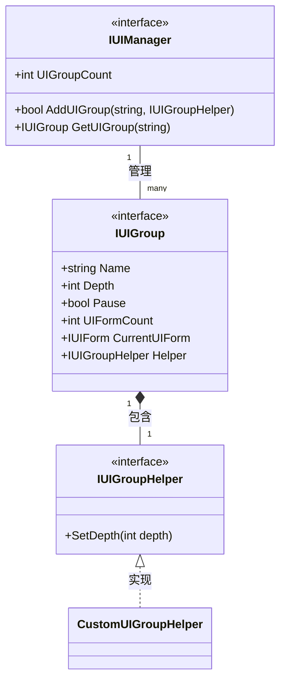
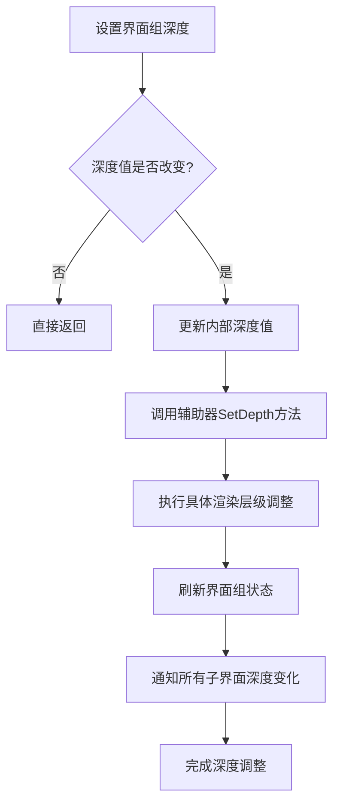
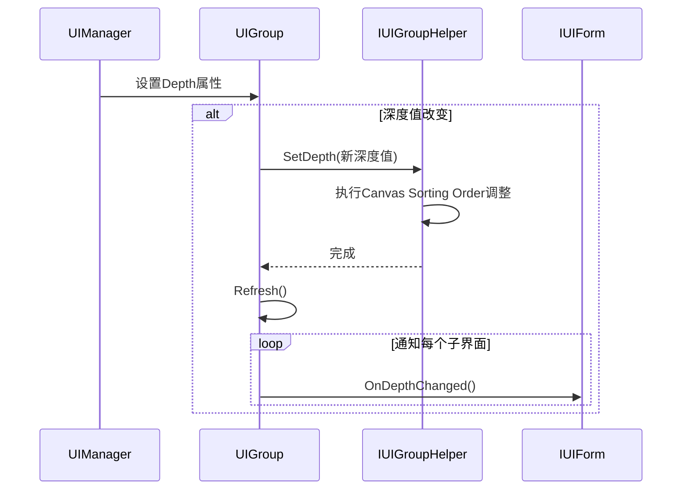
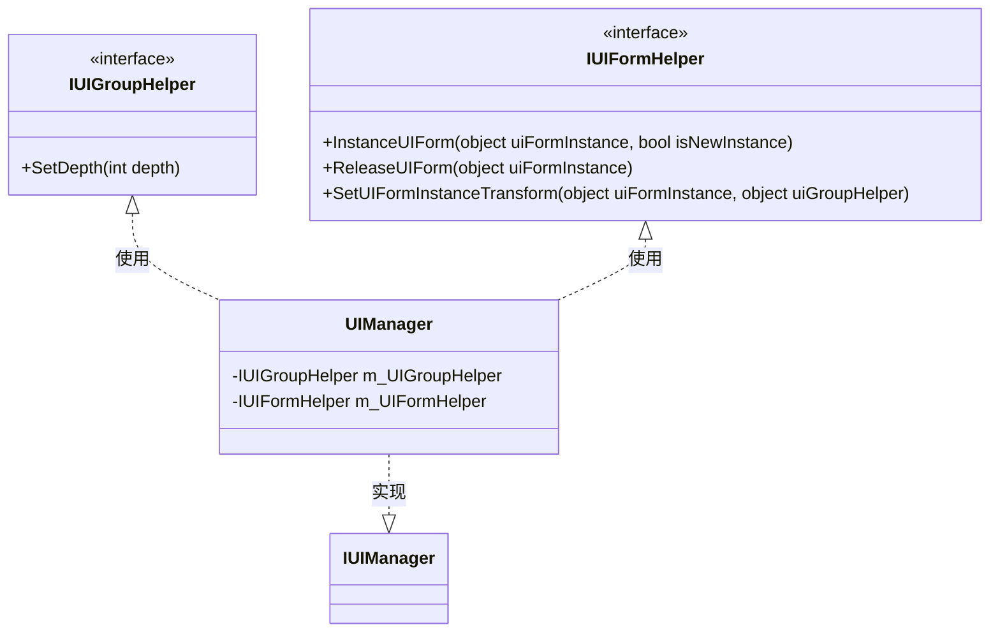

# 界面组辅助器

<cite>
**Referenced Files in This Document**  
- [IUIGroupHelper.cs](file://GameFramework/UI/IUIGroupHelper.cs)
- [IUIGroup.cs](file://GameFramework/UI/IUIGroup.cs)
- [IUIManager.cs](file://GameFramework/UI/IUIManager.cs)
- [UIManager.cs](file://GameFramework/UI/UIManager.cs)
- [UIManager.UIGroup.cs](file://GameFramework/UI/UIManager.UIGroup.cs)
- [IUIForm.cs](file://GameFramework/UI/IUIForm.cs)
</cite>

## Table of Contents
1. [引言](#引言)
2. [核心设计原理](#核心设计原理)
3. [SetDepth方法执行流程](#setdepth方法执行流程)
4. [调用时机与执行序列](#调用时机与执行序列)
5. [高级功能实现示例](#高级功能实现示例)
6. [与IUIFormHelper的协同控制](#与iuiformhelper的协同控制)
7. [多摄像机场景适配](#多摄像机场景适配)
8. [错误处理建议](#错误处理建议)
9. [结论](#结论)

## 引言
界面组辅助器（IUIGroupHelper）是游戏框架中UI管理系统的核心组件之一，负责处理界面组层级的动态调整。该接口通过SetDepth方法实现界面渲染层级的精确控制，确保复杂的UI叠加顺序能够准确反映业务逻辑需求。本文档深入解析其设计原理、应用场景及与其他系统的协同工作机制。

## 核心设计原理

IUIGroupHelper接口采用策略模式设计，将界面组深度调整的具体实现从UI管理器中解耦。这种设计允许开发者根据不同的UI框架（如UGUI、NGUI等）提供定制化的深度处理逻辑。



**Diagram sources**  
- [IUIGroupHelper.cs](file://GameFramework/UI/IUIGroupHelper.cs#L12-L19)
- [IUIGroup.cs](file://GameFramework/UI/IUIGroup.cs#L14-L119)
- [IUIManager.cs](file://GameFramework/UI/IUIManager.cs#L17-L380)

**Section sources**  
- [IUIGroupHelper.cs](file://GameFramework/UI/IUIGroupHelper.cs#L12-L19)
- [IUIGroup.cs](file://GameFramework/UI/IUIGroup.cs#L14-L119)

## SetDepth方法执行流程

当界面组深度发生变化时，SetDepth方法被触发执行，其核心流程如下：



**Diagram sources**  
- [UIManager.UIGroup.cs](file://GameFramework/UI/UIManager.UIGroup.cs#L40-L50)
- [IUIGroupHelper.cs](file://GameFramework/UI/IUIGroupHelper.cs#L12-L19)

**Section sources**  
- [UIManager.UIGroup.cs](file://GameFramework/UI/UIManager.UIGroup.cs#L40-L50)

## 调用时机与执行序列

### 调用时机
SetDepth方法在以下场景被调用：
- 界面组创建时初始化深度
- 通过UIManager调整界面组深度属性
- 界面组排序发生变化时自动触发

### 执行序列


**Diagram sources**  
- [UIManager.UIGroup.cs](file://GameFramework/UI/UIManager.UIGroup.cs#L40-L50)
- [IUIGroupHelper.cs](file://GameFramework/UI/IUIGroupHelper.cs#L12-L19)
- [IUIForm.cs](file://GameFramework/UI/IUIForm.cs#L129-L129)

**Section sources**  
- [UIManager.UIGroup.cs](file://GameFramework/UI/UIManager.UIGroup.cs#L40-L50)
- [IUIForm.cs](file://GameFramework/UI/IUIForm.cs#L129-L129)

## 高级功能实现示例

### 基于深度的Canvas重建优化
```csharp
public class OptimizedUIGroupHelper : IUIGroupHelper
{
    private Canvas _canvas;
    
    public void SetDepth(int depth)
    {
        if (_canvas == null) return;
        
        // 批量操作优化
        var parent = _canvas.transform.parent;
        _canvas.sortingOrder = depth * 100;
        
        // 延迟重建以提高性能
        Canvas.ForceUpdateCanvases();
    }
}
```

### 动态层级偏移
```csharp
public class OffsetUIGroupHelper : IUIGroupHelper
{
    private int _baseDepth;
    private int _offset;
    
    public void SetDepth(int depth)
    {
        int actualDepth = _baseDepth + _offset + depth;
        ApplyCanvasDepth(actualDepth);
    }
}
```

### 界面组透明度联动
```csharp
public class TransparentUIGroupHelper : IUIGroupHelper
{
    private Graphic[] _graphics;
    
    public void SetDepth(int depth)
    {
        float alpha = Mathf.Clamp01(depth / 1000f);
        foreach (var graphic in _graphics)
        {
            var color = graphic.color;
            color.a = alpha;
            graphic.color = color;
        }
    }
}
```

### 动画过渡效果触发
```csharp
public class AnimatedUIGroupHelper : IUIGroupHelper
{
    private Animator _animator;
    
    public void SetDepth(int depth)
    {
        _animator.SetInteger("Depth", depth);
        _animator.SetTrigger("DepthChanged");
    }
}
```

**Section sources**  
- [IUIGroupHelper.cs](file://GameFramework/UI/IUIGroupHelper.cs#L12-L19)

## 与IUIFormHelper的协同控制

IUIGroupHelper与IUIFormHelper共同构成完整的UI控制体系：



**Diagram sources**  
- [IUIGroupHelper.cs](file://GameFramework/UI/IUIGroupHelper.cs#L12-L19)
- [IUIForm.cs](file://GameFramework/UI/IUIForm.cs#L12-L130)

**Section sources**  
- [IUIGroupHelper.cs](file://GameFramework/UI/IUIGroupHelper.cs#L12-L19)
- [IUIForm.cs](file://GameFramework/UI/IUIForm.cs#L12-L130)

## 多摄像机场景适配

在多摄像机UI系统中，需要考虑以下适配策略：

1. **摄像机层级分离**：为不同摄像机的UI分配独立的深度范围
2. **深度映射**：将逻辑深度映射到物理摄像机的Sorting Layer
3. **同步机制**：确保跨摄像机UI的深度一致性

```csharp
public class MultiCameraUIGroupHelper : IUIGroupHelper
{
    private Camera _uiCamera;
    private int _cameraOffset;
    
    public void SetDepth(int depth)
    {
        int cameraSpecificDepth = _cameraOffset + depth;
        _uiCamera.depth = cameraSpecificDepth;
        
        // 同步所有Canvas
        foreach (var canvas in FindObjectsOfType<Canvas>())
        {
            if (canvas.worldCamera == _uiCamera)
            {
                canvas.sortingOrder = depth;
            }
        }
    }
}
```

**Section sources**  
- [IUIGroupHelper.cs](file://GameFramework/UI/IUIGroupHelper.cs#L12-L19)

## 错误处理建议

### 深度值越界处理
```csharp
public void SetDepth(int depth)
{
    // 深度值范围限制
    const int MIN_DEPTH = -1000;
    const int MAX_DEPTH = 1000;
    
    if (depth < MIN_DEPTH || depth > MAX_DEPTH)
    {
        GameFrameworkLog.Warning($"Depth value {depth} is out of range [{MIN_DEPTH}, {MAX_DEPTH}]");
        depth = Mathf.Clamp(depth, MIN_DEPTH, MAX_DEPTH);
    }
    
    // 执行深度设置
    ApplyDepth(depth);
}
```

### 辅助器未设置处理
```csharp
// 在UIManager中检查辅助器设置
public bool AddUIGroup(string uiGroupName, int uiGroupDepth, IUIGroupHelper uiGroupHelper)
{
    if (uiGroupHelper == null)
    {
        throw new GameFrameworkException("UI group helper is invalid.");
    }
    
    // 其他逻辑...
}
```

### 空引用安全检查
```csharp
public void SetDepth(int depth)
{
    if (m_UIGroupHelper == null)
    {
        GameFrameworkLog.Warning("UI group helper is null, cannot set depth");
        return;
    }
    
    try
    {
        m_UIGroupHelper.SetDepth(depth);
    }
    catch (Exception e)
    {
        GameFrameworkLog.Error($"Failed to set depth: {e.Message}");
    }
}
```

**Section sources**  
- [IUIGroupHelper.cs](file://GameFramework/UI/IUIGroupHelper.cs#L12-L19)
- [UIManager.cs](file://GameFramework/UI/UIManager.cs#L369-L389)

## 结论
IUIGroupHelper接口通过简洁的SetDepth方法实现了复杂的UI层级管理功能。其设计充分考虑了扩展性、性能优化和错误处理，为构建复杂的UI系统提供了坚实的基础。通过合理实现该接口，可以满足各种高级UI需求，包括动态层级调整、视觉效果联动和多摄像机适配等场景。