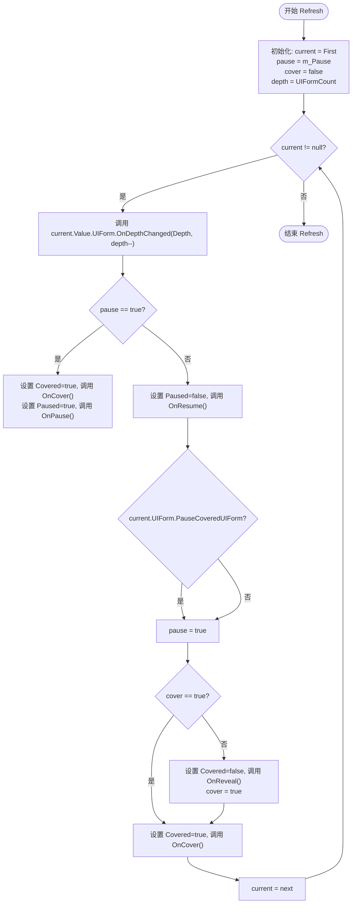

# 界面刷新与层级同步

<cite>
**本文档引用文件**  
- [UIManager.UIGroup.cs](file://GameFramework/UI/UIManager.UIGroup.cs)
- [UIManager.cs](file://GameFramework/UI/UIManager.cs)
- [IUIForm.cs](file://GameFramework/UI/IUIForm.cs)
- [GameFrameworkLinkedList.cs](file://GameFramework/Base/GameFrameworkLinkedList.cs)
</cite>

## 目录
1. [引言](#引言)
2. [核心数据结构](#核心数据结构)
3. [Refresh方法执行流程](#refresh方法执行流程)
4. [逆序遍历与深度分配机制](#逆序遍历与深度分配机制)
5. [Cover状态与视觉遮挡逻辑](#cover状态与视觉遮挡逻辑)
6. [生命周期事件同步机制](#生命周期事件同步机制)
7. [Refresh调用时机分析](#refresh调用时机分析)
8. [性能影响与优化建议](#性能影响与优化建议)
9. [总结](#总结)

## 引言
本文深入剖析Unity游戏框架中界面管理器的`Refresh`方法执行流程。该方法是UI系统的核心调度逻辑，负责在界面状态变化时重新同步所有界面的渲染层级、暂停状态和遮挡关系。通过分析其在`UIGroup`类中的实现，揭示其如何利用链表逆序遍历、深度递减和状态传递机制，实现高效且一致的界面状态管理。

## 核心数据结构

### UIFormInfo结构
`UIFormInfo`是`UIGroup`内部用于管理界面实例的元数据结构，包含以下关键字段：
- `UIForm`: 指向实际界面实例的引用
- `Paused`: 布尔值，表示该界面是否处于暂停状态
- `Covered`: 布尔值，表示该界面是否被上方界面遮挡

该结构通过`GameFrameworkLinkedList<UIFormInfo>`进行组织，链表的顺序即为界面在组内的Z轴顺序，链表头部（First）代表最上层的界面。

### GameFrameworkLinkedList链表
`GameFrameworkLinkedList<T>`是框架自定义的双向链表实现，相比标准`LinkedList<T>`，它增加了节点缓存机制，通过`m_CachedNodes`队列复用已移除的节点对象，有效减少GC压力。其`First`属性指向链表头部，`AddFirst`方法将新节点插入头部，确保最新打开的界面始终位于最上层。

**Section sources**
- [UIManager.UIGroup.cs](file://GameFramework/UI/UIManager.UIGroup.cs#L119-L125)
- [GameFrameworkLinkedList.cs](file://GameFramework/Base/GameFrameworkLinkedList.cs#L30-L35)

## Refresh方法执行流程

`Refresh`方法是`UIGroup`类的核心方法，负责在界面组状态（如`Depth`、`Pause`）或界面集合发生变化后，重新计算并同步所有界面的状态。

```mermaid
sequenceDiagram
participant Refresh as Refresh()
participant Loop as 遍历循环
participant UIForm as IUIForm
participant Helper as UIGroupHelper
Refresh->>Loop : 初始化 : pause = m_Pause, cover = false, depth = count
Loop->>UIForm : OnDepthChanged(Depth, depth--)
alt 界面组暂停 (pause == true)
UIForm->>UIForm : OnCover() (若未被遮挡)
UIForm->>UIForm : OnPause() (若未暂停)
else 界面组未暂停
UIForm->>UIForm : OnResume() (若已暂停)
alt 上方界面需暂停被覆盖界面
Loop->>Loop : pause = true
end
alt 上方界面已遮挡 (cover == true)
UIForm->>UIForm : OnCover() (若未被遮挡)
else
UIForm->>UIForm : OnReveal() (若已被遮挡)
Loop->>Loop : cover = true
end
end
Loop->>Loop : current = current.Next
Loop->>Loop : 继续遍历直到链表末尾
```

**Diagram sources**
- [UIManager.UIGroup.cs](file://GameFramework/UI/UIManager.UIGroup.cs#L473-L513)

**Section sources**
- [UIManager.UIGroup.cs](file://GameFramework/UI/UIManager.UIGroup.cs#L473-L513)

## 逆序遍历与深度分配机制

`Refresh`方法采用从链表头部开始的正向遍历（即从最上层界面到最下层界面），但通过一个递减的`depth`变量，为每个界面分配递减的渲染层级。

### 执行逻辑
1. **初始化深度**: `depth`变量初始化为`UIFormCount`（当前界面总数）。
2. **逐个遍历**: 从`m_UIFormInfos.First`开始，逐个访问链表中的每个`UIFormInfo`。
3. **分配深度**: 对于每个界面，调用其`OnDepthChanged`方法，并传入当前的`depth`值，然后`depth`递减。
4. **更新引用**: 使用`current = next`模式安全地遍历链表，避免在遍历过程中因状态变更导致的迭代器失效。

这种机制确保了链表头部（最新打开的界面）获得最高的深度值，而链表尾部（最早打开的界面）获得最低的深度值，从而实现了正确的Z轴排序。



**Diagram sources**
- [UIManager.UIGroup.cs](file://GameFramework/UI/UIManager.UIGroup.cs#L473-L513)

**Section sources**
- [UIManager.UIGroup.cs](file://GameFramework/UI/UIManager.UIGroup.cs#L473-L513)

## Cover状态与视觉遮挡逻辑

在非暂停状态下，`Refresh`方法通过`cover`标志的传递，精确地实现了“上方界面遮挡下方界面”的视觉效果。

### 核心逻辑
- **`cover`标志**: 一个布尔变量，初始为`false`。它代表“当前遍历位置的上方是否已有界面”。
- **遮挡判断**: 当`cover`为`true`时，表示当前界面被上方的界面遮挡，应调用`OnCover`。
- **揭示判断**: 当`cover`为`false`时，表示当前界面是当前遍历路径中第一个未被遮挡的界面，应调用`OnReveal`，并立即将`cover`设为`true`，以确保其下方的所有界面都被标记为“被遮挡”。

### 执行示例
假设一个界面组中有三个界面：A（底层）、B（中层）、C（顶层），按此顺序打开。
1. **遍历C (顶层)**: `cover`为`false` -> 调用`OnReveal` -> `cover`设为`true`。
2. **遍历B (中层)**: `cover`为`true` -> 调用`OnCover`。
3. **遍历A (底层)**: `cover`为`true` -> 调用`OnCover`。

此逻辑确保了只有最顶层的可见界面会收到`OnReveal`，而所有被遮挡的界面都会收到`OnCover`，从而实现了正确的视觉状态同步。

**Section sources**
- [UIManager.UIGroup.cs](file://GameFramework/UI/UIManager.UIGroup.cs#L473-L513)

## 生命周期事件同步机制

`Refresh`方法是界面生命周期事件（`OnCover`, `OnReveal`, `OnPause`, `OnResume`）的主要触发器。

### 事件触发条件
| 事件 | 触发条件 |
| :--- | :--- |
| `OnCover` | 1. 界面组处于`Pause`状态<br>2. 界面组未暂停，但`cover`标志为`true`（被上方界面遮挡） |
| `OnReveal` | 界面组未暂停，且`cover`标志为`false`（是当前最上层的可见界面） |
| `OnPause` | 界面组处于`Pause`状态 |
| `OnResume` | 界面组从`Pause`状态恢复 |

### 事件同步流程
1. **状态变更**: 当`UIGroup.Depth`或`UIGroup.Pause`属性被修改时，`set`访问器会自动调用`Refresh()`。
2. **界面变更**: 当调用`AddUIForm`、`RemoveUIForm`或`RefocusUIForm`时，这些方法在操作链表后会调用`Refresh()`。
3. **批量刷新**: 在`CloseUIForm`和`RefocusUIForm`等操作完成后，会再次调用`Refresh()`以确保所有界面状态一致。

这种设计确保了任何可能影响界面层级或状态的操作后，系统都能立即进入一个一致的状态。

**Section sources**
- [UIManager.UIGroup.cs](file://GameFramework/UI/UIManager.UIGroup.cs#L150-L158)
- [UIManager.UIGroup.cs](file://GameFramework/UI/UIManager.UIGroup.cs#L385-L395)
- [UIManager.UIGroup.cs](file://GameFramework/UI/UIManager.UIGroup.cs#L425-L435)

## Refresh调用时机分析

`Refresh`方法在以下关键时机被调用，以确保UI状态的实时同步：

### 1. 界面组属性变更
- **`Depth`属性变更**: 当`UIGroup.Depth`被修改时，`set`访问器会调用`Refresh()`，以通知所有界面其在全局UI层级中的深度已改变。
- **`Pause`属性变更**: 当`UIGroup.Pause`被修改时，`set`访问器会调用`Refresh()`，以统一暂停或恢复组内所有界面。

### 2. 界面集合变更
- **`AddUIForm`**: 当新界面被添加到组内（通常在打开时），会调用`Refresh()`以更新所有界面的`Covered`和`Paused`状态。
- **`RemoveUIForm`**: 在移除界面后，会调用`Refresh()`以确保剩余界面的状态正确。
- **`RefocusUIForm`**: 当激活一个已存在的界面时，会将其移动到链表头部，并调用`Refresh()`。

### 3. 界面操作完成
- **`CloseUIForm`**: 在成功关闭一个界面后，会调用`Refresh()`。
- **`RefocusUIForm`**: 在成功激活一个界面后，会调用`Refresh()`。

### 4. Update循环
`Refresh`方法**不会**在每一帧的`Update`循环中被调用。`UIGroup.Update`方法仅负责调用未暂停界面的`OnUpdate`，而`Refresh`仅在状态变更时被触发，这是一种性能优化，避免了不必要的遍历。

**Section sources**
- [UIManager.UIGroup.cs](file://GameFramework/UI/UIManager.UIGroup.cs#L150-L158)
- [UIManager.UIGroup.cs](file://GameFramework/UI/UIManager.UIGroup.cs#L359-L369)
- [UIManager.UIGroup.cs](file://GameFramework/UI/UIManager.UIGroup.cs#L409-L415)
- [UIManager.cs](file://GameFramework/UI/UIManager.cs#L745-L755)
- [UIManager.cs](file://GameFramework/UI/UIManager.cs#L785-L795)

## 性能影响与优化建议

### 性能分析
- **时间复杂度**: `Refresh`方法的时间复杂度为O(n)，其中n是当前界面组中的界面数量。它需要遍历整个链表一次。
- **调用频率**: 由于`Refresh`仅在状态变更时调用，而非每帧调用，因此其性能开销是可控的。
- **潜在瓶颈**: 在拥有大量界面的复杂UI场景中，频繁的打开/关闭操作会导致`Refresh`被频繁调用，可能成为性能热点。

### 优化实践建议
1. **批量操作**: 避免在单个逻辑帧内进行大量的界面打开/关闭操作。可以将多个UI变更操作合并，或在操作完成后统一处理。
2. **合理使用Pause**: `PauseCoveredUIForm`是一个强大的功能，但过度使用会导致大量界面进入暂停状态，增加`Refresh`的计算量。应仅在必要时（如复杂的弹窗系统）启用。
3. **减少Refresh调用**: 检查代码逻辑，确保没有不必要的`Refresh`调用。例如，如果只是修改了界面的某个属性而不影响其层级或遮挡关系，则无需调用`Refresh`。
4. **监控界面数量**: 在运行时监控`UIGroup`中的`UIFormCount`，避免在一个组内堆积过多的界面实例。
5. **利用对象池**: 确保`UIFormInstanceObject`对象池配置合理，减少因频繁创建/销毁界面实例带来的GC压力，这虽然不直接影响`Refresh`，但能提升整体UI性能。

## 总结
`Refresh`方法是GameFramework UI系统的核心调度器，它通过精巧的链表逆序遍历、深度递减和`cover`标志传递机制，高效地同步了界面的渲染层级、暂停和遮挡状态。其设计体现了“按需刷新”的原则，仅在状态变更时触发，避免了每帧遍历的性能开销。理解其执行流程对于开发高性能、状态一致的复杂UI系统至关重要。通过遵循优化建议，开发者可以最大限度地发挥该机制的优势，构建流畅的用户体验。