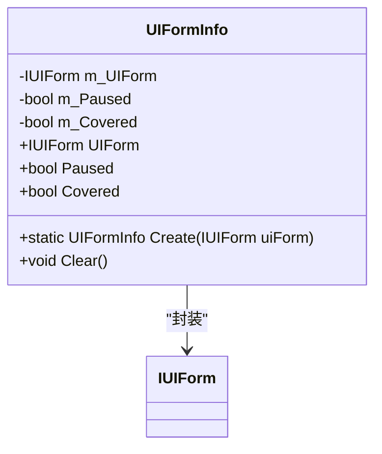
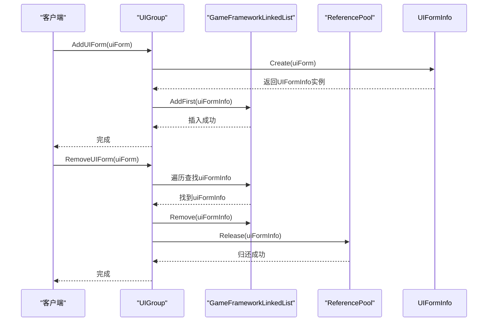
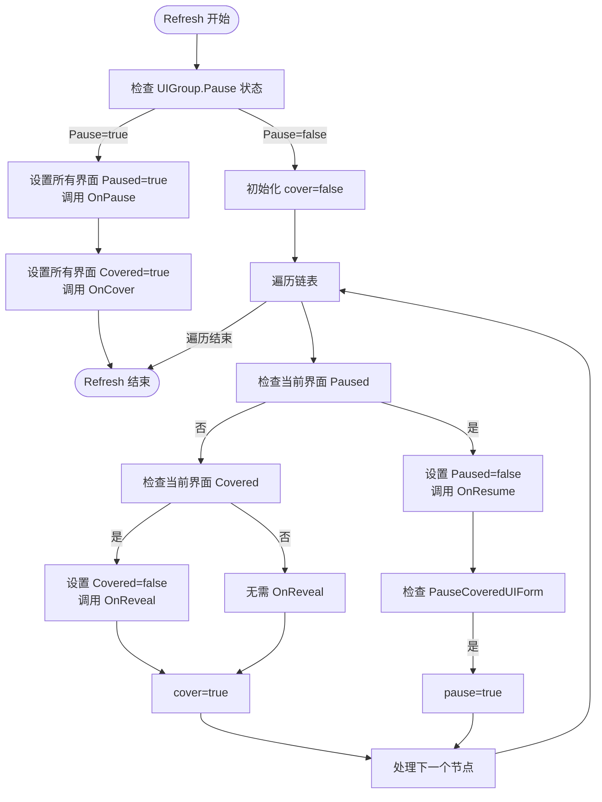
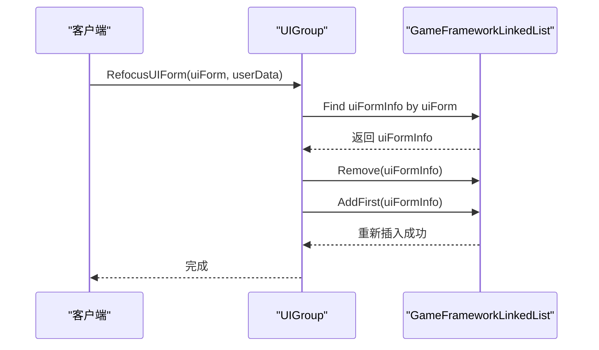

# 界面层级与堆栈管理

<cite>
**Referenced Files in This Document**  
- [UIManager.UIGroup.cs](file://GameFramework/UI/UIManager.UIGroup.cs)
- [UIManager.UIGroup.UIFormInfo.cs](file://GameFramework/UI/UIManager.UIGroup.UIFormInfo.cs)
- [GameFrameworkLinkedList.cs](file://GameFramework/Base/GameFrameworkLinkedList.cs)
</cite>

## 目录
1. [UIFormInfo类结构设计](#uiforminfo类结构设计)
2. [界面堆栈的LIFO管理机制](#界面堆栈的lifo管理机制)
3. [界面状态管理与生命周期事件](#界面状态管理与生命周期事件)
4. [RefocusUIForm的激活顺序调整机制](#refocusuiform的激活顺序调整机制)
5. [链表操作性能分析与风险提示](#链表操作性能分析与风险提示)

## UIFormInfo类结构设计

`UIFormInfo`类是界面堆栈管理的核心数据结构，作为`IReference`接口的实现，它封装了单个界面实例及其状态信息。该类通过私有字段`m_UIForm`持有对`IUIForm`实例的引用，确保了界面对象的统一管理。

状态标记`Paused`和`Covered`分别表示界面的暂停和遮挡状态。当界面被其他界面覆盖时，`Covered`标记为`true`，触发`OnCover`生命周期事件；当界面处于非活动状态时，`Paused`标记为`true`，触发`OnPause`事件。这两个布尔值的组合精确描述了界面在堆栈中的可见性和交互性。

`UIFormInfo`的创建通过静态工厂方法`Create`完成，该方法从引用池`ReferencePool`中获取实例，实现了对象的复用，避免了频繁的内存分配与垃圾回收。`Clear`方法在对象归还引用池前重置所有字段，确保下次使用时的干净状态。

**Diagram sources**  
- [UIManager.UIGroup.UIFormInfo.cs](file://GameFramework/UI/UIManager.UIGroup.UIFormInfo.cs#L11-L82)

**Section sources**  
- [UIManager.UIGroup.UIFormInfo.cs](file://GameFramework/UI/UIManager.UIGroup.UIFormInfo.cs#L11-L82)

## 界面堆栈的LIFO管理机制

UIGroup通过`GameFrameworkLinkedList<UIFormInfo>`实现界面堆栈的后进先出（LIFO）管理。链表的头部（First）代表当前最顶层的界面，即用户正在交互的界面。

`AddUIForm`方法将新界面插入链表头部，使用`AddFirst`操作确保新界面成为当前活动界面。这一操作的时间复杂度为O(1)，非常高效。`RemoveUIForm`方法首先通过`GetUIFormInfo`遍历链表查找对应的`UIFormInfo`节点，然后调用链表的`Remove`方法将其移除，并最终通过`ReferencePool.Release`将`UIFormInfo`实例归还到引用池。

**Diagram sources**  
- [UIManager.UIGroup.cs](file://GameFramework/UI/UIManager.UIGroup.cs#L330-L333)
- [UIManager.UIGroup.cs](file://GameFramework/UI/UIManager.UIGroup.cs#L339-L370)
- [GameFrameworkLinkedList.cs](file://GameFramework/Base/GameFrameworkLinkedList.cs#L18-L451)

**Section sources**  
- [UIManager.UIGroup.cs](file://GameFramework/UI/UIManager.UIGroup.cs#L330-L370)

## 界面状态管理与生命周期事件

`Refresh`方法是界面状态同步的核心，它遍历整个链表，根据`Paused`和`Covered`状态调用相应的生命周期事件。遍历从链表头部开始，逐个检查每个`UIFormInfo`节点。

当`UIGroup`整体处于暂停状态（`m_Pause`为`true`）时，所有界面都会被标记为`Paused`和`Covered`，并触发`OnPause`和`OnCover`事件。当`UIGroup`处于活动状态时，遍历逻辑更为复杂：第一个未被暂停的界面会触发`OnResume`事件，其下的所有界面则会因为被遮挡而触发`OnCover`事件，而第一个被遮挡的界面之上的界面则会触发`OnReveal`事件。

这种设计确保了界面堆栈的视觉层级和逻辑状态始终保持一致。例如，当一个新界面打开时，它下面的所有界面都会收到`OnCover`通知，可以据此暂停背景音乐或动画。

**Diagram sources**  
- [UIManager.UIGroup.cs](file://GameFramework/UI/UIManager.UIGroup.cs#L392-L476)

**Section sources**  
- [UIManager.UIGroup.cs](file://GameFramework/UI/UIManager.UIGroup.cs#L392-L476)

## RefocusUIForm的激活顺序调整机制

`RefocusUIForm`方法提供了一种特殊的界面激活机制，它不改变界面的打开或关闭状态，而是调整其在堆栈中的激活顺序。该方法首先通过`GetUIFormInfo`找到目标界面的`UIFormInfo`节点，然后将其从链表中移除，再通过`AddFirst`重新插入到链表头部。

这一操作的效果是将指定界面“提升”到堆栈的最顶层，使其成为当前活动界面，同时保持其`Paused`和`Covered`状态不变。这对于需要临时将某个后台界面拉回前台进行交互的场景非常有用，例如从设置菜单快速返回到主游戏界面。

**Diagram sources**  
- [UIManager.UIGroup.cs](file://GameFramework/UI/UIManager.UIGroup.cs#L377-L387)

**Section sources**  
- [UIManager.UIGroup.cs](file://GameFramework/UI/UIManager.UIGroup.cs#L377-L387)

## 链表操作性能分析与风险提示

`GameFrameworkLinkedList<T>`在标准`LinkedList<T>`的基础上增加了节点缓存机制，通过`m_CachedNodes`队列复用已移除的节点，有效减少了内存分配和GC压力，提升了频繁增删操作的性能。

然而，这种设计也存在潜在风险。`RemoveUIForm`和`Refresh`方法中的遍历操作时间复杂度为O(n)，在界面数量极多时可能成为性能瓶颈。此外，`Refresh`方法内部的`OnCover`、`OnPause`等事件回调如果执行耗时操作，会阻塞整个刷新流程，影响帧率。

建议在实际项目中：
1.  控制单个UIGroup内的界面数量，避免过度堆叠。
2.  确保`IUIForm`的生命周期方法（如`OnPause`、`OnCover`）执行高效，避免复杂计算或I/O操作。
3.  合理使用`RefocusUIForm`，避免频繁调用导致不必要的链表操作。
4.  监控`CachedNodeCount`，确保节点缓存不会无限增长。