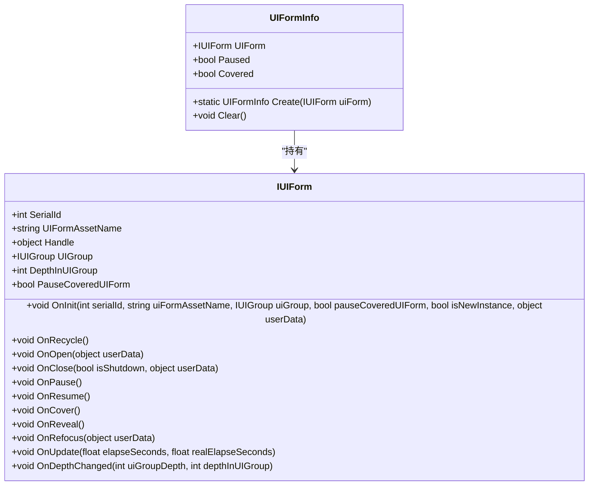
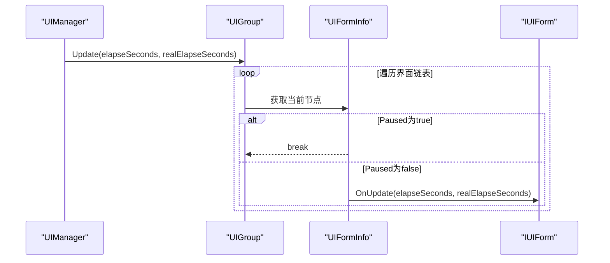
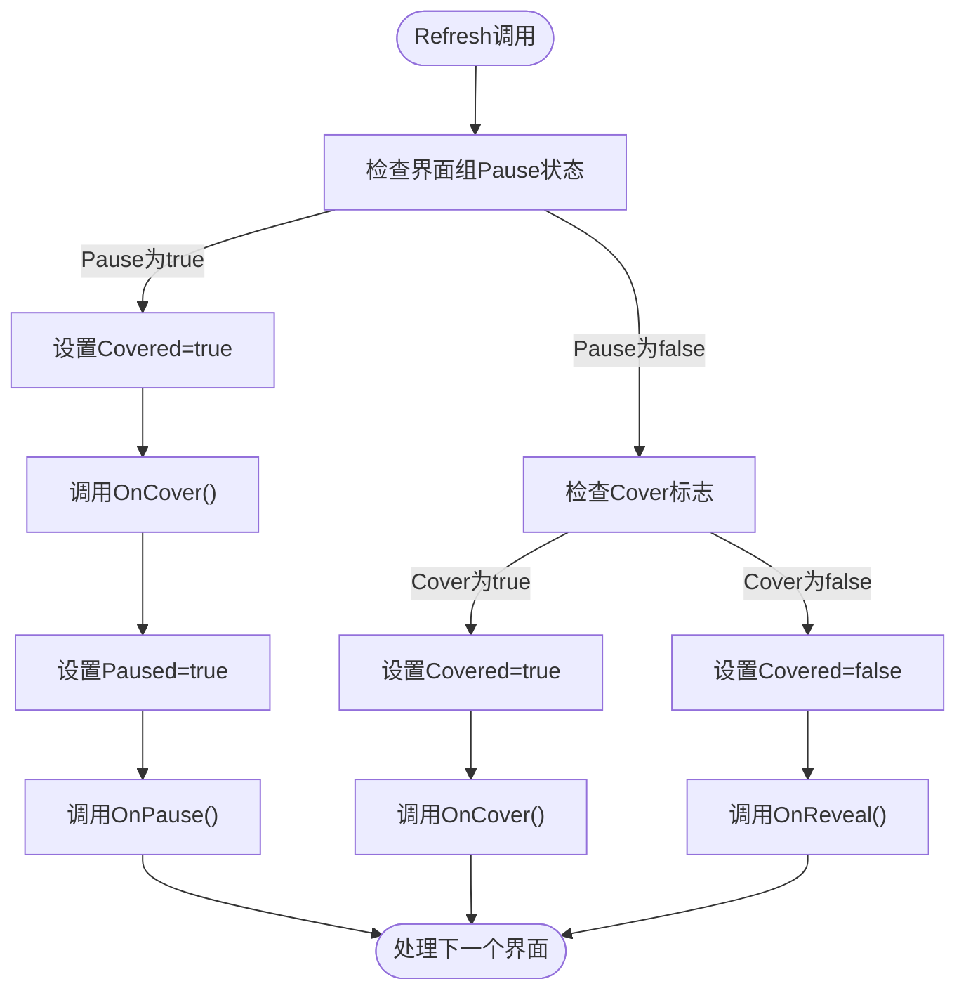
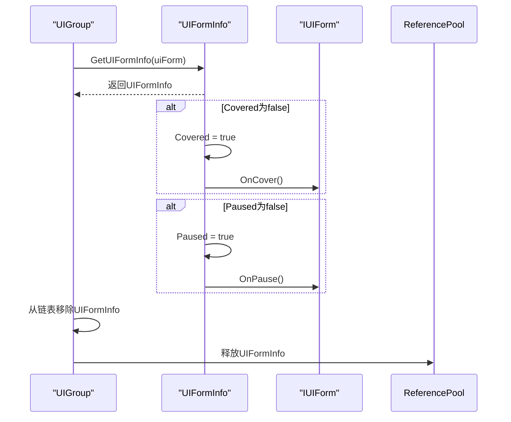
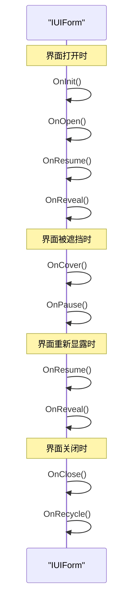

# 界面状态管理

<cite>
**Referenced Files in This Document**   
- [UIManager.UIGroup.UIFormInfo.cs](file://GameFramework/UI/UIManager.UIGroup.UIFormInfo.cs)
- [UIManager.UIGroup.cs](file://GameFramework/UI/UIManager.UIGroup.cs)
- [UIManager.cs](file://GameFramework/UI/UIManager.cs)
- [IUIForm.cs](file://GameFramework/UI/IUIForm.cs)
</cite>

## 目录
1. [简介](#简介)
2. [核心状态设计](#核心状态设计)
3. [状态控制机制](#状态控制机制)
4. [状态初始化与变更逻辑](#状态初始化与变更逻辑)
5. [生命周期回调触发顺序](#生命周期回调触发顺序)
6. [状态联动关系](#状态联动关系)
7. [常见问题与调试建议](#常见问题与调试建议)

## 简介
本文档详细解析`UIFormInfo`类中`Paused`和`Covered`状态标记的设计原理与作用机制。阐述`Paused`状态如何控制界面的更新暂停与恢复（OnPause/OnResume），`Covered`状态如何管理界面的遮挡与显露（OnCover/OnReveal）。说明在`AddUIForm`、`RemoveUIForm`和`RefocusUIForm`操作中状态的初始化与变更逻辑。结合代码示例，展示状态变化如何影响界面生命周期回调的触发顺序。分析状态管理与界面组Pause属性的联动关系，以及`PauseCoveredUIForm`标志对状态传播的影响。提供状态误用的常见问题与调试建议。

## 核心状态设计

`UIFormInfo`类作为界面管理器中的核心数据结构，负责维护每个界面实例的状态信息。该类通过两个布尔型状态标记`Paused`和`Covered`来精确控制界面的生命周期行为。

**Diagram sources**
- [UIManager.UIGroup.UIFormInfo.cs](file://GameFramework/UI/UIManager.UIGroup.UIFormInfo.cs#L9-L85)
- [IUIForm.cs](file://GameFramework/UI/IUIForm.cs#L1-L132)

**Section sources**
- [UIManager.UIGroup.UIFormInfo.cs](file://GameFramework/UI/UIManager.UIGroup.UIFormInfo.cs#L9-L85)
- [IUIForm.cs](file://GameFramework/UI/IUIForm.cs#L1-L132)

## 状态控制机制

### Paused状态控制

`Paused`状态用于控制界面的更新暂停与恢复。当界面处于暂停状态时，其`OnUpdate`方法将不会被调用，从而实现性能优化和逻辑隔离。

**Diagram sources**
- [UIManager.UIGroup.cs](file://GameFramework/UI/UIManager.UIGroup.cs#L150-L170)

**Section sources**
- [UIManager.UIGroup.cs](file://GameFramework/UI/UIManager.UIGroup.cs#L150-L170)

### Covered状态控制

`Covered`状态用于管理界面的遮挡与显露。当界面被其他界面遮挡时，会触发`OnCover`回调；当界面重新显露时，会触发`OnReveal`回调。

**Diagram sources**
- [UIManager.UIGroup.cs](file://GameFramework/UI/UIManager.UIGroup.cs#L400-L500)

**Section sources**
- [UIManager.UIGroup.cs](file://GameFramework/UI/UIManager.UIGroup.cs#L400-L500)

## 状态初始化与变更逻辑

### 状态初始化

在创建`UIFormInfo`实例时，`Paused`和`Covered`状态均被初始化为`true`，确保新打开的界面在首次刷新时能够正确触发相应的生命周期回调。

[SPEC SYMBOL](file://GameFramework/UI/UIManager.UIGroup.UIFormInfo.cs#L55-L58)

### AddUIForm操作

当向界面组添加新界面时，会创建`UIFormInfo`实例并将其添加到链表头部。

[SPEC SYMBOL](file://GameFramework/UI/UIManager.UIGroup.cs#L300-L303)

### RemoveUIForm操作

移除界面时，会检查并触发相应的状态变更回调，确保界面能够正确清理资源。

**Diagram sources**
- [UIManager.UIGroup.cs](file://GameFramework/UI/UIManager.UIGroup.cs#L305-L335)

**Section sources**
- [UIManager.UIGroup.cs](file://GameFramework/UI/UIManager.UIGroup.cs#L305-L335)

### RefocusUIForm操作

重新聚焦界面时，会将界面移动到链表头部，并触发界面组的刷新操作。

[SPEC SYMBOL](file://GameFramework/UI/UIManager.cs#L891-L907)

## 生命周期回调触发顺序

状态变化会按照特定顺序触发界面的生命周期回调方法。以下是典型的状态变更序列：

**Diagram sources**
- [IUIForm.cs](file://GameFramework/UI/IUIForm.cs#L1-L132)

**Section sources**
- [IUIForm.cs](file://GameFramework/UI/IUIForm.cs#L1-L132)

## 状态联动关系

### 界面组Pause属性联动

界面组的`Pause`属性与`UIFormInfo`的状态存在直接联动关系。当界面组被暂停时，其包含的所有界面都会被暂停。

[SPEC SYMBOL](file://GameFramework/UI/UIManager.UIGroup.cs#L130-L145)

### PauseCoveredUIForm标志影响

`PauseCoveredUIForm`标志决定了当前界面是否会影响被其遮挡的界面的状态。当该标志为`true`时，被遮挡的界面会被暂停。

[SPEC SYMBOL](file://GameFramework/UI/IUIForm.cs#L57-L60)

## 常见问题与调试建议

### 状态误用问题

1. **状态不一致**：手动修改状态标记而未调用相应生命周期方法
2. **回调遗漏**：未正确处理`OnCover`/`OnReveal`或`OnPause`/`OnResume`配对
3. **资源泄漏**：在`OnCover`中分配资源但未在`OnReveal`中释放

### 调试建议

1. **日志跟踪**：在关键生命周期方法中添加日志输出
2. **状态检查**：定期检查界面状态的一致性
3. **单元测试**：为状态变更逻辑编写单元测试
4. **可视化工具**：使用调试器查看界面链表和状态

**Section sources**
- [UIManager.UIGroup.cs](file://GameFramework/UI/UIManager.UIGroup.cs#L400-L500)
- [IUIForm.cs](file://GameFramework/UI/IUIForm.cs#L1-L132)