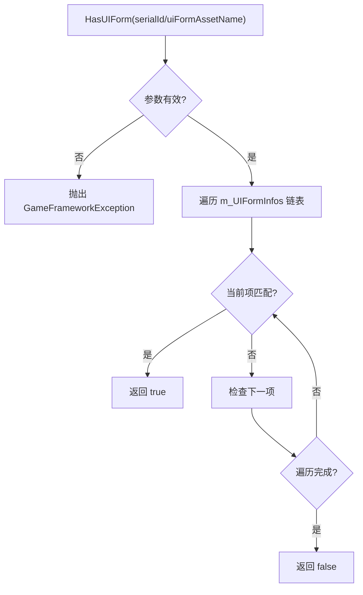
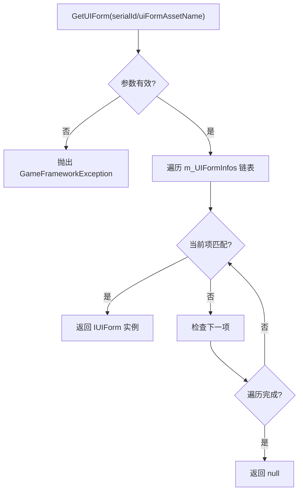

# 界面查询机制

<cite>
**Referenced Files in This Document**  
- [IUIGroup.cs](file://GameFramework/UI/IUIGroup.cs)
- [UIManager.UIGroup.cs](file://GameFramework/UI/UIManager.UIGroup.cs)
- [UIManager.UIGroup.UIFormInfo.cs](file://GameFramework/UI/UIManager.UIGroup.UIFormInfo.cs)
</cite>

## 目录
1. [引言](#引言)
2. [核心查询方法概览](#核心查询方法概览)
3. [存在性检查：HasUIForm](#存在性检查hasuiform)
4. [单实例查询：GetUIForm](#单实例查询getuiform)
5. [多实例查询：GetUIForms](#多实例查询getuiforms)
6. [全量查询：GetAllUIForms](#全量查询getalluiforms)
7. [性能特征与复杂度分析](#性能特征与复杂度分析)
8. [最佳实践与优化建议](#最佳实践与优化建议)

## 引言

在游戏开发中，高效的界面管理是确保流畅用户体验的关键。UIGroup作为界面管理系统的核心组件，提供了一套完整的界面查询机制，允许开发者根据序列编号（serialId）或资源名称（uiFormAssetName）快速定位和操作界面实例。本文档全面分析了UIGroup提供的各类界面查询方法，包括`HasUIForm`、`GetUIForm`、`GetUIForms`和`GetAllUIForms`，深入探讨其使用场景、内部实现逻辑和性能特征。通过对比不同查询方式的差异，特别是基于serialId和uiFormAssetName的查询，以及单结果与多结果查询的实现策略，为开发者提供在大规模界面管理场景下的优化建议。

## 核心查询方法概览

UIGroup接口定义了四类核心查询方法，分别服务于不同的使用场景：

1. **存在性检查**：`HasUIForm` 用于判断特定界面是否存在于当前界面组中。
2. **单实例获取**：`GetUIForm` 用于获取与指定标识符匹配的单个界面实例。
3. **多实例获取**：`GetUIForms` 用于获取与指定资源名称匹配的所有界面实例。
4. **全量获取**：`GetAllUIForms` 用于获取当前界面组中的所有界面实例。

这些方法均基于一个内部的双向链表`m_UIFormInfos`进行遍历操作，该链表存储了`UIFormInfo`对象，每个对象封装了一个`IUIForm`实例及其状态信息（如暂停、遮挡状态）。由于查询操作本质上是线性搜索，因此所有方法的时间复杂度均为O(n)，其中n为界面组中界面的数量。

**Section sources**
- [IUIGroup.cs](file://GameFramework/UI/IUIGroup.cs#L58-L121)
- [UIManager.UIGroup.cs](file://GameFramework/UI/UIManager.UIGroup.cs#L165-L324)

## 存在性检查：HasUIForm

`HasUIForm`方法提供了两种重载，分别通过序列编号（serialId）和界面资源名称（uiFormAssetName）来检查界面的存在性。

### 基于serialId的查询
该方法通过遍历`m_UIFormInfos`链表，比较每个`UIFormInfo`中`IUIForm`的`SerialId`属性与传入的`serialId`是否相等。一旦找到匹配项，立即返回`true`；若遍历完整个链表仍未找到，则返回`false`。此方法适用于需要快速确认某个特定界面实例（由唯一序列号标识）是否存在的场景。

### 基于uiFormAssetName的查询
此重载首先对传入的`uiFormAssetName`进行空值检查，若为空则抛出异常。随后，它遍历链表，比较每个`IUIForm`的`UIFormAssetName`属性。与serialId查询类似，它在找到第一个匹配项时即返回`true`。此方法适用于需要确认某种类型的界面（由资源名称标识）是否已打开的场景。

两种查询方式的逻辑相似，但应用场景不同：serialId用于精确的实例级操作，而uiFormAssetName用于类型级的批量操作。

**Diagram sources**
- [UIManager.UIGroup.cs](file://GameFramework/UI/UIManager.UIGroup.cs#L165-L199)

**Section sources**
- [UIManager.UIGroup.cs](file://GameFramework/UI/UIManager.UIGroup.cs#L165-L199)

## 单实例查询：GetUIForm

`GetUIForm`方法同样提供两种重载，用于获取单个界面实例。

### 基于serialId的查询
此方法的实现逻辑与`HasUIForm(int)`几乎完全相同，唯一的区别在于返回值。它遍历链表，寻找`SerialId`匹配的`IUIForm`实例，找到后立即返回该实例；若未找到，则返回`null`。这使得它非常适合用于根据已知的唯一标识符恢复或操作一个特定的界面。

### 基于uiFormAssetName的查询
此重载首先进行参数有效性检查，然后遍历链表，返回第一个`UIFormAssetName`匹配的`IUIForm`实例。需要注意的是，如果界面组中存在多个同名的界面实例，此方法仅返回最“顶层”的那个（即链表中位置最靠前的，通常也是最后打开的）。因此，当需要获取所有同名实例时，应使用`GetUIForms`方法。

**Diagram sources**
- [UIManager.UIGroup.cs](file://GameFramework/UI/UIManager.UIGroup.cs#L206-L240)

**Section sources**
- [UIManager.UIGroup.cs](file://GameFramework/UI/UIManager.UIGroup.cs#L206-L240)

## 多实例查询：GetUIForms

`GetUIForms`方法专门用于获取所有具有相同资源名称的界面实例，它提供了两种重载，体现了不同的内存管理策略。

### 数组返回重载
`IUIForm[] GetUIForms(string uiFormAssetName)`方法创建一个新的`List<IUIForm>`，遍历链表将所有匹配的`IUIForm`实例添加到列表中，最后调用`ToArray()`方法将列表转换为数组并返回。这种方法使用方便，但每次调用都会产生一次新的内存分配（List和数组），在频繁调用的场景下可能导致垃圾回收（GC）压力增大。

### List输出重载
`void GetUIForms(string uiFormAssetName, List<IUIForm> results)`方法则采用了一种更高效的模式。它接收一个外部传入的`List<IUIForm>`作为输出参数。方法内部首先清空该列表，然后将所有匹配的实例直接添加进去。这种方式避免了不必要的内存分配，调用者可以复用同一个`List`对象，显著降低了GC开销。这是处理多结果查询时推荐的模式。

**Diagram sources**
- [UIManager.UIGroup.cs](file://GameFramework/UI/UIManager.UIGroup.cs#L247-L270)

**Section sources**
- [UIManager.UIGroup.cs](file://GameFramework/UI/UIManager.UIGroup.cs#L247-L270)

## 全量查询：GetAllUIForms

`GetAllUIForms`方法用于获取界面组中的所有界面实例，其设计与`GetUIForms`类似，也提供了两种重载。

### 数组返回重载
`IUIForm[] GetAllUIForms()`方法创建一个新的`List<IUIForm>`，遍历整个`m_UIFormInfos`链表，将所有`IUIForm`实例添加到列表中，最后转换为数组返回。与`GetUIForms`的数组重载一样，这种方法简单但会产生额外的内存分配。

### List输出重载
`void GetAllUIForms(List<IUIForm> results)`方法接收一个外部`List`，清空后将所有界面实例添加进去。这是获取全量数据时的高效选择，因为它允许调用者完全控制`List`的生命周期，实现对象池化或复用，从而避免频繁的内存分配。

这两种方法的内部实现都通过一个名为`InternalGetAllUIForms`的私有方法来执行核心的遍历和添加逻辑，确保了代码的复用性和一致性。

**Diagram sources**
- [UIManager.UIGroup.cs](file://GameFramework/UI/UIManager.UIGroup.cs#L297-L324)

**Section sources**
- [UIManager.UIGroup.cs](file://GameFramework/UI/UIManager.UIGroup.cs#L297-L324)

## 性能特征与复杂度分析

所有UIGroup的查询方法都基于对`m_UIFormInfos`链表的线性遍历，因此它们的时间复杂度均为O(n)，其中n是界面组中界面的数量。这意味着随着界面数量的增加，查询操作的耗时会线性增长。

| 方法 | 时间复杂度 | 空间复杂度 (数组重载) | 空间复杂度 (List重载) |
| :--- | :--- | :--- | :--- |
| `HasUIForm` | O(n) | O(1) | O(1) |
| `GetUIForm` | O(n) | O(1) | O(1) |
| `GetUIForms` | O(n) | O(k) | O(k) |
| `GetAllUIForms` | O(n) | O(n) | O(n) |

*注：k为匹配的界面实例数量*

从空间复杂度角度看，数组返回的重载方法在返回结果时会产生O(k)或O(n)的额外空间开销，而List输出重载方法的空间开销由调用者控制，可以优化至O(1)（通过复用List对象）。

**Section sources**
- [UIManager.UIGroup.cs](file://GameFramework/UI/UIManager.UIGroup.cs#L165-L324)

## 最佳实践与优化建议

为了在大规模界面管理场景下保持高性能，建议遵循以下最佳实践：

1. **优先使用List输出重载**：在进行多实例或全量查询时，始终使用接收`List<IUIForm>`作为参数的重载方法。通过在调用者侧维护一个可复用的`List`对象，可以有效避免GC压力。

2. **合理使用缓存**：对于频繁查询且不常变化的数据（例如，某个特定类型的界面是否已存在），可以考虑在外部维护一个缓存。例如，使用一个`Dictionary<string, bool>`来缓存`HasUIForm(uiFormAssetName)`的结果，将O(n)的查询降为O(1)。

3. **避免不必要的全量查询**：`GetAllUIForms`操作代价高昂，应尽量避免在每帧或高频事件中调用。如果需要对所有界面进行操作，考虑是否有更高效的设计模式，如事件驱动。

4. **利用serialId进行精确查询**：当已知界面的唯一序列号时，使用`GetUIForm(int serialId)`是最快的方式，因为它通常能比`uiFormAssetName`查询更早地找到目标（假设界面是按打开顺序排列的）。

5. **理解查询的语义**：明确`GetUIForm(string)`只返回第一个匹配项，如果业务逻辑需要所有实例，必须使用`GetUIForms`。

通过理解这些查询方法的内部机制和性能特征，开发者可以做出更明智的选择，构建出响应迅速、内存高效的用户界面系统。

**Section sources**
- [UIManager.UIGroup.cs](file://GameFramework/UI/UIManager.UIGroup.cs#L165-L324)