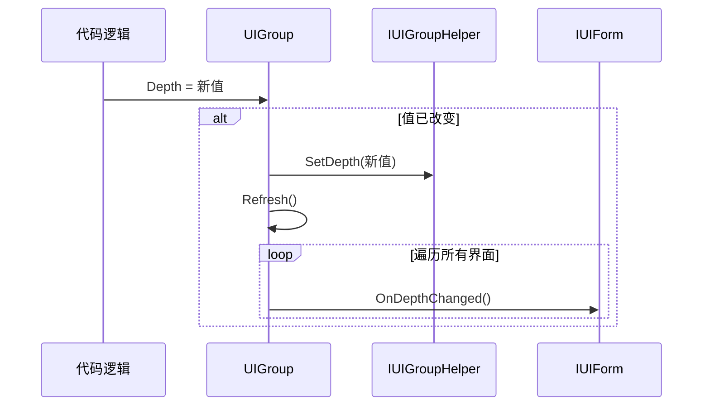
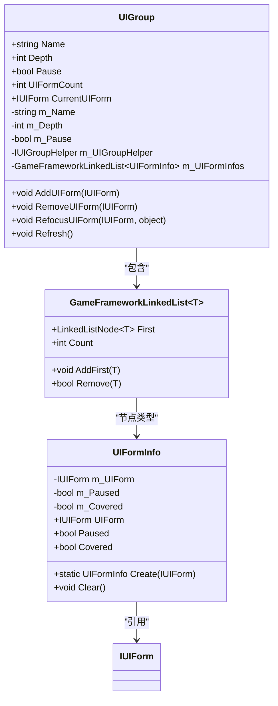

# 界面组属性详解

<cite>
**本文档引用文件**   
- [IUIGroup.cs](file://GameFramework/UI/IUIGroup.cs)
- [UIManager.UIGroup.cs](file://GameFramework/UI/UIManager.UIGroup.cs)
- [IUIForm.cs](file://GameFramework/UI/IUIForm.cs)
- [UIManager.cs](file://GameFramework/UI/UIManager.cs)
- [IUIGroupHelper.cs](file://GameFramework/UI/IUIGroupHelper.cs)
</cite>

## 目录
1. [引言](#引言)
2. [核心属性解析](#核心属性解析)
3. [Name属性：唯一标识机制](#name属性唯一标识机制)
4. [Depth属性：渲染顺序与交互优先级](#depth属性渲染顺序与交互优先级)
5. [Pause属性：暂停机制与事件触发](#pause属性暂停机制与事件触发)
6. [UIFormCount属性：实时统计与性能优化](#uiformcount属性实时统计与性能优化)
7. [CurrentUIForm属性：激活界面选取规则](#currentuiform属性激活界面选取规则)
8. [调试建议与常见误用规避](#调试建议与常见误用规避)
9. [总结](#总结)

## 引言
本文深入解析IUIGroup接口中定义的核心属性，包括Name、Depth、Pause、UIFormCount和CurrentUIForm。通过分析UIManager中UIGroup类的具体实现，详细阐述这些属性在运行时的行为机制、联动逻辑及最佳实践。文档结合代码结构与运行逻辑，为开发者提供全面的界面组管理理解与调试指导。

## 核心属性解析
IUIGroup接口定义了界面组的核心行为与状态管理，其属性设计体现了分层管理、状态同步与性能优化的设计理念。以下将逐一解析各属性的作用机制与实现原理。

**Section sources**
- [IUIGroup.cs](file://GameFramework/UI/IUIGroup.cs#L14-L119)

## Name属性：唯一标识机制
Name属性作为界面组的唯一标识符，在系统中承担着关键的定位与管理功能。该属性为只读字符串，其值在UIGroup实例化时通过构造函数传入，并存储于私有字段m_Name中。

Name的唯一性由UIManager在创建界面组时保证，通过Dictionary<string, UIGroup>类型的m_UIGroups集合进行管理，使用StringComparer.Ordinal进行键比较，确保名称的精确匹配。当调用GetUIGroup方法时，系统根据提供的名称在字典中查找对应的界面组实例，实现高效的O(1)时间复杂度检索。

该设计确保了界面组在整个生命周期内的身份稳定性，任何尝试创建同名界面组的操作都将被拒绝，从而避免了资源冲突与管理混乱。

**Section sources**
- [IUIGroup.cs](file://GameFramework/UI/IUIGroup.cs#L14-L22)
- [UIManager.UIGroup.cs](file://GameFramework/UI/UIManager.UIGroup.cs#L31-L49)
- [UIManager.cs](file://GameFramework/UI/UIManager.cs#L301-L315)

## Depth属性：渲染顺序与交互优先级
Depth属性控制界面组的渲染深度，直接影响其在UI层级中的显示顺序与用户交互优先级。该属性为可读写整型，其值的变化会触发界面组的刷新机制。

当Depth属性被修改时，系统首先检查新旧值是否相同，若不同则更新m_Depth字段，并通过m_UIGroupHelper.SetDepth(m_Depth)通知界面组辅助器进行实际的深度设置。随后调用Refresh()方法，遍历组内所有界面，触发IUIForm.OnDepthChanged事件，将新的组深度与界面在组内的相对深度传递给每个界面实例。

这种设计实现了界面组深度与UI渲染系统的联动，确保界面层级的正确性。较高的Depth值通常意味着更靠前的显示层级，从而获得更高的用户交互优先级。



**Diagram sources**
- [IUIGroup.cs](file://GameFramework/UI/IUIGroup.cs#L24-L32)
- [UIManager.UIGroup.cs](file://GameFramework/UI/UIManager.UIGroup.cs#L54-L67)
- [IUIGroupHelper.cs](file://GameFramework/UI/IUIGroupHelper.cs#L0-L20)
- [IUIForm.cs](file://GameFramework/UI/IUIForm.cs#L129-L129)

## Pause属性：暂停机制与事件触发
Pause属性控制界面组的更新状态，决定组内界面是否响应逻辑更新。该属性为可读写布尔值，其变化会触发组内界面的暂停/恢复事件链。

当Pause属性被设置时，系统检查状态变化，若从false变为true，则遍历m_UIFormInfos双向链表中的所有UIFormInfo节点。对于每个未暂停的界面，将其Paused标志设为true，并调用IUIForm.OnPause()方法；若从true变为false，则调用IUIForm.OnResume()方法。

关键的刷新逻辑在Refresh()方法中实现，该方法在Update周期中被调用。当m_Pause为true时，所有界面将被暂停；当m_Pause为false时，系统会根据界面的PauseCoveredUIForm属性决定是否暂停被覆盖的界面，形成层级化的暂停机制。

```mermaid
flowchart TD
Start([Pause属性变更]) --> CheckChange{"状态改变?"}
CheckChange --> |否| End([无操作])
CheckChange --> |是| UpdateField[更新m_Pause字段]
UpdateField --> CallRefresh[调用Refresh()]
CallRefresh --> CheckPause{"Pause=true?"}
CheckPause --> |是| LoopPause[遍历界面]
CheckPause --> |否| LoopResume[遍历界面]
LoopPause --> CheckPaused{"已暂停?"}
CheckPaused --> |否| SetPaused[设置Paused=true]
SetPaused --> CallOnPause[调用OnPause()]
LoopResume --> CheckResumed{"已恢复?"}
CheckResumed --> |否| SetResumed[设置Paused=false]
SetResumed --> CallOnResume[调用OnResume()]
CallOnPause --> End
CallOnResume --> End
```

**Diagram sources**
- [IUIGroup.cs](file://GameFramework/UI/IUIGroup.cs#L34-L42)
- [UIManager.UIGroup.cs](file://GameFramework/UI/UIManager.UIGroup.cs#L69-L82)
- [UIManager.UIGroup.cs](file://GameFramework/UI/UIManager.UIGroup.cs#L407-L444)
- [IUIForm.cs](file://GameFramework/UI/IUIForm.cs#L94-L94)
- [IUIForm.cs](file://GameFramework/UI/IUIForm.cs#L99-L99)

**Section sources**
- [IUIGroup.cs](file://GameFramework/UI/IUIGroup.cs#L34-L42)
- [UIManager.UIGroup.cs](file://GameFramework/UI/UIManager.UIGroup.cs#L69-L82)
- [UIManager.UIGroup.cs](file://GameFramework/UI/UIManager.UIGroup.cs#L407-L444)

## UIFormCount属性：实时统计与性能优化
UIFormCount属性提供界面组中界面数量的实时统计，其设计体现了性能优化的考量。该属性为只读整型，其值直接返回m_UIFormInfos.Count属性。

m_UIFormInfos是基于GameFrameworkLinkedList<UIFormInfo>实现的双向链表，其Count属性维护了内部计数器，使得数量查询的时间复杂度为O(1)，避免了遍历链表的性能开销。每当通过AddUIForm或RemoveUIForm方法添加或移除界面时，链表的内部计数器会自动增减，确保UIFormCount的实时准确性。

这种设计在频繁查询界面数量的场景下具有显著性能优势，特别适用于需要根据界面数量进行逻辑判断的UI管理系统。

**Section sources**
- [IUIGroup.cs](file://GameFramework/UI/IUIGroup.cs#L44-L52)
- [UIManager.UIGroup.cs](file://GameFramework/UI/UIManager.UIGroup.cs#L84-L89)
- [UIManager.UIGroup.cs](file://GameFramework/UI/UIManager.UIGroup.cs#L148-L154)

## CurrentUIForm属性：激活界面选取规则
CurrentUIForm属性标识当前激活的界面，其选取规则基于双向链表的首节点机制。该属性为只读IUIForm类型，其实现逻辑为：返回m_UIFormInfos.First节点的Value.UIForm，若链表为空则返回null。

UIGroup采用"栈式"管理策略，最新添加或激活的界面位于链表头部。AddUIForm方法使用AddFirst将新界面插入链表首部，RefocusUIForm方法通过Remove后AddFirst将指定界面移至首部，确保CurrentUIForm始终指向最新交互的界面。

这种设计自然地实现了界面的Z轴顺序管理，链表头部的界面具有最高交互优先级，符合常见的UI交互模式。



**Diagram sources**
- [IUIGroup.cs](file://GameFramework/UI/IUIGroup.cs#L54-L62)
- [UIManager.UIGroup.cs](file://GameFramework/UI/UIManager.UIGroup.cs#L31-L49)
- [UIManager.UIGroup.UIFormInfo.cs](file://GameFramework/UI/UIManager.UIGroup.UIFormInfo.cs#L11-L82)

**Section sources**
- [IUIGroup.cs](file://GameFramework/UI/IUIGroup.cs#L54-L62)
- [UIManager.UIGroup.cs](file://GameFramework/UI/UIManager.UIGroup.cs#L91-L96)
- [UIManager.UIGroup.cs](file://GameFramework/UI/UIManager.UIGroup.cs#L148-L154)

## 调试建议与常见误用规避
在使用界面组属性时，应注意以下调试建议与常见误用场景：

1. **Name冲突**：确保界面组名称的唯一性，避免创建同名组导致的管理混乱。建议使用命名规范或常量定义组名。

2. **Depth设置异常**：避免频繁或大幅度修改Depth值，可能导致渲染性能下降。建议在界面组创建时确定合理深度，并保持相对稳定。

3. **Pause状态管理**：注意Pause属性的层级传递逻辑，特别是PauseCoveredUIForm属性的影响。不当的暂停设置可能导致界面无法响应用户输入。

4. **CurrentUIForm空值检查**：在访问CurrentUIForm前始终检查其是否为null，避免空引用异常。空值表示界面组当前无激活界面。

5. **UIFormCount性能误区**：虽然UIFormCount查询高效，但应避免在每帧中进行不必要的数量检查，特别是在大型界面系统中。

6. **事件监听完整性**：确保IUIForm实现类正确处理OnPause、OnResume、OnCover、OnReveal等生命周期事件，避免状态不同步。

**Section sources**
- [UIManager.UIGroup.cs](file://GameFramework/UI/UIManager.UIGroup.cs#L407-L444)
- [IUIForm.cs](file://GameFramework/UI/IUIForm.cs#L94-L109)
- [UIManager.UIGroup.cs](file://GameFramework/UI/UIManager.UIGroup.cs#L369-L405)

## 总结
IUIGroup接口通过Name、Depth、Pause、UIFormCount和CurrentUIForm五个核心属性，构建了一个高效、灵活的界面组管理系统。Name提供唯一标识，Depth控制渲染层级，Pause管理更新状态，UIFormCount实现高效统计，CurrentUIForm确定激活界面。这些属性通过双向链表数据结构与事件驱动机制紧密协作，形成了完整的UI管理闭环。理解这些属性的内在机制对于开发稳定、高性能的UI系统至关重要。