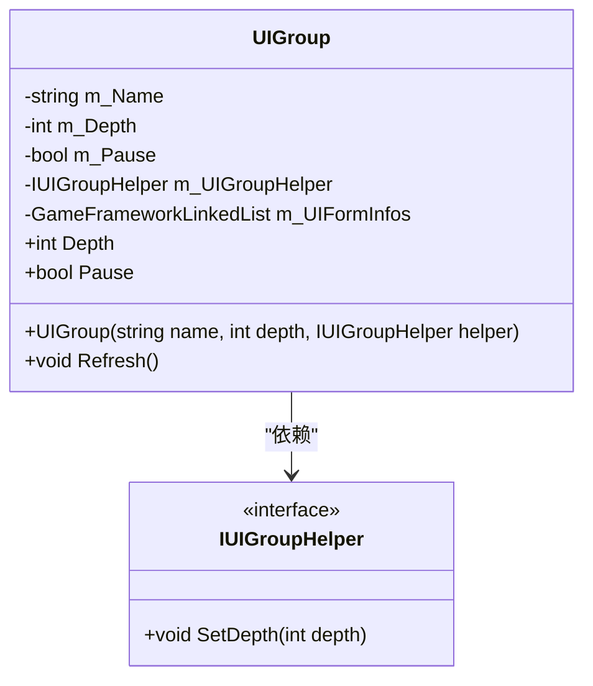
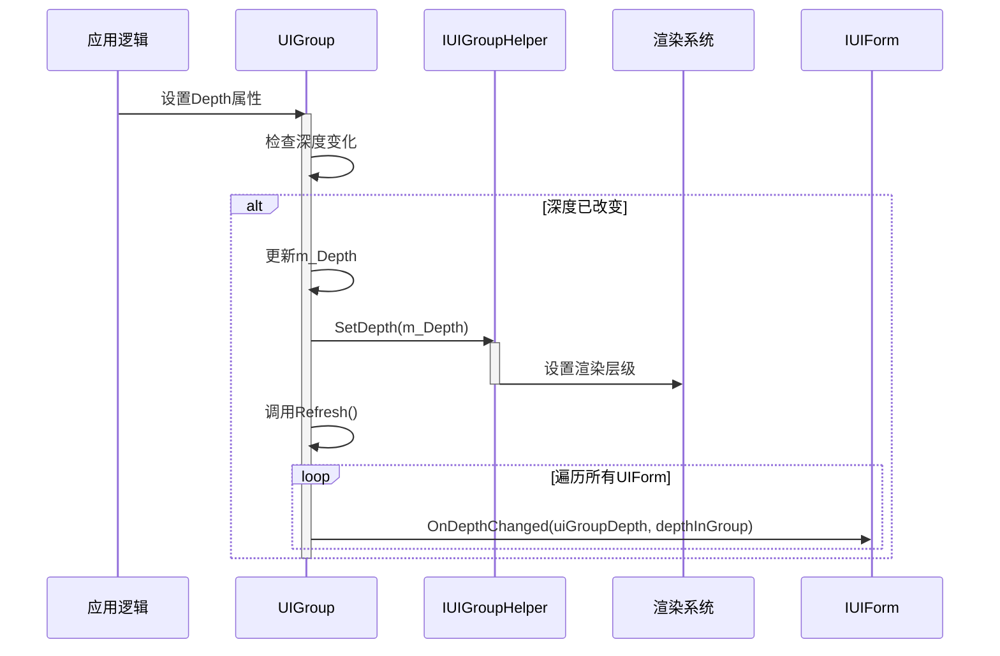

<cite>
**本文档中引用的文件**  
- [UIGroup.cs](file://GameFramework/UI/UIManager.UIGroup.cs)
- [IUIGroupHelper.cs](file://GameFramework/UI/IUIGroupHelper.cs)
- [UIManager.cs](file://GameFramework/UI/UIManager.cs)
- [IUIForm.cs](file://GameFramework/UI/IUIForm.cs)
</cite>

# 界面组辅助器集成

## 目录
1. [引言](#引言)
2. [UIGroup与IUIGroupHelper协作模式](#uigroup与iuigrouphelper协作模式)
3. [构造时Helper实例注入机制](#构造时helper实例注入机制)
4. [Depth属性变更与渲染层级同步](#depth属性变更与渲染层级同步)
5. [依赖注入设计的优势](#依赖注入设计的优势)
6. [自定义IUIGroupHelper实现](#自定义iuigrouphelper实现)
7. [辅助器扩展场景](#辅助器扩展场景)
8. [结论](#结论)

## 引言

在Unity游戏框架中，界面管理是核心系统之一。`UIGroup`与`IUIGroupHelper`的协作模式体现了典型的依赖注入（Dependency Injection）设计思想，通过将渲染系统相关的操作抽象为接口，实现了界面逻辑与渲染引擎的解耦。这种设计不仅提升了框架的可扩展性，还为开发者提供了灵活的定制能力，使其能够适配不同的UI渲染方案（如UGUI、NGUI等）。本文将深入分析这一协作机制的实现原理，并提供自定义扩展的指导。

## UIGroup与IUIGroupHelper协作模式

`UIGroup`类作为界面组的核心管理单元，负责维护一组界面（`IUIForm`）的生命周期、层级顺序和状态管理。而`IUIGroupHelper`接口则定义了与具体渲染系统交互的契约，特别是`SetDepth`方法，用于通知渲染系统界面组的深度变化。

这种职责分离的设计使得`UIGroup`本身不包含任何与特定渲染引擎相关的代码，它只关心业务逻辑（如界面的打开、关闭、暂停、层级排序等），而将最终的渲染指令通过`IUIGroupHelper`委托给具体的实现者。这种模式遵循了“关注点分离”（Separation of Concerns）原则，是构建可维护、可扩展框架的关键。



**Diagram sources**
- [UIGroup.cs](file://GameFramework/UI/UIManager.UIGroup.cs#L13-L136)
- [IUIGroupHelper.cs](file://GameFramework/UI/IUIGroupHelper.cs#L12-L19)

## 构造时Helper实例注入机制

`UIGroup`的构造函数是依赖注入的入口点。当通过`UIManager.AddUIGroup`方法创建一个新的界面组时，开发者必须提供一个实现了`IUIGroupHelper`接口的具体实例。

```csharp
public UIGroup(string name, int depth, IUIGroupHelper uiGroupHelper)
{
    if (string.IsNullOrEmpty(name))
    {
        throw new GameFrameworkException("UI group name is invalid.");
    }

    if (uiGroupHelper == null)
    {
        throw new GameFrameworkException("UI group helper is invalid.");
    }

    m_Name = name;
    m_Pause = false;
    m_UIGroupHelper = uiGroupHelper;
    m_UIFormInfos = new GameFrameworkLinkedList<UIFormInfo>();
    m_CachedNode = null;
    Depth = depth;
}
```

**Section sources**
- [UIGroup.cs](file://GameFramework/UI/UIManager.UIGroup.cs#L31-L49)

如上代码所示，`UIGroup`在构造时接收`IUIGroupHelper`实例，并将其存储在只读字段`m_UIGroupHelper`中。这确保了`UIGroup`在生命周期内始终持有对`Helper`的引用，从而可以在任何需要与渲染系统交互的时刻调用其方法。这种构造函数注入的方式简单、直接，且易于理解和测试。

## Depth属性变更与渲染层级同步

当`UIGroup`的`Depth`属性被修改时，会触发一系列操作来同步渲染层级。这是`UIGroup`与`IUIGroupHelper`协作的核心流程。

```csharp
public int Depth
{
    get
    {
        return m_Depth;
    }
    set
    {
        if (m_Depth == value)
        {
            return;
        }

        m_Depth = value;
        m_UIGroupHelper.SetDepth(m_Depth);
        Refresh();
    }
}
```

**Section sources**
- [UIGroup.cs](file://GameFramework/UI/UIManager.UIGroup.cs#L65-L82)

该流程的具体步骤如下：

1.  **属性变更检测**：首先检查新值是否与当前值相同，若相同则直接返回，避免不必要的操作。
2.  **更新内部状态**：将`m_Depth`字段更新为新值。
3.  **通知渲染系统**：调用`m_UIGroupHelper.SetDepth(m_Depth)`，将新的深度值传递给`Helper`。`Helper`的实现会负责将此深度值应用到实际的UI元素上（例如，设置`Canvas`的`sortingOrder`）。
4.  **刷新界面组**：调用`Refresh()`方法。该方法会遍历组内所有界面，并调用每个`IUIForm`的`OnDepthChanged`方法，通知它们自身在组内的相对深度也已改变。



**Diagram sources**
- [UIGroup.cs](file://GameFramework/UI/UIManager.UIGroup.cs#L65-L82)
- [UIGroup.cs](file://GameFramework/UI/UIManager.UIGroup.cs#L392-L476)
- [IUIForm.cs](file://GameFramework/UI/IUIForm.cs#L129)

## 依赖注入设计的优势

采用依赖注入设计`UIGroup`与`IUIGroupHelper`的协作模式，带来了显著的优势：

1.  **解耦**：`UIGroup`与具体的UI渲染技术（如UGUI的`Canvas`、NGUI的`UIPanel`）完全解耦。`UIGroup`无需知道任何关于渲染的细节，它只与`IUIGroupHelper`这个抽象接口交互。
2.  **可扩展性**：框架的可扩展性得到极大提升。开发者可以轻松地为不同的项目或需求创建新的`IUIGroupHelper`实现，而无需修改`UIGroup`的任何代码。这完美符合“开闭原则”（对扩展开放，对修改关闭）。
3.  **可测试性**：在单元测试中，可以为`UIGroup`提供一个模拟的`IUIGroupHelper`（Mock），从而隔离外部依赖，专注于测试`UIGroup`自身的逻辑。
4.  **灵活性**：允许在运行时动态地为不同的界面组注入不同的`Helper`，以实现更复杂的渲染策略。

## 自定义IUIGroupHelper实现

开发者可以通过实现`IUIGroupHelper`接口来创建自定义的辅助器，以适配不同的UI渲染引擎。

### 适配UGUI的示例

以下是一个为Unity UGUI系统实现的`IUIGroupHelper`示例：

```csharp
using UnityEngine;
using UnityEngine.UI;

public class UGUIGroupHelper : MonoBehaviour, IUIGroupHelper
{
    [SerializeField] private Canvas canvas; // 引用界面组的Canvas组件

    public void SetDepth(int depth)
    {
        if (canvas != null)
        {
            canvas.sortingOrder = depth;
        }
    }
}
```

在此实现中，`SetDepth`方法直接操作`Canvas`组件的`sortingOrder`属性，从而改变整个界面组的渲染层级。

### 适配NGUI的示例

对于NGUI系统，实现方式类似，但操作的是`UIPanel`组件：

```csharp
using UnityEngine;

public class NGUIGroupHelper : MonoBehaviour, IUIGroupHelper
{
    [SerializeField] private UIPanel uiPanel; // 引用界面组的UIPanel组件

    public void SetDepth(int depth)
    {
        if (uiPanel != null)
        {
            uiPanel.depth = depth;
        }
    }
}
```

**Section sources**
- [IUIGroupHelper.cs](file://GameFramework/UI/IUIGroupHelper.cs#L12-L19)

## 辅助器扩展场景

`IUIGroupHelper`接口不仅限于处理深度，还可以扩展以支持更多功能，从而实现更丰富的界面管理。

### 自定义动画管理

`Helper`可以负责在界面组打开或关闭时播放特定的动画。

```csharp
public interface IExtendedUIGroupHelper : IUIGroupHelper
{
    void PlayOpenAnimation();
    void PlayCloseAnimation();
}
```

### 资源绑定

`Helper`可以在`SetDepth`的同时，加载或卸载与该界面组相关的特定资源（如Shader、Texture），以优化内存使用。

### 日志记录

一个简单的装饰器模式可以用于记录所有深度变更操作，便于调试。

```csharp
public class LoggingUIGroupHelper : IUIGroupHelper
{
    private readonly IUIGroupHelper _innerHelper;

    public LoggingUIGroupHelper(IUIGroupHelper innerHelper)
    {
        _innerHelper = innerHelper;
    }

    public void SetDepth(int depth)
    {
        Debug.Log($"Setting UI Group depth to: {depth}");
        _innerHelper.SetDepth(depth);
    }
}
```

这些扩展场景展示了`IUIGroupHelper`作为扩展点的强大能力，开发者可以根据项目需求，灵活地增强界面组的行为。

## 结论

`UIGroup`与`IUIGroupHelper`的协作模式是游戏框架中一个精妙的设计范例。通过依赖注入，它成功地将界面管理的业务逻辑与底层的渲染细节分离开来，实现了高度的解耦和卓越的可扩展性。`UIGroup`专注于管理界面的状态和顺序，而`IUIGroupHelper`则作为与渲染系统沟通的桥梁。这种设计不仅使得框架本身更加健壮和灵活，也为开发者提供了强大的定制能力，使其能够轻松地将框架集成到使用不同UI技术的项目中。深入理解这一模式，对于掌握框架精髓和进行高效开发至关重要。