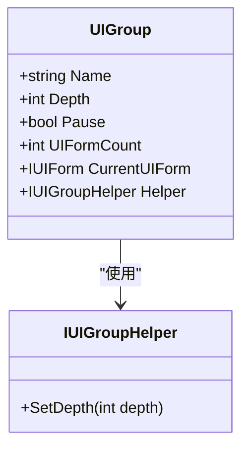
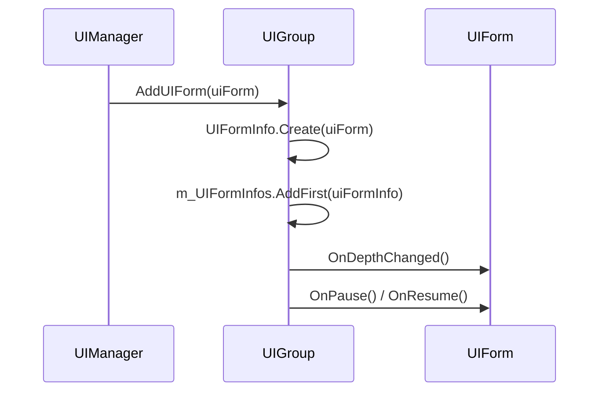
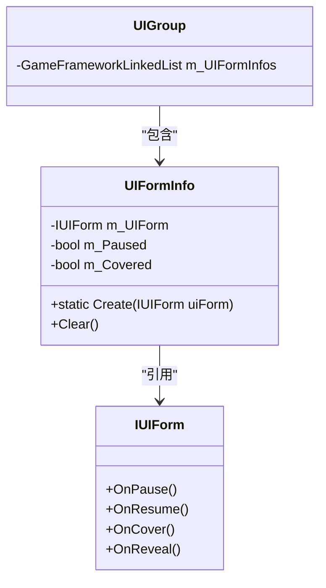

# 界面组（UIGroup）管理

<cite>
**Referenced Files in This Document**   
- [UIManager.UIGroup.cs](file://GameFramework/UI/UIManager.UIGroup.cs)
- [IUIGroup.cs](file://GameFramework/UI/IUIGroup.cs)
- [IUIGroupHelper.cs](file://GameFramework/UI/IUIGroupHelper.cs)
- [IUIForm.cs](file://GameFramework/UI/IUIForm.cs)
</cite>

## 目录
1. [引言](#引言)
2. [核心属性详解](#核心属性详解)
3. [界面管理方法](#界面管理方法)
4. [UIFormInfos双向链表结构](#uiforminfos双向链表结构)
5. [查询方法分析](#查询方法分析)
6. [UIGroupHelper扩展机制](#uigrouphelper扩展机制)
7. [结论](#结论)

## 引言
界面组（UIGroup）是游戏框架中用于组织和管理用户界面的核心组件。它提供了一套完整的机制来控制界面的显示顺序、渲染层级和交互逻辑。通过深度（Depth）属性，UIGroup能够精确控制界面在屏幕上的叠加顺序，确保正确的视觉层次。同时，通过暂停（Pause）机制，可以有效管理界面的生命周期和用户交互状态。本文档将深入剖析UIGroup的设计原理与管理功能，为开发者提供全面的技术指导。

**Section sources**
- [UIManager.UIGroup.cs](file://GameFramework/UI/UIManager.UIGroup.cs#L31-L49)
- [IUIGroup.cs](file://GameFramework/UI/IUIGroup.cs#L14-L119)

## 核心属性详解

### Name属性
Name属性用于标识界面组的唯一名称，是区分不同界面组的关键标识符。该名称在初始化时设定，不可更改，确保了界面组在整个生命周期内的身份一致性。

### Depth属性
Depth属性是控制界面渲染层级的核心参数。它决定了该界面组在整体UI堆栈中的垂直位置，数值越大，渲染层级越高，越靠近用户。当Depth属性被修改时，会触发`m_UIGroupHelper.SetDepth(m_Depth)`调用，通知辅助器更新实际的渲染深度，并通过`Refresh()`方法刷新组内所有界面的深度状态。

**Diagram sources**
- [UIManager.UIGroup.cs](file://GameFramework/UI/UIManager.UIGroup.cs#L69-L82)
- [IUIGroupHelper.cs](file://GameFramework/UI/IUIGroupHelper.cs#L10-L14)

### Pause属性
Pause属性控制界面组的整体暂停状态。当设置为true时，组内所有界面将进入暂停状态，停止接收用户输入和逻辑更新。此属性的变更会触发`Refresh()`方法，遍历所有界面并调用其`OnPause()`或`OnResume()`方法。

### UIFormCount属性
UIFormCount属性动态反映当前界面组中包含的界面数量。该值通过`m_UIFormInfos.Count`直接获取，提供了对界面堆栈规模的实时监控能力。

### CurrentUIForm属性
CurrentUIForm属性返回当前界面组中处于最顶层的界面实例。该属性通过访问`m_UIFormInfos.First.Value.UIForm`实现，体现了界面组作为LIFO（后进先出）堆栈的核心行为特征。

**Section sources**
- [UIManager.UIGroup.cs](file://GameFramework/UI/UIManager.UIGroup.cs#L84-L150)

## 界面管理方法

### AddUIGroup方法
AddUIGroup方法通过`AddUIForm(IUIForm uiForm)`实现，用于向界面组添加新的界面实例。该方法将新界面包装为`UIFormInfo`对象，并通过`AddFirst()`方法插入到双向链表的头部，确保新界面成为当前激活界面。深度参数通过界面组的Depth属性间接影响叠加顺序，数值较大的界面组会覆盖数值较小的界面组。

### CurrentUIForm属性维护机制
CurrentUIForm属性的维护依赖于双向链表的结构特性。每当有新界面加入或现有界面被重新激活时，对应的`UIFormInfo`节点都会被移动到链表头部。这种设计确保了`CurrentUIForm`始终指向用户当前正在交互的界面。

**Diagram sources**
- [UIManager.UIGroup.cs](file://GameFramework/UI/UIManager.UIGroup.cs#L385-L395)
- [IUIForm.cs](file://GameFramework/UI/IUIForm.cs#L118-L122)

**Section sources**
- [UIManager.UIGroup.cs](file://GameFramework/UI/UIManager.UIGroup.cs#L385-L395)
- [IUIForm.cs](file://GameFramework/UI/IUIForm.cs#L118-L122)

## UIFormInfos双向链表结构

UIGroup内部使用`GameFrameworkLinkedList<UIFormInfo>`来维护界面堆栈，其中`UIFormInfo`是一个实现了`IReference`接口的私有类，包含界面实例、暂停状态和覆盖状态等元数据。

该双向链表结构实现了典型的LIFO堆栈行为：
- 新界面通过`AddFirst()`插入头部
- 当前界面始终位于链表头部
- 界面移除时从链表中删除对应节点
- 遍历操作从头部开始，确保正确的更新顺序

这种数据结构的选择保证了界面管理的高效性，特别是在频繁的界面切换场景下，能够提供O(1)时间复杂度的添加和移除操作。

**Diagram sources**
- [UIManager.UIGroup.cs](file://GameFramework/UI/UIManager.UIGroup.cs#L44-L48)
- [UIManager.UIGroup.UIFormInfo.cs](file://GameFramework/UI/UIManager.UIGroup.UIFormInfo.cs#L16-L81)

**Section sources**
- [UIManager.UIGroup.cs](file://GameFramework/UI/UIManager.UIGroup.cs#L44-L48)
- [UIManager.UIGroup.UIFormInfo.cs](file://GameFramework/UI/UIManager.UIGroup.UIFormInfo.cs#L16-L81)

## 查询方法分析

### HasUIForm方法
HasUIForm方法提供两种重载形式，分别通过序列编号（serialId）和资源名称（uiFormAssetName）查询界面是否存在。两种实现都采用线性遍历`m_UIFormInfos`链表的方式，时间复杂度为O(n)。由于没有使用哈希表等更高效的数据结构，该方法更适合在界面数量较少的场景下使用。

### GetUIForm系列方法
GetUIForm系列方法包括单个界面获取和批量获取两种模式：
- `GetUIForm(int serialId/string uiFormAssetName)`：返回第一个匹配的界面实例
- `GetUIForms(string uiFormAssetName)`：返回所有匹配的界面实例数组
- `GetUIForms(string uiFormAssetName, List<IUIForm> results)`：将匹配结果填充到指定列表中

这些方法的查询逻辑与HasUIForm类似，都是基于线性遍历。批量获取方法通过`List<IUIForm>`参数提供了内存复用的可能性，有助于减少垃圾回收压力。

**Section sources**
- [UIManager.UIGroup.cs](file://GameFramework/UI/UIManager.UIGroup.cs#L200-L360)

## UIGroupHelper扩展机制

UIGroup通过依赖注入的方式接收`IUIGroupHelper`实例，实现了界面组行为的可扩展性。`IUIGroupHelper`接口仅定义了`SetDepth(int depth)`方法，为框架使用者提供了自定义深度设置逻辑的入口点。

开发者可以通过实现`IUIGroupHelper`接口来：
- 自定义深度到实际渲染层级的映射规则
- 添加深度变更时的额外处理逻辑
- 集成特定UI系统的深度管理机制

这种设计遵循了依赖倒置原则，使得UIGroup核心逻辑与具体渲染实现解耦，提高了框架的灵活性和可维护性。

**Section sources**
- [IUIGroupHelper.cs](file://GameFramework/UI/IUIGroupHelper.cs#L10-L14)
- [UIManager.UIGroup.cs](file://GameFramework/UI/UIManager.UIGroup.cs#L40-L43)

## 结论
界面组（UIGroup）通过精心设计的属性体系和数据结构，实现了高效的界面管理功能。其核心机制包括：
1. 通过Depth属性精确控制渲染层级
2. 利用双向链表维护界面堆栈顺序
3. 采用暂停机制管理界面生命周期
4. 提供灵活的查询接口满足不同场景需求
5. 通过Helper模式实现行为扩展

这些设计共同构成了一个稳定、高效且可扩展的界面管理解决方案，为复杂UI系统的开发提供了坚实的基础。