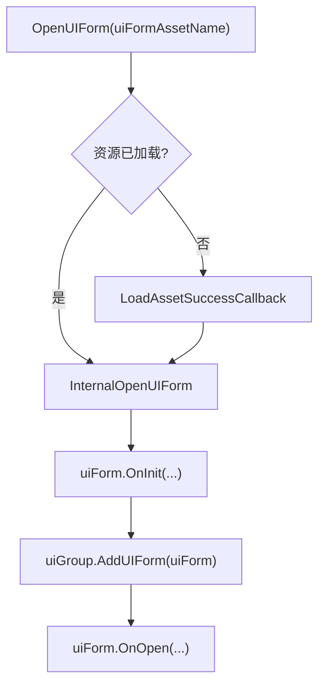
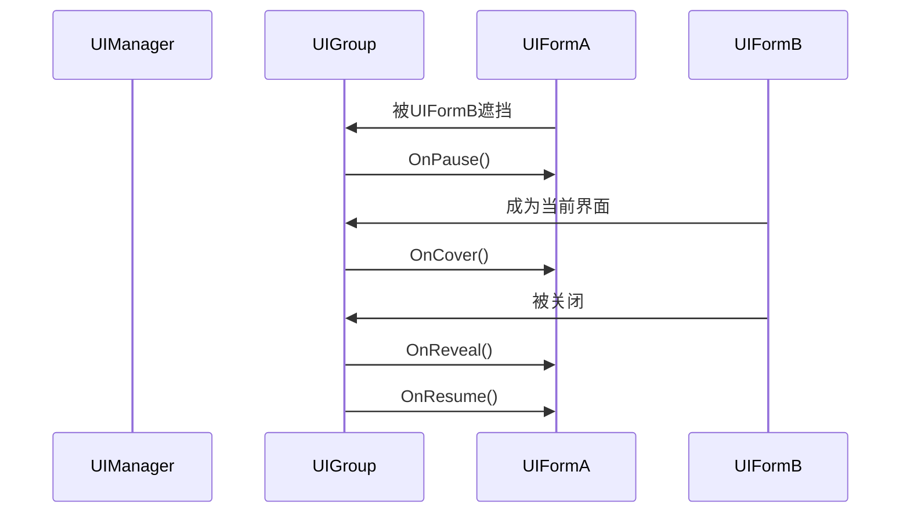
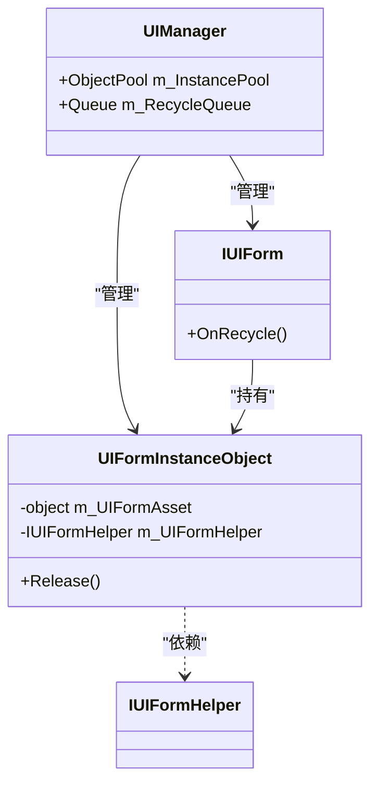

# 界面（IUIForm）接口规范

<cite>
**本文档中引用的文件**  
- [IUIForm.cs](file://GameFramework/UI/IUIForm.cs)
- [UIManager.cs](file://GameFramework/UI/UIManager.cs)
- [IUIGroup.cs](file://GameFramework/UI/IUIGroup.cs)
- [IUIFormHelper.cs](file://GameFramework/UI/IUIFormHelper.cs)
</cite>

## 目录
1. [引言](#引言)
2. [核心属性语义解析](#核心属性语义解析)
3. 生命周期回调方法详解
4. 对象池与复用机制
5. 界面通信与用户数据
6. 线程安全与性能优化
7. 实现示例与最佳实践
8. 总结

## 引言
`IUIForm` 是 GameFramework 框架中用于定义用户界面行为的核心接口。它通过一系列标准化的生命周期回调方法和属性契约，实现了对 UI 界面从创建、打开、关闭到回收的完整管理。该接口与 `UIManager` 和 `IUIGroup` 紧密协作，支持界面的分组管理、深度排序、遮挡与暂停逻辑，为构建复杂、可复用的 UI 系统提供了坚实的基础。

**Section sources**
- [IUIForm.cs](file://GameFramework/UI/IUIForm.cs#L12-L130)

## 核心属性语义解析

### SerialId（序列编号）
`SerialId` 是一个整型属性，用于唯一标识一个 `IUIForm` 实例。每当通过 `UIManager.OpenUIForm` 打开一个新的界面时，系统会自动生成一个全局唯一的序列号。该编号是查找和操作特定界面实例的主要依据。

### UIFormAssetName（界面资源名称）
此属性返回创建该界面实例所使用的资源名称（通常是 Prefab 的路径或资源标识符）。它用于标识界面的“类型”而非“实例”，多个实例可能共享同一个 `UIFormAssetName`。

### Handle（界面实例）
`Handle` 属性返回底层的 UI 实例对象（如 Unity 中的 GameObject 或 UI 组件）。这是与具体 UI 引擎（如 Unity UGUI）交互的桥梁，允许开发者访问和操作原始的 UI 元素。

### UIGroup（所属界面组）
每个 `IUIForm` 实例都隶属于一个 `IUIGroup`。界面组用于对界面进行逻辑分组和管理，例如将所有弹窗归为一个组，将主界面归为另一个组。组内界面遵循特定的显示和交互规则。

### DepthInUIGroup（组内深度）
该属性表示当前界面在其所属 `UIGroup` 中的深度值。深度值越大，界面在视觉上越靠前。`UIManager` 会根据此值自动调整界面的渲染顺序。

### PauseCoveredUIForm（是否暂停被覆盖的界面）
这是一个布尔属性，在界面初始化时由 `UIManager` 根据打开参数设置。如果为 `true`，当此界面被新打开的界面遮挡时，被遮挡的界面将进入“暂停”状态，其 `OnPause` 方法会被调用，通常用于暂停其内部的计时器或动画以节省性能。

**Section sources**
- [IUIForm.cs](file://GameFramework/UI/IUIForm.cs#L18-L58)

## 生命周期回调方法详解

### OnInit（初始化）


**Diagram sources**
- [UIManager.cs](file://GameFramework/UI/UIManager.cs#L939-L973)
- [UIManager.cs](file://GameFramework/UI/UIManager.cs#L975-L997)

`OnInit` 是生命周期的第一个回调，在界面实例创建后立即调用。它负责接收并初始化所有关键参数，包括 `serialId`、`uiFormAssetName`、`uiGroup` 以及 `userData`。`isNewInstance` 参数在此处至关重要，它指示当前实例是新创建的还是从对象池中复用的。

**Section sources**
- [IUIForm.cs](file://GameFramework/UI/IUIForm.cs#L64-L74)

### OnOpen（打开）
在 `OnInit` 之后，`OnOpen` 方法被调用，标志着界面正式“打开”。此时，界面已添加到其所属的 `UIGroup` 中。开发者应在此方法中执行与界面打开相关的逻辑，例如播放打开动画、订阅事件、初始化数据绑定等。

**Section sources**
- [IUIForm.cs](file://GameFramework/UI/IUIForm.cs#L80-L83)

### OnClose（关闭）
当界面被关闭时，`OnClose` 回调被触发。`isShutdown` 参数用于区分是正常关闭还是整个 `UIManager` 正在关闭。`userData` 参数可用于传递关闭原因或清理数据。此方法是执行资源释放、事件取消订阅等清理工作的理想位置。

**Section sources**
- [IUIForm.cs](file://GameFramework/UI/IUIForm.cs#L89-L93)

### OnPause 与 OnResume（暂停与恢复）


**Diagram sources**
- [UIManager.UIGroup.cs](file://GameFramework/UI/UIManager.UIGroup.cs#L339-L370)
- [UIManager.UIGroup.cs](file://GameFramework/UI/UIManager.UIGroup.cs#L392-L476)

`OnPause` 在界面因被其他界面遮挡而失去交互能力时调用。`OnResume` 则在界面重新变为可见并可交互时调用。这两个方法常用于控制界面内部的主动行为，如暂停/恢复背景音乐、停止/启动定时器。

### OnCover 与 OnReveal（遮挡与揭示）
`OnCover` 在界面被新界面完全遮挡时调用，而 `OnReveal` 在遮挡它的界面关闭后被调用。与 `OnPause/OnResume` 不同，`OnCover/OnReveal` 更侧重于视觉状态的改变，可用于播放遮挡/揭示的动画效果。

**Section sources**
- [IUIForm.cs](file://GameFramework/UI/IUIForm.cs#L101-L109)

### OnRefocus（重新聚焦）
当一个被暂停的界面重新获得焦点时，会调用 `OnRefocus` 方法。它与 `OnResume` 的区别在于，`OnRefocus` 会接收一个 `userData` 参数，可用于传递重新聚焦时的上下文信息。

**Section sources**
- [IUIForm.cs](file://GameFramework/UI/IUIForm.cs#L115-L118)

### OnUpdate（轮询）
`OnUpdate` 方法在每帧被调用（如果界面未被暂停），其参数 `elapseSeconds` 和 `realElapseSeconds` 分别代表逻辑帧和真实帧的流逝时间。这是实现界面动画、倒计时等需要持续更新逻辑的地方。

**Section sources**
- [IUIForm.cs](file://GameFramework/UI/IUIForm.cs#L124-L127)

### OnDepthChanged（深度改变）
当界面的 `DepthInUIGroup` 发生变化时，此方法被调用。它接收新的组内深度和所在组的深度作为参数。开发者可以利用此回调来响应界面层级的变化，例如调整阴影效果或更新 Z 轴坐标。

**Section sources**
- [IUIForm.cs](file://GameFramework/UI/IUIForm.cs#L133-L136)

## 对象池与复用机制


**Diagram sources**
- [UIManager.cs](file://GameFramework/UI/UIManager.cs#L39-L57)
- [UIManager.UIFormInstanceObject.cs](file://GameFramework/UI/UIManager.UIFormInstanceObject.cs#L16-L57)
- [IUIForm.cs](file://GameFramework/UI/IUIForm.cs#L76-L78)

`UIManager` 内部维护一个 `ObjectPool<UIFormInstanceObject>` 用于缓存已关闭的 UI 实例。当打开一个新界面时，系统会优先尝试从对象池中获取一个实例（`m_InstancePool.Spawn`）。如果获取成功，则 `isNewInstance` 为 `false`，表示这是一个复用的实例。当界面关闭时，它不会被立即销毁，而是被放入 `m_RecycleQueue` 队列。在 `UIManager.Update` 的末尾，队列中的所有界面都会调用 `OnRecycle` 方法进行回收清理，然后其 `Handle` 被放回对象池。`OnRecycle` 是重置界面内部状态、清除引用的关键方法。

**Section sources**
- [UIManager.cs](file://GameFramework/UI/UIManager.cs#L39-L57)
- [UIManager.cs](file://GameFramework/UI/UIManager.cs#LUpdate)
- [IUIForm.cs](file://GameFramework/UI/IUIForm.cs#L76-L78)

## 界面通信与用户数据
`userData` 是一个 `object` 类型的参数，贯穿于 `OnInit`、`OnOpen`、`OnClose`、`OnRefocus` 等多个生命周期方法中。它是实现界面间数据传递的主要机制。例如，打开一个详情界面时，可以将要显示的数据模型作为 `userData` 传递进去。在实际使用中，建议使用强类型的包装类来避免类型转换错误。

**Section sources**
- [IUIForm.cs](file://GameFramework/UI/IUIForm.cs#L64-L74)
- [IUIForm.cs](file://GameFramework/UI/IUIForm.cs#L80-L83)

## 线程安全与性能优化
- **线程安全**：`IUIForm` 的所有生命周期回调均在主线程中执行。`userData` 的传递也仅限于主线程。因此，开发者无需担心多线程并发问题，但也不应在这些回调中执行耗时的同步操作，以免造成卡顿。
- **性能优化**：
  1. **善用对象池**：确保在 `OnRecycle` 中正确清理状态，以保证复用实例的正确性。
  2. **按需更新**：避免在 `OnUpdate` 中执行过于频繁或复杂的计算，考虑使用事件驱动或降低更新频率。
  3. **资源管理**：在 `OnClose` 或 `OnRecycle` 中及时释放不再需要的资源（如事件监听、协程）。
  4. **暂停优化**：合理设置 `PauseCoveredUIForm`，让被遮挡的界面暂停不必要的更新，节省 CPU 开销。

## 实现示例与最佳实践
```csharp
public class ExampleUIForm : MonoBehaviour, IUIForm
{
    private int m_SerialId;
    private string m_UIFormAssetName;
    private IUIGroup m_UIGroup;
    private bool m_IsNewInstance;

    public int SerialId => m_SerialId;
    public string UIFormAssetName => m_UIFormAssetName;
    public object Handle => this;
    public IUIGroup UIGroup => m_UIGroup;
    public int DepthInUIGroup => m_UIGroup?.Depth ?? 0;
    public bool PauseCoveredUIForm => true; // 默认暂停被覆盖的界面

    public void OnInit(int serialId, string uiFormAssetName, IUIGroup uiGroup, bool pauseCoveredUIForm, bool isNewInstance, object userData)
    {
        m_SerialId = serialId;
        m_UIFormAssetName = uiFormAssetName;
        m_UIGroup = uiGroup;
        m_IsNewInstance = isNewInstance;

        // 如果是新实例，进行一次性初始化
        if (isNewInstance)
        {
            // 初始化组件引用
        }
        // 复用实例则重置状态
        else
        {
            ResetState();
        }
    }

    public void OnOpen(object userData)
    {
        // 播放打开动画
        // 订阅事件
        // 使用userData初始化数据
    }

    public void OnClose(bool isShutdown, object userData)
    {
        // 取消订阅事件
        // 停止协程
    }

    public void OnRecycle()
    {
        // 重置所有可变状态
        ResetState();
        // 清理临时数据
    }

    private void ResetState()
    {
        // 重置UI状态到初始值
    }

    // ... 其他回调方法
}
```

## 总结
`IUIForm` 接口通过定义清晰的契约和生命周期，为构建高效、可维护的 UI 系统提供了强大的支持。理解 `SerialId`、`Handle` 等核心属性的含义，掌握 `OnInit` 到 `OnRecycle` 各个回调的触发时机，并熟练运用对象池复用和 `userData` 通信机制，是开发高质量 UI 组件的关键。同时，遵循线程安全规范和性能优化建议，能够确保 UI 系统在复杂场景下的稳定运行。