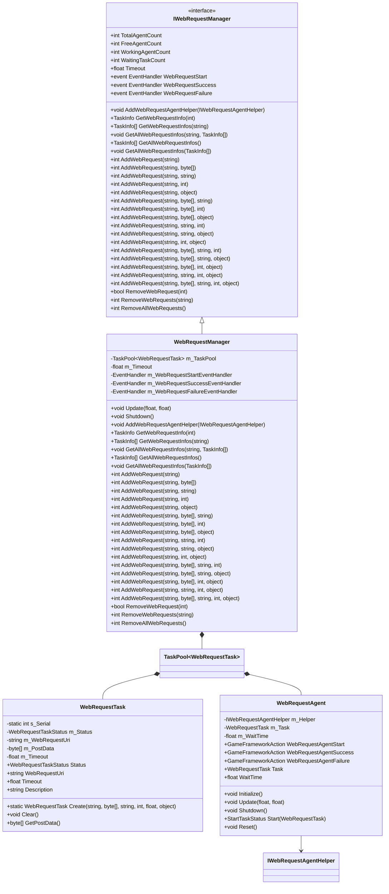
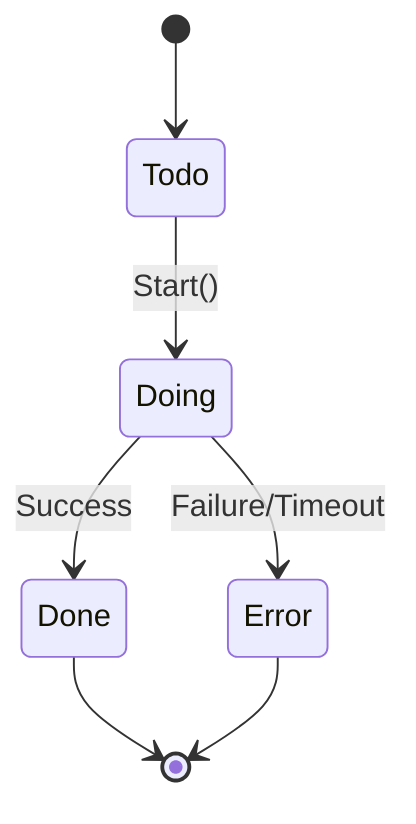
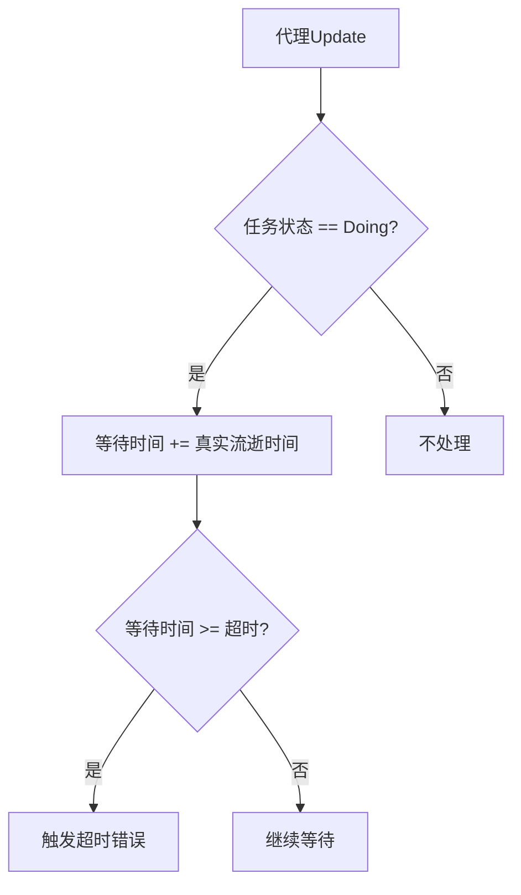
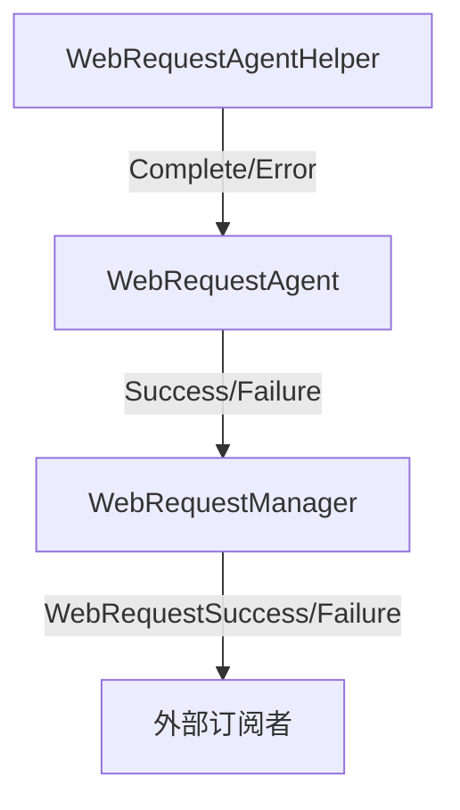
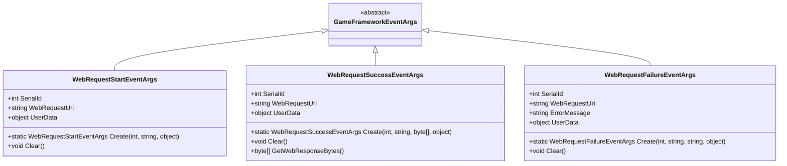
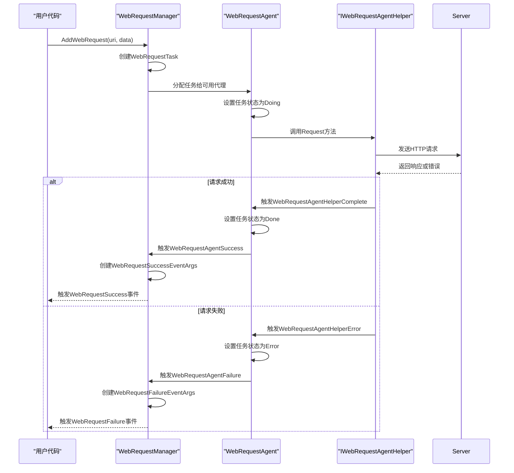

# Web请求

<cite>
**本文档引用的文件**  
- [IWebRequestManager.cs](file://GameFramework/WebRequest/IWebRequestManager.cs)
- [WebRequestManager.cs](file://GameFramework/WebRequest/WebRequestManager.cs)
- [Constant.cs](file://GameFramework/WebRequest/Constant.cs)
- [IWebRequestAgentHelper.cs](file://GameFramework/WebRequest/IWebRequestAgentHelper.cs)
- [WebRequestSuccessEventArgs.cs](file://GameFramework/WebRequest/WebRequestSuccessEventArgs.cs)
- [WebRequestFailureEventArgs.cs](file://GameFramework/WebRequest/WebRequestFailureEventArgs.cs)
- [WebRequestStartEventArgs.cs](file://GameFramework/WebRequest/WebRequestStartEventArgs.cs)
- [WebRequestAgentHelperCompleteEventArgs.cs](file://GameFramework/WebRequest/WebRequestAgentHelperCompleteEventArgs.cs)
- [WebRequestAgentHelperErrorEventArgs.cs](file://GameFramework/WebRequest/WebRequestAgentHelperErrorEventArgs.cs)
- [WebRequestManager.WebRequestTask.cs](file://GameFramework/WebRequest/WebRequestManager.WebRequestTask.cs)
- [WebRequestManager.WebRequestAgent.cs](file://GameFramework/WebRequest/WebRequestManager.WebRequestAgent.cs)
</cite>

## 目录
1. [简介](#简介)
2. [核心组件](#核心组件)
3. [请求生命周期与管理](#请求生命周期与管理)
4. [事件系统与回调处理](#事件系统与回调处理)
5. [并发控制与性能优化](#并发控制与性能优化)
6. [代码示例](#代码示例)
7. [安全性与错误处理](#安全性与错误处理)

## 简介

Web请求模块是GameFramework框架中用于处理HTTP/HTTPS网络请求的核心组件。该模块提供了一套完整的异步请求解决方案，支持GET/POST请求、并发控制、超时处理、错误重试和响应数据解析等功能。通过任务池（TaskPool）机制实现高效的并发管理，确保网络请求的稳定性和性能。

**Section sources**
- [IWebRequestManager.cs](file://GameFramework/WebRequest/IWebRequestManager.cs#L1-L277)
- [WebRequestManager.cs](file://GameFramework/WebRequest/WebRequestManager.cs#L1-L483)

## 核心组件

### IWebRequestManager接口

`IWebRequestManager`是Web请求管理器的接口定义，提供了对Web请求任务的全面控制能力。该接口定义了获取代理状态、管理请求任务、设置超时参数以及事件订阅等核心功能。

主要属性包括：
- `TotalAgentCount`: 获取Web请求代理总数量
- `FreeAgentCount`: 获取可用Web请求代理数量
- `WorkingAgentCount`: 获取工作中Web请求代理数量
- `WaitingTaskCount`: 获取等待Web请求数量
- `Timeout`: 获取或设置Web请求超时时长（以秒为单位）

**Section sources**
- [IWebRequestManager.cs](file://GameFramework/WebRequest/IWebRequestManager.cs#L15-L277)

### WebRequestManager实现

`WebRequestManager`是`IWebRequestManager`接口的具体实现类，继承自`GameFrameworkModule`。该类使用任务池模式管理Web请求，核心特性包括：

- 使用`TaskPool<WebRequestTask>`管理请求任务
- 默认超时时间为30秒（通过`Constant.DefaultPriority`定义）
- 通过事件机制通知请求状态变化
- 支持按序列编号、标签等方式查询和管理请求任务



**Diagram sources**
- [IWebRequestManager.cs](file://GameFramework/WebRequest/IWebRequestManager.cs#L15-L277)
- [WebRequestManager.cs](file://GameFramework/WebRequest/WebRequestManager.cs#L26-L483)
- [WebRequestManager.WebRequestTask.cs](file://GameFramework/WebRequest/WebRequestManager.WebRequestTask.cs#L14-L118)
- [WebRequestManager.WebRequestAgent.cs](file://GameFramework/WebRequest/WebRequestManager.WebRequestAgent.cs#L9-L174)
- [IWebRequestAgentHelper.cs](file://GameFramework/WebRequest/IWebRequestAgentHelper.cs#L1-L47)

### WebRequestTask任务类

`WebRequestTask`是Web请求的具体任务单元，继承自`TaskBase`。每个任务实例代表一个独立的HTTP请求，包含以下关键信息：

- `WebRequestUri`: 请求的URL地址
- `PostData`: POST请求要发送的数据流
- `Timeout`: 请求超时时长
- `Status`: 任务当前状态（Todo/Doing/Done/Error）
- `SerialId`: 任务的唯一序列编号

任务通过静态`Create`方法创建，使用对象池（ReferencePool）进行内存管理，提高性能并减少GC压力。

**Section sources**
- [WebRequestManager.WebRequestTask.cs](file://GameFramework/WebRequest/WebRequestManager.WebRequestTask.cs#L14-L118)

### IWebRequestAgentHelper接口

`IWebRequestAgentHelper`是Web请求代理辅助器接口，定义了实际执行HTTP请求的抽象方法。该接口允许框架与具体的HTTP实现解耦，支持不同的底层网络库。

主要方法包括：
- `Request(string webRequestUri, object userData)`: 发送GET请求
- `Request(string webRequestUri, byte[] postData, object userData)`: 发送POST请求
- `Reset()`: 重置辅助器状态

该接口通过事件`WebRequestAgentHelperComplete`和`WebRequestAgentHelperError`通知请求结果。

**Section sources**
- [IWebRequestAgentHelper.cs](file://GameFramework/WebRequest/IWebRequestAgentHelper.cs#L1-L47)

## 请求生命周期与管理

### 请求任务生命周期

Web请求任务的生命周期由`WebRequestTaskStatus`枚举定义，包含四个状态：

1. **Todo**: 任务已创建但尚未开始
2. **Doing**: 任务正在执行中
3. **Done**: 任务成功完成
4. **Error**: 任务执行失败



**Diagram sources**
- [WebRequestManager.WebRequestTask.cs](file://GameFramework/WebRequest/WebRequestManager.WebRequestTask.cs#L14-L118)
- [WebRequestManager.WebRequestAgent.cs](file://GameFramework/WebRequest/WebRequestManager.WebRequestAgent.cs#L9-L174)

### 请求创建与管理

通过`AddWebRequest`系列重载方法创建请求任务，支持多种参数组合：

- 基本GET请求：`AddWebRequest(string webRequestUri)`
- POST请求：`AddWebRequest(string webRequestUri, byte[] postData)`
- 带标签的请求：`AddWebRequest(string webRequestUri, string tag)`
- 带优先级的请求：`AddWebRequest(string webRequestUri, int priority)`
- 带用户数据的请求：`AddWebRequest(string webRequestUri, object userData)`

所有重载方法最终都会调用最完整的重载版本：
`AddWebRequest(string webRequestUri, byte[] postData, string tag, int priority, object userData)`

**Section sources**
- [WebRequestManager.cs](file://GameFramework/WebRequest/WebRequestManager.cs#L285-L465)

### 超时处理

超时机制在`WebRequestAgent`的`Update`方法中实现：



当任务执行时间超过预设的`Timeout`值时，会自动触发超时错误，通过`WebRequestAgentHelperError`事件通知上层。

**Section sources**
- [WebRequestManager.WebRequestAgent.cs](file://GameFramework/WebRequest/WebRequestManager.WebRequestAgent.cs#L78-L85)

## 事件系统与回调处理

### 事件体系结构

Web请求模块采用事件驱动架构，通过三级事件体系实现完整的状态通知：



**Diagram sources**
- [WebRequestManager.WebRequestAgent.cs](file://GameFramework/WebRequest/WebRequestManager.WebRequestAgent.cs#L9-L174)
- [WebRequestManager.cs](file://GameFramework/WebRequest/WebRequestManager.cs#L467-L481)

### 事件类型

#### WebRequestStartEventArgs
请求开始事件，包含：
- `SerialId`: 任务序列编号
- `WebRequestUri`: 请求地址
- `UserData`: 用户自定义数据

#### WebRequestSuccessEventArgs
请求成功事件，包含：
- `SerialId`: 任务序列编号
- `WebRequestUri`: 请求地址
- `WebResponseBytes`: 响应数据流
- `UserData`: 用户自定义数据

#### WebRequestFailureEventArgs
请求失败事件，包含：
- `SerialId`: 任务序列编号
- `WebRequestUri`: 请求地址
- `ErrorMessage`: 错误信息
- `UserData`: 用户自定义数据



**Diagram sources**
- [WebRequestStartEventArgs.cs](file://GameFramework/WebRequest/WebRequestStartEventArgs.cs#L12-L76)
- [WebRequestSuccessEventArgs.cs](file://GameFramework/WebRequest/WebRequestSuccessEventArgs.cs#L12-L91)
- [WebRequestFailureEventArgs.cs](file://GameFramework/WebRequest/WebRequestFailureEventArgs.cs#L12-L89)

### 回调处理流程



**Diagram sources**
- [WebRequestManager.cs](file://GameFramework/WebRequest/WebRequestManager.cs#L467-L481)
- [WebRequestManager.WebRequestAgent.cs](file://GameFramework/WebRequest/WebRequestManager.WebRequestAgent.cs#L130-L156)

## 并发控制与性能优化

### 任务池管理

Web请求管理器使用`TaskPool<WebRequestTask>`实现并发控制，通过代理模式管理HTTP请求：

- **代理总数**: `TotalAgentCount`
- **空闲代理**: `FreeAgentCount`
- **工作代理**: `WorkingAgentCount`
- **等待任务**: `WaitingTaskCount`

这种设计实现了请求的队列化处理，避免了过多并发连接导致的性能问题。

**Section sources**
- [IWebRequestManager.cs](file://GameFramework/WebRequest/IWebRequestManager.cs#L15-L45)
- [WebRequestManager.cs](file://GameFramework/WebRequest/WebRequestManager.cs#L40-L55)

### 对象池优化

通过`ReferencePool`实现对象复用，减少GC压力：

- `WebRequestTask`使用对象池进行创建和回收
- 事件对象（`WebRequestSuccessEventArgs`等）也通过对象池管理
- 避免频繁的内存分配和垃圾回收

**Section sources**
- [WebRequestManager.WebRequestTask.cs](file://GameFramework/WebRequest/WebRequestManager.WebRequestTask.cs#L89-L97)
- [WebRequestSuccessEventArgs.cs](file://GameFramework/WebRequest/WebRequestSuccessEventArgs.cs#L62-L70)

## 代码示例

### 基本GET请求

```csharp
// 订阅成功事件
webRequestManager.WebRequestSuccess += OnWebRequestSuccess;

// 发起GET请求
int serialId = webRequestManager.AddWebRequest("https://api.example.com/data");

void OnWebRequestSuccess(object sender, WebRequestSuccessEventArgs e)
{
    byte[] responseData = e.GetWebResponseBytes();
    // 处理响应数据
    Debug.Log($"请求成功: {e.WebRequestUri}");
}
```

### POST请求示例

```csharp
// 准备POST数据
string postData = "{\"name\":\"test\",\"value\":123}";
byte[] postDataBytes = Encoding.UTF8.GetBytes(postData);

// 发起POST请求
int serialId = webRequestManager.AddWebRequest(
    "https://api.example.com/submit", 
    postDataBytes, 
    "submit_request", 
    1, 
    userData: customData);
```

### 带错误处理的完整示例

```csharp
public class WebRequestHandler
{
    private IWebRequestManager webRequestManager;

    public void Initialize(IWebRequestManager manager)
    {
        webRequestManager = manager;
        
        // 订阅事件
        webRequestManager.WebRequestStart += OnWebRequestStart;
        webRequestManager.WebRequestSuccess += OnWebRequestSuccess;
        webRequestManager.WebRequestFailure += OnWebRequestFailure;
    }

    public int MakeRequest(string url, byte[] data = null)
    {
        if (string.IsNullOrEmpty(url))
            return -1;

        // 设置超时时间
        webRequestManager.Timeout = 30f;

        // 添加请求
        return data != null ? 
            webRequestManager.AddWebRequest(url, data) : 
            webRequestManager.AddWebRequest(url);
    }

    private void OnWebRequestStart(object sender, WebRequestStartEventArgs e)
    {
        Debug.Log($"请求开始: {e.WebRequestUri} (ID: {e.SerialId})");
    }

    private void OnWebRequestSuccess(object sender, WebRequestSuccessEventArgs e)
    {
        byte[] response = e.GetWebResponseBytes();
        string responseStr = Encoding.UTF8.GetString(response);
        Debug.Log($"请求成功: {e.WebRequestUri}\n响应: {responseStr}");
    }

    private void OnWebRequestFailure(object sender, WebRequestFailureEventArgs e)
    {
        Debug.LogError($"请求失败: {e.WebRequestUri}\n错误: {e.ErrorMessage}");
    }
}
```

**Section sources**
- [WebRequestManager.cs](file://GameFramework/WebRequest/WebRequestManager.cs#L285-L465)
- [WebRequestSuccessEventArgs.cs](file://GameFramework/WebRequest/WebRequestSuccessEventArgs.cs#L80-L85)
- [WebRequestFailureEventArgs.cs](file://GameFramework/WebRequest/WebRequestFailureEventArgs.cs#L85-L89)

## 安全性与错误处理

### 错误处理机制

系统内置了多层次的错误处理：

1. **参数验证**: 在`AddWebRequest`方法中验证URL有效性
2. **超时控制**: 通过`WebRequestAgent.Update`方法监控执行时间
3. **异常捕获**: 在代理初始化时检查辅助器有效性
4. **状态管理**: 通过任务状态机确保状态一致性

### 安全性考虑

- 所有事件对象通过`ReferencePool`管理，避免内存泄漏
- 使用`userData`参数支持安全的数据传递，避免闭包导致的内存问题
- 通过接口抽象隔离底层网络实现，提高安全性
- 支持HTTPS请求，确保数据传输安全

### 资源管理

- 代理在`Shutdown`时会正确清理事件订阅
- 任务完成或失败后自动释放相关资源
- 使用`using`模式确保资源的正确释放

**Section sources**
- [WebRequestManager.WebRequestAgent.cs](file://GameFramework/WebRequest/WebRequestManager.WebRequestAgent.cs#L110-L118)
- [WebRequestManager.cs](file://GameFramework/WebRequest/WebRequestManager.cs#L110-L118)