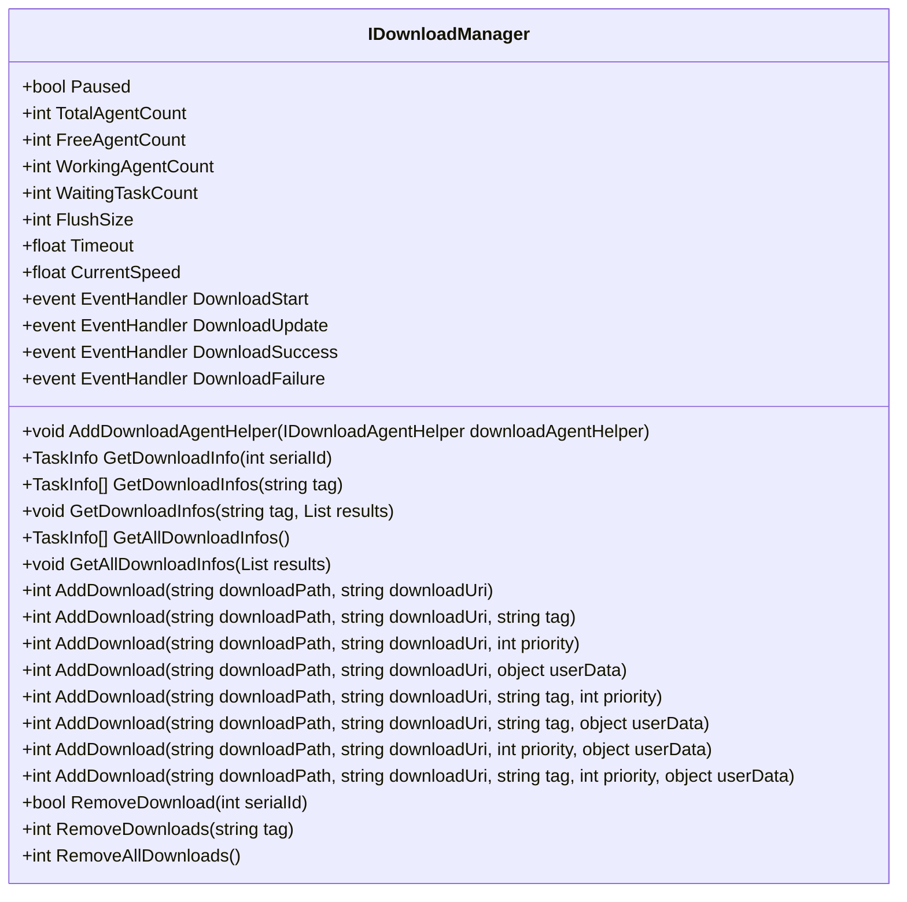
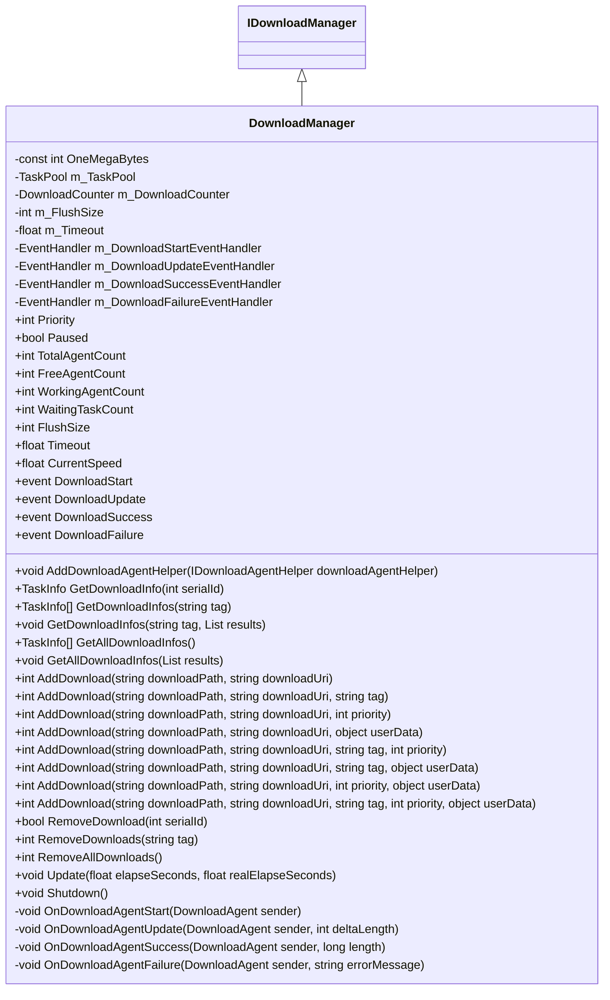
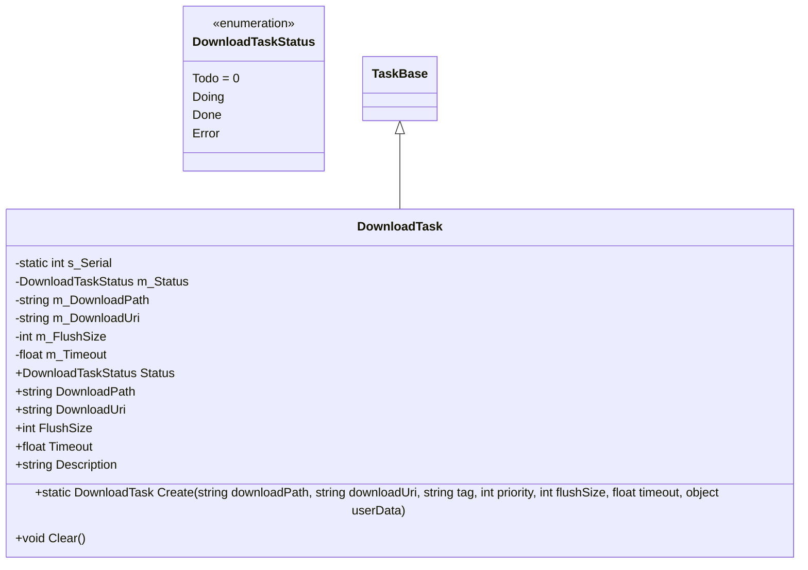
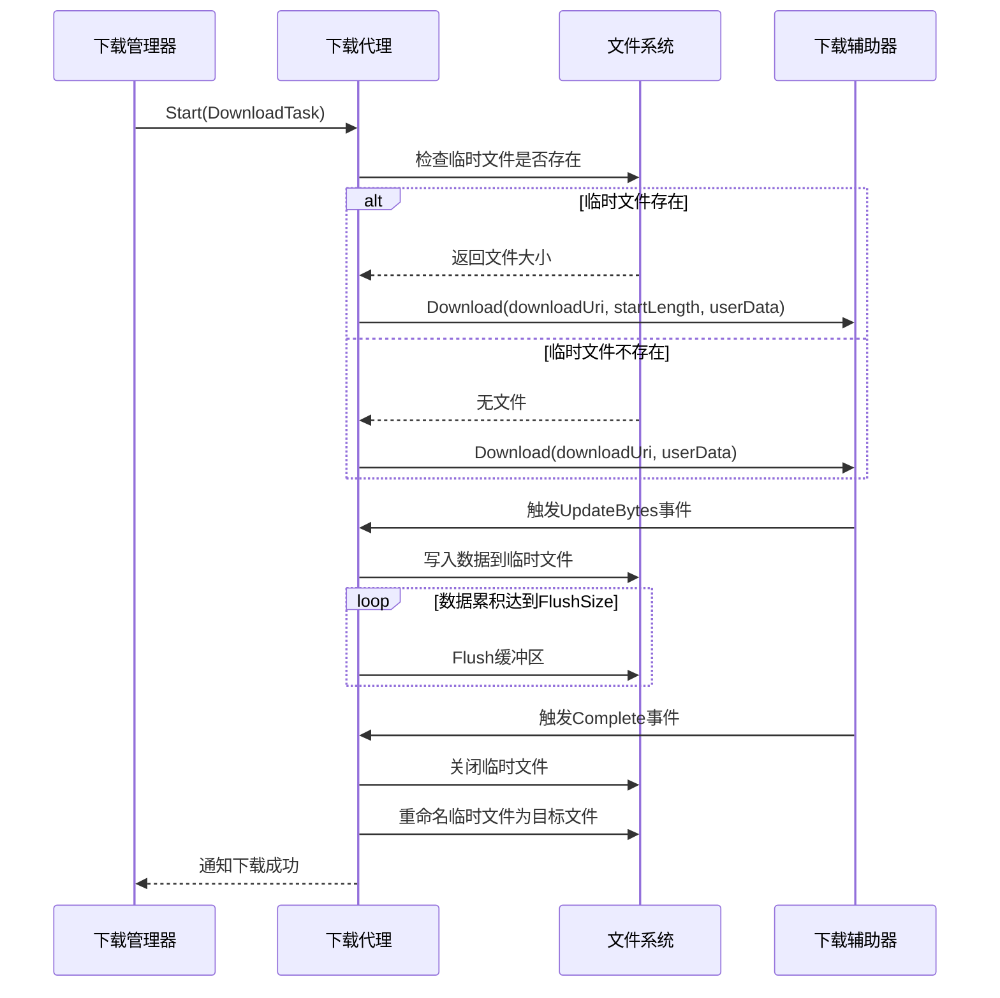
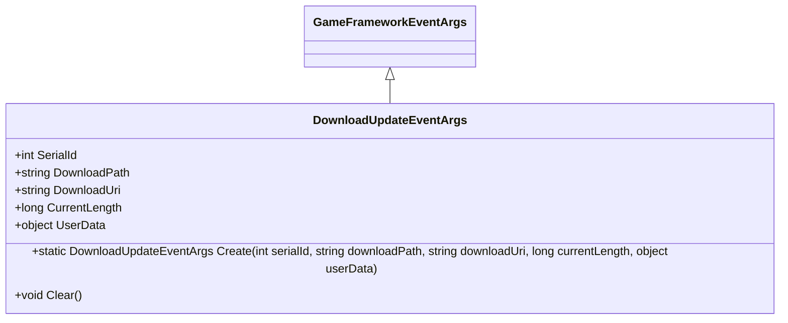
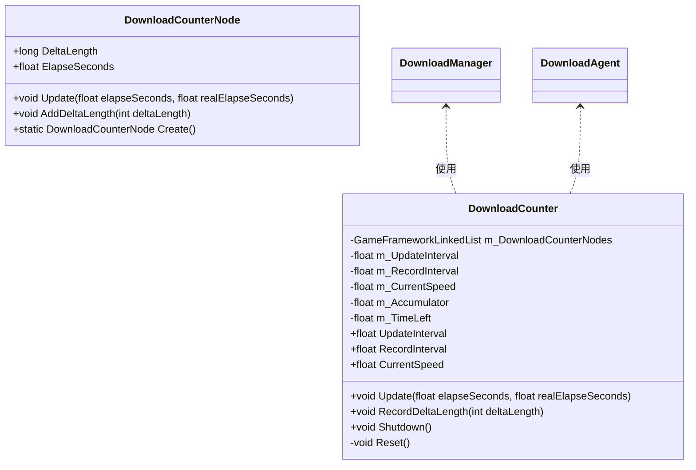

# 下载系统

<cite>
**Referenced Files in This Document**   
- [IDownloadManager.cs](file://GameFramework/Download/IDownloadManager.cs)
- [DownloadManager.cs](file://GameFramework/Download/DownloadManager.cs)
- [DownloadManager.DownloadTask.cs](file://GameFramework/Download/DownloadManager.DownloadTask.cs)
- [DownloadUpdateEventArgs.cs](file://GameFramework/Download/DownloadUpdateEventArgs.cs)
- [DownloadManager.DownloadCounter.cs](file://GameFramework/Download/DownloadManager.DownloadCounter.cs)
- [IDownloadAgentHelper.cs](file://GameFramework/Download/IDownloadAgentHelper.cs)
- [Constant.cs](file://GameFramework/Download/Constant.cs)
- [DownloadManager.DownloadTaskStatus.cs](file://GameFramework/Download/DownloadManager.DownloadTaskStatus.cs)
- [DownloadStartEventArgs.cs](file://GameFramework/Download/DownloadStartEventArgs.cs)
- [DownloadSuccessEventArgs.cs](file://GameFramework/Download/DownloadSuccessEventArgs.cs)
- [DownloadFailureEventArgs.cs](file://GameFramework/Download/DownloadFailureEventArgs.cs)
</cite>

## 目录
1. [简介](#简介)
2. [核心组件设计](#核心组件设计)
3. [下载任务调度与管理](#下载任务调度与管理)
4. [断点续传与文件写入机制](#断点续传与文件写入机制)
5. [下载进度监控与事件系统](#下载进度监控与事件系统)
6. [错误恢复与超时处理](#错误恢复与超时处理)
7. [带宽控制与性能优化](#带宽控制与性能优化)
8. [资源更新流程集成](#资源更新流程集成)
9. [使用示例与最佳实践](#使用示例与最佳实践)

## 简介

下载系统是游戏框架中的核心模块之一，负责管理所有与文件下载相关的操作。该系统提供了完整的下载功能，包括文件下载、断点续传、下载进度监控、多任务管理等。系统设计遵循模块化原则，通过清晰的接口定义和事件驱动机制，实现了高内聚、低耦合的架构。

下载系统的核心目标是为游戏资源更新、内容下载等场景提供稳定、高效的下载服务。系统支持并发下载、优先级调度、带宽监控等功能，能够满足不同类型游戏的下载需求。通过灵活的配置选项和扩展机制，开发者可以根据具体需求定制下载行为。

**Section sources**
- [IDownloadManager.cs](file://GameFramework/Download/IDownloadManager.cs#L15-L238)
- [DownloadManager.cs](file://GameFramework/Download/DownloadManager.cs#L31-L486)

## 核心组件设计

### IDownloadManager 接口

`IDownloadManager` 接口定义了下载管理器的核心功能和属性，为上层应用提供了统一的下载服务访问点。该接口通过属性暴露下载系统的状态信息，包括代理数量、任务队列状态、下载速度等，并通过事件机制通知下载过程中的关键状态变化。

接口提供了丰富的下载任务管理方法，支持通过序列号、标签等方式查询和管理下载任务。同时，接口定义了下载任务的增删改查操作，以及下载代理的注册机制，确保了系统的可扩展性和灵活性。

**Diagram sources**
- [IDownloadManager.cs](file://GameFramework/Download/IDownloadManager.cs#L15-L238)

**Section sources**
- [IDownloadManager.cs](file://GameFramework/Download/IDownloadManager.cs#L15-L238)

### DownloadManager 实现

`DownloadManager` 类实现了 `IDownloadManager` 接口，是下载系统的具体执行者。该类继承自 `GameFrameworkModule`，作为游戏框架的一个模块被管理和调度。`DownloadManager` 内部使用任务池（TaskPool）来管理下载任务和下载代理，实现了高效的并发下载能力。

下载管理器在初始化时创建了任务池和下载计数器，并设置了默认的缓冲区刷新大小和超时时间。通过 `Update` 方法，下载管理器定期轮询任务状态，更新下载速度统计，并将任务状态变化通过事件系统通知上层应用。

**Diagram sources**
- [DownloadManager.cs](file://GameFramework/Download/DownloadManager.cs#L31-L486)

**Section sources**
- [DownloadManager.cs](file://GameFramework/Download/DownloadManager.cs#L31-L486)

### DownloadTask 任务模型

`DownloadTask` 类是下载任务的具体表示，继承自 `TaskBase`，封装了下载任务的所有必要信息。每个下载任务都有唯一的序列号，用于标识和追踪任务状态。任务模型包含了下载路径、下载地址、刷新大小、超时时间等关键属性。

下载任务的状态由 `DownloadTaskStatus` 枚举定义，包括准备下载（Todo）、下载中（Doing）、下载完成（Done）和下载错误（Error）四种状态。任务的创建通过静态 `Create` 方法完成，该方法从引用池中获取任务实例，提高了内存使用效率。

**Diagram sources**
- [DownloadManager.DownloadTask.cs](file://GameFramework/Download/DownloadManager.DownloadTask.cs#L14-L140)
- [DownloadManager.DownloadTaskStatus.cs](file://GameFramework/Download/DownloadManager.DownloadTaskStatus.cs#L15-L38)

**Section sources**
- [DownloadManager.DownloadTask.cs](file://GameFramework/Download/DownloadManager.DownloadTask.cs#L14-L140)
- [DownloadManager.DownloadTaskStatus.cs](file://GameFramework/Download/DownloadManager.DownloadTaskStatus.cs#L15-L38)

## 下载任务调度与管理

### 任务调度策略

下载系统采用基于优先级的任务调度策略，通过任务池（TaskPool）管理所有下载任务。任务池根据任务的优先级和创建顺序，决定任务的执行顺序。高优先级的任务会被优先分配下载代理，确保关键资源能够快速下载。

系统支持多标签管理，开发者可以为下载任务设置标签，便于批量管理和查询。通过 `GetDownloadInfos` 和 `RemoveDownloads` 等方法，可以方便地对具有相同标签的任务进行操作，提高了任务管理的灵活性。

### 多任务管理

下载管理器通过 `AddDownload` 系列重载方法，支持创建各种配置的下载任务。每个任务都有唯一的序列号，可以通过 `RemoveDownload` 方法根据序列号移除特定任务。系统还提供了 `RemoveAllDownloads` 方法，用于清空所有下载任务。

任务池的统计信息通过 `TotalAgentCount`、`FreeAgentCount`、`WorkingAgentCount` 和 `WaitingTaskCount` 等属性暴露，使开发者能够实时监控下载系统的负载情况。通过 `Paused` 属性，可以全局暂停或恢复所有下载任务。

**Section sources**
- [DownloadManager.cs](file://GameFramework/Download/DownloadManager.cs#L31-L486)
- [IDownloadManager.cs](file://GameFramework/Download/IDownloadManager.cs#L15-L238)

## 断点续传与文件写入机制

### 断点续传实现

下载系统通过检查临时下载文件的存在和大小，实现了断点续传功能。当开始下载任务时，系统会检查是否存在以 ".download" 结尾的临时文件。如果存在，系统会获取该文件的当前大小，并从该位置继续下载，避免了重复下载已获取的数据。

断点续传的实现依赖于 `IDownloadAgentHelper` 接口的 `Download` 方法重载，该方法支持指定下载起始位置。下载代理在开始任务时，会根据临时文件的大小决定是从头开始下载还是从指定位置续传。

### 文件写入与缓冲机制

系统采用缓冲写入机制，通过 `FlushSize` 属性控制缓冲区写入磁盘的临界大小。当累积写入的数据量达到 `FlushSize` 时，系统会强制将缓冲区数据刷新到磁盘，确保数据的持久化。这种机制平衡了写入性能和数据安全性，避免了频繁的磁盘I/O操作。

下载过程中，数据首先写入以 ".download" 结尾的临时文件。当下载完成时，系统会将临时文件重命名为目标文件名，确保文件的原子性更新。如果下载失败且需要删除临时文件，系统会根据错误事件的 `DeleteDownloading` 标志决定是否清理临时文件。

**Diagram sources**
- [DownloadManager.DownloadAgent.cs](file://GameFramework/Download/DownloadManager.DownloadAgent.cs#L12-L373)
- [IDownloadAgentHelper.cs](file://GameFramework/Download/IDownloadAgentHelper.cs#L14-L64)

**Section sources**
- [DownloadManager.DownloadAgent.cs](file://GameFramework/Download/DownloadManager.DownloadAgent.cs#L12-L373)
- [IDownloadAgentHelper.cs](file://GameFramework/Download/IDownloadAgentHelper.cs#L14-L64)

## 下载进度监控与事件系统

### 下载进度事件

`DownloadUpdateEventArgs` 类封装了下载进度更新事件的数据，包含下载任务的序列号、下载路径、下载地址、当前大小和用户自定义数据。该事件在每次接收到新的下载数据时触发，使上层应用能够实时更新下载进度。

事件通过静态 `Create` 方法从引用池中获取实例，提高了内存使用效率。事件的 `Clear` 方法在事件处理完成后被调用，将事件实例归还到引用池，实现了对象的复用。

**Diagram sources**
- [DownloadUpdateEventArgs.cs](file://GameFramework/Download/DownloadUpdateEventArgs.cs#L12-L102)

**Section sources**
- [DownloadUpdateEventArgs.cs](file://GameFramework/Download/DownloadUpdateEventArgs.cs#L12-L102)

### 事件驱动架构

下载系统采用事件驱动架构，通过四个核心事件通知上层应用下载过程中的关键状态变化：

- **DownloadStart**: 下载开始时触发，通知应用某个下载任务已开始执行。
- **DownloadUpdate**: 下载进度更新时触发，提供当前下载大小信息。
- **DownloadSuccess**: 下载成功时触发，通知应用下载任务已完成。
- **DownloadFailure**: 下载失败时触发，提供错误信息。

这些事件的处理方法通过事件处理器（EventHandler）注册，确保了系统的松耦合性。事件处理器在接收到事件后，会创建相应的事件参数实例，填充数据后触发事件，最后将事件实例归还到引用池。

**Section sources**
- [IDownloadManager.cs](file://GameFramework/Download/IDownloadManager.cs#L15-L238)
- [DownloadManager.cs](file://GameFramework/Download/DownloadManager.cs#L31-L486)

## 错误恢复与超时处理

### 超时检测机制

下载代理在 `Update` 方法中实现超时检测。系统维护一个 `WaitTime` 计时器，每次轮询时累加真实流逝时间。当计时器值超过任务的 `Timeout` 属性时，系统认为下载超时，触发错误事件并终止当前下载任务。

超时机制确保了下载任务不会无限期挂起，提高了系统的健壮性。超时时间可以通过 `IDownloadManager` 接口的 `Timeout` 属性全局设置，也可以在创建下载任务时通过参数指定。

### 错误恢复策略

系统通过 `DownloadAgentHelperError` 事件接收下载过程中的错误信息。当发生错误时，下载代理会重置下载辅助器，关闭文件流，并根据错误事件的 `DeleteDownloading` 标志决定是否删除临时下载文件。

错误恢复策略允许应用根据错误类型采取不同的处理措施。例如，对于网络连接错误，应用可以选择重试下载；对于文件系统错误，可能需要提示用户检查存储空间。通过 `UserData` 参数，应用可以传递上下文信息，便于在错误处理时执行特定的恢复逻辑。

**Section sources**
- [DownloadManager.DownloadAgent.cs](file://GameFramework/Download/DownloadManager.DownloadAgent.cs#L12-L373)
- [DownloadFailureEventArgs.cs](file://GameFramework/Download/DownloadFailureEventArgs.cs#L12-L102)

## 带宽控制与性能优化

### 下载速度计算

`DownloadCounter` 类负责计算当前下载速度。系统维护一个时间窗口内的下载量记录，通过滑动窗口算法计算平均下载速度。计数器定期记录增量下载量，并在指定的时间间隔内计算速度值。

下载速度的计算考虑了真实流逝时间（realElapseSeconds），确保了在网络延迟或系统卡顿时仍能准确反映实际下载性能。计算结果通过 `CurrentSpeed` 属性暴露，供上层应用显示或用于带宽控制。

**Diagram sources**
- [DownloadManager.DownloadCounter.cs](file://GameFramework/Download/DownloadManager.DownloadCounter.cs#L12-L170)

**Section sources**
- [DownloadManager.DownloadCounter.cs](file://GameFramework/Download/DownloadManager.DownloadCounter.cs#L12-L170)

### 性能优化措施

系统通过多种机制优化下载性能：

1. **对象池技术**：使用 `ReferencePool` 管理 `DownloadTask`、事件参数等频繁创建和销毁的对象，减少了垃圾回收压力。
2. **缓冲写入**：通过 `FlushSize` 控制磁盘写入频率，平衡了I/O性能和数据安全性。
3. **异步处理**：下载代理独立处理下载任务，避免阻塞主线程。
4. **批量处理**：事件系统批量处理状态更新，减少了不必要的UI刷新。

对于大文件下载，建议适当增大 `FlushSize` 值，减少磁盘I/O次数；同时可以降低 `UpdateInterval`，获得更平滑的进度更新。

**Section sources**
- [DownloadManager.cs](file://GameFramework/Download/DownloadManager.cs#L31-L486)
- [DownloadManager.DownloadCounter.cs](file://GameFramework/Download/DownloadManager.DownloadCounter.cs#L12-L170)

## 资源更新流程集成

下载系统与资源更新流程紧密集成，为资源热更新提供了底层支持。在资源更新过程中，系统会创建多个下载任务，分别下载版本列表、资源文件等。通过任务标签，可以方便地管理同一更新批次中的所有下载任务。

资源更新器（ResourceUpdater）使用下载管理器下载远程资源，并通过下载事件监控更新进度。当所有资源下载完成后，更新器会验证资源完整性，然后应用更新。这种集成方式确保了资源更新过程的可靠性和可监控性。

**Section sources**
- [DownloadManager.cs](file://GameFramework/Download/DownloadManager.cs#L31-L486)
- [IDownloadManager.cs](file://GameFramework/Download/IDownloadManager.cs#L15-L238)

## 使用示例与