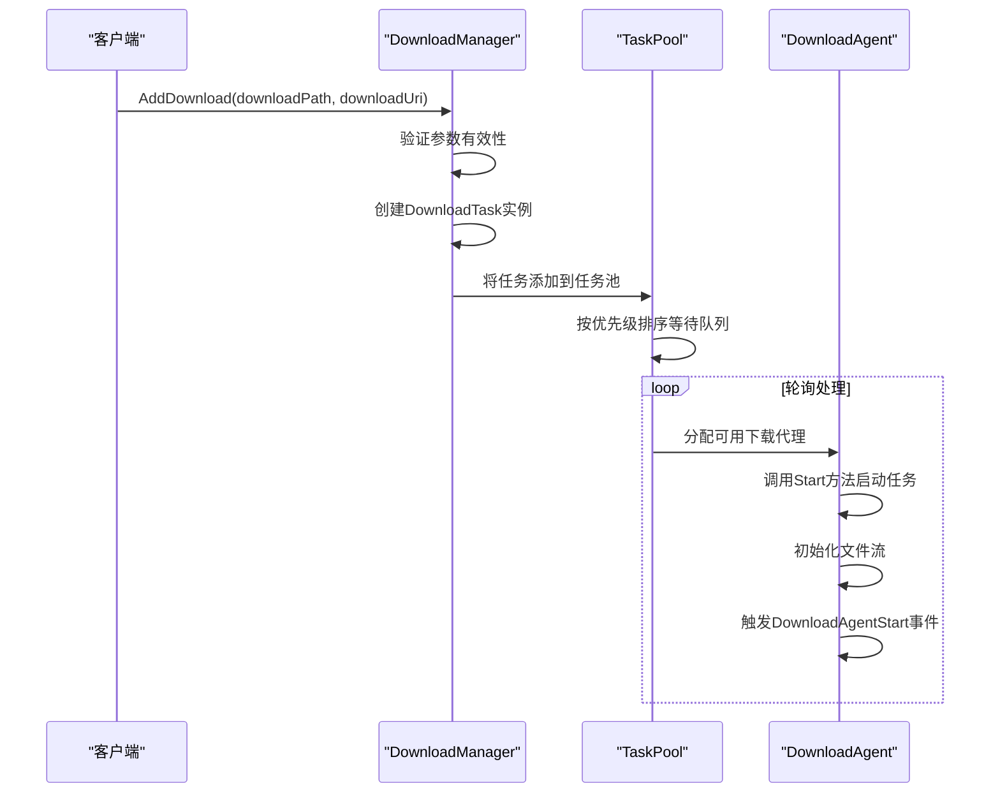
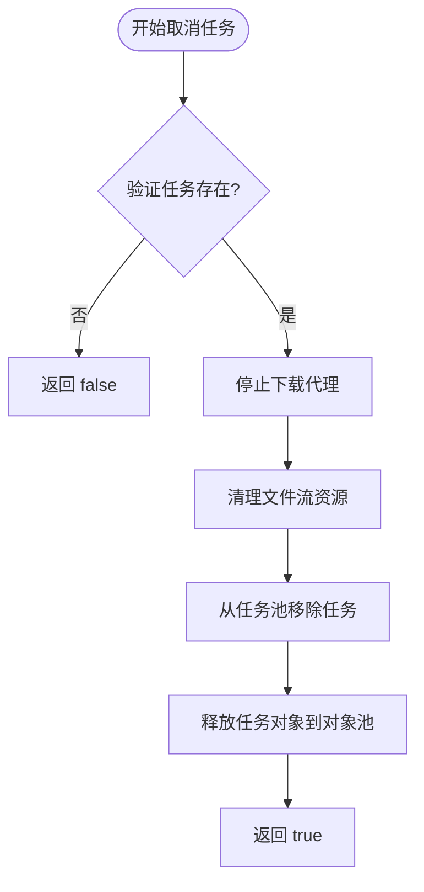
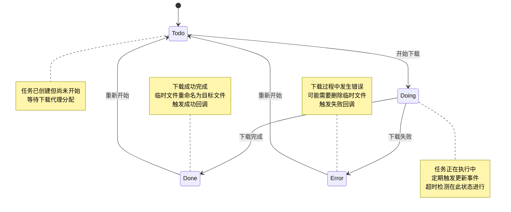
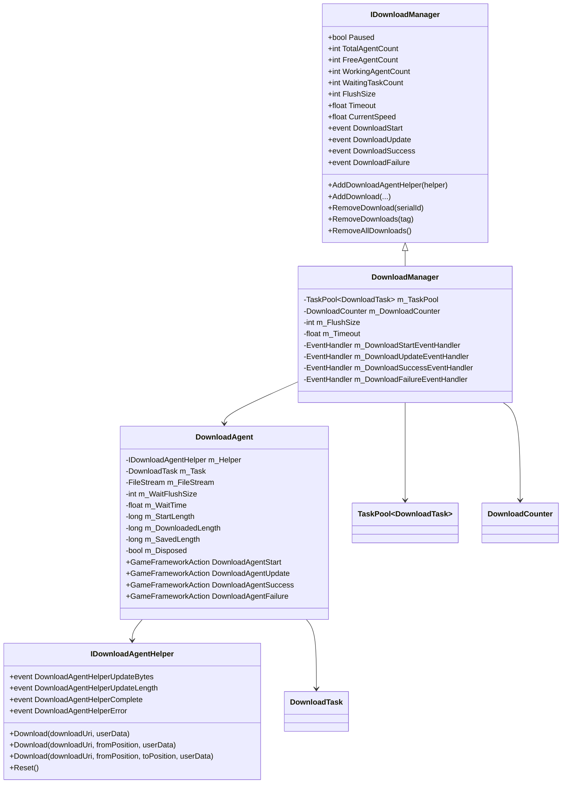
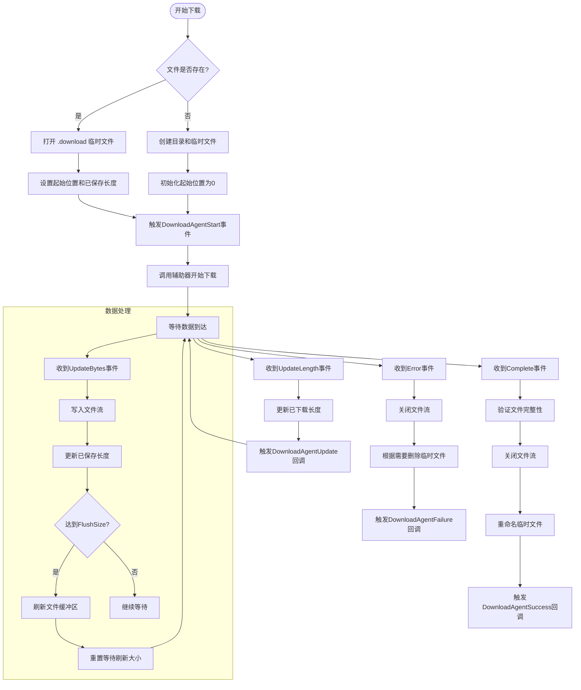
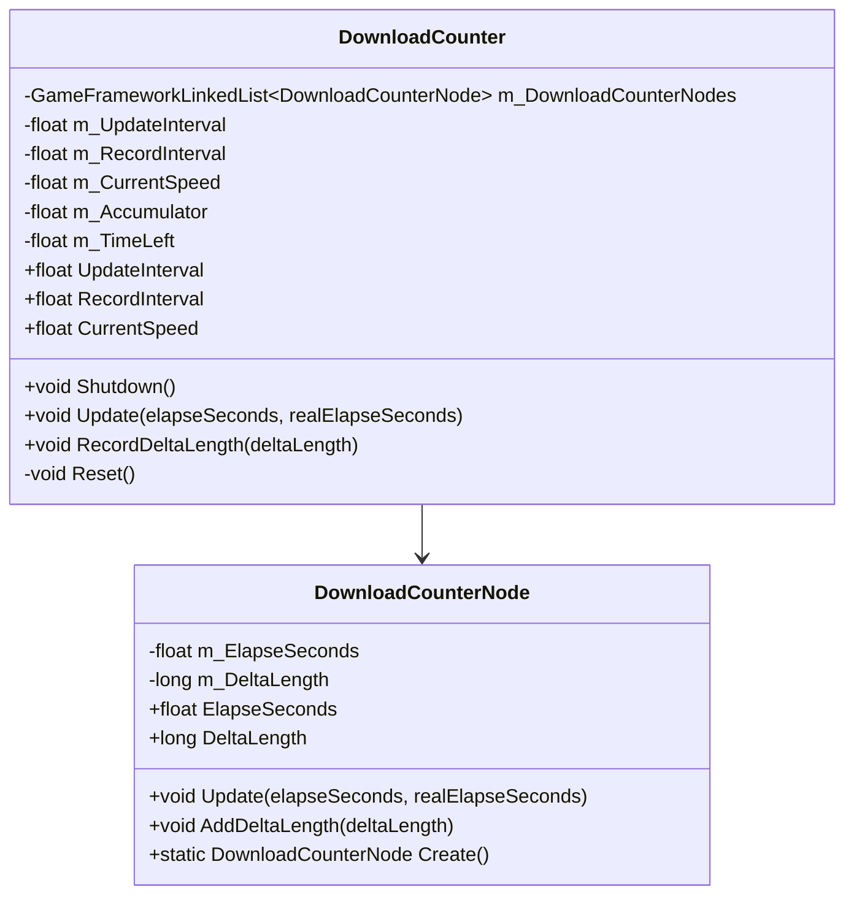
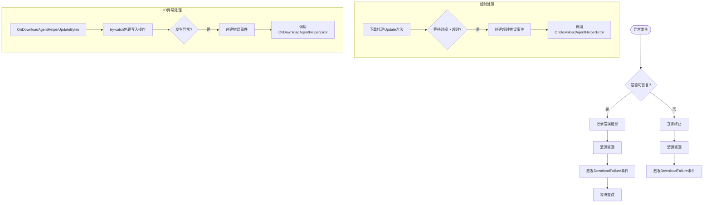

# 任务管理

<cite>
**Referenced Files in This Document**  
- [DownloadManager.cs](file://GameFramework/Download/DownloadManager.cs)
- [DownloadManager.DownloadTask.cs](file://GameFramework/Download/DownloadManager.DownloadTask.cs)
- [DownloadManager.DownloadTaskStatus.cs](file://GameFramework/Download/DownloadManager.DownloadTaskStatus.cs)
- [DownloadStartEventArgs.cs](file://GameFramework/Download/DownloadStartEventArgs.cs)
- [DownloadSuccessEventArgs.cs](file://GameFramework/Download/DownloadSuccessEventArgs.cs)
- [DownloadFailureEventArgs.cs](file://GameFramework/Download/DownloadFailureEventArgs.cs)
- [DownloadUpdateEventArgs.cs](file://GameFramework/Download/DownloadUpdateEventArgs.cs)
- [DownloadManager.DownloadAgent.cs](file://GameFramework/Download/DownloadManager.DownloadAgent.cs)
- [DownloadManager.DownloadCounter.cs](file://GameFramework/Download/DownloadManager.DownloadCounter.cs)
- [IDownloadManager.cs](file://GameFramework/Download/IDownloadManager.cs)
- [IDownloadAgentHelper.cs](file://GameFramework/Download/IDownloadAgentHelper.cs)
- [Constant.cs](file://GameFramework/Download/Constant.cs)
</cite>

## 目录
1. [任务生命周期管理](#任务生命周期管理)
2. [下载任务状态机](#下载任务状态机)
3. [事件系统与回调处理](#事件系统与回调处理)
4. [下载代理与辅助器机制](#下载代理与辅助器机制)
5. [性能监控与统计](#性能监控与统计)
6. [异常处理与重试机制](#异常处理与重试机制)

## 任务生命周期管理

下载任务的完整生命周期包括创建、启动、暂停、恢复和取消等操作，通过`DownloadManager`统一管理。

### 任务创建与启动

下载任务通过`DownloadManager.AddDownload`方法创建，该方法提供多个重载版本以支持不同参数组合。任务创建后会自动进入待处理队列，当有可用下载代理时即开始执行。



**Diagram sources**  
- [DownloadManager.cs](file://GameFramework/Download/DownloadManager.cs#L345-L480)
- [DownloadManager.DownloadTask.cs](file://GameFramework/Download/DownloadManager.DownloadTask.cs#L95-L135)
- [DownloadManager.DownloadAgent.cs](file://GameFramework/Download/DownloadManager.DownloadAgent.cs#L275-L310)

### 任务暂停与恢复

通过设置`DownloadManager.Paused`属性可以全局暂停或恢复所有下载任务。当`Paused`设为`true`时，任务池停止处理运行中的任务和等待队列中的任务。

```csharp
// 暂停所有下载任务
DownloadManager.Instance.Paused = true;

// 恢复所有下载任务
DownloadManager.Instance.Paused = false;
```

暂停期间，正在传输的数据会继续完成当前操作，但不会开始新的数据块传输。恢复后，任务从暂停处继续执行。

**Section sources**  
- [DownloadManager.cs](file://GameFramework/Download/DownloadManager.cs#L45-L55)
- [TaskPool.cs](file://GameFramework/Base/TaskPool/TaskPool.cs#L55-L65)

### 任务取消

任务取消通过`RemoveDownload`系列方法实现，支持按序列编号、标签或全部移除：

- `RemoveDownload(int serialId)`：根据序列编号移除单个任务
- `RemoveDownloads(string tag)`：根据标签移除多个任务
- `RemoveAllDownloads()`：移除所有任务

取消任务时，系统会清理相关资源并从任务池中移除任务实例。



**Diagram sources**  
- [DownloadManager.cs](file://GameFramework/Download/DownloadManager.cs#L445-L475)
- [TaskPool.cs](file://GameFramework/Base/TaskPool/TaskPool.cs#L375-L405)

## 下载任务状态机

`DownloadTaskStatus`枚举定义了下载任务的四种核心状态，形成完整的状态转换机。

### 状态定义

```csharp
private enum DownloadTaskStatus : byte
{
    /// <summary>
    /// 准备下载。
    /// </summary>
    Todo = 0,

    /// <summary>
    /// 下载中。
    /// </summary>
    Doing,

    /// <summary>
    /// 下载完成。
    /// </summary>
    Done,

    /// <summary>
    /// 下载错误。
    /// </summary>
    Error
}
```

### 状态转换图



**Diagram sources**  
- [DownloadManager.DownloadTaskStatus.cs](file://GameFramework/Download/DownloadManager.DownloadTaskStatus.cs#L15-L38)
- [DownloadManager.DownloadTask.cs](file://GameFramework/Download/DownloadManager.DownloadTask.cs#L30-L35)

### 状态转换逻辑

状态转换由下载代理(`DownloadAgent`)在特定事件发生时触发：

- **Todo → Doing**：当`DownloadAgent.Start`方法被调用时，任务状态从准备变为进行中
- **Doing → Done**：当收到`DownloadAgentHelperComplete`事件且文件写入完成后，状态转为完成
- **Doing → Error**：当收到`DownloadAgentHelperError`事件或发生IO异常时，状态转为错误
- **Error/Done → Todo**：通过重新创建任务或调用重试逻辑可重置为准备状态

**Section sources**  
- [DownloadManager.DownloadAgent.cs](file://GameFramework/Download/DownloadManager.DownloadAgent.cs#L275-L375)
- [DownloadManager.DownloadTask.cs](file://GameFramework/Download/DownloadManager.DownloadTask.cs#L45-L55)

## 事件系统与回调处理

下载系统通过事件机制通知外部任务状态变化，提供细粒度的进度监控和结果处理。

### 事件参数类型

#### DownloadStartEventArgs

表示下载开始事件，包含任务初始信息：

```csharp
public sealed class DownloadStartEventArgs : GameFrameworkEventArgs
{
    public int SerialId { get; private set; }
    public string DownloadPath { get; private set; }
    public string DownloadUri { get; private set; }
    public long CurrentLength { get; private set; }
    public object UserData { get; private set; }
}
```

#### DownloadUpdateEventArgs

表示下载进度更新事件，用于实时监控下载进度：

```csharp
public sealed class DownloadUpdateEventArgs : GameFrameworkEventArgs
{
    public int SerialId { get; private set; }
    public string DownloadPath { get; private set; }
    public string DownloadUri { get; private set; }
    public long CurrentLength { get; private set; }
    public object UserData { get; private set; }
}
```

#### DownloadSuccessEventArgs

表示下载成功事件，包含最终结果信息：

```csharp
public sealed class DownloadSuccessEventArgs : GameFrameworkEventArgs
{
    public int SerialId { get; private set; }
    public string DownloadPath { get; private set; }
    public string DownloadUri { get; private set; }
    public long CurrentLength { get; private set; }
    public object UserData { get; private set; }
}
```

#### DownloadFailureEventArgs

表示下载失败事件，包含错误详情：

```csharp
public sealed class DownloadFailureEventArgs : GameFrameworkEventArgs
{
    public int SerialId { get; private set; }
    public string DownloadPath { get; private set; }
    public string DownloadUri { get; private set; }
    public string ErrorMessage { get; private set; }
    public object UserData { get; private set; }
}
```

### 事件订阅与处理

```csharp
// 订阅下载事件
DownloadManager.Instance.DownloadStart += OnDownloadStart;
DownloadManager.Instance.DownloadUpdate += OnDownloadUpdate;
DownloadManager.Instance.DownloadSuccess += OnDownloadSuccess;
DownloadManager.Instance.DownloadFailure += OnDownloadFailure;

// 事件处理方法
private void OnDownloadStart(object sender, DownloadStartEventArgs e)
{
    Debug.Log($"下载开始: {e.DownloadPath}, 序列号: {e.SerialId}");
    // 更新UI显示下载开始
}

private void OnDownloadUpdate(object sender, DownloadUpdateEventArgs e)
{
    float progress = (float)e.CurrentLength / expectedTotalSize;
    Debug.Log($"下载进度: {e.DownloadPath} - {progress:P2}");
    // 更新进度条
}

private void OnDownloadSuccess(object sender, DownloadSuccessEventArgs e)
{
    Debug.Log($"下载成功: {e.DownloadPath}, 大小: {e.CurrentLength} bytes");
    // 处理下载完成后的逻辑
}

private void OnDownloadFailure(object sender, DownloadFailureEventArgs e)
{
    Debug.LogError($"下载失败: {e.DownloadPath}, 错误: {e.ErrorMessage}");
    // 处理错误情况，可能需要重试
}
```

事件对象采用对象池模式(`ReferencePool`)进行管理，使用`Create`静态方法创建，处理完成后通过`ReferencePool.Release`方法释放回池中，避免频繁GC。

**Section sources**  
- [DownloadStartEventArgs.cs](file://GameFramework/Download/DownloadStartEventArgs.cs)
- [DownloadUpdateEventArgs.cs](file://GameFramework/Download/DownloadUpdateEventArgs.cs)
- [DownloadSuccessEventArgs.cs](file://GameFramework/Download/DownloadSuccessEventArgs.cs)
- [DownloadFailureEventArgs.cs](file://GameFramework/Download/DownloadFailureEventArgs.cs)

## 下载代理与辅助器机制

下载系统采用代理模式，将下载逻辑与具体实现分离，提高系统的可扩展性和可测试性。

### 架构设计



**Diagram sources**  
- [IDownloadManager.cs](file://GameFramework/Download/IDownloadManager.cs)
- [DownloadManager.cs](file://GameFramework/Download/DownloadManager.cs)
- [IDownloadAgentHelper.cs](file://GameFramework/Download/IDownloadAgentHelper.cs)
- [DownloadManager.DownloadAgent.cs](file://GameFramework/Download/DownloadManager.DownloadAgent.cs)

### 下载代理工作流程

下载代理(`DownloadAgent`)负责执行具体的下载任务，其主要职责包括：

1. 管理文件流的打开和关闭
2. 处理数据写入和缓冲区刷新
3. 监控下载超时
4. 转发辅助器事件到下载管理器



**Section sources**  
- [DownloadManager.DownloadAgent.cs](file://GameFramework/Download/DownloadManager.DownloadAgent.cs)

## 性能监控与统计

系统内置下载速度统计功能，帮助开发者监控网络性能和用户体验。

### 下载速度计算器

`DownloadCounter`类负责计算当前下载速度，采用滑动时间窗口算法：



**Diagram sources**  
- [DownloadManager.DownloadCounter.cs](file://GameFramework/Download/DownloadManager.DownloadCounter.cs)
- [DownloadManager.DownloadCounter.cs](file://GameFramework/Download/DownloadManager.DownloadCounter.cs#L12-L20)

### 统计原理

1. **数据记录**：每次收到`UpdateLength`事件时，将增量数据大小记录到当前时间窗口
2. **窗口管理**：维护一个时间链表，超出记录间隔的节点会被移除
3. **速度计算**：定期根据时间窗口内的总数据量计算平均速度

```csharp
// 在DownloadAgent中记录数据增量
private void OnDownloadAgentHelperUpdateLength(object sender, DownloadAgentHelperUpdateLengthEventArgs e)
{
    m_WaitTime = 0f;
    m_DownloadedLength += e.DeltaLength;
    
    // 记录到下载计数器
    m_DownloadCounter.RecordDeltaLength(e.DeltaLength);
    
    if (DownloadAgentUpdate != null)
    {
        DownloadAgentUpdate(this, e.DeltaLength);
    }
}
```

通过`DownloadManager.CurrentSpeed`属性可以获取当前下载速度（字节/秒）。

**Section sources**  
- [DownloadManager.DownloadCounter.cs](file://GameFramework/Download/DownloadManager.DownloadCounter.cs)
- [DownloadManager.cs](file://GameFramework/Download/DownloadManager.cs#L85-L90)

## 异常处理与重试机制

系统提供了完善的异常处理机制，确保下载过程的稳定性和可靠性。

### 异常类型

系统可能遇到的异常包括：
- 网络连接超时
- 服务器返回错误
- 文件IO异常
- 磁盘空间不足
- 权限不足

### 异常处理流程



**Section sources**  
- [DownloadManager.DownloadAgent.cs](file://GameFramework/Download/DownloadManager.DownloadAgent.cs#L185-L210)
- [DownloadManager.DownloadAgent.cs](file://GameFramework/Download/DownloadManager.DownloadAgent.cs#L350-L375)

### 重试最佳实践

```csharp
public class DownloadRetryHandler
{
    private const int MaxRetryCount = 3;
    private Dictionary<int, int> _retryCounts = new Dictionary<int, int>();
    
    public void Initialize()
    {
        DownloadManager.Instance.DownloadFailure += OnDownloadFailure;
    }
    
    private void OnDownloadFailure(object sender, DownloadFailureEventArgs e)
    {
        // 检查是否需要重试
        if (IsRetryableError(e.ErrorMessage))
        {
            int currentRetry = GetRetryCount(e.SerialId);
            if (currentRetry < MaxRetryCount)
            {
                // 延迟重试，使用指数退避
                float delay = Mathf.Pow(2, currentRetry) * 1f;
                StartCoroutine(DelayedRetry(e, delay));
            }
            else
            {
                Debug.LogError($"下载失败超过最大重试次数: {e.DownloadPath}");
                // 通知用户或记录日志
            }
        }
        else
        {
            Debug.LogError($"不可恢复的下载错误: {e.ErrorMessage}");
            // 立即失败，无需重试
        }
    }
    
    private IEnumerator DelayedRetry(DownloadFailureEventArgs e, float delay)
    {
        yield return new WaitForSeconds(delay);
        
        // 重新添加下载任务
        int newSerialId = DownloadManager.Instance.AddDownload(
            e.DownloadPath, 
            e.DownloadUri, 
            e.UserData
        );
        
        // 更新重试计数
        IncrementRetryCount(e.SerialId);
        
        Debug.Log($"重试下载: {e.DownloadPath}, 延迟: {delay}s");
    }
    
    private bool IsRetryableError(string errorMessage)
    {
        // 网络相关错误通常可重试
        return errorMessage.Contains("Timeout") || 
               errorMessage.Contains("Connection") ||
               errorMessage.Contains("Network");
    }
    
    private int GetRetryCount(int serialId)
    {
        return _retryCounts.TryGetValue(serialId, out int count) ? count : 0;
    }
    
    private void IncrementRetryCount(int serialId)
    {
        int current = GetRetryCount(serialId);
        _retryCounts[serialId] = current + 1;
    }
}
```

**Section sources**  
- [DownloadFailureEventArgs.cs](file://GameFramework/Download/DownloadFailureEventArgs.cs)
- [DownloadManager.cs](file://GameFramework/Download/DownloadManager.cs#L345-L445)