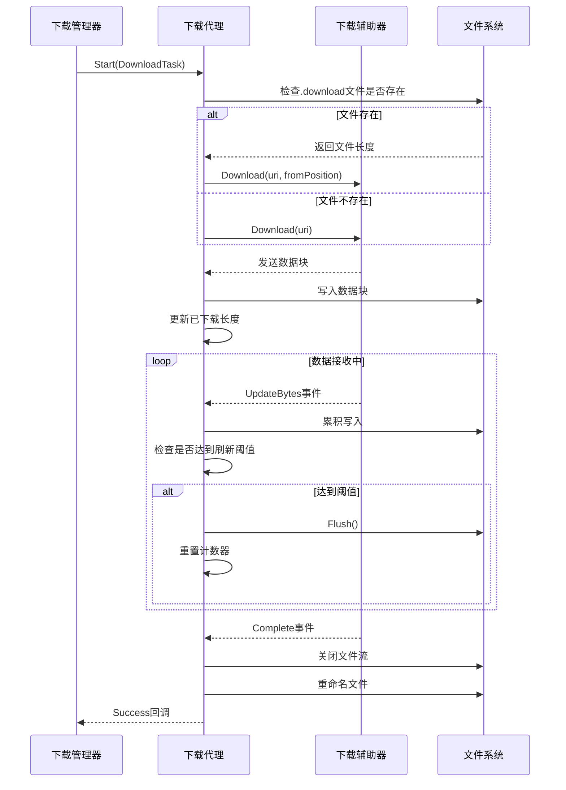
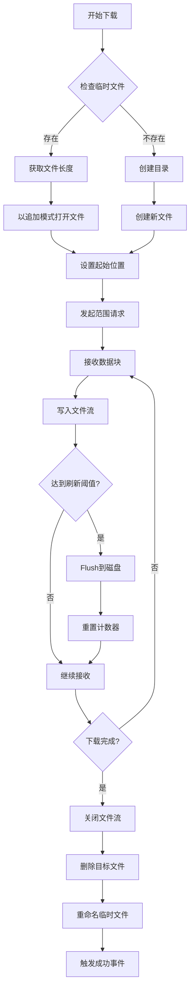
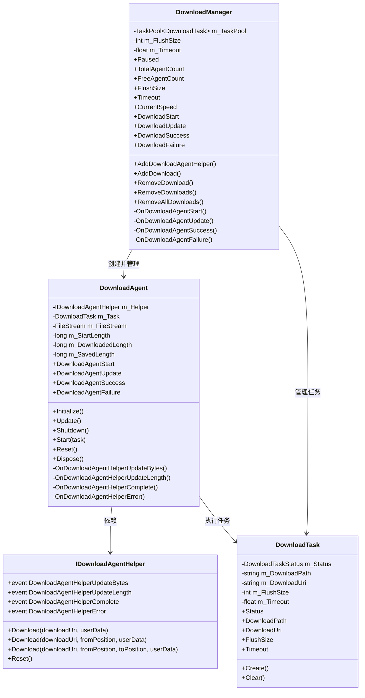

<cite>
**Referenced Files in This Document**  
- [IDownloadAgentHelper.cs](file://GameFramework/Download/IDownloadAgentHelper.cs)
- [DownloadManager.DownloadAgent.cs](file://GameFramework/Download/DownloadManager.DownloadAgent.cs)
- [DownloadManager.cs](file://GameFramework/Download/DownloadManager.cs)
- [DownloadManager.DownloadTask.cs](file://GameFramework/Download/DownloadManager.DownloadTask.cs)
- [DownloadAgentHelperUpdateBytesEventArgs.cs](file://GameFramework/Download/DownloadAgentHelperUpdateBytesEventArgs.cs)
- [DownloadAgentHelperCompleteEventArgs.cs](file://GameFramework/Download/DownloadAgentHelperCompleteEventArgs.cs)
</cite>

# 断点续传支持

## Table of Contents
1. [接口设计与范围请求支持](#接口设计与范围请求支持)
2. [下载代理处理流程](#下载代理处理流程)
3. [持久化存储与文件合并机制](#持久化存储与文件合并机制)
4. [完整性校验方法](#完整性校验方法)
5. [配置方式与使用限制](#配置方式与使用限制)
6. [大文件分段下载与恢复流程](#大文件分段下载与恢复流程)
7. [兼容性问题与解决方案](#兼容性问题与解决方案)

## 接口设计与范围请求支持

`IDownloadAgentHelper` 接口是断点续传功能的核心，通过重载的 `Download` 方法支持不同形式的范围请求。该接口定义了四种下载方法，其中三种支持起始位置和结束位置的指定，为实现 HTTP 范围请求（Range Request）提供了基础。

接口通过事件机制与下载管理器通信，包括 `DownloadAgentHelperUpdateBytes`（数据流更新）、`DownloadAgentHelperUpdateLength`（数据大小更新）、`DownloadAgentHelperComplete`（下载完成）和 `DownloadAgentHelperError`（下载错误）四个关键事件。这种设计实现了下载逻辑与业务逻辑的解耦，使得不同的平台和协议可以通过实现该接口来适配统一的下载管理框架。

当需要从特定位置开始下载时，调用 `Download(string downloadUri, long fromPosition, object userData)` 方法，这对应于 HTTP 协议中的 `Range: bytes=fromPosition-` 请求头。若需要下载指定范围的数据，则使用 `Download(string downloadUri, long fromPosition, long toPosition, object userData)` 方法，对应 `Range: bytes=fromPosition-toPosition` 请求头。

**Section sources**
- [IDownloadAgentHelper.cs](file://GameFramework/Download/IDownloadAgentHelper.cs#L14-L64)

## 下载代理处理流程

`DownloadManager.DownloadAgent` 类作为下载任务的执行者，负责处理 HTTP 206 部分内容响应。下载代理在 `Start` 方法中初始化下载任务，并根据目标文件是否存在来决定是否支持断点续传。

当检测到临时下载文件（`.download` 后缀）已存在时，代理会获取文件当前长度作为 `fromPosition`，并通过 `IDownloadAgentHelper.Download` 方法发起范围请求。这一机制确保了下载中断后可以从上次停止的位置继续，而不是重新开始。

下载过程中，代理通过 `OnDownloadAgentHelperUpdateBytes` 回调接收数据块，并将其写入文件流。同时，`OnDownloadAgentHelperUpdateLength` 回调用于更新已下载数据的逻辑长度。代理还维护了 `m_WaitFlushSize` 计数器，当累积写入的数据量达到配置的刷新阈值时，会强制将缓冲区数据写入磁盘，平衡了性能与数据安全性。

**Diagram sources**
- [DownloadManager.DownloadAgent.cs](file://GameFramework/Download/DownloadManager.DownloadAgent.cs#L100-L375)
- [DownloadAgentHelperUpdateBytesEventArgs.cs](file://GameFramework/Download/DownloadAgentHelperUpdateBytesEventArgs.cs#L14-L94)

**Section sources**
- [DownloadManager.DownloadAgent.cs](file://GameFramework/Download/DownloadManager.DownloadAgent.cs#L100-L375)

## 持久化存储与文件合并机制

断点续传的持久化存储采用临时文件机制。下载过程中，所有数据首先写入以 `.download` 为后缀的临时文件中，这确保了在下载未完成前，目标文件不会被破坏或处于不完整状态。

`DownloadAgent` 内部使用 `FileStream` 对象管理文件写入操作。在 `Start` 方法中，根据临时文件是否存在来决定是创建新文件还是以追加模式打开现有文件。这种设计天然支持断点续传，因为文件系统会自动维护文件的写入位置。

文件合并发生在下载完成时，通过原子性的文件重命名操作实现。`OnDownloadAgentHelperComplete` 方法在确认所有数据已成功写入后，先删除可能存在的目标文件，然后将临时文件重命名为目标文件名。这一过程保证了文件更新的原子性，避免了多线程或异常情况下的文件竞争问题。

**Diagram sources**
- [DownloadManager.DownloadAgent.cs](file://GameFramework/Download/DownloadManager.DownloadAgent.cs#L200-L350)

**Section sources**
- [DownloadManager.DownloadAgent.cs](file://GameFramework/Download/DownloadManager.DownloadAgent.cs#L200-L350)

## 完整性校验方法

系统通过多层次的机制确保下载的完整性。首先，在 `OnDownloadAgentHelperComplete` 方法中，系统会检查 `m_SavedLength`（实际写入磁盘的字节数）是否等于 `CurrentLength`（预期总长度）。如果不匹配，会抛出 "Internal download error" 异常，防止不完整文件被当作完整文件处理。

其次，文件重命名操作本身也是一种完整性保障。只有当下载完全成功时，临时文件才会被重命名为最终文件名。如果下载过程中断或失败，临时文件会保留，下次启动时可以继续下载；或者在错误处理中被删除，确保不会产生损坏的文件。

此外，系统还提供了 `DownloadAgentHelperError` 事件，允许上层逻辑根据错误类型决定是否删除下载中的文件。通过 `DownloadAgentHelperErrorEventArgs` 的 `DeleteDownloading` 属性，可以控制是否清理不完整的下载文件，为上层应用提供了灵活的错误处理策略。

**Section sources**
- [DownloadManager.DownloadAgent.cs](file://GameFramework/Download/DownloadManager.DownloadAgent.cs#L320-L350)
- [DownloadAgentHelperCompleteEventArgs.cs](file://GameFramework/Download/DownloadAgentHelperCompleteEventArgs.cs#L14-L57)

## 配置方式与使用限制

断点续传功能的配置主要通过 `DownloadManager` 的属性进行。`FlushSize` 属性控制写入磁盘的缓冲区大小，默认值为 1MB（1048576 字节），可以根据性能需求调整。较大的值可以提高写入效率，但会增加数据丢失的风险；较小的值则更安全但可能影响性能。

`Timeout` 属性设置下载超时时长，默认为 30 秒。对于大文件下载，可能需要适当增加此值以避免因网络波动导致的下载中断。

使用限制方面，断点续传依赖于服务器支持 HTTP 范围请求（HTTP 206 响应）。如果服务器不支持范围请求，即使客户端发起范围请求，也会收到完整的 HTTP 200 响应，此时断点续传功能将无法正常工作。此外，文件系统必须支持随机访问写入，这对于大多数现代文件系统都不是问题。

**Section sources**
- [DownloadManager.cs](file://GameFramework/Download/DownloadManager.cs#L50-L80)
- [Constant.cs](file://GameFramework/Download/Constant.cs#L14-L20)

## 大文件分段下载与恢复流程

大文件的分段下载与恢复流程由 `DownloadManager` 和 `DownloadAgent` 协同完成。应用通过 `AddDownload` 方法添加下载任务，系统会自动处理断点续传逻辑。

恢复流程的关键在于 `Start` 方法中的文件检查逻辑。当任务开始时，代理会检查对应 `.download` 临时文件是否存在且可读。如果存在，`FileStream` 会自动定位到文件末尾，`m_StartLength` 被设置为文件当前长度，并以此作为范围请求的起始位置。

整个流程无需应用层干预，完全由下载框架自动处理。应用只需关注下载开始、进度更新、成功和失败等事件，而断点续传的细节被完全封装在下载代理内部。

**Diagram sources**
- [DownloadManager.DownloadAgent.cs](file://GameFramework/Download/DownloadManager.DownloadAgent.cs#L100-L375)
- [DownloadManager.cs](file://GameFramework/Download/DownloadManager.cs#L50-L486)
- [DownloadManager.DownloadTask.cs](file://GameFramework/Download/DownloadManager.DownloadTask.cs#L14-L143)

**Section sources**
- [DownloadManager.DownloadAgent.cs](file://GameFramework/Download/DownloadManager.DownloadAgent.cs#L100-L375)
- [DownloadManager.cs](file://GameFramework/Download/DownloadManager.cs#L50-L486)

## 兼容性问题与解决方案

断点续传功能在不同平台和协议下可能遇到兼容性问题。主要问题包括服务器不支持 HTTP 范围请求、文件系统权限限制、网络协议差异等。

解决方案包括：首先进行能力探测，尝试发起范围请求并检查是否返回 HTTP 206 响应；对于不支持范围请求的服务器，降级为完整下载；在移动平台注意外部存储权限的申请；对于 FTP 等其他协议，需要实现对应的 `IDownloadAgentHelper`。

框架通过接口抽象的方式很好地解决了协议兼容性问题。不同的网络库可以实现 `IDownloadAgentHelper` 接口，将底层协议差异封装起来，为上层提供统一的断点续传接口。这种设计模式使得系统可以轻松支持 HTTP、HTTPS、FTP 等多种协议，而无需修改核心下载逻辑。

**Section sources**
- [IDownloadAgentHelper.cs](file://GameFramework/Download/IDownloadAgentHelper.cs#L14-L64)
- [DownloadManager.DownloadAgent.cs](file://GameFramework/Download/DownloadManager.DownloadAgent.cs#L100-L375)