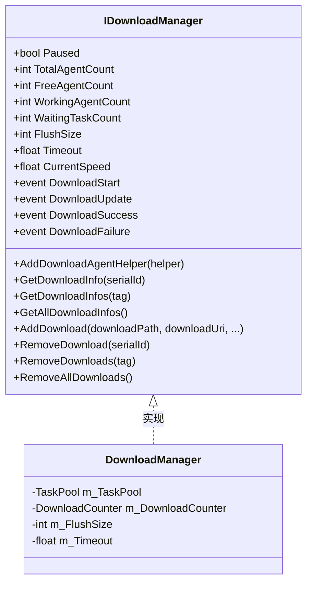
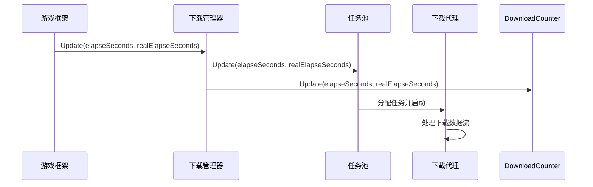
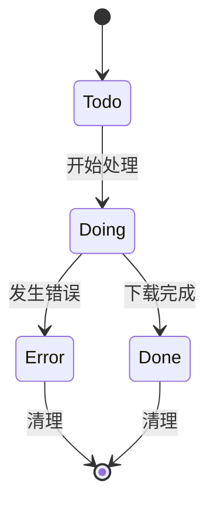
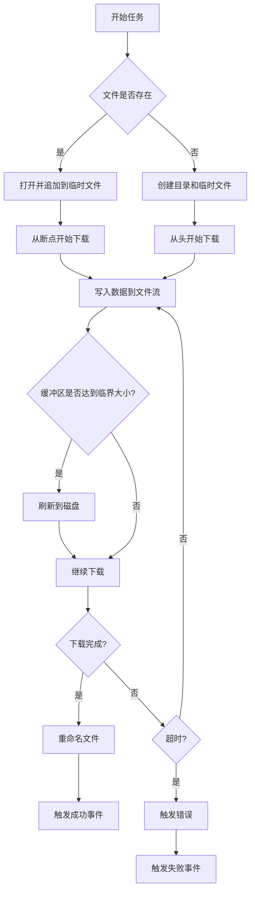
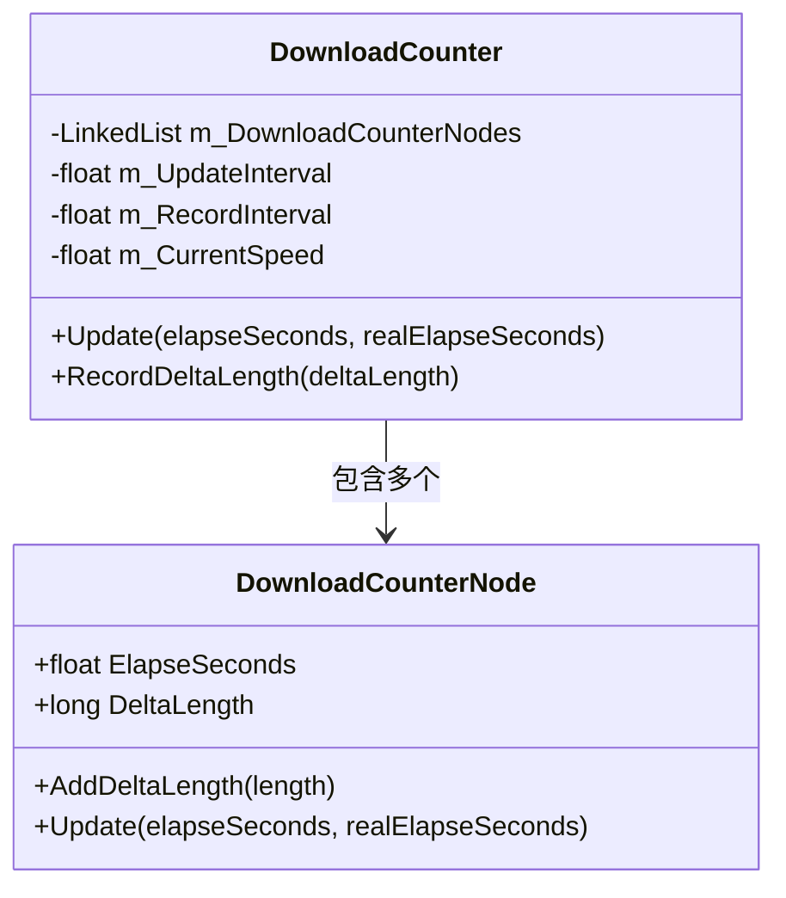
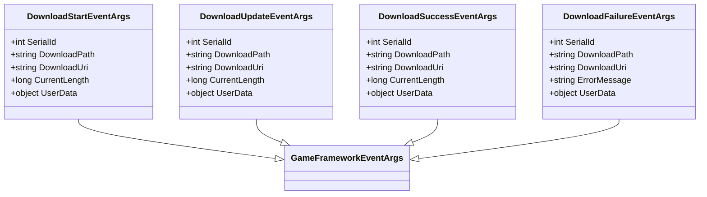
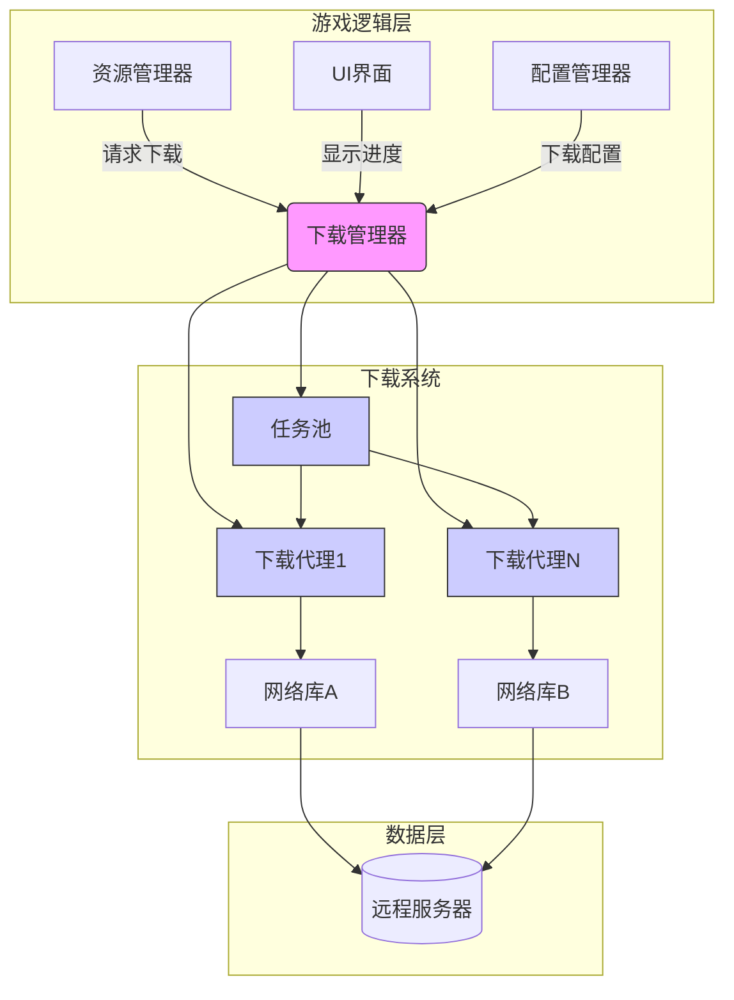

# 核心概念

<cite>
**本文档中引用的文件**  
- [IDownloadManager.cs](file://GameFramework/Download/IDownloadManager.cs)
- [DownloadManager.cs](file://GameFramework/Download/DownloadManager.cs)
- [DownloadManager.DownloadTask.cs](file://GameFramework/Download/DownloadManager.DownloadTask.cs)
- [DownloadManager.DownloadAgent.cs](file://GameFramework/Download/DownloadManager.DownloadAgent.cs)
- [DownloadManager.DownloadCounter.cs](file://GameFramework/Download/DownloadManager.DownloadCounter.cs)
- [Constant.cs](file://GameFramework/Download/Constant.cs)
- [IDownloadAgentHelper.cs](file://GameFramework/Download/IDownloadAgentHelper.cs)
- [DownloadStartEventArgs.cs](file://GameFramework/Download/DownloadStartEventArgs.cs)
- [DownloadUpdateEventArgs.cs](file://GameFramework/Download/DownloadUpdateEventArgs.cs)
- [DownloadSuccessEventArgs.cs](file://GameFramework/Download/DownloadSuccessEventArgs.cs)
- [DownloadFailureEventArgs.cs](file://GameFramework/Download/DownloadFailureEventArgs.cs)
</cite>

## 目录
1. [引言](#引言)
2. [接口设计原理](#接口设计原理)
3. [下载管理器实现机制](#下载管理器实现机制)
4. [下载任务生命周期管理](#下载任务生命周期管理)
5. [下载代理工作流程](#下载代理工作流程)
6. [任务调度与并发控制](#任务调度与并发控制)
7. [带宽分配与优先级处理](#带宽分配与优先级处理)
8. [事件系统集成](#事件系统集成)
9. [扩展与自定义机制](#扩展与自定义机制)
10. [典型使用场景架构图](#典型使用场景架构图)

## 引言
下载系统是游戏框架中的核心模块之一，负责管理所有网络资源的下载任务。该系统采用模块化设计，通过清晰的接口定义和事件驱动机制，实现了高效、稳定和可扩展的下载功能。本文档深入解析其核心概念，包括接口设计、实现机制、生命周期管理、调度策略以及与其他模块的集成方式。

## 接口设计原理

`IDownloadManager` 接口定义了下载系统的公共契约，遵循单一职责原则和开闭原则。接口提供了对下载状态的全面控制和查询能力，包括暂停/恢复、代理数量统计、任务信息获取等。事件机制的设计使得调用方能够异步响应下载过程中的关键状态变化，避免了轮询带来的性能开销。

**图示来源**
- [IDownloadManager.cs](file://GameFramework/Download/IDownloadManager.cs#L15-L238)
- [DownloadManager.cs](file://GameFramework/Download/DownloadManager.cs#L31-L41)

**本节来源**
- [IDownloadManager.cs](file://GameFramework/Download/IDownloadManager.cs#L15-L238)

## 下载管理器实现机制

`DownloadManager` 类作为 `IDownloadManager` 接口的具体实现，内部依赖 `TaskPool<DownloadTask>` 进行任务调度和 `DownloadCounter` 进行速度统计。其构造函数初始化了关键参数，如默认缓冲区刷新大小（1MB）和超时时间（30秒）。通过 `Update` 方法在游戏主循环中驱动任务池和计数器的更新，确保下载过程的实时性。

**图示来源**
- [DownloadManager.cs](file://GameFramework/Download/DownloadManager.cs#L31-L41)
- [DownloadManager.DownloadAgent.cs](file://GameFramework/Download/DownloadManager.DownloadAgent.cs#L12-L373)

**本节来源**
- [DownloadManager.cs](file://GameFramework/Download/DownloadManager.cs#L31-L41)

## 下载任务生命周期管理

下载任务（`DownloadTask`）的生命周期由 `DownloadTaskStatus` 枚举定义，包含 `Todo`（待处理）、`Doing`（进行中）、`Done`（已完成）和 `Error`（出错）四种状态。任务通过 `TaskBase` 基类实现对象池模式，通过 `ReferencePool` 进行高效复用，减少GC压力。任务的创建由静态 `Create` 方法完成，初始化时分配唯一的序列号。

**图示来源**
- [DownloadManager.DownloadTask.cs](file://GameFramework/Download/DownloadManager.DownloadTask.cs#L12-L143)
- [DownloadManager.DownloadTaskStatus.cs](file://GameFramework/Download/DownloadManager.DownloadTaskStatus.cs#L1-L38)

**本节来源**
- [DownloadManager.DownloadTask.cs](file://GameFramework/Download/DownloadManager.DownloadTask.cs#L12-L143)

## 下载代理工作流程

下载代理（`DownloadAgent`）是执行具体下载任务的实体，实现了 `ITaskAgent<DownloadTask>` 接口。它通过 `IDownloadAgentHelper` 与底层网络库解耦，代理在启动时订阅辅助器的事件（`UpdateBytes`、`UpdateLength` 等），并将下载数据写入临时文件（`.download` 后缀）。当下载完成时，原子性地将临时文件重命名为目标文件，确保数据完整性。

**图示来源**
- [DownloadManager.DownloadAgent.cs](file://GameFramework/Download/DownloadManager.DownloadAgent.cs#L12-L373)

**本节来源**
- [DownloadManager.DownloadAgent.cs](file://GameFramework/Download/DownloadManager.DownloadAgent.cs#L12-L373)

## 任务调度与并发控制

系统通过 `TaskPool<DownloadTask>` 实现任务调度。下载代理（`DownloadAgent`）作为工作线程的抽象，其数量决定了最大并发下载数。当有可用代理时，任务池会立即分配任务；否则，新任务将进入等待队列。`Paused` 属性可全局暂停所有下载，但不会中断正在进行的任务。这种设计实现了平滑的并发控制和资源管理。

**本节来源**
- [DownloadManager.cs](file://GameFramework/Download/DownloadManager.cs#L31-L41)
- [DownloadManager.DownloadAgent.cs](file://GameFramework/Download/DownloadManager.DownloadAgent.cs#L12-L373)

## 带宽分配与优先级处理

系统通过 `DownloadCounter` 类统计下载速度。它维护一个时间窗口内的下载量记录（`DownloadCounterNode`），通过滑动平均算法计算当前速度。虽然 `DownloadTask` 支持优先级参数，但当前实现中任务池按先进先出（FIFO）原则调度，优先级主要用于业务逻辑的区分和查询。带宽的公平分配依赖于底层网络库和操作系统的调度。

**图示来源**
- [DownloadManager.DownloadCounter.cs](file://GameFramework/Download/DownloadManager.DownloadCounter.cs#L1-L170)

**本节来源**
- [DownloadManager.DownloadCounter.cs](file://GameFramework/Download/DownloadManager.DownloadCounter.cs#L1-L170)

## 事件系统集成

下载系统深度集成框架的事件系统。当下载状态发生变化时（开始、更新、成功、失败），`DownloadManager` 会创建相应的事件对象（如 `DownloadStartEventArgs`），并通过 `ReferencePool` 进行对象池管理，避免频繁的内存分配。这些事件被发布到 `EventManager`，由注册了相应事件处理器的模块进行消费，实现了松耦合的模块间通信。

**图示来源**
- [DownloadStartEventArgs.cs](file://GameFramework/Download/DownloadStartEventArgs.cs#L12-L102)
- [DownloadUpdateEventArgs.cs](file://GameFramework/Download/DownloadUpdateEventArgs.cs#L12-L102)
- [DownloadSuccessEventArgs.cs](file://GameFramework/Download/DownloadSuccessEventArgs.cs#L12-L102)
- [DownloadFailureEventArgs.cs](file://GameFramework/Download/DownloadFailureEventArgs.cs#L12-L102)

**本节来源**
- [DownloadStartEventArgs.cs](file://GameFramework/Download/DownloadStartEventArgs.cs#L12-L102)
- [DownloadUpdateEventArgs.cs](file://GameFramework/Download/DownloadUpdateEventArgs.cs#L12-L102)
- [DownloadSuccessEventArgs.cs](file://GameFramework/Download/DownloadSuccessEventArgs.cs#L12-L102)
- [DownloadFailureEventArgs.cs](file://GameFramework/Download/DownloadFailureEventArgs.cs#L12-L102)

## 扩展与自定义机制

系统通过 `IDownloadAgentHelper` 接口实现高度可扩展性。开发者可以实现此接口，接入不同的网络库（如 UnityWebRequest、HttpClient 等）。通过 `AddDownloadAgentHelper` 方法将自定义的辅助器注入 `DownloadManager`，系统会自动创建对应的 `DownloadAgent` 实例。此外，通过 `userData` 参数，可以在任务的整个生命周期中传递自定义上下文，便于状态管理和回调处理。

**本节来源**
- [IDownloadAgentHelper.cs](file://GameFramework/Download/IDownloadAgentHelper.cs#L1-L66)
- [DownloadManager.cs](file://GameFramework/Download/DownloadManager.cs#L31-L41)

## 典型使用场景架构图

**图示来源**
- [DownloadManager.cs](file://GameFramework/Download/DownloadManager.cs#L31-L41)
- [DownloadManager.DownloadAgent.cs](file://GameFramework/Download/DownloadManager.DownloadAgent.cs#L12-L373)
- [IDownloadAgentHelper.cs](file://GameFramework/Download/IDownloadAgentHelper.cs#L1-L66)

**本节来源**
- [DownloadManager.cs](file://GameFramework/Download/DownloadManager.cs#L31-L41)
- [DownloadManager.DownloadAgent.cs](file://GameFramework/Download/DownloadManager.DownloadAgent.cs#L12-L373)
- [IDownloadAgentHelper.cs](file://GameFramework/Download/IDownloadAgentHelper.cs#L1-L66)