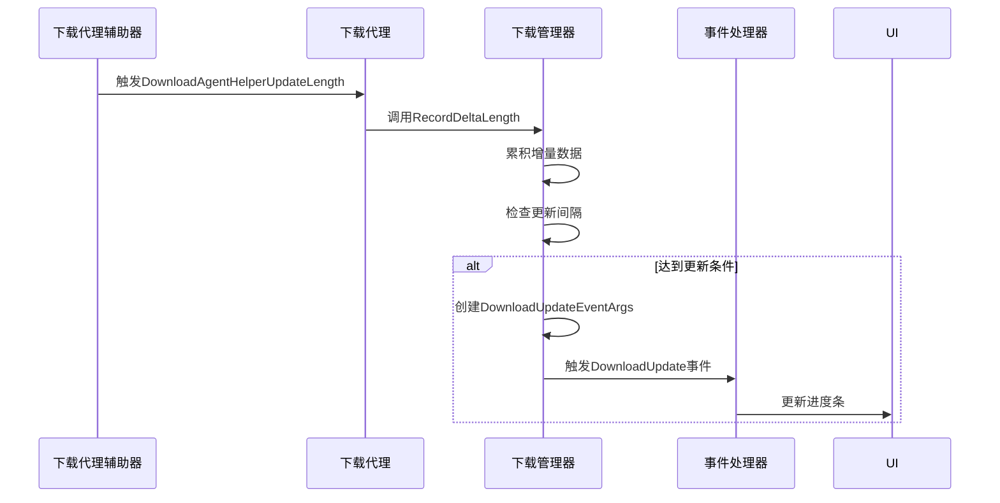
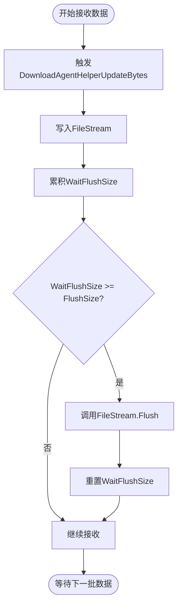
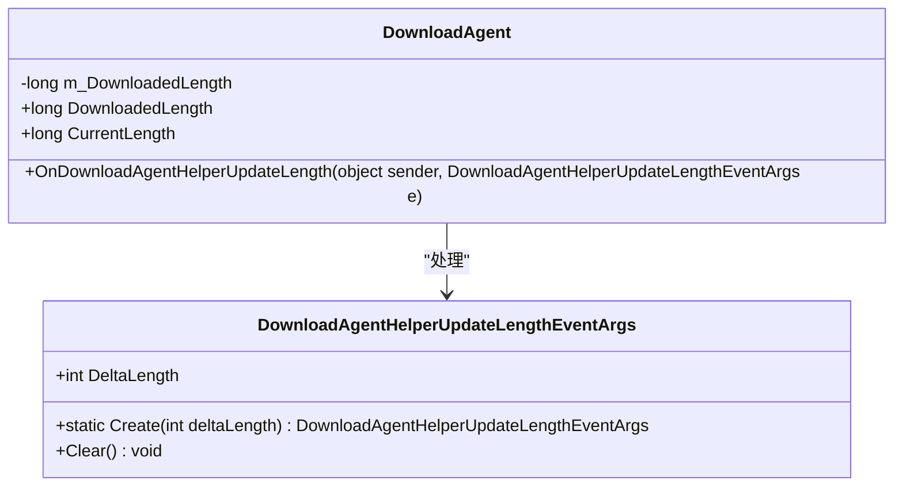
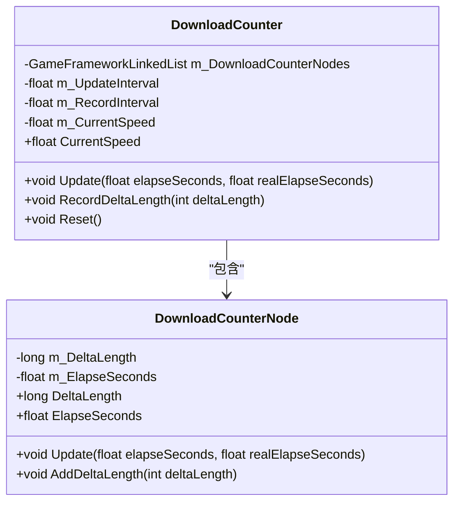

<cite>
**本文档中引用的文件**  
- [DownloadUpdateEventArgs.cs](file://GameFramework/Download/DownloadUpdateEventArgs.cs)
- [DownloadAgentHelperUpdateBytesEventArgs.cs](file://GameFramework/Download/DownloadAgentHelperUpdateBytesEventArgs.cs)
- [DownloadAgentHelperUpdateLengthEventArgs.cs](file://GameFramework/Download/DownloadAgentHelperUpdateLengthEventArgs.cs)
- [DownloadManager.DownloadCounter.cs](file://GameFramework/Download/DownloadManager.DownloadCounter.cs)
- [DownloadManager.DownloadCounter.DownloadCounterNode.cs](file://GameFramework/Download/DownloadManager.DownloadCounter.DownloadCounterNode.cs)
- [DownloadManager.cs](file://GameFramework/Download/DownloadManager.cs)
- [DownloadManager.DownloadAgent.cs](file://GameFramework/Download/DownloadManager.DownloadAgent.cs)
- [DownloadManager.DownloadTask.cs](file://GameFramework/Download/DownloadManager.DownloadTask.cs)
</cite>

# 进度监控

## 目录
1. [事件机制与更新频率控制](#事件机制与更新频率控制)
2. [字节级与长度级更新事件](#字节级与长度级更新事件)
3. [下载计数器与并发任务追踪](#下载计数器与并发任务追踪)
4. [UI更新与性能优化策略](#ui更新与性能优化策略)

## 事件机制与更新频率控制

下载进度的监控机制通过事件驱动的方式实现，核心在于`DownloadUpdateEventArgs`事件的触发策略。该事件由下载管理器在接收到代理辅助器的更新通知时触发，实现了下载进度的实时反馈。

`DownloadUpdateEventArgs`事件的触发频率经过精心设计，以平衡实时性与性能开销。事件并非在每次接收到字节数据时立即触发，而是通过`DownloadAgentHelperUpdateLengthEventArgs`事件进行增量累积，当累积的下载量达到一定阈值或经过特定时间间隔后，才触发`DownloadUpdateEventArgs`。这种批量处理机制有效减少了事件调用的频率，避免了因频繁的UI更新导致的性能瓶颈。

事件的创建和释放通过引用池（ReferencePool）进行管理，进一步优化了内存分配和垃圾回收的开销。`DownloadUpdateEventArgs.Create`方法从引用池中获取实例，使用完毕后通过`ReferencePool.Release`方法归还，避免了频繁的实例创建和销毁。



**Diagram sources**
- [DownloadUpdateEventArgs.cs](file://GameFramework/Download/DownloadUpdateEventArgs.cs#L12-L102)
- [DownloadManager.cs](file://GameFramework/Download/DownloadManager.cs#L200-L215)
- [DownloadManager.DownloadAgent.cs](file://GameFramework/Download/DownloadManager.DownloadAgent.cs#L250-L270)

**Section sources**
- [DownloadUpdateEventArgs.cs](file://GameFramework/Download/DownloadUpdateEventArgs.cs#L12-L102)
- [DownloadManager.cs](file://GameFramework/Download/DownloadManager.cs#L200-L215)

## 字节级与长度级更新事件

系统通过两个关键事件来区分不同粒度的下载更新：`DownloadAgentHelperUpdateBytesEventArgs`和`DownloadAgentHelperUpdateLengthEventArgs`，分别处理字节级和长度级的更新。

### DownloadAgentHelperUpdateBytesEventArgs

该事件用于处理实际的字节数据流更新。当下载代理辅助器接收到新的数据块时，会触发此事件，将原始字节数组、偏移量和长度信息传递给下载代理。下载代理负责将这些数据写入临时文件流，并根据配置的`FlushSize`决定何时将缓冲区数据强制写入磁盘，以平衡I/O性能和数据安全性。



**Diagram sources**
- [DownloadAgentHelperUpdateBytesEventArgs.cs](file://GameFramework/Download/DownloadAgentHelperUpdateBytesEventArgs.cs#L12-L92)
- [DownloadManager.DownloadAgent.cs](file://GameFramework/Download/DownloadManager.DownloadAgent.cs#L300-L330)

**Section sources**
- [DownloadAgentHelperUpdateBytesEventArgs.cs](file://GameFramework/Download/DownloadAgentHelperUpdateBytesEventArgs.cs#L12-L92)
- [DownloadManager.DownloadAgent.cs](file://GameFramework/Download/DownloadManager.DownloadAgent.cs#L300-L330)

### DownloadAgentHelperUpdateLengthEventArgs

该事件用于处理下载量的增量更新。与字节级事件不同，它不携带实际数据，仅传递一个`DeltaLength`值，表示本次更新的字节数量。这种设计极大地减少了数据传递的开销，特别适用于需要频繁更新下载进度但不需要处理原始数据的场景。

下载代理在接收到此事件后，会更新内部的`DownloadedLength`计数器，并触发`DownloadAgentUpdate`回调，最终由下载管理器汇总所有代理的增量，用于计算总体下载速度和触发`DownloadUpdateEventArgs`。



**Diagram sources**
- [DownloadAgentHelperUpdateLengthEventArgs.cs](file://GameFramework/Download/DownloadAgentHelperUpdateLengthEventArgs.cs#L12-L55)
- [DownloadManager.DownloadAgent.cs](file://GameFramework/Download/DownloadManager.DownloadAgent.cs#L250-L270)

**Section sources**
- [DownloadAgentHelperUpdateLengthEventArgs.cs](file://GameFramework/Download/DownloadAgentHelperUpdateLengthEventArgs.cs#L12-L55)
- [DownloadManager.DownloadAgent.cs](file://GameFramework/Download/DownloadManager.DownloadAgent.cs#L250-L270)

## 下载计数器与并发任务追踪

`DownloadCounter`和`DownloadCounterNode`是系统用于统计和追踪多个并发下载任务总体进度的核心组件。它们共同实现了基于滑动时间窗口的下载速度计算。

### DownloadCounter

`DownloadCounter`类负责管理一个`DownloadCounterNode`的链表，每个节点代表一个时间窗口内的下载增量。通过`UpdateInterval`和`RecordInterval`两个参数，系统可以灵活地控制速度计算的精度和性能。

- `UpdateInterval`：决定`CurrentSpeed`属性更新的频率。
- `RecordInterval`：决定每个`DownloadCounterNode`记录数据的时间长度。



**Diagram sources**
- [DownloadManager.DownloadCounter.cs](file://GameFramework/Download/DownloadManager.DownloadCounter.cs#L20-L170)
- [DownloadManager.DownloadCounter.DownloadCounterNode.cs](file://GameFramework/Download/DownloadManager.DownloadCounter.DownloadCounterNode.cs#L11-L61)

**Section sources**
- [DownloadManager.DownloadCounter.cs](file://GameFramework/Download/DownloadManager.DownloadCounter.cs#L20-L170)
- [DownloadManager.DownloadCounter.DownloadCounterNode.cs](file://GameFramework/Download/DownloadManager.DownloadCounter.DownloadCounterNode.cs#L11-L61)

### 工作流程

1. **记录增量**：每当一个下载代理报告了新的下载量（通过`DownloadAgentHelperUpdateLengthEventArgs`），`DownloadManager`会调用`DownloadCounter.RecordDeltaLength`方法。
2. **节点管理**：`RecordDeltaLength`方法会检查链表中最后一个节点是否仍在当前`UpdateInterval`内。如果是，则将增量累加到该节点；否则，创建一个新节点并加入链表末尾。
3. **过期清理**：在`Update`方法中，系统会遍历链表，移除所有`ElapseSeconds`超过`RecordInterval`的旧节点，确保速度计算只基于最近的数据。
4. **速度计算**：当`m_TimeLeft`归零时，系统会遍历所有有效节点，累加`DeltaLength`，并除以总时间`m_Accumulator`，得到当前的平均下载速度。

这种设计使得系统能够准确地反映近期的下载性能，同时自动平滑掉瞬时的网络波动。

## UI更新与性能优化策略

### 实际代码示例

以下是如何订阅`DownloadUpdate`事件并更新UI进度条和带宽估算的示例：

```csharp
// 订阅下载更新事件
downloadManager.DownloadUpdate += OnDownloadUpdate;

private void OnDownloadUpdate(object sender, DownloadUpdateEventArgs e)
{
    // 更新UI进度条
    float progress = (float)e.CurrentLength / totalFileSize;
    progressBar.value = progress;

    // 显示当前下载速度
    float speed = downloadManager.CurrentSpeed;
    speedText.text = $"下载速度: {FormatBytes(speed)}/s";

    // 显示已下载大小
    downloadedText.text = $"已下载: {FormatBytes(e.CurrentLength)}";
}

// 格式化字节数为可读字符串 (如 1.2 MB)
private string FormatBytes(float bytes)
{
    string[] suffixes = {"B", "KB", "MB", "GB"};
    int counter = 0;
    decimal number = (decimal)bytes;
    while (Math.Round(number / 1024) >= 1)
    {
        number = number / 1024;
        counter++;
    }
    return string.Format("{0:n1}{1}", number, suffixes[counter]);
}
```

### 避免性能瓶颈的策略

1. **事件节流**：如前所述，`DownloadUpdateEventArgs`的触发频率远低于底层的字节接收频率，这是避免UI卡顿的第一道防线。
2. **引用池**：所有事件类都实现了`IReference`接口，并通过`ReferencePool`进行复用，避免了GC压力。
3. **滑动窗口计算**：`DownloadCounter`使用固定时间窗口计算速度，避免了对历史数据的无限累积，保证了计算效率。
4. **异步I/O**：虽然代码中使用了同步的`FileStream`，但在实际应用中，可以将`IDownloadAgentHelper`的实现替换为使用异步HTTP客户端，将I/O操作移出主线程。
5. **UI更新批处理**：在Unity等游戏引擎中，可以将UI更新操作放入`Update`或`FixedUpdate`中，而不是在事件回调中直接更新，进一步平滑帧率。

通过这些策略的组合，系统能够在提供流畅用户体验的同时，高效地管理大量的并发下载任务。