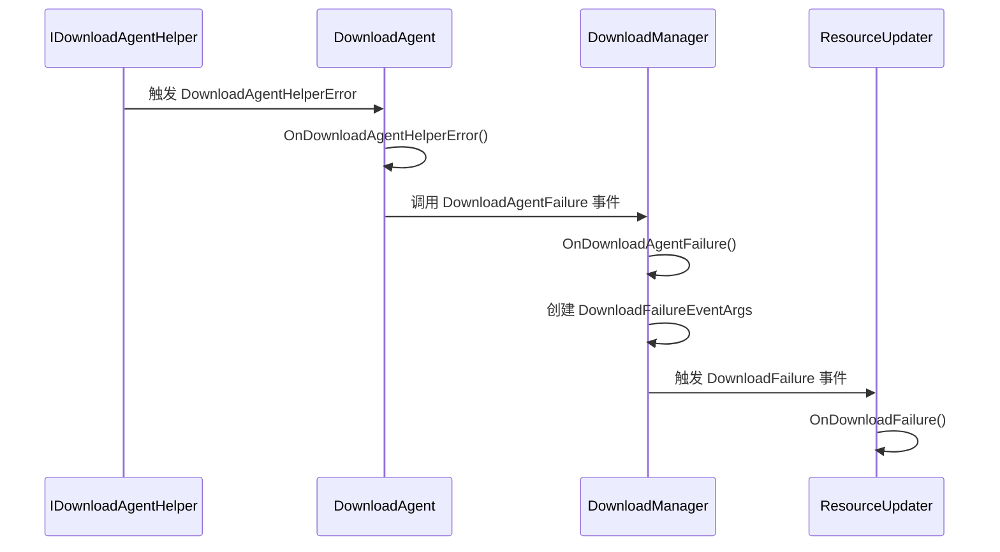
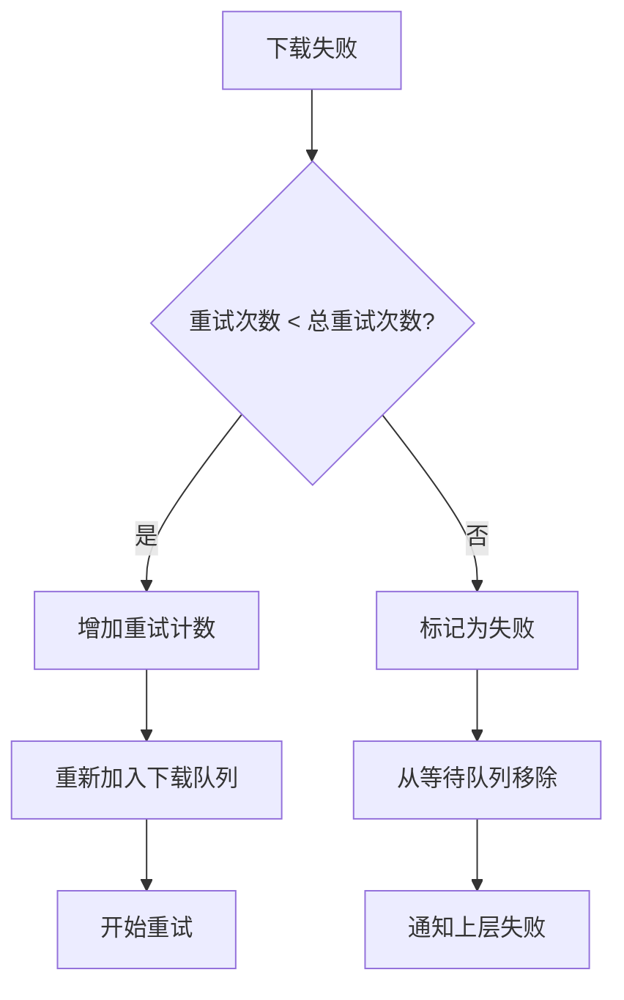

# 错误处理

<cite>
**本文档引用的文件**  
- [DownloadFailureEventArgs.cs](file://GameFramework/Download/DownloadFailureEventArgs.cs)
- [DownloadAgentHelperErrorEventArgs.cs](file://GameFramework/Download/DownloadAgentHelperErrorEventArgs.cs)
- [Constant.cs](file://GameFramework/Download/Constant.cs)
- [DownloadManager.cs](file://GameFramework/Download/DownloadManager.cs)
- [DownloadManager.DownloadAgent.cs](file://GameFramework/Download/DownloadManager.DownloadAgent.cs)
- [ResourceManager.ResourceUpdater.cs](file://GameFramework/Resource/ResourceManager.ResourceUpdater.cs)
</cite>

## 目录
1. [引言](#引言)
2. [错误类型与事件结构](#错误类型与事件结构)
3. [异常捕获机制](#异常捕获机制)
4. [恢复策略与自动重试](#恢复策略与自动重试)
5. [错误日志与用户提示](#错误日志与用户提示)
6. [断点续传与错误恢复协同机制](#断点续传与错误恢复协同机制)
7. [结论](#结论)

## 引言
本系统文档详细阐述了下载过程中涉及的错误类型、异常捕获机制和恢复策略。重点分析了 `DownloadFailureEventArgs` 和 `DownloadAgentHelperErrorEventArgs` 两个核心事件类的结构与用途，结合 `Constant.cs` 中定义的常量，说明了网络超时、连接中断、文件校验失败等常见错误的识别与响应方式。同时，提供了错误日志记录、用户提示和自动重试的实现范例，并深入探讨了断点续传与错误恢复的协同工作机制。

## 错误类型与事件结构

### DownloadFailureEventArgs 结构分析
`DownloadFailureEventArgs` 类用于封装下载任务失败时的详细信息。该事件在下载任务因任何原因失败时触发，由下载管理器发布。

**核心属性：**
- **SerialId**: 获取下载任务的序列编号，用于唯一标识失败的任务。
- **DownloadPath**: 获取下载后存放路径，指示文件预期的存储位置。
- **DownloadUri**: 获取原始下载地址，用于追踪失败的资源来源。
- **ErrorMessage**: 获取具体的错误信息字符串，描述失败原因。
- **UserData**: 获取用户自定义数据，允许开发者传递上下文信息。

该类通过静态 `Create` 方法从对象池中获取实例，以提高性能并避免频繁的内存分配。

**Section sources**
- [DownloadFailureEventArgs.cs](file://GameFramework/Download/DownloadFailureEventArgs.cs#L12-L102)

### DownloadAgentHelperErrorEventArgs 结构分析
`DownloadAgentHelperErrorEventArgs` 类由下载代理辅助器（`IDownloadAgentHelper`）在发生底层错误时触发，代表了更底层的网络或I/O异常。

**核心属性：**
- **DeleteDownloading**: 布尔值，指示是否需要删除已部分下载的临时文件（`.download` 文件）。
- **ErrorMessage**: 获取具体的错误信息，通常来自底层网络库或文件系统。

此事件是 `DownloadFailureEventArgs` 的前置事件，下载代理（`DownloadAgent`）在收到此事件后，会将其包装并转换为更高层的 `DownloadFailureEventArgs`。

**Section sources**
- [DownloadAgentHelperErrorEventArgs.cs](file://GameFramework/Download/DownloadAgentHelperErrorEventArgs.cs#L12-L63)

## 异常捕获机制

### 下载代理的异常捕获流程
异常捕获始于 `DownloadAgent` 类。该类通过事件订阅机制监听其辅助器 `IDownloadAgentHelper` 的错误事件。

**Diagram sources**
- [DownloadManager.DownloadAgent.cs](file://GameFramework/Download/DownloadManager.DownloadAgent.cs#L300-L375)
- [DownloadManager.cs](file://GameFramework/Download/DownloadManager.cs#L465-L485)
- [ResourceManager.ResourceUpdater.cs](file://GameFramework/Resource/ResourceManager.ResourceUpdater.cs#L918-L935)

### 常见错误类型及其识别
根据 `ResourceManager.ResourceUpdater` 中的代码，系统会主动识别并处理多种特定错误：

1.  **文件长度校验失败**:
    - **压缩长度错误**: 下载的文件大小与预期的 `CompressedLength` 不符。
    - **解压后长度错误**: 解压后的文件大小与预期的 `Length` 不符。
    - **识别方式**: 通过 `FileStream.Length` 与元数据对比。

2.  **文件哈希校验失败**:
    - **压缩包哈希错误**: 下载的压缩文件的CRC32校验值与预期的 `CompressedHashCode` 不符。
    - **解压后文件哈希错误**: 解压后的文件的CRC32校验值与预期的 `HashCode` 不符。
    - **识别方式**: 使用 `Utility.Verifier.GetCrc32()` 计算并对比。

3.  **网络超时**:
    - **识别方式**: 在 `DownloadAgent.Update()` 方法中，通过累加 `WaitTime` 并与 `m_Task.Timeout` 比较。当等待时间超过设定的超时阈值（默认30秒）时，触发超时错误。

4.  **文件系统写入错误**:
    - **识别方式**: 调用 `IFileSystem.WriteFile()` 方法后，检查返回值。如果写入失败，则抛出错误。

**Section sources**
- [ResourceManager.ResourceUpdater.cs](file://GameFramework/Resource/ResourceManager.ResourceUpdater.cs#L824-L876)
- [DownloadManager.DownloadAgent.cs](file://GameFramework/Download/DownloadManager.DownloadAgent.cs#L200-L215)

## 恢复策略与自动重试

### 自动重试机制
系统实现了基于计数的自动重试策略。当下载失败时，`ResourceUpdater` 会检查当前的重试次数。

**关键逻辑**:
- **重试次数**: 由 `ResourceUpdater.UpdateRetryCount` 控制，默认为3次。
- **重试条件**: 只有当 `updateInfo.RetryCount < m_UpdateRetryCount` 时才会重试。
- **重试执行**: 调用 `DownloadResource(updateInfo)` 将任务重新加入下载管理器。

**Section sources**
- [ResourceManager.ResourceUpdater.cs](file://GameFramework/Resource/ResourceManager.ResourceUpdater.cs#L918-L935)

## 错误日志与用户提示

### 错误日志实现
系统通过 `DownloadFailureEventArgs` 的 `ErrorMessage` 字段生成详细的错误日志。日志信息使用 `Utility.Text.Format()` 进行格式化，包含具体的错误原因和相关参数。

**示例日志信息**:
- `"Resource compressed length error, need '{0}', downloaded '{1}'."`
- `"Unable to decompress resource '{0}'."`
- `"Timeout"`

这些日志最终会通过事件系统传递给上层模块，由上层决定如何记录（如写入文件或显示在调试器中）。

### 用户提示
虽然核心下载模块不直接处理UI，但它为上层应用提供了必要的信息来向用户提示错误。`ResourceUpdateFailure` 事件会携带 `ErrorMessage`，上层UI系统可以订阅此事件，并将错误信息以友好的方式展示给用户。

**Section sources**
- [ResourceManager.ResourceUpdater.cs](file://GameFramework/Resource/ResourceManager.ResourceUpdater.cs#L918-L935)

## 断点续传与错误恢复协同机制

### 协同工作流程
断点续传和错误恢复是紧密耦合的。当下载因网络中断等原因失败时，系统不会简单地从头开始，而是利用已下载的部分进行恢复。

**工作流程**:
1.  **失败处理**: 下载失败后，`DownloadAgent` 根据 `DownloadAgentHelperErrorEventArgs.DeleteDownloading` 决定是否删除 `.download` 临时文件。
2.  **保留临时文件**: 如果 `DeleteDownloading` 为 `false`（默认），则临时文件会被保留。
3.  **重试请求**: `ResourceUpdater` 决定重试后，会再次调用 `DownloadManager.AddDownload()`。
4.  **断点续传**: `DownloadAgent.Start()` 方法检测到 `.download` 文件存在，会打开该文件并从 `m_FileStream.Length` 处继续写入，并向辅助器发送 `m_StartLength`，指示从该偏移量开始下载。

此机制确保了在网络不稳定的情况下，能够最大限度地利用已下载的数据，提高下载效率。

**Section sources**
- [DownloadManager.DownloadAgent.cs](file://GameFramework/Download/DownloadManager.DownloadAgent.cs#L250-L285)

## 结论
本系统通过分层的事件机制（`DownloadAgentHelperErrorEventArgs` -> `DownloadFailureEventArgs` -> `ResourceUpdateFailureEventArgs`）实现了清晰的错误传播。它结合了自动重试、文件校验、断点续传等多种策略，构建了一个健壮的下载恢复系统。开发者可以基于这些事件和配置，实现自定义的错误处理逻辑和用户交互，确保应用在面对网络和I/O异常时具有良好的容错性和用户体验。