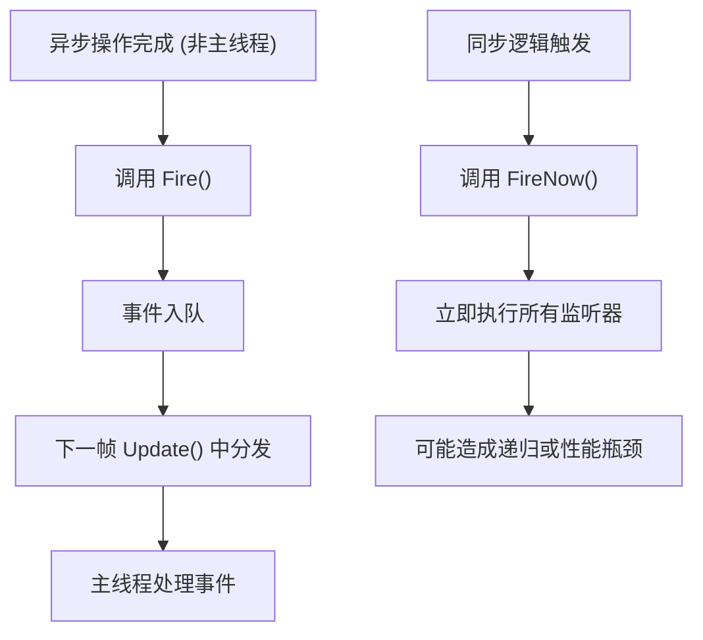

# 事件使用模式与最佳实践

<cite>
**本文档中引用的文件**  
- [EventManager.cs](file://GameFramework/Event/EventManager.cs)
- [IEventManager.cs](file://GameFramework/Event/IEventManager.cs)
- [EventPool.cs](file://GameFramework/Base/EventPool/EventPool.cs)
- [BaseEventArgs.cs](file://GameFramework/Base/EventPool/BaseEventArgs.cs)
- [GameEventArgs.cs](file://GameFramework/Event/GameEventArgs.cs)
- [ShowEntitySuccessEventArgs.cs](file://GameFramework/Entity/ShowEntitySuccessEventArgs.cs)
- [OpenUIFormSuccessEventArgs.cs](file://GameFramework/UI/OpenUIFormSuccessEventArgs.cs)
- [NetworkConnectedEventArgs.cs](file://GameFramework/Network/NetworkConnectedEventArgs.cs)
- [README.md](file://README.md)
</cite>

## 目录
1. [简介](#简介)
2. [事件ID的定义与管理策略](#事件id的定义与管理策略)
3. [事件订阅与取消订阅的配对原则](#事件订阅与取消订阅的配对原则)
4. [模块间解耦通信示例](#模块间解耦通信示例)
5. [Fire与FireNow的使用场景对比](#fire与firenow的使用场景对比)
6. [异常处理与调试技巧](#异常处理与调试技巧)
7. [性能监控与常见陷阱](#性能监控与常见陷阱)

## 简介

事件系统是Game Framework中用于实现模块间松耦合通信的核心机制。通过事件驱动架构，不同模块（如UI、Entity、Network）可以在不直接依赖彼此的情况下进行交互。例如，UI按钮点击后可触发实体创建事件，而无需直接调用实体管理器。本指南将深入探讨事件系统的典型使用模式与最佳实践，涵盖事件定义、订阅管理、性能优化及常见问题规避。

**Section sources**  
- [README.md](file://README.md#L58-L101)

## 事件ID的定义与管理策略

为确保事件类型的安全性和可维护性，建议使用枚举或常量类来定义事件ID。虽然框架本身通过`BaseEventArgs.Id`抽象属性识别事件类型，但实际开发中应避免使用魔法数字。推荐做法是为每个功能模块创建对应的事件枚举，例如：

```csharp
public enum UIEventId
{
    ButtonClicked,
    FormOpened,
    FormClosed
}

public enum EntityEventId
{
    Created,
    Destroyed,
    HealthChanged
}
```

此类集中式管理方式有助于提升代码可读性、减少命名冲突，并便于后期重构和静态分析。

**Section sources**  
- [BaseEventArgs.cs](file://GameFramework/Base/EventPool/BaseEventArgs.cs#L12-L21)
- [GameEventArgs.cs](file://GameFramework/Event/GameEventArgs.cs#L12-L14)

## 事件订阅与取消订阅的配对原则

为防止内存泄漏，必须严格遵守“订阅与取消订阅配对”的原则。每个`Subscribe`调用都应有对应的`Unsubscribe`操作，尤其是在生命周期较短的对象中（如UI界面或临时实体）。典型模式如下：

```csharp
void OnEnable()
{
    GameFramework.Event.EventManager.Subscribe(UIEventId.ButtonClicked, OnButtonClicked);
}

void OnDisable()
{
    GameFramework.Event.EventManager.Unsubscribe(UIEventId.ButtonClicked, OnButtonClicked);
}
```

若未正确取消订阅，事件处理器中的`this`引用将导致对象无法被垃圾回收，从而引发内存泄漏。建议在所有可能销毁的对象中实现成对的订阅/取消逻辑。

**Section sources**  
- [EventManager.cs](file://GameFramework/Event/EventManager.cs#L108-L117)
- [IEventManager.cs](file://GameFramework/Event/IEventManager.cs#L58-L67)

## 模块间解耦通信示例

事件系统广泛应用于跨模块通信。以下为典型应用场景：

### UI触发实体创建
当UI按钮被点击时，可发布一个事件，由实体系统监听并响应：

```csharp
// UI模块
void OnButtonClick()
{
    var args = ShowEntitySuccessEventArgs.Create(entity, duration, userData);
    GameFramework.Event.EventManager.Fire(this, args);
}

// 实体模块
void Start()
{
    GameFramework.Event.EventManager.Subscribe(EntityEventId.Created, OnEntityCreated);
}

void OnEntityCreated(object sender, GameEventArgs e)
{
    // 处理实体创建后的逻辑
}
```

### 网络连接成功通知
网络模块在连接成功后发布事件，供其他系统（如UI、任务系统）响应：

```csharp
// NetworkConnectedEventArgs 已预定义
GameFramework.Event.EventManager.Fire(this, NetworkConnectedEventArgs.Create(channel, userData));
```

这种模式实现了UI、Entity、Network等模块之间的完全解耦，提升了系统的可扩展性与可测试性。

**Section sources**  
- [ShowEntitySuccessEventArgs.cs](file://GameFramework/Entity/ShowEntitySuccessEventArgs.cs#L12-L76)
- [OpenUIFormSuccessEventArgs.cs](file://GameFramework/UI/OpenUIFormSuccessEventArgs.cs#L12-L76)
- [NetworkConnectedEventArgs.cs](file://GameFramework/Network/NetworkConnectedEventArgs.cs#L12-L63)

## Fire与FireNow的使用场景对比

| 特性 | Fire | FireNow |
|------|------|---------|
| 执行时机 | 延迟至下一帧分发 | 立即执行 |
| 线程安全性 | 是（保证在主线程回调） | 否 |
| 适用场景 | 主线程外抛出事件（如异步加载完成）、避免递归调用 | 需要立即响应的同步逻辑 |
| 性能影响 | 轻微延迟，但更安全 | 无延迟，但可能导致栈过深或竞态条件 |

### 使用建议
- **优先使用`Fire`**：大多数情况下应使用`Fire`，特别是在资源加载、网络回调等异步操作完成后通知主线程。
- **谨慎使用`FireNow`**：仅在确定上下文为主线程且需要即时响应时使用，例如在初始化流程或状态机切换中。



**Diagram sources**  
- [EventManager.cs](file://GameFramework/Event/EventManager.cs#L138-L147)
- [EventPool.cs](file://GameFramework/Base/EventPool/EventPool.cs#L248-L267)

## 异常处理与调试技巧

### 异常处理
事件系统内置了基础异常检测机制：
- 抛出空事件时会抛出`GameFrameworkException`
- 重复订阅或无效处理器也会触发异常
- 若事件无处理函数且模式不允许（`EventPoolMode.AllowNoHandler`未设置），将抛出异常

建议在事件处理函数中添加try-catch块以防止异常中断整个事件链：

```csharp
void OnEvent(object sender, GameEventArgs e)
{
    try {
        // 业务逻辑
    } catch (Exception ex) {
        GameFrameworkLog.Error($"事件处理异常: {ex.Message}");
    }
}
```

### 调试技巧
- 利用`EventHandlerCount`和`EventCount`属性监控事件系统状态
- 在编辑器中通过`DebuggerManager`查看实时事件流
- 使用`SetDefaultHandler`设置兜底处理器，捕获未处理的事件

**Section sources**  
- [EventPool.cs](file://GameFramework/Base/EventPool/EventPool.cs#L270-L284)
- [EventManager.cs](file://GameFramework/Event/EventManager.cs#L128-L136)

## 性能监控与常见陷阱

### 性能监控
- **事件队列长度**：通过`EventCount`监控待处理事件数量，避免积压
- **处理器数量**：`EventHandlerCount`过高可能意味着订阅未清理
- **分发耗时**：在`Update`中记录`EventPool.Update`执行时间，评估性能瓶颈

### 常见陷阱与规避
1. **在事件处理中修改正在遍历的集合**  
   ❌ 错误做法：
   ```csharp
   void OnEntityDestroyed(object sender, GameEventArgs e)
   {
       foreach (var item in list) // 若此事件由list变化触发，则此处可能抛出异常
       {
           // 修改list
       }
   }
   ```
   ✅ 正确做法：使用延迟执行（`Fire`）或将变更暂存，待遍历结束后统一处理。

2. **事件循环依赖**  
   避免A事件触发B事件再触发A事件的循环，可能导致栈溢出。

3. **未及时取消订阅**  
   特别是在脚本`Destroy`或`OnDisable`时忘记取消订阅，导致内存泄漏。

4. **滥用FireNow导致线程安全问题**  
   在多线程环境下使用`FireNow`可能导致数据竞争。

通过遵循上述最佳实践，可构建高效、稳定且易于维护的事件驱动系统。

**Section sources**  
- [EventPool.cs](file://GameFramework/Base/EventPool/EventPool.cs#L102-L124)
- [EventManager.cs](file://GameFramework/Event/EventManager.cs#L98-L107)