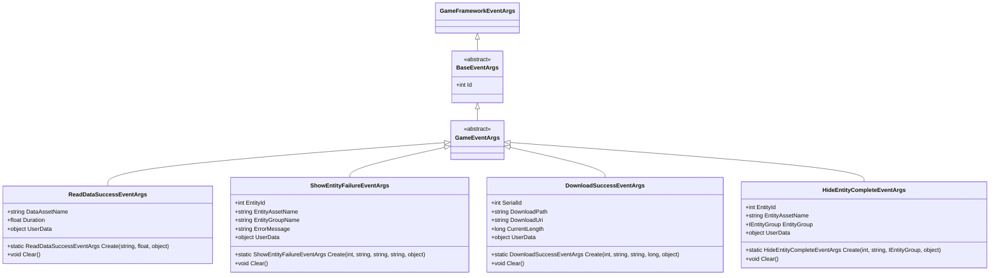
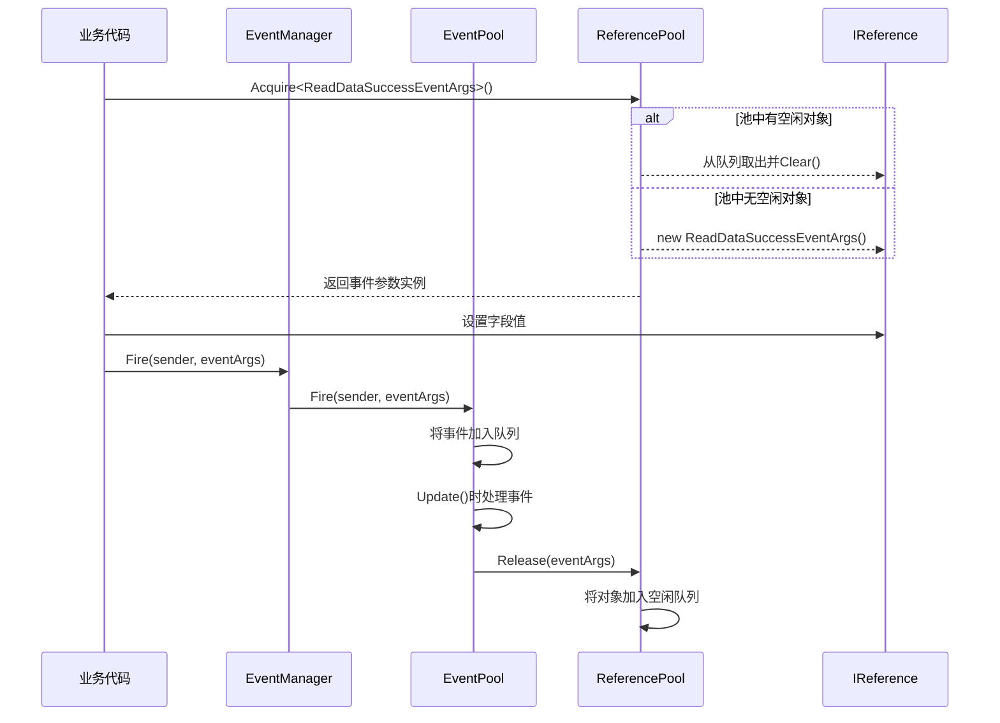

# 事件参数体系

<cite>
**本文档中引用的文件**  
- [GameEventArgs.cs](file://GameFramework/Event/GameEventArgs.cs)
- [BaseEventArgs.cs](file://GameFramework/Base/EventPool/BaseEventArgs.cs)
- [IReference.cs](file://GameFramework/Base/ReferencePool/IReference.cs)
- [ReferencePool.cs](file://GameFramework/Base/ReferencePool/ReferencePool.cs)
- [ReadDataSuccessEventArgs.cs](file://GameFramework/Base/DataProvider/ReadDataSuccessEventArgs.cs)
- [ShowEntityFailureEventArgs.cs](file://GameFramework/Entity/ShowEntityFailureEventArgs.cs)
- [DownloadSuccessEventArgs.cs](file://GameFramework/Download/DownloadSuccessEventArgs.cs)
- [HideEntityCompleteEventArgs.cs](file://GameFramework/Entity/HideEntityCompleteEventArgs.cs)
- [EventPool.cs](file://GameFramework/Base/EventPool/EventPool.cs)
- [EventManager.cs](file://GameFramework/Event/EventManager.cs)
</cite>

## 目录
1. [引言](#引言)
2. [事件参数继承体系](#事件参数继承体系)
3. [引用池管理机制](#引用池管理机制)
4. [事件ID的作用与分发机制](#事件id的作用与分发机制)
5. [自定义事件参数的创建与使用](#自定义事件参数的创建与使用)
6. [最佳实践与设计建议](#最佳实践与设计建议)
7. [与Fire/FireNow方法的集成](#与firefirenow方法的集成)
8. [结论](#结论)

## 引言
在GameFramework中，事件系统是实现模块间解耦和通信的核心机制。事件参数作为事件数据的载体，其设计直接影响系统的性能、可维护性和扩展性。本文档系统性地文档化事件参数的继承体系与设计模式，重点阐述`GameEventArgs`作为所有游戏事件参数的抽象基类的设计原理，以及如何通过继承该基类创建高效、可复用的自定义事件参数类。

**Section sources**
- [GameEventArgs.cs](file://GameFramework/Event/GameEventArgs.cs#L12-L14)
- [BaseEventArgs.cs](file://GameFramework/Base/EventPool/BaseEventArgs.cs#L12-L21)

## 事件参数继承体系

`GameEventArgs`是所有游戏逻辑事件参数的抽象基类，位于`GameFramework.Event`命名空间下。它继承自`BaseEventArgs`，而`BaseEventArgs`又继承自`GameFrameworkEventArgs`，形成了一条清晰的继承链。`BaseEventArgs`定义了一个抽象属性`Id`，用于标识事件的类型编号，这是事件分发机制的关键。

所有具体的事件参数类（如`ReadDataSuccessEventArgs`、`ShowEntityFailureEventArgs`等）都直接或间接继承自`GameEventArgs`，从而确保了事件参数的一致性和类型安全。这种分层设计使得事件系统能够统一处理各种类型的事件，同时为不同业务场景提供灵活的扩展能力。



**Diagram sources**
- [GameEventArgs.cs](file://GameFramework/Event/GameEventArgs.cs#L12-L14)
- [BaseEventArgs.cs](file://GameFramework/Base/EventPool/BaseEventArgs.cs#L12-L21)
- [ReadDataSuccessEventArgs.cs](file://GameFramework/Base/DataProvider/ReadDataSuccessEventArgs.cs#L12-L76)
- [ShowEntityFailureEventArgs.cs](file://GameFramework/Entity/ShowEntityFailureEventArgs.cs#L12-L102)
- [DownloadSuccessEventArgs.cs](file://GameFramework/Download/DownloadSuccessEventArgs.cs#L12-L102)
- [HideEntityCompleteEventArgs.cs](file://GameFramework/Entity/HideEntityCompleteEventArgs.cs#L12-L89)

**Section sources**
- [GameEventArgs.cs](file://GameFramework/Event/GameEventArgs.cs#L12-L14)
- [BaseEventArgs.cs](file://GameFramework/Base/EventPool/BaseEventArgs.cs#L12-L21)

## 引用池管理机制

为了优化内存分配和垃圾回收（GC）压力，GameFramework引入了引用池（Reference Pool）机制。所有事件参数类都实现了`IReference`接口，该接口定义了一个`Clear()`方法，用于在对象归还给池时重置其内部状态。

`ReferencePool`是一个静态类，负责管理所有类型的引用对象。当通过`ReferencePool.Acquire<T>()`方法获取一个事件参数实例时，如果池中有可用的空闲对象，则直接返回并调用其`Clear()`方法进行重置；否则，会创建一个新的实例。当事件处理完毕后，通过`ReferencePool.Release()`方法将对象归还到池中，而不是任其被GC回收。

这种设计模式显著减少了频繁创建和销毁对象带来的性能开销，特别适用于高频率触发的事件系统。



**Diagram sources**
- [IReference.cs](file://GameFramework/Base/ReferencePool/IReference.cs#L12-L18)
- [ReferencePool.cs](file://GameFramework/Base/ReferencePool/ReferencePool.cs#L98-L102)
- [ReadDataSuccessEventArgs.cs](file://GameFramework/Base/DataProvider/ReadDataSuccessEventArgs.cs#L58-L65)
- [EventPool.cs](file://GameFramework/Base/EventPool/EventPool.cs#L217-L229)

**Section sources**
- [IReference.cs](file://GameFramework/Base/ReferencePool/IReference.cs#L12-L18)
- [ReferencePool.cs](file://GameFramework/Base/ReferencePool/ReferencePool.cs#L98-L102)

## 事件ID的作用与分发机制

事件ID是事件分发机制的核心。每个继承自`BaseEventArgs`的事件参数类都必须实现`Id`属性，该属性返回一个唯一的整数，用于标识事件的类型。事件管理器（`EventManager`）内部使用一个字典（`m_EventHandlers`）来存储事件ID到事件处理函数（`EventHandler<T>`）的映射。

当调用`Fire`或`FireNow`方法时，事件系统会根据传入的事件参数的`Id`属性，查找并调用所有订阅了该ID的事件处理函数。这种基于ID的分发机制高效且灵活，允许不同的模块订阅同一类型的事件，实现了松耦合的通信。

```mermaid
flowchart TD
A[业务代码] --> B{调用 Fire/FireNow}
B --> C[获取事件参数的 Id]
C --> D[在 EventPool 中查找 Id 对应的处理函数列表]
D --> E{找到处理函数?}
E --> |是| F[遍历并调用所有处理函数]
E --> |否| G{是否存在默认处理函数?}
G --> |是| H[调用默认处理函数]
G --> |否| I{是否允许无处理函数?}
I --> |否| J[抛出异常]
I --> |是| K[释放事件参数]
F --> L[调用 ReferencePool.Release()]
H --> L
J --> M[错误处理]
K --> L
L --> N[事件处理完成]
```

**Diagram sources**
- [BaseEventArgs.cs](file://GameFramework/Base/EventPool/BaseEventArgs.cs#L12-L21)
- [EventPool.cs](file://GameFramework/Base/EventPool/EventPool.cs#L217-L244)

**Section sources**
- [BaseEventArgs.cs](file://GameFramework/Base/EventPool/BaseEventArgs.cs#L12-L21)
- [EventPool.cs](file://GameFramework/Base/EventPool/EventPool.cs#L217-L244)

## 自定义事件参数的创建与使用

创建自定义事件参数类遵循一套标准模式。以`ReadDataSuccessEventArgs`为例，其关键设计要素包括：

1.  **字段设计**：定义私有字段来存储事件相关的数据，如`DataAssetName`、`Duration`和`UserData`。`UserData`字段允许开发者传递任意自定义数据。
2.  **构造函数**：私有或内部构造函数，用于初始化字段的默认值（通常为null或0）。
3.  **静态创建方法**：提供一个`static Create(...)`方法，该方法通过`ReferencePool.Acquire<T>()`获取实例，设置字段值，然后返回。这是创建事件参数的唯一推荐方式。
4.  **清理方法**：重写`Clear()`方法，将所有字段重置为默认值，以便对象可以安全地被重用。

使用自定义事件参数时，应始终通过`Create`方法获取实例，填充数据后，通过`EventManager.Fire()`或`FireNow()`方法触发事件。事件处理完毕后，系统会自动将其归还到引用池。

**Section sources**
- [ReadDataSuccessEventArgs.cs](file://GameFramework/Base/DataProvider/ReadDataSuccessEventArgs.cs#L12-L76)
- [ShowEntityFailureEventArgs.cs](file://GameFramework/Entity/ShowEntityFailureEventArgs.cs#L12-L102)
- [DownloadSuccessEventArgs.cs](file://GameFramework/Download/DownloadSuccessEventArgs.cs#L12-L102)

## 最佳实践与设计建议

1.  **字段设计**：优先使用值类型（int, float, bool等）和不可变引用类型（string）。避免在事件参数中存储大型对象或复杂结构，以减少序列化和内存开销。
2.  **序列化支持**：如果事件参数需要在网络上传输或持久化，应实现序列化接口（如`ISerializable`）或使用`[Serializable]`特性。确保`Clear()`方法不会破坏序列化所需的状态。
3.  **内存管理**：严格遵守引用池的使用规范。永远不要手动`new`一个事件参数实例，也永远不要在事件处理函数外部调用`Release()`。`Fire`方法会自动处理释放。
4.  **命名规范**：事件参数类名应清晰地反映其用途，通常采用`[事件主题][事件状态]EventArgs`的模式，如`ShowEntityFailureEventArgs`。
5.  **UserData的使用**：`UserData`是一个强大的功能，可用于传递上下文信息，但应避免滥用，防止事件参数变得过于复杂和难以维护。

**Section sources**
- [ReadDataSuccessEventArgs.cs](file://GameFramework/Base/DataProvider/ReadDataSuccessEventArgs.cs#L12-L76)
- [HideEntityCompleteEventArgs.cs](file://GameFramework/Entity/HideEntityCompleteEventArgs.cs#L12-L89)

## 与Fire/FireNow方法的集成

`EventManager`提供了两个核心方法来触发事件：`Fire`和`FireNow`。

*   **Fire**：将事件加入一个队列，保证事件处理在主线程的下一帧统一执行。这个操作是线程安全的，适合从异步线程（如网络回调、资源加载完成）中触发事件。
*   **FireNow**：立即在当前线程同步执行所有事件处理函数。这个操作不是线程安全的，但性能更高，适用于确定在主线程中执行且需要立即响应的场景。

无论使用哪个方法，传入的事件参数都必须是继承自`GameEventArgs`的实例。方法内部会调用`EventPool`的对应方法，完成事件的分发和后续的引用池管理。

**Section sources**
- [EventManager.cs](file://GameFramework/Event/EventManager.cs#L133-L146)
- [EventPool.cs](file://GameFramework/Base/EventPool/EventPool.cs#L217-L244)

## 结论

GameFramework的事件参数体系通过`GameEventArgs`基类、`BaseEventArgs`的ID机制和`IReference`接口的引用池管理，构建了一个高效、安全且易于扩展的事件通信框架。开发者通过继承`GameEventArgs`并遵循标准模式创建自定义事件参数，可以充分利用这套机制，实现高性能的模块间通信，同时有效管理内存资源，避免GC问题。理解并正确应用这一设计模式，是开发高质量Unity游戏应用的关键。