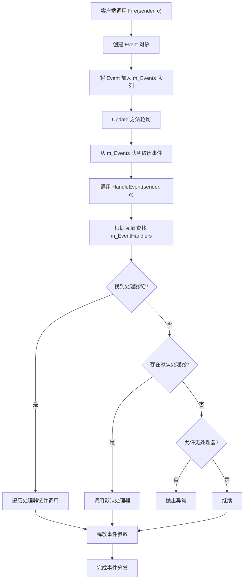
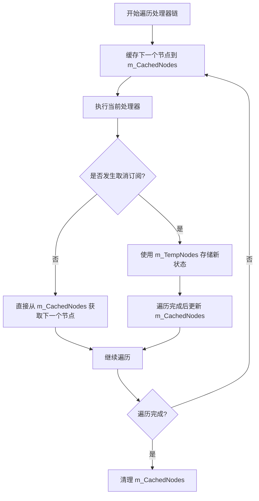
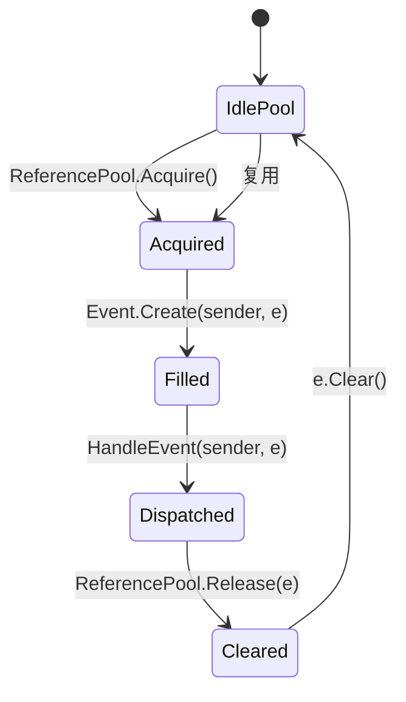
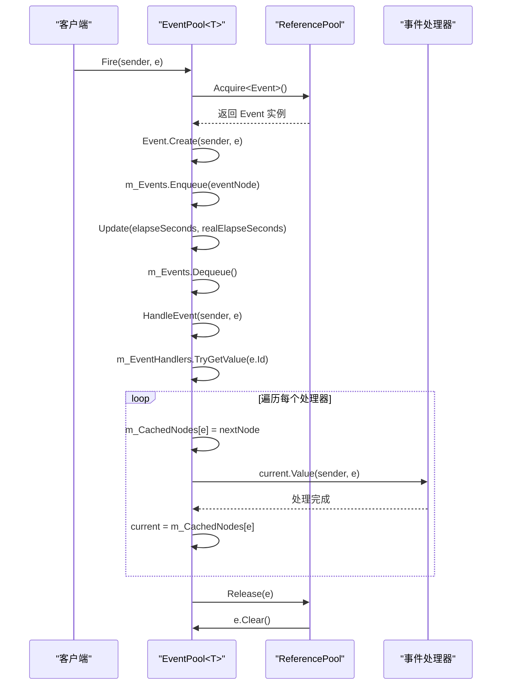

# 事件分发机制

<cite>
**Referenced Files in This Document**   
- [EventPool.cs](file://GameFramework/Base/EventPool/EventPool.cs)
- [EventPool.Event.cs](file://GameFramework/Base/EventPool/EventPool.Event.cs)
- [BaseEventArgs.cs](file://GameFramework/Base/EventPool/BaseEventArgs.cs)
- [ReferencePool.cs](file://GameFramework/Base/ReferencePool/ReferencePool.cs)
- [GameFrameworkEventArgs.cs](file://GameFramework/Base/GameFrameworkEventArgs.cs)
</cite>

## Table of Contents
1. [事件分发机制](#事件分发机制)
2. [核心组件](#核心组件)
3. [事件分发流程](#事件分发流程)
4. [双重缓存安全机制](#双重缓存安全机制)
5. [事件对象生命周期](#事件对象生命周期)
6. [执行链分析](#执行链分析)

## 核心组件

深入剖析EventPool<T>.HandleEvent方法的事件分发流程，重点描述其如何从m_Events队列中取出事件并遍历m_EventHandlers字典查找对应处理器链表。详细说明m_CachedNodes和m_TempNodes字典在防止遍历过程中修改集合导致异常的双重缓存策略，解释其在多线程或嵌套事件触发场景下的安全机制。结合Event类的Create与Clear方法，阐述事件对象从引用池获取、填充数据到最终释放回池的完整生命周期。提供代码路径分析，展示从Fire事件到所有订阅者被调用的执行链。

**Section sources**
- [EventPool.cs](file://GameFramework/Base/EventPool/EventPool.cs#L1-L285)
- [EventPool.Event.cs](file://GameFramework/Base/EventPool/EventPool.Event.cs#L1-L57)

## 事件分发流程

事件分发流程始于客户端调用Fire方法将事件加入队列，最终在Update方法中通过HandleEvent方法完成事件的处理与分发。整个流程确保了线程安全性，同时支持在主线程中回调事件处理函数。

**Diagram sources**
- [EventPool.cs](file://GameFramework/Base/EventPool/EventPool.cs#L1-L285)

**Section sources**
- [EventPool.cs](file://GameFramework/Base/EventPool/EventPool.cs#L1-L285)

## 双重缓存安全机制

在事件处理过程中，m_CachedNodes和m_TempNodes字典共同构成了防止遍历过程中修改集合导致异常的双重缓存策略。该机制在多线程或嵌套事件触发场景下提供了安全保障。

当事件处理器在执行过程中可能触发其他事件或修改自身订阅状态时，直接遍历m_EventHandlers链表会导致"集合被修改"的异常。为解决此问题，系统采用以下策略：

1. 在遍历前，将当前节点的下一个节点缓存到m_CachedNodes字典中
2. 执行当前处理器方法
3. 从m_CachedNodes中获取下一个节点继续遍历
4. 若在执行过程中发生取消订阅操作，通过m_TempNodes临时存储更新后的节点状态
5. 遍历完成后统一更新m_CachedNodes状态

**Diagram sources**
- [EventPool.cs](file://GameFramework/Base/EventPool/EventPool.cs#L1-L285)

**Section sources**
- [EventPool.cs](file://GameFramework/Base/EventPool/EventPool.cs#L1-L285)

## 事件对象生命周期

事件对象从引用池获取、填充数据到最终释放回池的完整生命周期由ReferencePool统一管理，实现了对象的高效复用，避免了频繁的内存分配与垃圾回收。

事件对象的生命周期包含以下关键阶段：
1. **空闲状态**：事件对象存储在ReferencePool的空闲队列中等待复用
2. **获取状态**：通过ReferencePool.Acquire方法从池中获取可用对象
3. **填充状态**：调用Event.Create方法填充事件源和参数数据
4. **分发状态**：在HandleEvent中被处理，通知所有订阅者
5. **清理状态**：调用Clear方法重置内部状态
6. **归还状态**：通过ReferencePool.Release方法归还到池中

**Diagram sources**
- [EventPool.Event.cs](file://GameFramework/Base/EventPool/EventPool.Event.cs#L1-L57)
- [ReferencePool.cs](file://GameFramework/Base/ReferencePool/ReferencePool.cs#L1-L225)

**Section sources**
- [EventPool.Event.cs](file://GameFramework/Base/EventPool/EventPool.Event.cs#L1-L57)
- [ReferencePool.cs](file://GameFramework/Base/ReferencePool/ReferencePool.cs#L1-L225)

## 执行链分析

从Fire事件到所有订阅者被调用的执行链展示了事件系统的核心调用流程，体现了各组件间的协作关系。

**Diagram sources**
- [EventPool.cs](file://GameFramework/Base/EventPool/EventPool.cs#L1-L285)
- [EventPool.Event.cs](file://GameFramework/Base/EventPool/EventPool.Event.cs#L1-L57)
- [ReferencePool.cs](file://GameFramework/Base/ReferencePool/ReferencePool.cs#L1-L225)

**Section sources**
- [EventPool.cs](file://GameFramework/Base/EventPool/EventPool.cs#L1-L285)
- [EventPool.Event.cs](file://GameFramework/Base/EventPool/EventPool.Event.cs#L1-L57)
- [ReferencePool.cs](file://GameFramework/Base/ReferencePool/ReferencePool.cs#L1-L225)