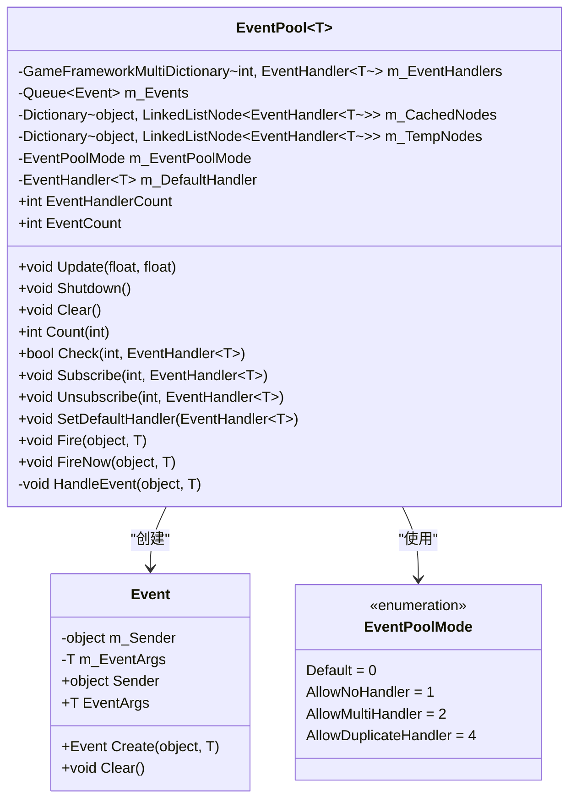
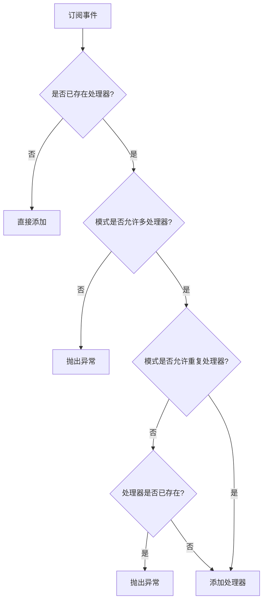
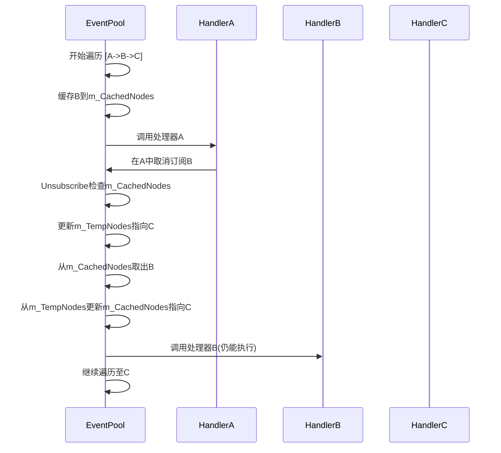

<cite>
**本文档中引用的文件**   
- [EventPool.cs](file://GameFramework/Base/EventPool/EventPool.cs)
- [EventPoolMode.cs](file://GameFramework/Base/EventPool/EventPoolMode.cs)
- [EventPool.Event.cs](file://GameFramework/Base/EventPool/EventPool.Event.cs)
- [ReferencePool.cs](file://GameFramework/Base/ReferencePool/ReferencePool.cs)
</cite>

# 事件池工作原理

## 目录
1. [引言](#引言)
2. [核心数据结构](#核心数据结构)
3. [事件池模式](#事件池模式)
4. [事件分发机制](#事件分发机制)
5. [对象复用机制](#对象复用机制)
6. [总结](#总结)

## 引言

事件池（EventPool<T>）是游戏框架中用于管理事件订阅与分发的核心组件。它提供了一种高效、安全的事件处理机制，支持线程安全的事件抛出和立即模式的事件分发。本文档将深入解析EventPool<T>的内部实现机制，包括其关键数据结构、事件处理模式、遍历安全设计以及对象复用策略。

**Section sources**
- [EventPool.cs](file://GameFramework/Base/EventPool/EventPool.cs#L14-L285)

## 核心数据结构

EventPool<T>内部维护了多个关键数据结构，共同协作实现事件的高效管理。

### 事件处理器字典 (m_EventHandlers)

`m_EventHandlers` 是一个 `GameFrameworkMultiDictionary<int, EventHandler<T>>` 类型的字典，用于存储所有事件类型编号（ID）到其对应事件处理器的映射关系。由于一个事件ID可能对应多个处理器（取决于模式），因此使用了多值字典结构。

**Section sources**
- [EventPool.cs](file://GameFramework/Base/EventPool/EventPool.cs#L24-L25)

### 事件队列 (m_Events)

`m_Events` 是一个 `Queue<Event>` 类型的队列，用于存储通过 `Fire` 方法抛出的待处理事件。该队列是线程安全的，允许多个线程向其中添加事件，而主线程在 `Update` 方法中统一处理。

**Section sources**
- [EventPool.cs](file://GameFramework/Base/EventPool/EventPool.cs#L25-L26)

### 缓存节点字典 (m_CachedNodes)

`m_CachedNodes` 是一个 `Dictionary<object, LinkedListNode<EventHandler<T>>>` 类型的字典，这是事件池实现安全遍历的关键设计。它在遍历事件处理器链表时，缓存下一个节点的引用，从而避免了在遍历过程中直接修改集合导致的异常。

**Section sources**
- [EventPool.cs](file://GameFramework/Base/EventPool/EventPool.cs#L26-L27)

### 临时节点字典 (m_TempNodes)

`m_TempNodes` 与 `m_CachedNodes` 配合使用，在 `Unsubscribe` 方法中用于临时存储更新后的节点引用，确保在取消订阅操作后，`m_CachedNodes` 中的缓存仍然有效。

**Section sources**
- [EventPool.cs](file://GameFramework/Base/EventPool/EventPool.cs#L27-L28)



**Diagram sources**
- [EventPool.cs](file://GameFramework/Base/EventPool/EventPool.cs#L14-L285)
- [EventPool.Event.cs](file://GameFramework/Base/EventPool/EventPool.Event.cs#L14-L57)
- [EventPoolMode.cs](file://GameFramework/Base/EventPool/EventPoolMode.cs#L14-L36)

## 事件池模式

事件池的行为由 `EventPoolMode` 枚举通过位标志（[Flags]）组合来控制。这种设计允许灵活地组合不同的行为模式。

### EventPoolMode 枚举

`EventPoolMode` 是一个 `byte` 类型的枚举，定义了四种模式，其值为2的幂次，便于进行位运算。

```csharp
[Flags]
internal enum EventPoolMode : byte
{
    Default = 0,
    AllowNoHandler = 1,
    AllowMultiHandler = 2,
    AllowDuplicateHandler = 4
}
```

**Section sources**
- [EventPoolMode.cs](file://GameFramework/Base/EventPool/EventPoolMode.cs#L14-L36)

### 模式组合与约束

| 模式 | 位值 | 说明 | 适用场景 |
| :--- | :--- | :--- | :--- |
| **Default** | 0 | 默认模式，必须存在且仅存在一个事件处理函数 | 严格保证事件处理逻辑的唯一性，如核心系统事件 |
| **AllowNoHandler** | 1 | 允许不存在事件处理函数 | 可选功能模块，事件可能未被订阅 |
| **AllowMultiHandler** | 2 | 允许存在多个事件处理函数 | 广播通知，多个模块需要响应同一事件 |
| **AllowDuplicateHandler** | 4 | 允许存在重复的事件处理函数 | 特殊需求，如调试或日志记录 |

这些模式通过位或（\|）操作进行组合。例如，`AllowNoHandler \| AllowMultiHandler` 表示允许无处理器或多个处理器。

在 `Subscribe` 方法中，会根据当前模式进行约束检查：
- 如果模式不允许多处理器（`AllowMultiHandler` 未设置），则禁止订阅第二个处理器。
- 如果模式不允许重复处理器（`AllowDuplicateHandler` 未设置），则禁止订阅已存在的处理器。



**Diagram sources**
- [EventPool.cs](file://GameFramework/Base/EventPool/EventPool.cs#L108-L136)
- [EventPoolMode.cs](file://GameFramework/Base/EventPool/EventPoolMode.cs#L14-L36)

## 事件分发机制

事件池提供了两种事件分发方式：延迟分发（`Fire`）和立即分发（`FireNow`）。

### 延迟分发 (Fire)

`Fire` 方法将事件包装成一个 `Event` 对象并放入 `m_Events` 队列。此操作是线程安全的，可以在任何线程中调用。事件的实际处理在主线程的 `Update` 方法中进行，通过 `HandleEvent` 方法完成。

**Section sources**
- [EventPool.cs](file://GameFramework/Base/EventPool/EventPool.cs#L208-L217)

### 立即分发 (FireNow)

`FireNow` 方法直接调用 `HandleEvent` 方法处理事件，不经过队列。此操作不是线程安全的，必须在主线程中调用。

**Section sources**
- [EventPool.cs](file://GameFramework/Base/EventPool/EventPool.cs#L229-L234)

### 安全遍历设计 (m_CachedNodes)

`HandleEvent` 方法是事件分发的核心，其巧妙的设计解决了在遍历过程中修改集合的难题。

1.  当遍历到某个处理器时，立即将下一个节点的引用（`current.Next`）存入 `m_CachedNodes[e]`。
2.  执行当前处理器的回调函数。
3.  回调函数执行完毕后，从 `m_CachedNodes[e]` 中取出下一个节点，继续遍历。

这种设计的关键在于，即使在回调函数中执行了 `Unsubscribe` 操作，`m_CachedNodes` 中缓存的“下一个节点”引用仍然有效，因为 `Unsubscribe` 方法会检查 `m_CachedNodes` 并相应地更新 `m_TempNodes`，确保遍历的连续性。



**Diagram sources**
- [EventPool.cs](file://GameFramework/Base/EventPool/EventPool.cs#L247-L275)
- [EventPool.cs](file://GameFramework/Base/EventPool/EventPool.cs#L140-L172)

## 对象复用机制

为了减少垃圾回收（GC）压力，事件池采用了对象池技术来复用事件对象。

### 事件对象 (Event)

`Event` 类实现了 `IReference` 接口，并被 `ReferencePool` 管理。它是一个可复用的对象，其状态通过 `Clear` 方法重置。

**Section sources**
- [EventPool.Event.cs](file://GameFramework/Base/EventPool/EventPool.Event.cs#L14-L57)

### 引用池 (ReferencePool)

`ReferencePool` 是一个静态的泛型对象池，用于管理所有实现了 `IReference` 接口的对象。

- **Acquire<T>()**: 从池中获取一个对象，如果池为空，则创建一个新实例。
- **Release(IReference)**: 将使用完毕的对象归还到池中，供后续复用。

在 `Fire` 方法中，通过 `Event.Create(sender, e)` 创建事件对象，该方法内部调用 `ReferencePool.Acquire<Event>()`。在 `Update` 方法处理完事件后，调用 `ReferencePool.Release(eventNode)` 将 `Event` 对象归还池中。

**Section sources**
- [ReferencePool.cs](file://GameFramework/Base/ReferencePool/ReferencePool.cs#L108-L118)
- [EventPool.Event.cs](file://GameFramework/Base/EventPool/EventPool.Event.cs#L45-L52)

```mermaid
flowchart LR
A[调用Fire] --> B[Event.Create]
B --> C[ReferencePool.Acquire<Event>]
C --> D[创建或获取Event实例]
D --> E[放入m_Events队列]
E --> F[Update中处理]
F --> G[HandleEvent处理事件]
G --> H[ReferencePool.Release(e)]
H --> I[Event归还引用池]
I --> J[Event.Clear重置状态]
```

**Diagram sources**
- [EventPool.cs](file://GameFramework/Base/EventPool/EventPool.cs#L208-L217)
- [EventPool.cs](file://GameFramework/Base/EventPool/EventPool.cs#L250-L251)
- [EventPool.Event.cs](file://GameFramework/Base/EventPool/EventPool.Event.cs#L45-L52)
- [ReferencePool.cs](file://GameFramework/Base/ReferencePool/ReferencePool.cs#L108-L118)

## 总结

EventPool<T> 通过精心设计的数据结构和算法，实现了一个高效、安全、灵活的事件管理系统。其核心亮点在于：
1.  **灵活的模式控制**：通过 `EventPoolMode` 位标志枚举，提供了可配置的事件处理约束。
2.  **安全的遍历机制**：利用 `m_CachedNodes` 和 `m_TempNodes` 字典，巧妙地解决了在遍历过程中修改集合的难题。
3.  **高效的内存管理**：通过 `ReferencePool` 复用 `Event` 对象，显著降低了GC压力。

这些设计共同确保了事件池在高并发、复杂逻辑场景下的稳定性和性能。