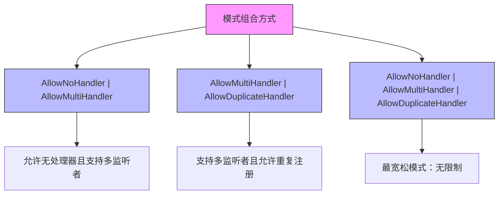
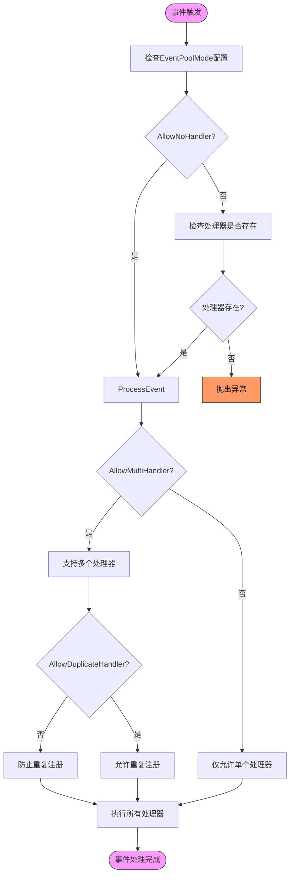

# 事件池模式配置

<cite>
**Referenced Files in This Document**  
- [EventPoolMode.cs](file://GameFramework/Base/EventPool/EventPoolMode.cs)
- [EventPool.cs](file://GameFramework/Base/EventPool/EventPool.cs)
</cite>

## 目录
1. [简介](#简介)
2. [事件池模式设计原理](#事件池模式设计原理)
3. [四种模式详解](#四种模式详解)
4. [模式组合使用方式](#模式组合使用方式)
5. [运行时逻辑分支分析](#运行时逻辑分支分析)
6. [实际代码示例](#实际代码示例)
7. [性能与安全性权衡](#性能与安全性权衡)

## 简介
事件池（EventPool）是游戏框架中用于管理事件订阅与分发的核心组件。本文档详细解释`EventPoolMode`枚举的位标志设计原理及其四种模式的组合使用方式，分析不同模式配置下的运行时行为差异，并提供实际应用建议。

**Section sources**
- [EventPool.cs](file://GameFramework/Base/EventPool/EventPool.cs#L1-L20)

## 事件池模式设计原理
`EventPoolMode`采用位标志（[Flags] attribute）枚举设计，允许通过按位运算组合多种行为模式。这种设计具有以下优势：

- **内存高效**：使用`byte`类型存储，仅占用1字节
- **灵活组合**：支持任意模式的自由组合
- **性能优越**：按位操作比布尔数组或集合操作更快
- **语义清晰**：每个模式对应独立的位，便于理解和维护

该设计基于二进制位的独立性，使得四种模式可以独立存在或组合使用，为事件处理提供了高度可配置的行为控制。

**Section sources**
- [EventPoolMode.cs](file://GameFramework/Base/EventPool/EventPoolMode.cs#L14-L36)

## 四种模式详解

### Default模式
默认模式要求每个事件必须有且仅有一个处理函数。这是最严格的模式，确保事件处理的确定性和可预测性。

### AllowNoHandler模式
允许事件没有注册任何处理函数。在此模式下，当事件被触发但无订阅者时不会抛出异常，适用于可选事件或阶段性功能。

### AllowMultiHandler模式
支持单个事件类型被多个监听者订阅。启用后，事件会依次通知所有订阅者，实现一对多的通信模式。

### AllowDuplicateHandler模式
允许同一处理函数被多次注册到同一事件。此模式需谨慎使用，可能导致事件被重复处理。

```mermaid
classDiagram
class EventPoolMode {
+Default : byte
+AllowNoHandler : byte
+AllowMultiHandler : byte
+AllowDuplicateHandler : byte
}
note right of EventPoolMode
位标志枚举设计
每个模式对应独立二进制位
支持按位组合使用
end note
```

**Diagram sources**
- [EventPoolMode.cs](file://GameFramework/Base/EventPool/EventPoolMode.cs#L14-L36)

**Section sources**
- [EventPoolMode.cs](file://GameFramework/Base/EventPool/EventPoolMode.cs#L14-L36)

## 模式组合使用方式
通过按位或（|）操作符可以组合多种模式，实现复杂的事件处理策略。



**Diagram sources**
- [EventPoolMode.cs](file://GameFramework/Base/EventPool/EventPoolMode.cs#L14-L36)

**Section sources**
- [EventPoolMode.cs](file://GameFramework/Base/EventPool/EventPoolMode.cs#L14-L36)

## 运行时逻辑分支分析
事件池在运行时根据`m_EventPoolMode`的配置执行不同的逻辑分支处理。



**Diagram sources**
- [EventPool.cs](file://GameFramework/Base/EventPool/EventPool.cs#L139-L162)
- [EventPool.cs](file://GameFramework/Base/EventPool/EventPool.cs#L251-L282)

**Section sources**
- [EventPool.cs](file://GameFramework/Base/EventPool/EventPool.cs#L29-L37)
- [EventPool.cs](file://GameFramework/Base/EventPool/EventPool.cs#L251-L282)

## 实际代码示例
以下示例展示如何根据业务需求选择合适的模式组合：

```csharp
// 场景1：严格模式 - 确保每个事件都有唯一处理者
var strictPool = new EventPool<MyEventArgs>(EventPoolMode.Default);

// 场景2：宽松模式 - 允许广播式通知
var broadcastPool = new EventPool<MyEventArgs>(
    EventPoolMode.AllowNoHandler | 
    EventPoolMode.AllowMultiHandler
);

// 场景3：完全开放模式 - 最大灵活性
var flexiblePool = new EventPool<MyEventArgs>(
    EventPoolMode.AllowNoHandler | 
    EventPoolMode.AllowMultiHandler | 
    EventPoolMode.AllowDuplicateHandler
);
```

这些配置直接影响`Subscribe`、`Unsubscribe`和`Fire`方法的行为表现。

**Section sources**
- [EventPool.cs](file://GameFramework/Base/EventPool/EventPool.cs#L139-L162)
- [EventPool.cs](file://GameFramework/Base/EventPool/EventPool.cs#L217-L229)

## 性能与安全性权衡
不同的模式配置在性能和安全性方面有不同的权衡：

| 模式组合 | 性能影响 | 安全性 | 适用场景 |
|---------|--------|-------|--------|
| Default | 最高 | 最高 | 核心系统事件 |
| AllowNoHandler | 低 | 中等 | 可选功能事件 |
| AllowMultiHandler | 中等 | 中等 | UI通知、广播 |
| AllowDuplicateHandler | 低 | 低 | 需要重复注册的特殊场景 |

**关键权衡点：**
- **AllowMultiHandler**：增加遍历开销，但提高系统解耦性
- **AllowDuplicateHandler**：可能导致意外的重复执行，需额外去重逻辑
- **AllowNoHandler**：避免异常开销，但可能掩盖逻辑错误

开发者应根据具体业务需求，在灵活性和安全性之间做出合理选择。

**Section sources**
- [EventPool.cs](file://GameFramework/Base/EventPool/EventPool.cs#L139-L162)
- [EventPool.cs](file://GameFramework/Base/EventPool/EventPool.cs#L251-L282)