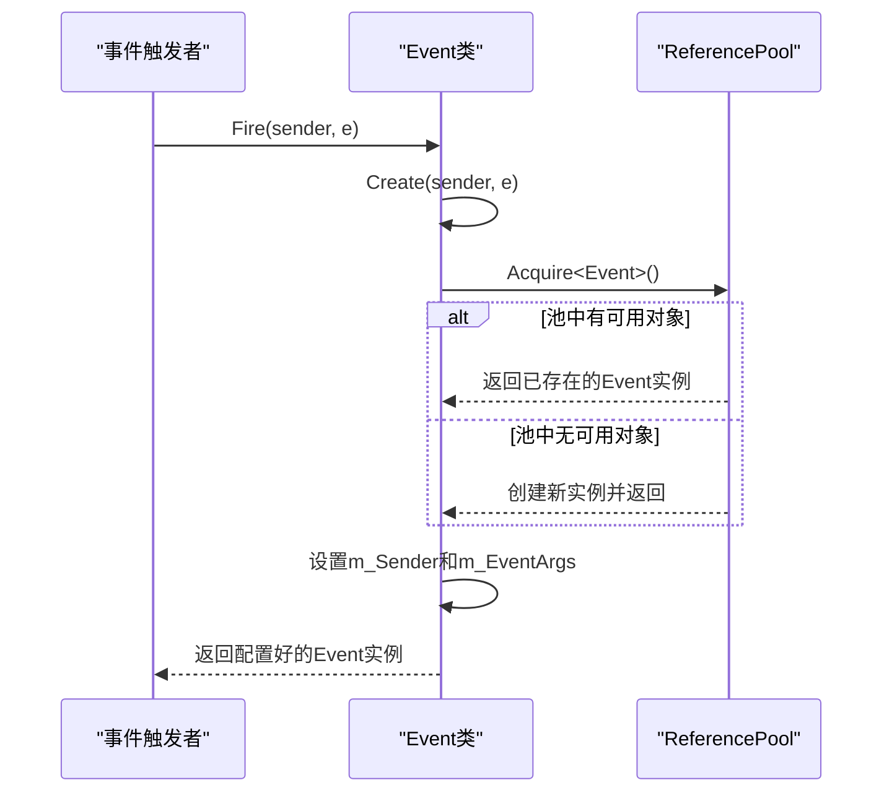
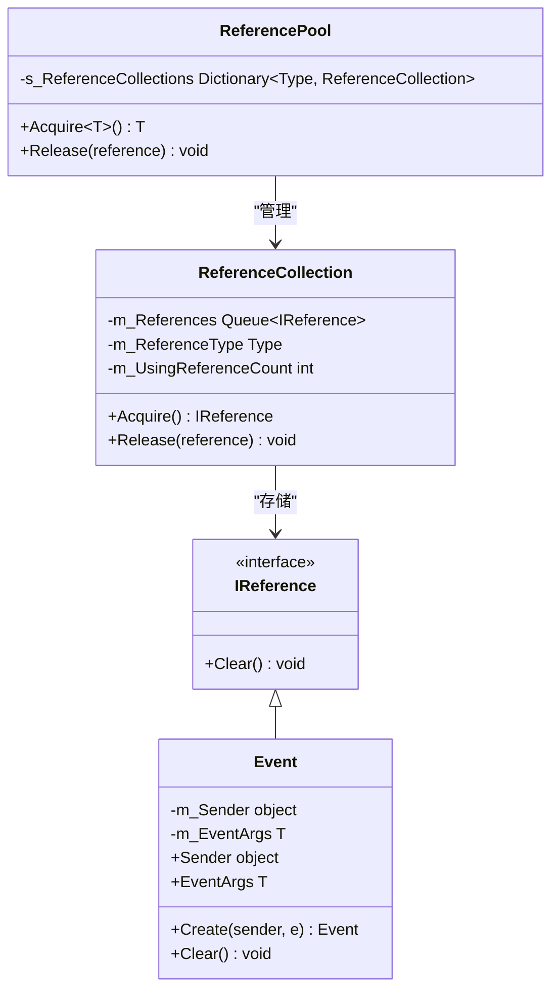

<cite>
**本文档中引用的文件**   
- [EventPool.Event.cs](file://GameFramework/Base/EventPool/EventPool.Event.cs)
- [IReference.cs](file://GameFramework/Base/ReferencePool/IReference.cs)
- [ReferencePool.cs](file://GameFramework/Base/ReferencePool/ReferencePool.cs)
- [EventPool.cs](file://GameFramework/Base/EventPool/EventPool.cs)
</cite>

# 内存管理与对象复用

## 目录
1. [事件与引用池协同机制](#事件与引用池协同机制)
2. [对象复用实现原理](#对象复用实现原理)
3. [引用池内部管理逻辑](#引用池内部管理逻辑)
4. [性能优势分析](#性能优势分析)
5. [最佳实践建议](#最佳实践建议)

## 事件与引用池协同机制

事件池中的 `Event` 类通过实现 `IReference` 接口，与 `ReferencePool` 协同工作，实现了高效的对象复用机制。该设计模式有效减少了频繁创建和销毁对象带来的垃圾回收（GC）压力，特别适用于高频事件触发的场景。

`Event` 类作为事件池的内部节点，封装了事件源（`Sender`）和事件参数（`EventArgs`）。通过实现 `IReference` 接口，它获得了被引用池管理的能力，使其生命周期不再依赖于单次事件的处理周期。

**Section sources**
- [EventPool.Event.cs](file://GameFramework/Base/EventPool/EventPool.Event.cs#L14-L54)
- [IReference.cs](file://GameFramework/Base/ReferencePool/IReference.cs#L12-L18)

## 对象复用实现原理

### 对象获取：Event.Create 静态方法

`Event.Create` 静态方法是对象复用机制的核心入口。该方法不直接使用 `new` 关键字创建新实例，而是通过 `ReferencePool.Acquire<Event>()` 从引用池中获取一个可用的 `Event` 实例。

**Diagram sources**
- [EventPool.Event.cs](file://GameFramework/Base/EventPool/EventPool.Event.cs#L41-L47)
- [ReferencePool.cs](file://GameFramework/Base/ReferencePool/ReferencePool.cs#L108-L118)

### 对象重置：Clear 方法

`Clear` 方法是确保对象安全复用的关键。当一个 `Event` 实例被释放回引用池时，其 `Clear` 方法会被调用，将所有字段（`m_Sender` 和 `m_EventArgs`）重置为 `null`。

这种重置机制确保了：
1.  **内存安全**：断开对旧对象的引用，防止内存泄漏。
2.  **数据隔离**：保证下一次从池中获取该实例时，不会携带上一次使用的残留数据。
3.  **状态纯净**：为对象的下一次使用提供一个干净、可预测的初始状态。

**Section sources**
- [EventPool.Event.cs](file://GameFramework/Base/EventPool/EventPool.Event.cs#L50-L54)

## 引用池内部管理逻辑

`ReferencePool` 是一个静态泛型类，其核心是一个以 `Type` 为键、`ReferenceCollection` 为值的字典（`s_ReferenceCollections`）。每个 `ReferenceCollection` 管理着特定类型（如 `Event`）的所有实例。

### 对象获取 (Acquire) 流程

1.  **类型检查**：`Acquire` 方法首先通过 `GetReferenceCollection` 获取或创建对应类型的 `ReferenceCollection`。
2.  **从队列获取**：`ReferenceCollection` 内部维护一个 `Queue<IReference>`。`Acquire` 会尝试从队列头部出队（`Dequeue`）一个对象。
3.  **创建新对象**：如果队列为空，则通过 `Activator.CreateInstance` 动态创建一个新实例。
4.  **计数更新**：无论从队列获取还是新创建，都会更新内部的使用计数（`m_UsingReferenceCount`）和获取计数（`m_AcquireReferenceCount`）。

### 对象释放 (Release) 流程

1.  **调用 Clear**：`Release` 方法首先调用对象的 `Clear()` 方法，重置其内部状态。
2.  **入队缓存**：重置后的对象被放入 `ReferenceCollection` 的 `Queue<IReference>` 尾部（`Enqueue`）。
3.  **计数更新**：更新释放计数（`m_ReleaseReferenceCount`）和使用计数（`m_UsingReferenceCount`）。

**Diagram sources**
- [ReferencePool.cs](file://GameFramework/Base/ReferencePool/ReferencePool.cs#L98-L126)
- [ReferencePool.ReferenceCollection.cs](file://GameFramework/Base/ReferencePool/ReferencePool.ReferenceCollection.cs#L112-L126)

**Section sources**
- [ReferencePool.cs](file://GameFramework/Base/ReferencePool/ReferencePool.cs#L98-L126)
- [ReferencePool.ReferenceCollection.cs](file://GameFramework/Base/ReferencePool/ReferencePool.ReferenceCollection.cs#L112-L126)

## 性能优势分析

该对象复用机制在高频事件场景下具有显著的性能优势：

1.  **减少 GC 压力**：避免了频繁的 `new` 操作，大幅减少了短生命周期对象的产生，从而降低了垃圾回收器的触发频率和工作量，有效防止了因 GC 导致的帧率波动（卡顿）。
2.  **提升内存效率**：通过复用对象，减少了内存的分配和释放开销，提高了内存使用效率。
3.  **降低 CPU 开销**：对象的构造和析构是相对昂贵的操作。复用对象避免了这些开销，将 CPU 时间集中在核心业务逻辑上。

**性能对比建议**：
在实际项目中，可以通过对比开启和关闭引用池（或调整池大小）时的性能指标来量化其优势。建议监控以下数据：
-  **GC 暂停时间**：使用 Unity Profiler 观察 GC.Collect 的调用频率和耗时。
-  **内存分配速率**：观察每帧的内存分配量（B/frame）。
-  **帧率稳定性**：记录帧率（FPS）的波动情况，特别是在大量事件触发时。

## 最佳实践建议

1.  **严格实现 Clear 方法**：任何实现 `IReference` 的类，其 `Clear` 方法必须彻底重置所有字段，确保对象状态的纯净。
2.  **及时释放对象**：使用完从引用池获取的对象后，必须调用 `ReferencePool.Release()` 将其归还，避免对象泄漏。
3.  **合理预热引用池**：在系统启动或关卡加载时，可以预先调用 `ReferencePool.Add<T>(count)` 向池中添加一定数量的对象，避免在游戏运行时因首次获取而创建对象。
4.  **监控引用池状态**：利用 `ReferencePool.GetAllReferencePoolInfos()` 定期检查各类型对象的使用情况，分析 `Acquire` 和 `Release` 的次数是否平衡，以及 `Add` 和 `Remove` 的次数，以优化池的大小。