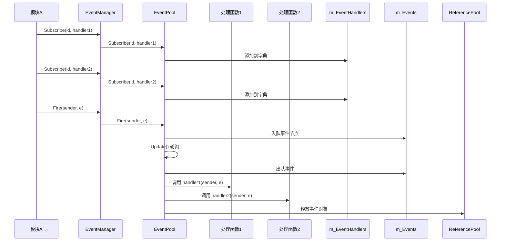
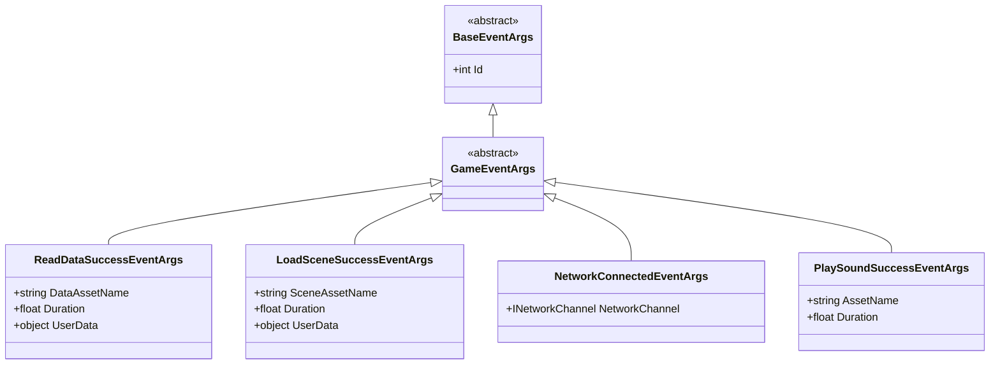
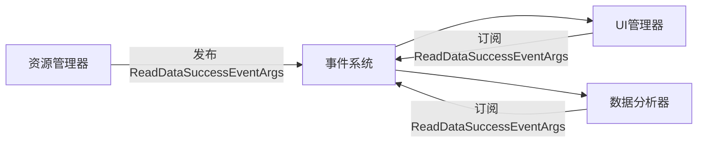

# 事件系统

<cite>
**本文档中引用的文件**  
- [IEventManager.cs](file://GameFramework/Event/IEventManager.cs)
- [EventManager.cs](file://GameFramework/Event/EventManager.cs)
- [EventPool.cs](file://GameFramework/Base/EventPool/EventPool.cs)
- [EventPoolMode.cs](file://GameFramework/Base/EventPool/EventPoolMode.cs)
- [BaseEventArgs.cs](file://GameFramework/Base/EventPool/BaseEventArgs.cs)
- [GameEventArgs.cs](file://GameFramework/Event/GameEventArgs.cs)
- [EventPool.Event.cs](file://GameFramework/Base/EventPool/EventPool.Event.cs)
</cite>

## 目录
1. [简介](#简介)
2. [核心组件架构](#核心组件架构)
3. [事件订阅与发布机制](#事件订阅与发布机制)
4. [线程安全与分发流程](#线程安全与分发流程)
5. [GameEventArgs 继承体系与自定义事件](#gameeventargs-继承体系与自定义事件)
6. [EventPool 模式详解](#eventpool-模式详解)
7. [高级特性使用指南](#高级特性使用指南)
8. [模块解耦实践](#模块解耦实践)
9. [性能分析与优化策略](#性能分析与优化策略)
10. [附录](#附录)

## 简介
事件系统是 GameFramework 框架中的核心通信机制，用于实现模块间的松耦合交互。通过 `IEventManager` 接口和 `EventManager` 实现类，系统提供了线程安全的事件订阅、发布与分发功能。事件参数继承自 `BaseEventArgs`，并以 `GameEventArgs` 为游戏逻辑事件的基类。事件的生命周期由 `EventPool<T>` 管理，支持多种模式配置以适应不同场景需求。

## 核心组件架构

```mermaid
classDiagram
class IEventManager {
+int EventHandlerCount
+int EventCount
+int Count(int id)
+bool Check(int id, EventHandler~GameEventArgs~ handler)
+void Subscribe(int id, EventHandler~GameEventArgs~ handler)
+void Unsubscribe(int id, EventHandler~GameEventArgs~ handler)
+void SetDefaultHandler(EventHandler~GameEventArgs~ handler)
+void Fire(object sender, GameEventArgs e)
+void FireNow(object sender, GameEventArgs e)
}
class EventManager {
-EventPool~GameEventArgs~ m_EventPool
+int Priority
+void Update(float elapseSeconds, float realElapseSeconds)
+void Shutdown()
}
class EventPool~T~ {
-GameFrameworkMultiDictionary~int, EventHandler~T~~ m_EventHandlers
-Queue~Event~ m_Events
-Dictionary~object, LinkedListNode~EventHandler~T~~~ m_CachedNodes
-EventPoolMode m_EventPoolMode
-EventHandler~T~ m_DefaultHandler
+void Subscribe(int id, EventHandler~T~ handler)
+void Unsubscribe(int id, EventHandler~T~ handler)
+void Fire(object sender, T e)
+void FireNow(object sender, T e)
+void Update(float elapseSeconds, float realElapseSeconds)
}
class BaseEventArgs {
<<abstract>>
+int Id
}
class GameEventArgs {
<<abstract>>
}
class EventPoolMode {
<<flags>>
+Default = 0
+AllowNoHandler = 1
+AllowMultiHandler = 2
+AllowDuplicateHandler = 4
}
IEventManager <|-- EventManager
EventManager --> EventPool~GameEventArgs~ : "使用"
EventPool~T~ : where T : BaseEventArgs
BaseEventArgs <|-- GameEventArgs
EventPool~T~ --> EventPoolMode : "配置"
```

**图示来源**  
- [IEventManager.cs](file://GameFramework/Event/IEventManager.cs#L14-L80)
- [EventManager.cs](file://GameFramework/Event/EventManager.cs#L14-L147)
- [EventPool.cs](file://GameFramework/Base/EventPool/EventPool.cs#L29-L37)
- [BaseEventArgs.cs](file://GameFramework/Base/EventPool/BaseEventArgs.cs#L12-L21)
- [GameEventArgs.cs](file://GameFramework/Event/GameEventArgs.cs#L12-L14)
- [EventPoolMode.cs](file://GameFramework/Base/EventPool/EventPoolMode.cs#L14-L36)

**本节来源**  
- [EventManager.cs](file://GameFramework/Event/EventManager.cs#L14-L147)
- [EventPool.cs](file://GameFramework/Base/EventPool/EventPool.cs#L29-L37)

## 事件订阅与发布机制

事件系统通过 `Subscribe` 和 `Unsubscribe` 方法实现事件处理函数的注册与注销。每个事件由整型 `id` 唯一标识，多个处理函数可订阅同一事件（取决于 `EventPoolMode` 配置）。`Fire` 和 `FireNow` 方法分别用于异步和同步发布事件。



**图示来源**  
- [IEventManager.cs](file://GameFramework/Event/IEventManager.cs#L55-L80)
- [EventPool.cs](file://GameFramework/Base/EventPool/EventPool.cs#L203-L284)

**本节来源**  
- [IEventManager.cs](file://GameFramework/Event/IEventManager.cs#L55-L80)
- [EventPool.cs](file://GameFramework/Base/EventPool/EventPool.cs#L203-L284)

## 线程安全与分发流程

事件系统通过双层机制保障线程安全。`Fire` 方法将事件封装为 `Event` 节点并线程安全地加入 `m_Events` 队列，该操作通过 `lock` 保证原子性。事件的实际分发在主线程的 `Update` 轮询中进行，确保所有事件处理函数都在主线程执行。

```mermaid
flowchart TD
A[调用 Fire(sender, e)] --> B{e 是否为空?}
B --> |是| C[抛出异常]
B --> |否| D[创建 Event 节点]
D --> E[获取 m_Events 锁]
E --> F[事件节点入队]
F --> G[释放锁]
G --> H[返回]
I[Update 轮询] --> J{m_Events 是否为空?}
J --> |否| K[出队事件节点]
K --> L[调用 HandleEvent]
L --> M[执行所有订阅的处理函数]
M --> N[释放事件节点]
N --> J
J --> |是| O[结束]
```

**图示来源**  
- [EventPool.cs](file://GameFramework/Base/EventPool/EventPool.cs#L61-L100)
- [EventPool.Event.cs](file://GameFramework/Base/EventPool/EventPool.Event.cs#L9-L55)

**本节来源**  
- [EventPool.cs](file://GameFramework/Base/EventPool/EventPool.cs#L61-L100)
- [EventPool.Event.cs](file://GameFramework/Base/EventPool/EventPool.Event.cs#L9-L55)

## GameEventArgs 继承体系与自定义事件

所有事件参数必须继承自 `BaseEventArgs`，并实现抽象属性 `Id`。`GameEventArgs` 作为游戏逻辑事件的基类，进一步继承自 `BaseEventArgs`。自定义事件需继承 `GameEventArgs` 并定义唯一的 `Id`。



**图示来源**  
- [BaseEventArgs.cs](file://GameFramework/Base/EventPool/BaseEventArgs.cs#L12-L21)
- [GameEventArgs.cs](file://GameFramework/Event/GameEventArgs.cs#L12-L14)
- [ReadDataSuccessEventArgs.cs](file://GameFramework/Base/DataProvider/ReadDataSuccessEventArgs.cs#L12-L78)
- [LoadSceneSuccessEventArgs.cs](file://GameFramework/Scene/LoadSceneSuccessEventArgs.cs#L12-L78)

**本节来源**  
- [BaseEventArgs.cs](file://GameFramework/Base/EventPool/BaseEventArgs.cs#L12-L21)
- [GameEventArgs.cs](file://GameFramework/Event/GameEventArgs.cs#L12-L14)

## EventPool 模式详解

`EventPoolMode` 是一个标志枚举，用于配置事件池的行为。`EventManager` 默认使用 `AllowNoHandler | AllowMultiHandler` 模式。

| 模式 | 说明 | 适用场景 |
|------|------|----------|
| Default | 必须存在且仅有一个处理函数 | 严格契约场景，确保事件必被处理 |
| AllowNoHandler | 允许无处理函数 | 动态模块加载，避免因未订阅而抛异常 |
| AllowMultiHandler | 允许多个处理函数 | 广播通知，多个模块响应同一事件 |
| AllowDuplicateHandler | 允许重复订阅同一处理函数 | 特殊逻辑需求，需谨慎使用 |

```csharp
// EventManager 构造函数中的模式设置
m_EventPool = new EventPool<GameEventArgs>(EventPoolMode.AllowNoHandler | EventPoolMode.AllowMultiHandler);
```

**本节来源**  
- [EventPoolMode.cs](file://GameFramework/Base/EventPool/EventPoolMode.cs#L14-L36)
- [EventManager.cs](file://GameFramework/Event/EventManager.cs#L21-L24)

## 高级特性使用指南

### 事件优先级
事件系统本身不直接支持优先级，但可通过事件 `id` 的设计实现逻辑优先级。例如，将 `id` 的高字节用于表示优先级等级。

### 事件过滤
可通过在事件处理函数内部添加条件判断实现过滤逻辑，或使用 `Check` 方法动态判断是否已订阅。

### 内存泄漏防范
- 所有事件参数对象均通过 `ReferencePool` 进行复用，避免频繁 GC。
- 在 `HandleEvent` 结束后立即调用 `ReferencePool.Release(e)` 释放事件对象。
- 及时调用 `Unsubscribe` 注销事件处理函数，防止对象被意外持有。

```csharp
// 事件处理函数示例
private void OnDataLoaded(object sender, ReadDataSuccessEventArgs e)
{
    // 过滤特定资源
    if (e.DataAssetName != "Config/Data")
        return;

    // 处理逻辑
    ProcessData(e.UserData);
}
```

**本节来源**  
- [EventPool.cs](file://GameFramework/Base/EventPool/EventPool.cs#L243-L284)
- [EventPool.Event.cs](file://GameFramework/Base/EventPool/EventPool.Event.cs#L9-L55)

## 模块解耦实践

事件系统是实现模块间解耦的核心。例如，资源加载模块在完成加载后发布 `ReadDataSuccessEventArgs`，UI 模块订阅该事件并更新界面，二者无需直接引用。



**本节来源**  
- [ReadDataSuccessEventArgs.cs](file://GameFramework/Base/DataProvider/ReadDataSuccessEventArgs.cs#L12-L78)
- [IEventManager.cs](file://GameFramework/Event/IEventManager.cs#L55-L80)

## 性能分析与优化策略

### 性能开销
- **事件发布**：`Fire` 操作为 O(1)，仅涉及队列入队。
- **事件分发**：`Update` 中的分发为 O(n)，n 为当前待处理事件数。
- **内存开销**：通过 `ReferencePool` 复用事件对象，减少 GC 压力。

### 优化策略
1. **批量处理**：在 `Update` 中批量处理所有待分发事件，减少锁竞争。
2. **避免频繁发布**：对高频事件进行合并或节流。
3. **合理使用 FireNow**：仅在确定在主线程且需立即响应时使用，避免破坏帧同步。
4. **及时清理**：在模块销毁时调用 `Unsubscribe` 或 `Clear`，避免内存泄漏。

**本节来源**  
- [EventPool.cs](file://GameFramework/Base/EventPool/EventPool.cs#L61-L100)
- [EventPool.cs](file://GameFramework/Base/EventPool/EventPool.cs#L203-L284)

## 附录

### 事件系统核心接口摘要
| 方法 | 说明 |
|------|------|
| Subscribe | 订阅事件处理函数 |
| Unsubscribe | 取消订阅事件处理函数 |
| Fire | 异步发布事件（线程安全） |
| FireNow | 同步立即发布事件（非线程安全） |
| SetDefaultHandler | 设置默认事件处理函数 |
| Check | 检查事件处理函数是否已订阅 |

### 事件参数创建规范
所有自定义事件应遵循以下模式：
```csharp
public sealed class CustomEventArgs : GameEventArgs
{
    public static CustomEventArgs Create(/* parameters */) { ... }
    public override void Clear() { /* 重置字段 */ }
}
```

**本节来源**  
- [IEventManager.cs](file://GameFramework/Event/IEventManager.cs#L14-L80)
- [ReadDataSuccessEventArgs.cs](file://GameFramework/Base/DataProvider/ReadDataSuccessEventArgs.cs#L12-L78)